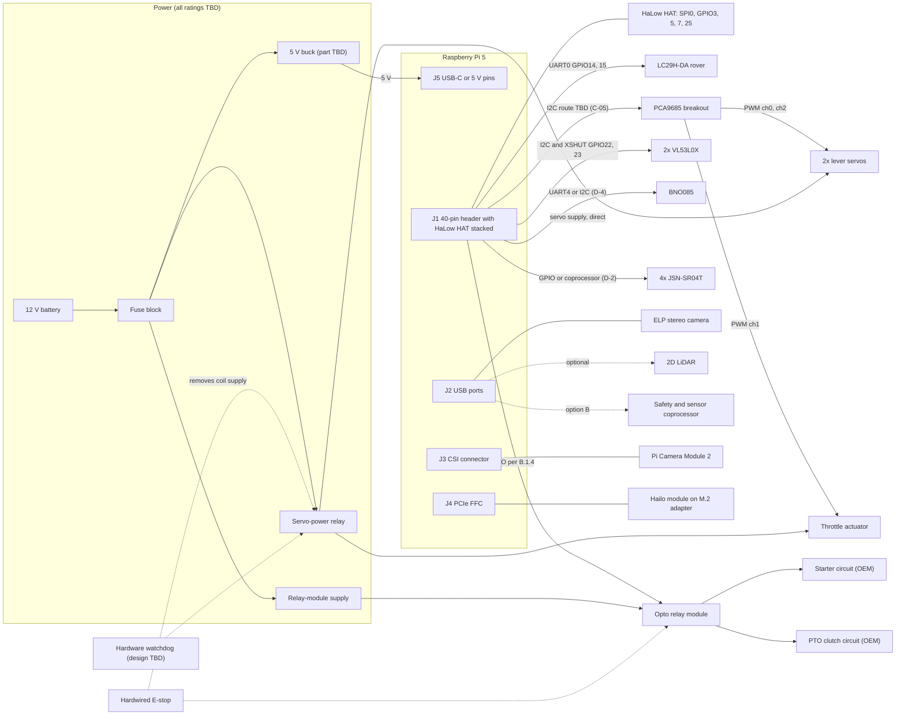
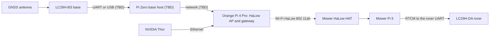
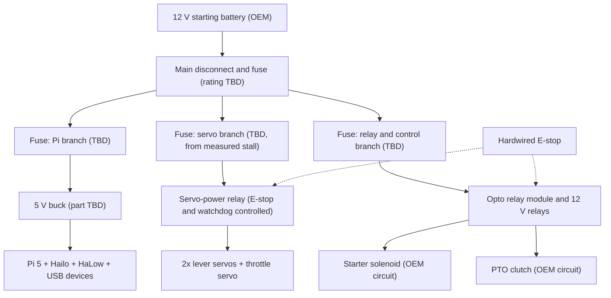
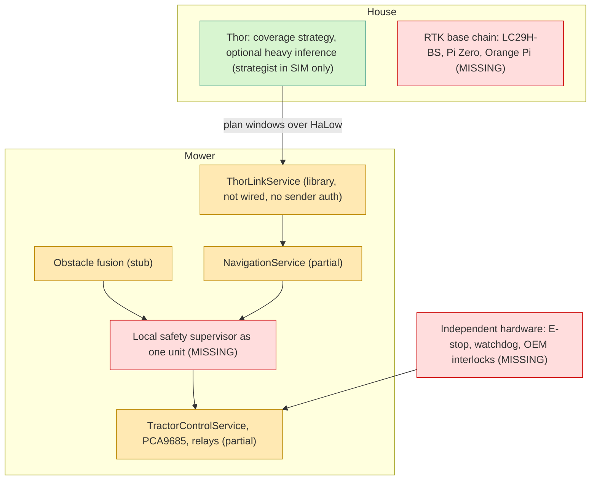
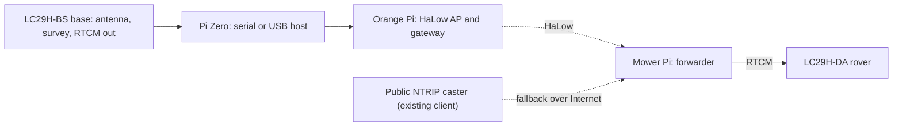

# LawnBerry-pi integration audit — 2026-10-24

**Status:** audit and engineering plan. It is **not** an as-built record and it authorises no powered actuation.
Everything below is traceable to a file in the repository, to a read-only inspection of the deployed Pi, or to the
owner's requirement documents. Anything that is none of those is marked `TBD` (needs a measurement) or `[DS]`
(general datasheet knowledge, not evidenced in this repository; bench-confirm before relying on it).

## Contents

- [0. Scope, baseline and conventions](#0-scope-baseline-and-conventions)
- [Part A. Subsystem status matrix](#part-a-subsystem-status-matrix) (A.1 to A.15)
- [Part B. Phase 3 hardware deliverables](#part-b-phase-3-hardware-deliverables) (B.1 to B.7)
- [Part C. Phase 4 distributed AI and navigation architecture](#part-c-phase-4-distributed-ai-and-navigation-architecture)
- [Part D. Phase 5 safety review](#part-d-phase-5-safety-review)
- [Part E. Prioritised development plan (P0 to P6)](#part-e-prioritised-development-plan-p0-to-p6)
- [Part F. Remaining hardware conflicts and unresolved safety requirements](#part-f-remaining-hardware-conflicts-and-unresolved-safety-requirements)
- [Implemented in this PR](#implemented-in-this-pr) (placeholder: the integrator fills it)

## 0. Scope, baseline and conventions

### 0.1 Baseline

| Item | Value |
|---|---|
| Repository baseline | `origin/main` at `765c737` (branch `audit/docs` adds documentation only) |
| Deployed Pi | host `pi5`, checkout `/apps/lawnberry-pi` at `23a6e4d`, kernel `6.12.21-morse+`; **read-only inspection on 2026-10-24**, nothing written, no actuator driven, no hardware config changed |
| Requirement documents | draft PR #18, branch `docs/2026-10-24-hardware-architecture-audit`: `docs/OMP-THOR-HANDOFF-2026-10-24.md`, `docs/2026-10-24-physical-integration-plan.md`, `docs/2026-10-24-development-roadmap.md`, `docs/2026-10-24-compatibility-gap-register.md`. They are **not on this branch**; they are cited by file name and treated as proposed requirements, not as evidence of implementation |
| Gap IDs | **H-01 … H-28** are the register's IDs. Findings the register does not contain carry **N-01 … N-31** (section A.15); they are proposed additions to the register. Conflicts are **C-xx** (B.1), measurements **M-xx** (B.7), owner decisions **D-n** (B.1.4), requirements **R-Pnn** (B.3), work packages **WP-Pn-nn** and sign-off gates **G0 … G6** (Part E) |
| Test baseline | `SIM_MODE=1 pytest tests --ignore=tests/soak -p no:cacheprovider`: **530 passed, 69 skipped, 0 failed** (collection: 600 items including 1 soak test). Parallel implementation branches (`audit/checker`, `audit/safety`, `audit/thorlink`) are **not** reflected in the statuses below; the integrator records what landed under [Implemented in this PR](#implemented-in-this-pr) |

### 0.2 Status vocabulary

| Status | Meaning in this document |
|---|---|
| **IMPLEMENTED** | Code exists, is wired to its consumer and has at least one test that exercises it (SIM or hardware). It does **not** mean verified on the machine unless the row says "live" or cites a measurement |
| **PARTIALLY IMPLEMENTED** | Exists, but part of the behaviour, wiring, configuration or test coverage is missing or contradicted |
| **SIMULATED** | Behaviour exists only under `SIM_MODE` or against fakes; no hardware effect |
| **STUBBED** | Placeholder that returns constants or sets flags with no hardware path |
| **MISSING** | No code, configuration or document for the capability |
| **UNVERIFIED** | Claimed in documents or configuration; no evidence either way |

### 0.3 Evidence tags

- **LIVE** = read-only inspection of the deployed Pi on 2026-10-24 (`/boot/firmware/config.txt`, decoded
  `halow-dw.dtbo`, `/sys/kernel/debug/pinctrl`, `gpioinfo`, `lspci`, `lsusb`, `ls /dev`, `ip`, `systemctl`).
  The `pinctrl` CLI was not installed (pin states came from debugfs and `gpioinfo`) and `i2cdetect` was
  deliberately not run. Absence of a device at this site is **not** proof of a design error: most sensors are
  detached there.
- **[DS]** = datasheet or general engineering knowledge, not evidenced in this repository.
- **[INF]** = inference from reading code; not executed.
- **TBD** = unknown; a measurement in B.7 closes it.
- Test counts in parentheses are the passing tests the audit counted for that file. Every passing test named here
  runs on fakes or `SIM_MODE`; none demonstrates a physical outcome.
- **Citations.** `file:line` references are against baseline `765c737`. Documents this PR itself edits (`README.md`,
  `hardware.md`, `docs/hardware-feature-matrix.md`, `docs/hardware-overview.md`, `docs/servo-hat-pins.md`,
  `docs/tractor-platform.md`, `docs/tractor-acceptance-criteria.md`, `docs/field-validation-protocol.md`,
  `docs/RELEASE_NOTES.md`, `docs/ultrasonic-wiring-guide.md`) are cited by section because their line numbers moved.
  Files other branches may change (`spec/hardware.yaml`, `scripts/check_hardware_pin_conflicts.py`,
  `docs/hardware-integration.md`, `backend/src/**`) keep their baseline line numbers.

### 0.4 Release gates carried over from the gap register

1. **No live motion** while H-01 to H-08 are unresolved.
2. **No autonomous mowing** until sensor and RTK health, a physical fail-safe, operator protections and field
   acceptance are proven.
3. **No remote VR driving** until authentication, a dead-man input, measured latency and a local safety override
   are proven.

State of the gates at this baseline: **all three are closed** (see Part F).

## Part A. Subsystem status matrix

### A.1 Backend services and drivers

| Subsystem | Status | Evidence (file:line) | Tests | Gap IDs |
|---|---|---|---|---|
| Application lifespan wiring | PARTIALLY IMPLEMENTED | `backend/src/main.py:67-201`. Tractor service, watchdog and tilt monitor start only if `tractor.enabled` (`:144-170`, shipped `false`); an exception anywhere in that block is logged and swallowed (`:169-170`) while `/api/v2/tractor/*` stays routed (N-05). `ThorLinkService` is never instantiated (no import in `main.py`). Teardown (`:184-201`) stops the monitors and the RoboHAT service but never parks the tractor (N-09) | `tests/unit/test_tractor_safety_monitor.py` | H-08, H-12, H-13 |
| Sensor manager | PARTIALLY IMPLEMENTED | `backend/src/services/sensor_manager.py`: IMU interface `:166-225` (ONLINE only on an I2C ACK at 0x4A/0x4B, `:186-190`), ToF `:228-`, stereo `:795-850`, ultrasonic gating `:858-886` | `tests/unit/test_sensor_presence.py`, `test_sensor_manager_ultrasonic.py` | H-02, H-03 |
| GPS driver (ZED-F9P, LC29H-DA, Neo-8M) | IMPLEMENTED (driver); the fitted receiver is UNVERIFIED | `backend/src/drivers/sensors/gps_driver.py`; modes `F9P_USB`, `F9P_UART`, `NEO8M_UART`, `LC29H_UART` (`backend/src/models/sensor_data.py:37-43`). NMEA only: no LC29H `PAIR`/`PQTM` configuration exists anywhere in `backend/`, `scripts/` or `config/` | `tests/unit/test_gps_driver.py` (5), `test_gps_config_fallback.py` | H-09 |
| BNO085 IMU driver | **STUBBED** | `backend/src/drivers/sensors/bno085_driver.py:1-9` ("simulation stub"), `:69-78` returns zeros and constants on real hardware; presence is decided by an I2C ACK, not by the driver (`sensor_manager.py:186-190`) | none exercises hardware | H-03, N-06 |
| VL53L0X ToF driver (x2) | PARTIALLY IMPLEMENTED | `backend/src/drivers/sensors/vl53l0x_driver.py:262-300` (XSHUT pair addressing), boot hook `backend/src/main.py:78-107`. The interrupt pins (GPIO6, GPIO12) are read by no code. Header I2C is absent on the deployed Pi | `tests/unit/test_sensor_presence.py`; `tests/contract/test_tof_sensors.py` is a skipped placeholder | H-03, H-17 |
| Ultrasonic driver (3x HC-SR04) | PARTIALLY IMPLEMENTED; disabled by configuration | `backend/src/drivers/sensors/ultrasonic_driver.py:80-84` (GPIO4/17, 27/10, 11/9); `config/limits.yaml:17`; fail-closed gating `sensor_manager.py:871-886` | `tests/unit/test_ultrasonic_driver.py` (10), `test_sensor_manager_ultrasonic.py` (SIM, asserts three sensors) | H-02, H-10, H-19 |
| **JSN-SR04T x4** | **MISSING** | No driver, configuration, model or test. `UltrasonicData` is three HC-SR04 values (`backend/src/models/mower_data_frame.py:104-110`) | none | H-10, H-19 |
| BME280, INA3221, Victron | PARTIALLY IMPLEMENTED | `backend/src/drivers/sensors/bme280_driver.py`, `ina3221_driver.py` (CH1 solar, CH3 battery: `:3-6,101`); Victron via the `victron-ble` CLI (`docs/victron-ble-integration.md`, `config/hardware.yaml:34-42`). Header I2C absent on the deployed Pi | `tests/contract/test_ina3221.py`, `tests/unit/test_power_sensor_interface.py` | H-17, N-12 |
| Stereo camera driver | IMPLEMENTED (capture only) | `backend/src/drivers/sensors/stereo_camera_driver.py:40-79` (2560x960 split into 1280x960 per eye; SIM synthetic frames). LIVE: a UVC camera `32e4:9750` enumerates | `tests/unit/test_stereo_camera_driver.py` (4) | H-16, H-26 |
| Camera stream service | IMPLEMENTED (live) | `backend/src/services/camera_stream_service.py`, `systemd/lawnberry-camera.service`, `docs/pi5-csi-camera-libcamera-status.md`. LIVE: `lawnberry-camera` active, imx219 on the RP1 CFE | `tests/unit/test_camera_stream_service.py`, `test_camera_ai.py` | H-17 |
| Hailo driver and inference | IMPLEMENTED (SIM and hardware path) | `backend/src/drivers/ai/hailo_driver.py:55-80` (`detector` = YOLO26 and `scdepthv3` = monocular depth models), `yolo26.py`, `backend/src/services/camera_stream_service.py:899-1034`, `backend/src/services/ai_inference_service.py`. `docs/autonomy-toolchain-matrix.md:87`: `hailortcli benchmark` on the Pi, HailoRT 4.24.0, yolo26s 41.7 FPS. LIVE: `/dev/hailo0` | `tests/unit/test_hailo_driver_lifecycle.py` (4), `test_ai_inference_service.py`, `test_camera_ai.py`, `test_ai_navigation_loop.py` (3); `test_yolo26_decode.py` (1 skipped, no cv2) | H-17 |
| Tractor control service | PARTIALLY IMPLEMENTED | `backend/src/services/tractor_service.py`: levers `:176-203`, blade `:218-231`, engine `:233-256` (no engine-run sensor, `:248`), e-stop `:258-288`. State fields are commanded values, not feedback | `tests/unit/test_tractor.py` (16), `test_tractor_navigation.py` | H-06, H-08, H-21, N-26 |
| Tractor actuators | PARTIALLY IMPLEMENTED | `backend/src/drivers/actuators/tractor_actuators.py`: `ServoActuator` `:42-77` (updates `_us`/`_value` before the write, `:65-69`), `RelayActuator` `:80-125` (gpiozero `OutputDevice(initial_value=False)` `:102`, silent fallback to simulation `:104-108`, unguarded `set` `:111-115`, starter `pulse` with `finally` `:117-124`) | `tests/unit/test_tractor.py` | H-02b, H-21, N-27 |
| PCA9685 driver | PARTIALLY IMPLEMENTED | `backend/src/drivers/actuators/pca9685_driver.py:47-171`: raw smbus2. An absent chip degrades to a silent no-op (`:117-126,155-156`, N-07); a write fault propagates once the chip was seen (`:170-171`). `MODE2 = 0x04` (`:57,111`). `MODE1` is written `0x30` then `0x20` (`:108-112`), which clears the ALLCALL bit [DS]. No `OE` handling, no read-back, no timeout on the thread write (N-28) | `tests/unit/test_pca9685_driver.py` (8) | H-04, H-08 |
| Tractor safety monitor and watchdog | PARTIALLY IMPLEMENTED | `backend/src/safety/tractor_safety_monitor.py:82-115` (20 Hz; feeds the heartbeat unconditionally at `:87`; the tilt edge calls `engage_blade(False)` once, `:103-112`; IMU loss returns silently, `:37-47,98-100`); `backend/src/safety/watchdog.py:54-69` (one-shot: `break` after the first timeout) | `tests/unit/test_tractor_safety_monitor.py` (9), `tests/contract/test_watchdog.py` | H-08, N-04, N-06 |
| RoboHAT service | PARTIALLY IMPLEMENTED (differential-drive platform only) | `backend/src/services/robohat_service.py`: `_maintain_usb_control` re-sends the last PWM every about 0.9 s (`:246-269`, N-14); `emergency_stop` `:441-459`; `shutdown` `:501-` | `tests/unit/test_robohat_service_usb_control.py` | H-08, H-11 |
| RoboHAT JSON driver | STUBBED (not used by the service; protocol mismatch) | `backend/src/drivers/motor/robohat_rp2040.py:84-134` sends JSON `MOTOR_COMMAND`/`EMERGENCY_STOP`; the firmware parser accepts a text protocol (`robohat-rp2040-code/code.py:186-225`) | `tests/unit/test_robohat_rp2040_driver.py` (fake) | H-11 |
| Blade service and IBT-4 driver | **STUBBED** | `backend/src/drivers/blade/ibt4_gpio.py:25-50` (`setup`/`set_active` only set flags; no GPIO library imported). `BladeService.emergency_stop` (`backend/src/services/blade_service.py:46-55`) and `IBT4BladeDriver.set_estop` (`ibt4_gpio.py:103-106`) have no callers (N-03) | `tests/unit/test_ibt4_blade_driver.py` (flags only) | H-02c, H-08 |
| Motor service | PARTIALLY IMPLEMENTED | `backend/src/services/motor_service.py:409-419` command-timeout handler; `control_drive_v2` does not use it (`backend/src/api/rest.py:310-417` calls `robohat.send_motor_command` directly) | none for the REST path | H-08, N-14 |
| Navigation service | PARTIALLY IMPLEMENTED | `backend/src/services/navigation_service.py`: `ObstacleDetector` `:33-82`, `execute_mission` `:175-238` (auto-crank `:188-195`), `go_to_waypoint` `:240-372`, `apply_ai_prediction` `:818-860` | `tests/unit/test_tractor_navigation.py`, `test_return_to_home.py`, `tests/test_nav_*.py` | H-06, H-23, H-26, N-08, N-11 |
| Mission API and service | PARTIALLY IMPLEMENTED | `backend/src/api/mission.py:9-90` (create, start, pause, resume, abort, status, list; no auth dependency), `backend/src/services/mission_service.py` | `tests/test_mission_api.py` | H-14, N-16 |
| Teleop capture and Thor uploader | IMPLEMENTED (software); the Pi capture session was blocked | `backend/src/services/capture_service.py`, `backend/src/services/thor_uploader.py`, `scripts/teleop.py`; `docs/autonomy-toolchain-matrix.md:76` | `tests/unit/test_capture_service.py`, `test_thor_uploader_config.py` | H-16 |
| Sensor-manager systemd unit | **STUBBED** | `systemd/lawnberry-sensors.service:16-17`: `ExecStart` is `echo "...placeholder..." && sleep infinity`. Sensors actually run inside the backend process | none | N-20 |

### A.2 Firmware

| Subsystem | Status | Evidence | Tests | Gap IDs |
|---|---|---|---|---|
| RoboHAT RP2040 firmware (CircuitPython) | IMPLEMENTED for the differential-drive platform; UNVERIFIED on hardware (no RP2040 enumerates at this site) | `robohat-rp2040-code/code.py`: text protocol `pwm,<steer>,<throttle>`, `rc=enable`/`rc=disable`, `blade=...`; hardware watchdog 8 s with RESET (`:98-101`); USB silence of 2 s falls back to RC mode (`:105-107,305-309`); RC signal loss for 1 s centres the outputs (`:111,315-322`); RC channel-5 stop (`:326-336`) is evaluated **only inside `if rc_enabled`** (`:312`), i.e. not while the Pi holds USB control | host side only (`tests/unit/test_robohat_*`); no firmware tests | H-08, H-11 |
| MDDRC10 input state during a firmware WDT reset | UNVERIFIED | TBD: scope the steer/throttle pins during an induced reset (M-23) | none | H-08 |
| Toro platform firmware | MISSING | `code.py` drives GP10/GP11 servo PWM, GP12 blade PWM, GP13 mode, GP8/9 encoder, GP2-7 RC inputs (`:4-7,58-59,72-77,90-91,95`). There is no PCA9685, relay or tractor path in firmware | none | H-11 |
| Safety / sensor coprocessor firmware | MISSING (design option, B.1.4 option B) | no code | none | H-08, H-19 |

### A.3 Hardware configuration (repository and deployed Pi)

| Subsystem | Status | Evidence | Tests | Gap IDs |
|---|---|---|---|---|
| `spec/hardware.yaml` | PARTIALLY IMPLEMENTED; internally contradictory; no platform tag | Mixed registry: mower sections plus a `tractor:` block (`:94-133`). Pin 32 is booked twice (ToF-R interrupt `:142`, BNO085 TX `:144`); BNO085 RX is `rxd: 4` on pin 33 (`:143`). INA3221 `channel_1` battery / `channel_3` solar (`:61-70`) is the reverse of the driver (N-12). GPS ZED-F9P preferred (`:9-12`). Hailo recorded as "Hailo-8 AI Hat" (`:37`). UART1 RoboHAT 38400 (`:155`) vs USB CDC 115200 (`docs/servo-hat-pins.md` section 2). `i2c_addresses` (`:146-151`) omits 0x41, 0x4A/0x4B and 0x70 | none loads it | H-03, H-09, H-11 |
| `config/hardware.yaml` | PARTIALLY IMPLEMENTED (mower) | LC29H-DA on `/dev/ttyAMA0` (`:8-11`) contradicts the spec; INA3221 shunt comments (`:29-33`); a Victron MAC (`:37`, device identification, no key); ToF bus 1 (`:21`) | `tests/unit/test_config_loader.py` | H-09, H-17 |
| `config/tractor.yaml` | PARTIALLY IMPLEMENTED; shipped disabled | `enabled: false` (`:11`; LIVE identical); PCA9685 0x41, bus 1 (`:17-18`); relays BCM5 and BCM26 (`:31,36`); microsecond endpoints are illustrative (`:22-27`); "no clutch/brake pedal" (`:38-39`) contradicts the parking brake at PARK (`docs/tractor-platform.md`, "Physical integration decisions" item 2); PTO "latching" (`:32`) vs the owner-reported momentary switch | none | H-12, H-21 |
| `config/limits.yaml` | PARTIALLY IMPLEMENTED | `ultrasonic_enabled: false` (`:17`; LIVE identical), `estop_latency_ms: 100` (`:4`), `watchdog_timeout_ms: 1000` (`:10`); the comment at `:16` "Trigger e-stop if any sensor reads below this" is false (N-19) | `tests/unit/test_config_loader.py`; `scripts/validate_safety_config.py` | H-02, H-08 |
| Deployed boot configuration (unversioned) | UNVERIFIED in the repository | LIVE `/boot/firmware/config.txt`: `dtparam=i2c_arm=off` (`:23`), `dtoverlay=halow-dw`, `dtoverlay=spi0-1cs`, `enable_uart=1`, `dtparam=pciex1_gen=3`, a `dwc2` overlay, `device_tree=bcm2712-rpi-5-b-morse.dtb`, `kernel=kernel_2712-morse.img`; HaLow pin comments at `:20-31`; **no `uart4-pi5`**. Nothing in the repository versions this file | none | H-02, H-17, H-25 |
| Deployed application configuration | IMPLEMENTED (matches repo) | LIVE `/apps/lawnberry-pi/config/tractor.yaml` and `limits.yaml` identical to the repository; no `config/hardware.local.yaml`, no `.env` | none | H-12 |

### A.4 GPIO and buses

| Subsystem | Status | Evidence | Tests | Gap IDs |
|---|---|---|---|---|
| Pin and address conflict checker | PARTIALLY IMPLEMENTED | `scripts/check_hardware_pin_conflicts.py:53-87` compares only `pins.gpio_used[].gpio`, `config/tractor.yaml relays.*.gpio`, `pins.i2c_addresses` and the tractor PCA9685 address. Rows without a `gpio` key are skipped (`:57-59`); the self-test asserts that rxd/txd rows must not collide (`:129-141`). It never reads HaLow, overlays, `config/hardware.yaml`, `limits.yaml` or physical pin numbers. What-if probes by the audit: moving the starter to GPIO17 or GPIO3 reports nothing | inline `--self-test` only; no file in `tests/` references it | H-01, H-02, H-03 |
| hardware-guard workflow | PARTIALLY IMPLEMENTED; enforces a documented error | `.github/workflows/hardware-guard.yml:14-59`; `:54-59` requires CH1 = Battery and CH3 = Solar, the reverse of the driver | none | N-12, N-22 |
| Header I2C1 on the deployed Pi | **MISSING (disabled)** | LIVE `dtparam=i2c_arm=off`; `/dev/i2c-1` absent (only `i2c-11` = RP1 CSI bus with the imx219 at 0x10, `i2c-13`, `i2c-14` = HDMI DDC) | none | H-02, H-17, H-25 |
| UART0 (GNSS) | IMPLEMENTED (device present) | LIVE `/dev/ttyAMA0`, GPIO14/15 alt4 `uart0`; receiver behind it unverified | `tests/unit/test_gps_driver.py` (SIM) | H-09 |
| UART4 (BNO085) | **MISSING** | LIVE no `uart4-pi5` overlay and no `/dev/ttyAMA4`. `docs/hardware-integration.md` (baseline line 116) says `dtoverlay=uart4`; the Pi's overlay README documents `uart4` as BCM2711-only (GPIO8-11) and `uart4-pi5` as GPIO12-13 (N-13) | none | H-03, N-13 |
| SPI0 and the HaLow radio | IMPLEMENTED (live) | LIVE `halow-dw` + `spi0-1cs`; GPIO8-11 SPI0, GPIO25 IRQ, GPIO5 RESET, GPIO3 WAKE, GPIO7 BUSY | none | H-02, H-17 |
| ToF XSHUT (GPIO22/23) | PARTIALLY IMPLEMENTED | LIVE `lgpio` holds GPIO22 LOW and GPIO23 HIGH; the addressing sequence cannot reach the sensors without an I2C bus | none | H-17 |
| HaLow claims in the pin registry | MISSING | HaLow is absent from `spec/hardware.yaml` | none | H-02, H-17 |
| Hardware self-test | PARTIALLY IMPLEMENTED; unsafe on this Pi | `backend/src/services/hw_selftest.py:36-41,192-255`, route `backend/src/api/routers/maintenance.py:62-69` (N-18) | none | H-02 |

### A.5 Electrical and power

| Subsystem | Status | Evidence | Tests | Gap IDs |
|---|---|---|---|---|
| Servo supply rail | UNVERIFIED; documents contradict | 12 V (`hardware.md` Actuation; `docs/tractor-platform.md` introduction) vs 24 V (`docs/hardware-overview.md`, `docs/tractor-acceptance-criteria.md`, `docs/RELEASE_NOTES.md`, `docs/field-validation-protocol.md`, `docs/servo-hat-pins.md`; **superseded notes added in this PR**). Owner-reported: two matching 150 kg·cm-class servos at nominal 10-12.6 V, possibly 8 A or more stall (not bench-verified) | none | H-05, H-20 |
| Fuses, wire gauges, stall-current budget | **MISSING** | `hardware.md` lists only "inline fuse holders + assorted fuses, 12 AWG, 4-pack" and 14 AWG primary wire; no rating, no per-branch gauge, no budget anywhere in the repository | none | H-20 |
| Independent hardwired E-stop | **MISSING** | No hardware input in code or configuration; `backend/src/safety/estop_handler.py:5-7` ("Hardware GPIO integration will be added later"); `spec/hardware.yaml:87` is a flag with no pin. `hardware.md` (Safety) lists a mushroom button but no circuit | `tests/integration/test_safety_systems.py:14-29` measures a Python flag flip | H-07, H-08 |
| PCA9685 `OE` / servo-power cut | **MISSING** | No `OE` GPIO anywhere (`config/tractor.yaml`, `spec/hardware.yaml`, code); `pca9685_driver.py:21-23`, `docs/tractor-platform.md` (PCA9685 paragraph). The 74HC123 watchdog (`hardware.md` Safety) is a BOM line with "any free GPIO" unassigned | none | H-04, H-08 |
| Relay modules (starter, PTO) | UNVERIFIED | `hardware.md` (Engine and implement): GPIO to opto module to Bosch-style relay; trigger polarity, boot-time state, pull configuration, flyback and contact ratings unknown; software assumes `active_high: true` (`config/tractor.yaml:31,36`) | `tests/unit/test_tractor.py` (fakes) | H-21, H-02b |
| Power monitor (INA3221) | PARTIALLY IMPLEMENTED | `backend/src/drivers/sensors/ina3221_driver.py:3-6,101`; which shunt carries which current is unmeasured (N-12) | `tests/contract/test_ina3221.py` | H-17 |
| Pi 5 V supply | UNVERIFIED | DROK 9-36 V to 5.2 V module (`hardware.md` Power) vs Pololu D24V50F5 (`docs/hardware-overview.md`); neither load-tested. LIVE single idle sample: `vcgencmd get_throttled = 0x0`, `EXT5V_V = 5.13 V` | none | H-17 |
| Grounding and isolation | **MISSING** | No document defines the ground topology (Pi, PCA9685, servo supply, relay supply, sensors) | none | H-20 |
| Battery and charging | UNVERIFIED | mower: 12.8 V 30 Ah LiFePO4 + 30 W solar (`spec/hardware.yaml:47-60`); Toro: the 12 V starting battery and an unmeasured charging stator (`docs/hardware-overview.md` Power) | none | H-05 |

### A.6 AI and navigation

| Subsystem | Status | Evidence | Tests | Gap IDs |
|---|---|---|---|---|
| VLA policy (37M parameters) on the Hailo | UNVERIFIED | Claimed in the README; the repository holds no throughput or accuracy measurement of the policy on the Pi. The only measured Hailo figure is detector throughput (`docs/autonomy-toolchain-matrix.md:87`). Performance tests are gated by `RUN_PERF_TESTS` | 15 + 1 perf tests skipped | H-23 |
| AI inference loop and action mapping | PARTIALLY IMPLEMENTED | `backend/src/services/ai_inference_service.py:494-504` sets `safety_override` when `min_distance_cm < 30`; `backend/src/services/navigation_service.py:735-760` (AI loop) and `:835-860` (`apply_ai_prediction`: override calls `tractor.emergency_stop()` at `:845-849`). `to_tractor_command()` reuses the differential mix; the twin-lever mixing is an open item (`docs/tractor-platform.md`, Configuration section) | `tests/unit/test_ai_inference_service.py`, `test_ai_navigation_loop.py` (3) | H-23, N-25 |
| Local coverage and path planning | IMPLEMENTED (unit) | `backend/src/nav/coverage_planner.py`, `coverage_patterns.py`, `path_planner.py`, `obstacle_avoidance.py:83` (`plan_path_astar`), `geofence_validator.py`, `zone_coverage.py` | `tests/test_nav_*.py`, `tests/unit/test_coverage_planner_angle.py` | H-26 |
| EKF and odometry | IMPLEMENTED (unit) | `backend/src/nav/odometry.py` | `tests/unit/test_ekf.py` (4), `test_odometry.py` | H-26 |
| Mission execution | PARTIALLY IMPLEMENTED | `navigation_service.py:175-238`: RTK fix quality is not a start precondition; the waypoint loop polls mission status only (`:265-284`); the tractor path re-asserts `blade_engaged` every 0.2 s tick (`:354-371`) | `tests/unit/test_tractor_navigation.py` | H-23, N-06, N-08 |
| Obstacle model and fusion | **STUBBED** | `navigation_service.py:33-82`: ToF only (distance < 1000, unit assumed mm and unchecked against the metres in `limits.yaml`), `Position(0, 0)` placeholder (`:51,64`), constant confidence 0.8, `is_path_clear` returns False on any hit and is not called by the mission loop; `go_to_waypoint` (`:240-372`) never reads obstacle state | `tests/contract/test_sensor_fusion.py` skipped placeholder | H-26, N-11 |
| Stereo depth / disparity | **MISSING** | No `StereoSGBM`, `reprojectImageTo3D` or calibration code. `stereo_depth` is never filled (`backend/src/models/mower_data_frame.py:174`); `backend/src/services/perimeter_recorder.py:510-511` reads a `.depth` attribute the driver never sets. Monocular `scdepthv3` HEF support exists (`hailo_driver.py:63,77`) and is unevaluated | none | H-16, H-26 |
| 2D LiDAR | **MISSING** | No driver, configuration, model or document beyond the requirement; no model selected | none | H-15, H-26 |
| ROS 2 / Nav2 | **MISSING** | No `rclpy`, `nav2` or `ros2` code, dependency or configuration anywhere in `pyproject.toml`, `backend/`, `scripts/`, `config/` | none | H-26 |
| Thor coverage strategist | IMPLEMENTED (SIM) | `backend/src/nav/thor_strategist.py:73-262` (boustrophedon plan, no-go zones, replans from uplink detections, pauses unless the fix is `rtk_fixed`, resume) | `tests/unit/test_thor_strategist.py` (4; more than 97 % coverage on a synthetic 60 x 40 m yard) | H-23 |
| Detector output to the Thor uplink | **MISSING** | `ThorLinkService(build_uplink=None)` sends an empty `Uplink` (`backend/src/services/thor_link_service.py:57,150`); nothing builds an uplink from GPS or detections | none | H-23 |
| Manual teleop (keyboard) | IMPLEMENTED | `scripts/teleop.py:36-37` (20 Hz, client-side dead-man 0.25 s, `--confirm-supervised`, REST `/api/v2/tractor/command`); the server has no dead-man (N-14) | none | H-14, H-16 |
| VR stereo streaming and head tracking | **MISSING** | No head tracking, pan/tilt, WebXR or stereo stream endpoint; `camera_stream_service.py` has no stereo path | none | H-16 |
| Agent bridge (PR #16, PR #17) | status only | PR #16: draft, one documentation file. PR #17 `feat/agent-bridge-omp`: draft, 62 files under `tools/agent_bridge/**`, not merged, nothing under `backend/` | not run | H-27 |

### A.7 RTK and GNSS

| Subsystem | Status | Evidence | Tests | Gap IDs |
|---|---|---|---|---|
| Rover: u-blox ZED-F9P | IMPLEMENTED (driver); UNVERIFIED on hardware | `gps_driver.py` (`F9P_USB`, `F9P_UART`); `spec/hardware.yaml:9-12` "preferred"; LIVE: no `/dev/ttyACM*` | `tests/unit/test_gps_driver.py` (5, SIM) | H-09 |
| Rover: Quectel LC29H-DA | PARTIALLY IMPLEMENTED | NMEA path only: `gps_driver.py:77-81`, `backend/src/models/hardware_config.py:74,120-122`, `backend/src/services/websocket_hub.py:98-99`, `config/hardware.yaml:8-11`. No `PAIR`/`PQTM` configuration; no LC29H-specific test | `tests/unit/test_gps_config_fallback.py` | H-09 |
| Base: Quectel LC29H-BS | **MISSING** | Zero hits for `LC29H-BS`, base survey-in or RTCM base-mode handling in `backend/`, `scripts/`, `config/` | none | H-09, H-22 |
| Pi Zero RTK base host | **MISSING** | No code or document in the repository; owner's candidate topology only | none | H-22 |
| Orange Pi 4 Pro HaLow AP / gateway | UNVERIFIED in the repository | Documented as the AP (192.168.1.140, HT-HC01P on SPI3) in `docs/autonomy-toolchain-matrix.md:47-69`; its units live on that host. `halow-link-watch` is the only HaLow unit versioned here | none | H-22 |
| NTRIP forwarder | IMPLEMENTED (client to serial) | `backend/src/services/ntrip_client.py:35-300` (caster to serial RTCM, GGA keepalive, backoff); configured through `.env`, which is absent on the deployed Pi. Serves a public caster only; there is no local base source | no dedicated test file | H-22 |
| GPS degradation handling | PARTIALLY IMPLEMENTED | `backend/src/nav/gps_degradation.py:22-35`: AUTONOMOUS to MANUAL in the in-memory `RobotState` when accuracy is above 5 m or the fix is older than 10 s; no actuator-level stop | `tests/unit/test_gps_degradation.py` | H-09 |
| Correction age and fix-transition handling | **MISSING** | No correction-age metric consumed by navigation; the Thor strategist pauses on a non-fixed position but is not wired | none | H-09 |
| RTK diagnostics | PARTIALLY IMPLEMENTED | `scripts/diagnose_gps_rtk.py`, `scripts/rtk_diagnostics_watch.py` (ZED-oriented; not run by the audit) | none | H-09 |

### A.8 Communications

| Subsystem | Status | Evidence | Tests | Gap IDs |
|---|---|---|---|---|
| HaLow link operations | IMPLEMENTED (operations); measured at two locations | `scripts/halow_link_watch.sh`, `systemd/halow-link-watch.{service,timer}`, `systemd/install_services.sh:34-39,66`. `docs/autonomy-toolchain-matrix.md:30-70`: Pi to Thor 2026-10-06 TCP 4.79 / 4.61 Mbit/s, 50 pings at 5 Hz 0 % loss, RTT 7.3 / 18.0 / 73.2 ms (min / avg / max); Pi to AP 2026-10-13 TCP 4.84 / 5.17 Mbit/s, 30-minute soak 0 % loss. LIVE `halow0` was DOWN at audit time (traffic via `eth0` and `tun0`) | none | H-16, H-17, H-22, H-23 |
| HaLow recovery (power cycle, driver reload, Pi reboot) | UNVERIFIED | Same document: "A real HaLow drop and a Pi reboot were not exercised"; a stopped backend once took the radio down (`:76`); the AP radio vanished after a TX-cap change (`:49`) | none | H-23 |
| Pi-Thor link protocol | IMPLEMENTED (protocol) | `backend/src/models/thor_link.py:22-113`: v1, JSON over UDP, 1200 B cap, 10 Hz uplink, waypoint windows of up to 16 | `tests/unit/test_thor_link.py` (8) | H-13, H-23 |
| Pi-side Thor link service | PARTIALLY IMPLEMENTED; **not wired** | `backend/src/services/thor_link_service.py:49-172`; instantiated only in tests; `current_plan()` (`:115-117`) has no consumer; LIVE no listener on UDP 47101 | `tests/unit/test_thor_link.py` (includes a loopback UDP round trip) | H-13, H-23, N-15 |
| Link authentication and integrity | **MISSING** | `_on_datagram` ignores the source address (`:98-110`); the socket binds `0.0.0.0:47101` (`:54`); no key, HMAC, nonce or source check | none | H-13, H-14, N-15 |
| Replay and stale-plan protection | PARTIALLY IMPLEMENTED | `seq <= _last_rx_seq` drop (`:106-107`); no epoch, plan age or `start_index` check; one datagram with a very large `seq` makes every later legitimate datagram look reordered until the Pi restarts | `tests/unit/test_thor_link.py` (duplicate case) | H-13, N-15 |
| Link-loss to safe hold | IMPLEMENTED (software, fake clock) | `_evaluate_hold` (`:132-145`): `timeout_s = 0.5`, blade off then levers neutral, non-revoking; `tick` swallows exceptions (`:121-130`), so `safe_hold` can read true while actuation failed | `tests/unit/test_thor_link.py` | H-08, H-23 |
| Retransmission and acknowledgement | MISSING | Uplink is fire-and-forget; the Thor re-sends waypoint windows on each uplink (implicit) | none | H-13 |
| REST and WebSocket API | IMPLEMENTED | `backend/src/main.py:227-247` (prefix `/api/v2`); `/ws/telemetry` and `/ws/control` under `/api/v2/` and as legacy root routes (`backend/src/api/rest.py:34-36`); `/ws/control` drains and acknowledges only (`backend/src/api/routers/telemetry.py:175-206`) | `tests/contract/*`, `tests/integration/*` | H-14 |

### A.9 Security

| Subsystem | Status | Evidence | Tests | Gap IDs |
|---|---|---|---|---|
| Operator authentication | PARTIALLY IMPLEMENTED; **disabled in the shipped and deployed unit** | `backend/src/api/deps.py:33-57` (code default is on); `systemd/lawnberry-backend.service:24` sets `OPERATOR_AUTH_REQUIRED=0` (LIVE identical); the backend binds `0.0.0.0:8081` (`:33`) and is reachable over the VPN. `PRODUCT.md:11` and `docs/authentication-config.md` record it as a decision | `tests/integration/test_operator_authz.py`, `test_auth_hardening.py`; TDD skips in `tests/unit/test_websocket_auth.py` and `tests/integration/test_manual_control_auth.py` | H-14 |
| Routes with no auth dependency | PARTIALLY IMPLEMENTED | Missions (`backend/src/api/mission.py:9-90`), AI enable (`backend/src/api/routers/ai_control.py:143-176`), `POST /control/emergency_clear` (`backend/src/api/safety.py:19`), `POST /control/emergency` and `/control/emergency-stop`, the debug injectors for GPS, geofence, ToF and tilt (`backend/src/api/navigation.py:32-100`, `backend/src/api/routers/sensors.py:450-516`), `GET /system/selftest` | none | H-14, N-16 |
| Tractor routes | PARTIALLY IMPLEMENTED | `backend/src/api/routers/tractor.py:36-93`: writes use `require_operator_auth` (off in production); `/tractor/emergency-stop` is unauthenticated by design; `/tractor/clear-emergency` can be called remotely with no local acknowledgement. With auth off, any host that can reach the port can `authorize`, start, command and engage | `tests/integration/test_operator_authz.py` (tractor routes not among the confirmed cases) | H-14, N-10 |
| WebSocket authorisation | PARTIALLY IMPLEMENTED | `backend/src/api/routers/auth.py:318-386` admits localhost, `testserver` or any client under `SIM_MODE=1` as an operator; the HTTP handshake helper `backend/src/api/routers/telemetry.py:96-111` accepts any non-empty bearer string | skipped | H-14, N-16 |
| Default credentials | **present** | `operator123` and `admin`/`admin`: `backend/src/api/rest_v1.py:108`, `backend/src/api/routers/auth.py:396-397`, `backend/src/services/auth_service.py:233` | tests use them | H-14, N-17 |
| JWT secret persistence | PARTIALLY IMPLEMENTED | `auth_service.py:83-85` generates a random key per process start when `LAWN_BERRY_AUTH_SECRET` is unset (no `.env` live); a second mechanism exists (`backend/src/core/secrets_manager.py:81-86`) | none | N-21 |
| CORS | PARTIALLY IMPLEMENTED | `backend/src/middleware/security.py:191-228`: origin allow-list with credentials; `http://<pi-ip>:3000` is not in the defaults unless `LAWN_BERRY_ALLOWED_ORIGINS` is set (not set) | `tests/unit/test_security_middleware.py` | N-21 |
| Pi-Thor link authentication | **MISSING** | see A.8 | none | H-13, N-15 |
| Secret hygiene | PARTIALLY IMPLEMENTED | A local pre-commit hook only (`scripts/pre-commit-secret-scan.sh`); no secret-scanning workflow; no secrets found in tracked files by the audit's search | none | N-22 |

### A.10 Safety

Summary of the safety audit; the full traces are in Part D.

| # | Subsystem | Status | Evidence | H / N IDs |
|---|---|---|---|---|
| 1 | Independent hardwired E-stop | **MISSING** | A.5. The only quasi-independent stop is the RC channel-5 stop on the RP2040 (`code.py:326-336`), inactive while the Pi holds USB control, on the same MCU as the drive output, and irrelevant to the PCA9685 Toro platform | H-07, H-08 |
| 2 | Software E-stop (tractor) | PARTIALLY IMPLEMENTED | `POST /api/v2/tractor/emergency-stop` (`backend/src/api/routers/tractor.py:85-88`) to `tractor_service.py:258-288`: flag, revoke, PTO relay off first, then each channel in its own try/except. A failed channel keeps its last pulse and the reply is still `status: emergency_stop`; `RelayActuator.set` is unguarded (`tractor_actuators.py:111-115`), so a GPIO error raises before the servos are safed | H-08, N-27 |
| 3 | General E-stop routes | **STUBBED / false assurance** | `POST /control/emergency-stop` (`backend/src/api/rest.py:676-692`) only sets flags and replies `motors_stopped: true, blade_disabled: true`; `POST /control/emergency` (`:600-673`) stops the RoboHAT only if its serial link is up and blocks follow-up commands for 0.2-0.3 s; neither touches the tractor or the IBT-4 | N-01, N-02, N-03 |
| 4 | Motor watchdog | PARTIALLY IMPLEMENTED | Event-loop liveness only, tractor-only, one-shot (`watchdog.py:54-69`); `main.py:155-158` gives it a private `MotorAuthorization` nothing else reads; `safety_validator.py:37-38` validates `watchdog_timeout_ms >= estop_latency_ms` (1000 ms vs 100 ms) | H-08, N-04 |
| 5 | Loss of comms | **MISSING** for the operator; Thor link implemented but unwired | A.8; `/tractor/command` has no TTL or lease; `/control/drive` validates `duration_ms` but never schedules a stop (`rest.py:378-388`); the RoboHAT host loop re-sends the last PWM about every 0.9 s (`robohat_service.py:246-269`) | H-13, H-14, N-14, N-15 |
| 6 | Servo neutral and parking brake | PARTIALLY IMPLEMENTED | Neutral is a command (`ServoCalibration` defaults `tractor_actuators.py:30-39`; `config/tractor.yaml:22-27` illustrative values); lever self-centring unverified; a real parking brake exists only at the outboard PARK position, reachable by hand only (`docs/tractor-platform.md`, Physical integration decisions item 2) | H-06, H-08 |
| 7 | PCA9685 `OE` and bus faults | `OE` **MISSING**; bus-fault propagation IMPLEMENTED; silent no-op when absent at boot | A.1, A.5 | H-04, H-08, N-07, N-28 |
| 8 | Safe startup | PARTIALLY IMPLEMENTED | Safe defaults (`tractor_service.py:109-110`), parking in `initialize()` (`:127-136`), start interlocks (`:233-244`). Not latched across restart (N-10); no engine-run sensor (`:248`); mission auto-crank (N-08); parking skipped entirely while `tractor.enabled` is false (`main.py:146`) | H-06, H-12, N-08, N-10 |
| 9 | Safe shutdown | **MISSING** | Teardown never parks the tractor (`main.py:184-201`); `systemd/lawnberry-backend.service:37-44` has no `ExecStopPost`; the relay GPIO state at process exit and SIGKILL is unknown; `finally: set(False)` in `pulse` does not run on SIGKILL (`tractor_actuators.py:117-124`); `MemoryMax=512M` makes OOM kills possible | H-08, N-09 |
| 10 | PTO latching vs momentary | **MISSING / CONTRADICTED** | Software models a latching relay (`config/tractor.yaml:32-36`, `tractor_service.py:228-229`); the owner reports a momentary OEM switch; no PTO feedback; no pulse-to-toggle logic | H-21, N-26 |
| 11 | Operator authentication | PARTIALLY IMPLEMENTED; deployed OFF | A.9 | H-14 |
| 12 | OEM interlock preservation | MISSING in software (documentation only) | Nothing senses the seat, PARK or OEM ROS; `docs/tractor-platform.md` (items 3-4) and `docs/tractor-acceptance-criteria.md` sections 8-9 and 11 record the physical facts. The mission auto-crank contradicts "a human starts the engine with the levers in PARK" (N-08) | H-06, H-07 |
| 13 | Tilt cutoff | PARTIALLY IMPLEMENTED; defeated in autonomous mode | N-06; 30° threshold (`config/limits.yaml:5`); the blade-stop latency is measured only as a function call (`tests/integration/test_safety_systems.py:32-45`) | H-08, N-06, N-24 |
| 14 | Obstacle detection and stop | **MISSING** for actuation | `SafetyTriggerManager.trigger_obstacle`, `trigger_ultrasonic_obstacle`, `trigger_low_battery`, `trigger_high_temp` (`safety_triggers.py:94-141`) have no production callers; thresholds are consumed only by the debug injector (`sensors.py:474`) | H-02, H-10, H-19, H-26, N-11 |
| 15 | Stopping distance | **MISSING** | No speed-dependent stopping distance, reaction time or braking model; fixed constants only (ToF 0.2 m, ultrasonic 30 cm, AI 30/50 cm, navigation 1000 of unclear unit); `ramp_rate` is an unused field (`backend/src/models/motor_control.py:53`) | H-26 |

### A.11 Tests

| Item | Status | Evidence |
|---|---|---|
| Full suite | PASS in SIM | `SIM_MODE=1 pytest tests --ignore=tests/soak -p no:cacheprovider`: **530 passed, 69 skipped, 0 failed**, 68.8 s, 2 warnings (httpx deprecation). HIL and soak were not run |
| Skipped tests | UNVERIFIED paths | 29 + 1 "Placeholder integration test" and 10 "Placeholder contract test" (`RUN_PLACEHOLDER_*`); 15 + 1 perf tests (`RUN_PERF_TESTS`); `_require_bearer_auth` TODO(v3) skips and a legacy `/ws/telemetry` skip (`tests/unit/test_websocket_auth.py:20,27,35,58`; the stated reason is stale because `/ws/telemetry` is registered at `backend/src/api/rest.py:35`); "Auth enforcement not yet implemented - TDD test" (`tests/integration/test_manual_control_auth.py:23,69,119`); hardware self-test (`RUN_HW_TESTS`), 8-hour soak (`RUN_8H_SOAK`), quick soak (`RUN_SOAK_CI`); one test needing `cv2` (`tests/unit/test_yolo26_decode.py:185`) |
| HIL | **MISSING** | `tests/hil/test_hil_probe.py` runs `scripts/hil_probe.py` under `SIM_MODE` and parses a CSV; it is not a hardware test, and no CI job runs `tests/hil` or `tests/soak` |
| Pin checker | UNTESTED | No file in `tests/` references `scripts/check_hardware_pin_conflicts.py`; none loads `spec/hardware.yaml` |
| Areas with **no test at all** | MISSING | Stop-distance logic, comms-loss behaviour, shutdown parking, PCA9685-absent reporting in production, tilt re-engagement by navigation, IBT-4 e-stop, PTO momentary behaviour, Thor link authentication |

What the passing safety tests prove and do not prove:

| Area | Tests (all pass, SIM) | What they do not prove |
|---|---|---|
| Servo mapping, relays, interlocks, e-stop sequence | `tests/unit/test_tractor.py` (16) | Any physical outcome |
| PCA9685 arithmetic and fault modes | `tests/unit/test_pca9685_driver.py` (8) | `OE`, power-up state, a real I2C bus |
| Tilt and watchdog wiring | `tests/unit/test_tractor_safety_monitor.py` (9) | A real IMU, re-engagement by navigation, latency |
| Thor link logic | `tests/unit/test_thor_link.py` (8) | Wiring, authentication, consumers, hardware |
| Bare watchdog and bool e-stop | `tests/contract/test_watchdog.py`, `tests/integration/test_safety_systems.py` | Any hardware; the "latency under 100 ms" test times a flag flip (`:14-29`) and the tilt test times a function call (`:32-45`) |
| RoboHAT driver and service | `tests/unit/test_robohat_rp2040_driver.py`, `test_robohat_service_usb_control.py` | The firmware protocol |
| Operator auth | `tests/integration/test_operator_authz.py`, `test_auth_hardening.py` | Tractor, mission, AI and `emergency_clear` routes; WebSocket paths |

### A.12 Documentation

| Contradiction or gap | Where | State after this PR |
|---|---|---|
| GPS receiver (ZED-F9P vs LC29H-DA) | `README.md`, `spec/hardware.yaml:9`, `hardware.md`, `config/hardware.yaml:8-11`, `docs/autonomy-toolchain-matrix.md:14,27`, `.github/copilot-instructions.md` | Annotated as unreconciled in README, matrix and `hardware.md` (H-09). `spec/` and `config/` unchanged: an owner decision with a physical check |
| Servo rail 12 V vs 24 V | `hardware-overview.md`, `tractor-acceptance-criteria.md`, `RELEASE_NOTES.md`, `field-validation-protocol.md`, `servo-hat-pins.md`, `tractor-platform.md` | Superseded notes added; historical text kept (H-05, H-20) |
| `OE` polarity | `tractor-acceptance-criteria.md` section 1 | Corrected, bench measurement added (H-04) |
| Pin 17 voltage, divider schematic and margin, resistor BOM | `ultrasonic-wiring-guide.md` | Corrected; whole guide marked legacy (H-01, H-18) |
| Ultrasonic part and count | guide, matrix, README | Marked legacy / MISSING for JSN-SR04T (H-10, H-19). `spec/hardware.yaml`, `PRODUCT.md:32` unchanged |
| Matrix rows (IBT-4, BNO085, ultrasonic, stereo, GPIO/I2C/UART/USB tables, starter/PTO) | `hardware-feature-matrix.md` | Corrected |
| Ports 8000/3001 vs 8081/3000, `/control/estop`, `/missions`, telemetry routes, fictional config files | `README.md` | Corrected. **Still open:** `docs/deployment-guide.md:172-244` uses 8000 and `ws://localhost:8000/ws/telemetry` |
| `/control/emergency-stop` listed as an e-stop | `docs/OPERATIONS.md:59` | **Open** (N-01): the route only sets flags |
| Damaged paragraph and unqualified "verified conflict-free" | `tractor-platform.md` | Repaired and qualified (H-02b) |
| Platform tagging (differential-drive vs Toro) | README, matrix, hardware-overview, servo-hat-pins, hardware.md | Tags added (H-11). `docs/hardware-integration.md` and `spec/hardware.yaml` are changed on the checker branch, not here |
| Hailo-8 vs 8L | `spec/hardware.yaml:37`, README, `hardware.md`, matrix | Annotated; verify with `hailortcli fw-control identify` |
| HaLow HAT identity | live `config.txt` (Heltec HT-HC01P V2) vs `halow-bringup.service` and `docs/autonomy-toolchain-matrix.md:17,47` (Seeed WM6108 / HT-HC01P) | **Open**, TBD by inspection |
| OS and kernel | `spec/hardware.yaml:3`, `docs/hardware-integration.md` (Bookworm); `docs/autonomy-toolchain-matrix.md:14` (Ubuntu 24.04.4, 6.8.0-raspi); LIVE 6.12.21-morse+ | Annotated in README; **open** |
| Version naming v2 / v3 | README title vs `systemd/*.service` descriptions | **Open** |
| `PRODUCT.md:25` ride-on Craftsman tractor with Ackermann steering | superseded on 2026-09-01 (`docs/RELEASE_NOTES.md`) | **Open** (owner file) |
| `docs/authentication-config.md:650` "emergency123" | not found in code | **Open** |
| Documentation-sync rule for `docs/code_structure_overview.md` | `.github/copilot-instructions.md`; `scripts/check_docs_drift.sh` only checks that some docs file changed | **Open** (N-22) |
| `AGENTS.md` is generic code-index boilerplate | repository root | **Open** |
| `hardware.md` Safety: 74HC123 fed from "any free GPIO" | `hardware.md` | **Open**: no GPIO is assigned (B.1) |

### A.13 Workflows (CI)

| Workflow | Trigger | What it runs | Gap |
|---|---|---|---|
| `sim-tests.yml` | push, PR | `uv sync --frozen`, `SIM_MODE=1 LBY_ACCEL=cpu uv run pytest -q`, an API smoke on port 8000 (`:16-26`) | Includes the 69 skips (auth TDD tests never run); no HIL, soak or dedicated safety job; port 8000 vs the deployed 8081 |
| `lint.yml` | push, PR | `ruff@0.15.19 check .` and `format --check .` (`:17-19`) | Not run by the audit |
| `hardware-guard.yml` | PR | the pin checker, then `grep` presence checks on `spec/hardware.yaml` (`:14-59`) | Checks the manifest, not reality; `:54-59` enforces CH1 battery / CH3 solar (N-12); `:39-44` blocks the strings "soil", "weather station", "jetson", "movidius" |
| `docs-drift.yml` | PR, push to main | `scripts/check_docs_drift.sh` | Path-regex only (`:40`); passes if any `docs/**` file changed; locally `git fetch --depth=0` errors and is swallowed (`:18`), so a local run on an unchanged branch is vacuous; does not look at `config/*.yaml`, `hardware/` or `robohat-rp2040-code/` |
| `config-lint.yml` | PR | yamllint, dotenv-linter, shellcheck via `ludeeus/action-shellcheck@master` (unpinned, `:14`), `systemd-analyze verify` with ExecStart-missing errors filtered | Does not compare units with the deployed Pi |
| `dep-audit.yml` | PR | `pip-audit` and `npm audit` | Both commands end in `\|\| true` (`:18,28`), so they never fail the job |
| `deps-lock.yml` | PR | `uv.lock` present and locked; forbids `pycoral`/`edgetpu` in `pyproject.toml` (`:22`) | none |
| `webui-build.yml` | PR | `npm run build` and Playwright e2e against a mocked backend (`:16-28`) | vitest unit tests are not run in CI |
| `codeql.yml`, `pr-hygiene.yml`, `todo-policy-check.yml` | various | not individually audited | UNVERIFIED |
| **Absent** | n/a | HIL, soak, secret scanning, a check that `systemd/` matches the deployed units, any deploy workflow | N-22 |

### A.14 Deployment

| Item | Status | Evidence |
|---|---|---|
| Backend unit vs deployed | PARTIALLY IMPLEMENTED | LIVE unit equals `systemd/lawnberry-backend.service` except `User=kp` (repo `pi`) and comments; both `--port 8081`, `SIM_MODE=0`, `OPERATOR_AUTH_REQUIRED=0`. A live drop-in `/etc/systemd/system/lawnberry-backend.service.d/thor-upload.conf` sets `THOR_UPLOAD_ENABLED=1` (repo: `0`, `:27`) and is not in the repository |
| Installer | PARTIALLY IMPLEMENTED | `systemd/install_services.sh:20-66` copies units verbatim; units hard-code `User=pi` (`lawnberry-backend.service:10-11`; the database unit `chown -R pi:pi`); the deployed user is `kp` and the installer does not substitute it |
| Units installed live | PARTIALLY IMPLEMENTED | Active: backend, camera, database, frontend, sensors (placeholder). `lawnberry-health.service` present but disabled. Not installed: remote-access, cert-renewal and timer, backup and timer, `halow-link-watch` timer, acme-renew, although the installer enables most of them (`:55-66`) |
| HaLow units | UNVERIFIED in the repository | LIVE `halow-bringup`, `halow-failover`, `halow-lan-routes.timer`, `wifi-halow-*`, `wificommand` and a `wpa_supplicant@halow0` drop-in exist on the Pi and are not versioned here |
| Listeners | UNVERIFIED | LIVE: 8081 and 3000 on all interfaces; also 1337, 1377 (wificommand), 5015, 2947 (gpsd, loopback), 11434 (ollama, loopback). Owners of 1337 and 5015 unknown (TBD) |
| Secrets | PARTIALLY IMPLEMENTED | No `.env` live (the unit uses `EnvironmentFile=-`); `config/secrets.json` exists, mode 600, git-ignored |
| Host hardware watchdog | UNVERIFIED live | `systemd/10-watchdog.conf` (`RuntimeWatchdogSec=20s`) reboots a hung host and does not neutralise actuators; whether it is installed on the Pi was not checked |
| Process limits | PARTIALLY IMPLEMENTED | `MemoryMax=512M`, `CPUQuota=80%` (`lawnberry-backend.service:64-65`): an OOM kill is a SIGKILL with no cleanup (N-09) |
| Containers and deploy path | MISSING | No Dockerfile, compose file or deploy workflow |

### A.15 Findings outside the PR #18 register (N-01 to N-31)

These are proposed additions to the gap register. Each cites the file and line (baseline `765c737`).

| ID | Finding | Evidence | Related H |
|---|---|---|---|
| N-01 | General E-stop routes do not actuate everything yet reply that motors and blade are stopped | `backend/src/api/rest.py:600-692` | H-08 |
| N-02 | The e-stop block on follow-up drive and blade commands lasts 0.2-0.3 s and is not latched | `rest.py:175-179,204-222,324,359,503,550,621-627` | H-08 |
| N-03 | The IBT-4 blade is never e-stopped; `BladeService.emergency_stop` and `IBT4BladeDriver.set_estop` have no callers | `blade_service.py:46-55`, `ibt4_gpio.py:103-106`, `rest.py:550-555` | H-08 |
| N-04 | The watchdog heartbeat is the monitor's own loop liveness; the watchdog is one-shot; its `EstopHandler` holds a private `MotorAuthorization` | `watchdog.py:54-69`, `tractor_safety_monitor.py:84-87`, `main.py:155-158` | H-08 |
| N-05 | If tractor initialisation raises, the actuation API stays live with no watchdog and no tilt monitor, and nothing alerts | `main.py:144-170` | H-08, H-12 |
| N-06 | Tilt cutoff: one-shot blade-off, re-engaged by the mission loop within about 200 ms [INF]; IMU loss is fail-open; on real hardware the IMU is a stub that reports zero roll and pitch | `navigation_service.py:354-371`, `tractor_service.py:218-231,304`, `tractor_safety_monitor.py:37-47,97-115`, `sensor_manager.py:186-200`, `bno085_driver.py:69-78` | H-08 |
| N-07 | A PCA9685 absent or unreachable at boot makes every lever command and e-stop a silent success | `pca9685_driver.py:117-126,155-156`, `tractor_service.py:157-172,199-203` | H-04, H-08 |
| N-08 | `execute_mission` cranks the engine whenever `engine_running` is false, and the state is OFF after any backend restart, so a mission start can pulse the starter on a running engine; it contradicts "a human starts the engine with the levers in PARK" | `navigation_service.py:188-195`, `tractor_service.py:109-110,246-250` | H-06 |
| N-09 | No safe shutdown: teardown does not park actuators, no `ExecStopPost`, relay pin state at exit is unknown | `main.py:184-201`, `systemd/lawnberry-backend.service:37-44`, `tractor_actuators.py:95-124` | H-08 |
| N-10 | E-stop is not latched across a restart; `clear-emergency` needs only the (off) operator auth, with no local acknowledgement | `tractor_service.py:109-110,290-293`, `routers/tractor.py:91-93` | H-08, H-14 |
| N-11 | Obstacle triggers are advisory: no production caller, thresholds used only by the debug injector, `go_to_waypoint` ignores obstacle state, the detector uses a `Position(0, 0)` placeholder | `safety_triggers.py:94-141`, `routers/sensors.py:474`, `navigation_service.py:33-82,240-372` | H-10, H-19, H-26 |
| N-12 | INA3221 channel map: spec and CI say CH1 battery / CH3 solar; driver and `config/hardware.yaml` say CH1 solar / CH3 battery | `spec/hardware.yaml:61-70`, `hardware-guard.yml:54-59`, `ina3221_driver.py:3-6,101`, `config/hardware.yaml:29-33` | none |
| N-13 | `dtoverlay=uart4` is the wrong overlay for the Pi 5 (needs `uart4-pi5`); `rpi4_alt_pin: 21/24` are physical pins read as BCM | `docs/hardware-integration.md` (baseline lines 68, 116), `spec/hardware.yaml:143-144`, LIVE overlay README | H-03 |
| N-14 | The RoboHAT host loop re-sends the last PWM about every 0.9 s, defeating the firmware's USB-silence failsafe; `duration_ms` is validated and ignored; `/tractor/command` has no TTL, lease or server dead-man | `robohat_service.py:246-269`, `rest.py:378-388`, `routers/tractor.py:67-70` | H-08, H-14 |
| N-15 | Thor link: any source address accepted, no HMAC or epoch, sequence-poisoning denial of service (a Thor restart that resets `seq` is dropped the same way), hold is non-revoking, `tick` swallows actuation errors, `current_plan()` has no consumer | `thor_link_service.py:45-62,98-145` | H-13, H-23 |
| N-16 | Missions, AI enable, `emergency_clear`, debug injectors and `/system/selftest` have no auth dependency; WebSocket helpers accept any bearer or any `SIM_MODE` client | see A.9 | H-14 |
| N-17 | Hard-coded default credentials | A.9 | H-14 |
| N-18 | `hw_selftest.ultrasonic_probe()` claims and drives TRIG pins GPIO4/27/11 regardless of `ultrasonic_enabled`, with `gpiochip_open(4)` hard-coded | `hw_selftest.py:36-41,192-255`, `routers/maintenance.py:62-69` | H-02 |
| N-19 | `limits.yaml` says an ultrasonic reading "triggers e-stop" and no code does that; `SafetyLimits.ultrasonic_enabled` defaults to True | `config/limits.yaml:16-17`, `models/safety_limits.py:20` | H-02 |
| N-20 | The sensor-manager systemd unit is a placeholder (`sleep infinity`) and reports active | `systemd/lawnberry-sensors.service:16-17` | none |
| N-21 | Deployment drift: undocumented drop-in, unversioned HaLow units, `User=pi` vs `kp`, no `.env` (random JWT secret per restart), CORS defaults exclude the LAN origin | A.9, A.14 | H-11 |
| N-22 | CI blind spots: manifest-only hardware guard, path-regex docs drift, audits that cannot fail, no HIL, soak, safety or secret-scan job | A.13 | H-11 |
| N-23 | Documentation defects beyond those corrected here (A.12 "Open" rows) | A.12 | H-11 |
| N-24 | Unmeasured safety claims: "e-stop latency under 100 ms" times a flag flip; "tilt cutoff under 200 ms" times a function call | `tests/integration/test_safety_systems.py:14-45` | H-08 |
| N-25 | A frame with no ultrasonic data reads as an obstacle at 0 cm, which stops the AI path by accident rather than by design [INF] | `mower_data_frame.py:104-110`, `ai_inference_service.py:494-502`, `navigation_service.py:845-849` | H-26 |
| N-26 | Engine and PTO state are commanded, not sensed; `stop_engine` only sets a flag, there is no ignition-kill actuator | `tractor_service.py:246-256` | H-06, H-21 |
| N-27 | `set_levers` applies left then right with no rollback; `ServoActuator.command` records the state before the write; a relay failure can pre-empt servo safing | `tractor_service.py:196-197`, `tractor_actuators.py:65-69,95-115` | H-08 |
| N-28 | The PCA9685 write runs in a thread with no timeout, so a hung bus can stall the e-stop sequence for as long as the kernel I2C timeout allows [INF, DS] | `pca9685_driver.py:170-171`, `tractor_service.py:272-283` | H-04, H-08 |
| N-29 | The watchdog circuit in `hardware.md` (Safety, "Circuit") does not follow from its own formula: `t = 0.45 x R x C` with 50 kOhm and 1 uF gives 22.5 ms, not "near a 200 ms window", and is shorter than the 50 ms heartbeat period it must ride through. Its GPIO is unassigned. No value from that paragraph may be used; the window is derived from the measured stopping distance (M-43) with the safety reviewer [DS formula as quoted by the repository] | `hardware.md` (Safety, "Circuit"; section cited because this PR edits the file) | H-08 |
| N-30 | Entering safe hold sets `safe_hold` before the actuation awaits. If `engage_blade(False)` raises, the lever call is skipped, and the retry branch re-asserts only the levers (and only while `state.moving`); the blade is never retried, while the uplink reports `safe_hold: true` [INF, not executed] | `thor_link_service.py:132-145,150-160` | H-08, H-13 |
| N-31 | The GPS-degradation monitor does not observe real missions: it acts only when the `RobotState` mode is `AUTONOMOUS`, whose only writer in `backend/src` is the debug route `POST /api/v2/nav/mode`, while missions and the AI loop use a different enum and state (`AUTO`, `AI`); its "fix age" is the age of the whole state's `last_updated`, not of the GNSS fix; when it does fire it changes an in-memory flag and no actuator | `nav/gps_degradation.py:69-89`, `api/navigation.py:93-100`, `navigation_service.py:198`, `models/robot_state.py:18-22`, `models/navigation_state.py:12-22`, `main.py:108-110` | H-09, H-26 |

## Part B. Phase 3 hardware deliverables

Everything in Part B is a **requirement or a proposal**, not an as-built record. No connection below has been
made, measured or energised. Every unverified electrical detail is `TBD`, and ratings are deliberately absent
where the repository has no evidence for them.

### B.1 GPIO allocation and conflict report

#### B.1.1 Evidence base

- Repository: `spec/hardware.yaml` (`pins`), `config/tractor.yaml`, `config/hardware.yaml`, `config/limits.yaml`,
  the drivers, `docs/ultrasonic-wiring-guide.md`, `docs/hardware-integration.md`.
- LIVE, read-only, 2026-10-24: `/boot/firmware/config.txt` (HaLow pin comments: WAKE=GPIO3 at `:20-22`,
  Reset=GPIO5 and IRQ=GPIO25 at `:28`, BUSY=GPIO7 at `:30-31`; `dtparam=i2c_arm=off` at `:23`), the decoded
  `halow-dw.dtbo` (`reset-gpios = <&gpio 5>`, `spi-irq-gpios = <&gpio 25>`), debugfs pinctrl and `gpioinfo`.
- Reported by the checker branch (`audit/checker`, **UNVERIFIED by this document**): the vendor schematic in `~/halow`
  on the Pi suggests the HaLow HAT reference design can also occupy GPIO2, GPIO6 and GPIO16 (RGB LED), GPIO14 and
  GPIO15 (UART header), GPIO21 (button) and GPIO4 (a TRST reference overlay). These are warnings to measure
  (M-02), not facts.
- The physical-pin to BCM mapping is the standard Raspberry Pi header [DS]; every repository table that lists a
  pin agrees with it.

#### B.1.2 The 40-pin header on the deployed Pi

| Pin | Signal [DS] | Claimed by the repository | LIVE 2026-10-24 | Verdict |
|---|---|---|---|---|
| 1 | 3V3 | rail | | rail |
| 2 | 5V | legacy ultrasonic S1 VCC | | rail |
| 3 | GPIO2 / SDA1 | I2C1 SDA: ToF, BME280, INA3221, OLED, PCA9685 (`config/tractor.yaml:18`; PR #18 plan) | `i2c_arm=off`: no header I2C; function none. HAT note: RGB LED? | **BLOCKED** (C-05) |
| 4 | 5V | legacy ultrasonic S2 VCC | | rail |
| 5 | GPIO3 / SCL1 | I2C1 SCL (same list) | **HaLow WAKE** (`config.txt` comment); I2C1 disabled for this reason | **CONFLICT** (C-05) |
| 6 | GND | legacy S1 GND; PCA9685 logic GND (PR #18 plan) | | ground |
| 7 | GPIO4 | legacy S1 TRIG (`ultrasonic_driver.py:81`); `limits.yaml:17` says the HaLow HAT owns it | unclaimed, function none. HAT note: TRST reference overlay? | **UNVERIFIED** (C-01) |
| 8 | GPIO14 / TXD0 | UART0 TX to the GNSS receiver (`config/hardware.yaml:9-11`) | alt4 `uart0` (claimed by `1f00030000.serial`). HAT note: UART header? | in use |
| 9 | GND | | | ground |
| 10 | GPIO15 / RXD0 | UART0 RX from the GNSS receiver | alt4 `uart0`. HAT note: UART header? | in use |
| 11 | GPIO17 | legacy S1 ECHO | unclaimed | free live; legacy claim |
| 12 | GPIO18 | none | unclaimed | **candidate** |
| 13 | GPIO27 | legacy S2 TRIG | unclaimed | free live; legacy claim |
| 14 | GND | legacy S2 GND | | ground |
| 15 | GPIO22 | ToF-L XSHUT (`spec/hardware.yaml:137`, `config/hardware.yaml:25`) | held by `lgpio` (the backend), output LOW | in use |
| 16 | GPIO23 | ToF-R XSHUT (`spec/hardware.yaml:138`) | held by `lgpio`, output HIGH | in use |
| 17 | 3V3 | rail (the legacy guide called it 5 V) | | rail (C-10) |
| 18 | GPIO24 | Blade IN1 (`spec/hardware.yaml:139`) | unclaimed | assigned (mower); driver stub |
| 19 | GPIO10 / SPI0 MOSI | legacy S2 ECHO | alt0 `spi0` (`1f00050000.spi`) | **CONFLICT** (C-01) |
| 20 | GND | legacy S3 GND | | ground |
| 21 | GPIO9 / SPI0 MISO | legacy S3 ECHO | alt0 `spi0` | **CONFLICT** (C-01) |
| 22 | GPIO25 | Blade IN2 (`spec/hardware.yaml:140`) | claimed `mm610x_spi_irq_gpio`, input, IRQ 170 | **CONFLICT** (C-03) |
| 23 | GPIO11 / SPI0 SCLK | legacy S3 TRIG | alt0 `spi0` | **CONFLICT** (C-01) |
| 24 | GPIO8 / SPI0 CE0 | HaLow chip select | claimed `spi0 CS0` | in use (HaLow) |
| 25 | GND | | | ground |
| 26 | GPIO7 / SPI0 CE1 | HaLow BUSY (`config.txt` comment); CE1 disabled by `spi0-1cs` | function none | in use (HaLow); continuity UNVERIFIED |
| 27, 28 | ID_SD, ID_SC | HAT EEPROM | | reserved |
| 29 | GPIO5 | starter relay (`config/tractor.yaml:31`) | function gpio, level high, `gpioinfo` "unused"; the `halow-dw` overlay names it `reset-gpios` | **CONFLICT** (C-02) |
| 30 | GND | | | ground |
| 31 | GPIO6 | ToF-L IRQ (`spec/hardware.yaml:141`) | unclaimed. HAT note: RGB LED? | reserved; no reader (C-08) |
| 32 | GPIO12 | ToF-R IRQ (`spec/hardware.yaml:142`) **and** BNO085 TXD4 (`:144`) | unclaimed, function none | **CONFLICT** (C-04) |
| 33 | GPIO13 | BNO085 RXD4 (`spec/hardware.yaml:143`, `docs/hardware-integration.md:67`) | unclaimed | assigned; overlay absent (C-06) |
| 34 | GND | | | ground |
| 35 | GPIO19 | none | unclaimed | **candidate** |
| 36 | GPIO16 | none | unclaimed. HAT note: RGB LED? | free live; HAT warning |
| 37 | GPIO26 | blade PTO relay (`config/tractor.yaml:36`) | unclaimed | assigned (Toro) |
| 38 | GPIO20 | none | unclaimed | **candidate** |
| 39 | GND | | | ground |
| 40 | GPIO21 | none | unclaimed. HAT note: button? | free live; HAT warning |

#### B.1.3 Conflict register

| ID | Conflict | Evidence | Caught by the checker at baseline? | Gap | Resolution path |
|---|---|---|---|---|---|
| C-01 | Legacy ultrasonic GPIO9/10/11 are the HaLow SPI0 MISO/MOSI/SCLK; the `limits.yaml` claim that the HAT also owns GPIO4 is not supported by the live overlay | `ultrasonic_driver.py:80-84`, `config/limits.yaml:17`, LIVE pinctrl | No: the ultrasonic pins are not in the registry and HaLow is absent from it | H-02 | Retire the legacy pin map. Place the four JSN-SR04T on a coprocessor or on pins that M-02 proves free. Confirm GPIO4 with the HAT fitted |
| C-02 | Starter relay GPIO5 is the HaLow RESET line | `config/tractor.yaml:31`; LIVE `halow-dw` overlay | No | H-02b | Reassign the starter input. Before any relay is attached, scope GPIO5 during a HaLow reset (M-03) |
| C-03 | Blade IN2 GPIO25 is the HaLow IRQ line | `spec/hardware.yaml:140`; LIVE `gpioinfo` | No | H-02c | Mower platform only and the IBT-4 driver is a stub; reassign before that driver is ever completed |
| C-04 | GPIO12 is both the ToF-R interrupt and BNO085 TXD4 | `spec/hardware.yaml:142,144` | No: rxd/txd rows are skipped by design (`check_hardware_pin_conflicts.py:57-59`) | H-03 | Choose one: BNO085 on UART4 via `uart4-pi5`, or on I2C. Drop the ToF interrupt (no code reads it) |
| C-05 | Header I2C1 (GPIO2/3) is disabled and GPIO3 is HaLow WAKE, yet the PCA9685, INA3221, ToF, BME280 and OLED are all configured on bus 1; the PR #18 plan routes the PCA9685 to pins 3 and 5 | `config/tractor.yaml:18`, LIVE `config.txt:23` | No | H-17, H-25 | Decide the bus route (B.1.4); candidate pins TBD |
| C-06 | The Pi 5 needs `uart4-pi5` (GPIO12/13); the docs say `uart4` (BCM2711-only, GPIO8-11) | N-13 | n/a | H-03 | Correct the docs; enable the overlay only after C-04 is decided |
| C-07 | `rpi4_alt_pin: 21 / 24` are physical pins but are read as BCM GPIO 24 / 21 | `spec/hardware.yaml:143-144`, `docs/hardware-integration.md:68` | No | H-03 | Documentation fix |
| C-08 | ToF interrupts GPIO6/12 are reserved but no code reads them | `vl53l0x_driver.py` | n/a | H-03 | Release the pins in the registry unless an interrupt path is built |
| C-09 | `hw_selftest.ultrasonic_probe()` claims and drives GPIO4/27/11 regardless of `ultrasonic_enabled`, with chip 4 hard-coded | N-18 | No | H-02 | Gate on the flag, discover the chip, never drive pins in a probe |
| C-10 | Legacy guide: pin 17 is 3V3, not 5 V | `docs/ultrasonic-wiring-guide.md` | No (prose) | H-01 | **Corrected in this PR** |
| C-11 | The HaLow HAT may also occupy GPIO2, 4, 6, 14, 15, 16, 21 (reported, UNVERIFIED) | `~/halow` on the Pi (via the checker branch) | n/a | H-17, H-25 | Measure with the HAT fitted (M-02) |
| C-12 | PCA9685 at 0x41 sits in the INA3221 strap family 0x40-0x43 [DS]; a re-strap of the INA3221 would collide. The PCA9685 all-call 0x70 is undocumented | `config/tractor.yaml:17`, `spec/hardware.yaml:146-151` | Partly (0x40 only) | H-17 | Confirm both straps (M-20, M-16); register 0x41 and 0x70 |
| C-13 | The header GPIO chip is `gpiochip0` on the deployed kernel (chips 10-14 also exist); `hw_selftest.py` assumes `gpiochip4`; the drivers probe `[4, 0]` | LIVE `/dev/gpiochip*`, `hw_selftest.py:202,214`, `drivers/base.py:14-35` | n/a | H-17 | Probe, do not hard-code |
| C-14 | No GPIO is allocated for PCA9685 `OE`, for the watchdog heartbeat, or for an e-stop state input | A.5 | n/a | H-04, H-08 | Allocate in the Toro profile (B.1.4) |

What the checker saw at baseline (what-if probes by the audit, nothing written): moving the starter to GPIO17 or
GPIO3 reported no conflict; moving it to GPIO12 reported a conflict only because the ToF interrupt is a `gpio:`
row; changing the PCA9685 to 0x29 or 0x40 reported conflicts. The checker also does not validate duplicate physical
pins, `pin` against `gpio` consistency, or any address from `config/hardware.yaml`. A parallel branch
(`audit/checker`) extends it (reviewed conflicts allow-listed in `spec/known_conflicts.yaml`, HAT-occupancy
warnings); it is **not** part of this baseline.

#### B.1.4 Candidate allocation for the Toro build (not approved)

Demand for the Toro build with four JSN-SR04T and the safety I/O the roadmap requires:

| Signal | Count | Allocated today | Note |
|---|---|---|---|
| I2C bus (PCA9685, INA3221, ToF, BME280; BNO085 if I2C) | 2 wires | GPIO2/3, **blocked** | needs a route (decision D-1) |
| Starter relay control | 1 out | GPIO5, **conflict** | reassign |
| PTO relay control | 1 out | GPIO26 | candidate; polarity and boot state unmeasured |
| PCA9685 `OE` control | 1 out | none | a "stop commanding" path only (H-04) |
| Heartbeat to the hardware watchdog | 1 out | none ("any free GPIO" in `hardware.md`) | |
| E-stop state input (monitoring only; the e-stop itself must not depend on it) | 1 in | none | |
| JSN-SR04T x4, trigger/echo mode | 8 (4 TRIG + 4 ECHO) | none | mode UNVERIFIED (M-40); UART mode needs 4 serial ports or a multiplexer |
| ToF XSHUT | 2 out | GPIO22/23 | in use |
| ToF interrupt | 0 to 2 in | GPIO6/12 | no reader; drop |
| BNO085 | UART TX/RX (2) or I2C | GPIO12/13 | transport undecided (D-4) |
| GNSS UART | 2 | GPIO14/15 | in use |

Supply: header GPIOs that are unclaimed on the live Pi **and** not flagged by the vendor-schematic warnings are
**GPIO12, 13, 17, 18, 19, 20, 24, 26, 27** (nine). GPIO26 is the PTO relay; GPIO12/13 carry the BNO085 and
ToF-interrupt claims; GPIO17/27 carry the legacy ultrasonic claims; GPIO24 is the mower's blade IN1. With the BNO085
on I2C and the ToF interrupts dropped, **eight** pins are free of claims, against a new demand of 12 (starter, `OE`,
heartbeat, e-stop input, eight ultrasonic lines) or 14 with an I2C route. Every one of them still needs the
continuity check in M-02. **Conclusion: putting four trigger/echo ultrasonics and the safety I/O on the 40-pin
header does not fit.**

| Option | Description | For | Against | State |
|---|---|---|---|---|
| A | Everything on the Pi header | no extra hardware | does not fit (above); ultrasonic timing in a non-real-time process; the HaLow HAT may block more pins (C-11); I2C needs a re-route that touches the HaLow WAKE strap | not viable as stated |
| B | A USB safety and sensor **coprocessor** (for example an RP2040 board, reusing the CircuitPython and USB-CDC pattern the repository already has for the RoboHAT) owns the ultrasonic timing, the PCA9685 I2C bus, `OE`, the servo-power relay driver, the watchdog heartbeat and the e-stop state input, and generates the servo PWM itself so it can substitute a neutral pulse when the Pi's heartbeat stops | frees the header; hard real time for echoes; I2C isolated from the HaLow HAT; neutral-on-fault becomes possible (D.3) | new firmware, protocol and tests; its own failure modes (the RoboHAT firmware's hardware watchdog is 8 s, `code.py:100`; reset-state pulls must hold relays and `OE` safe); it must **not** be the only stop path | design option, nothing exists (A.2) |
| C | Hybrid: ultrasonics and `OE` on a coprocessor, relays and the GNSS UART on the header | smaller firmware | I2C route and relay pins still unresolved | not evaluated |

Decisions the owner must make before any wiring (none is made here): **D-1** I2C route for the PCA9685; **D-2**
ultrasonic architecture (A, B or C); **D-3** which device owns the relays, `OE` and the watchdog heartbeat; **D-4**
BNO085 transport; **D-5** HaLow HAT occupancy (inspect first, M-01 and M-02).

### B.2 Connector-to-connector wiring proposal (signal level)

> **Proposal only. Not as-built.** It names signals and connectors; it does not give wire gauges, fuse ratings,
> connector part numbers or pin numbers that the evidence does not support. Connector labels `Jn` are local to this
> document. Anything marked `TBD` must be resolved by the measurements in B.7 and by an independent electrical
> review before a wire is cut. The PR #18 plan's rule applies: Pi GPIO must never directly power a starter
> solenoid or a PTO clutch, and no design here bypasses an OEM interlock.

| Net | From | To | Signal and level | Status |
|---|---|---|---|---|
| PWR-12V | battery + via fuse block | each branch (Pi, servo, relay) | 12 V nominal | ratings, gauges, fuse curves **TBD** (B.3) |
| PWR-PI | 5 V buck output | Pi USB-C (J5) or the header 5 V pins | 5 V, current TBD | supply part TBD (DROK vs Pololu); whether the Pi negotiates its USB current limit from a non-PD supply [DS] TBD |
| PCA-I2C | Pi SDA, SCL (route TBD) | PCA9685 SDA, SCL | 3.3 V open-drain, pull-ups TBD | **blocked** on the deployed Pi (C-05) |
| PCA-GND | Pi GND | PCA9685 GND | logic reference | star-point design TBD (R-P07) |
| PCA-VCC | 3V3 or 5 V (pin TBD) | PCA9685 logic supply | breakout-dependent | TBD |
| PCA-OE | GPIO, coprocessor or hardware watchdog | PCA9685 `OE` | active-low: HIGH disables outputs and gives no pulse [DS] | unallocated (C-14); pull state at power-up TBD (M-21) |
| SERVO-SIG | PCA9685 ch0 (left), ch1 (throttle), ch2 (right) | servo signal inputs | 50 Hz, endpoints illustrative (`config/tractor.yaml:23-27`); high level equals the PCA9685 logic supply [DS] | endpoints uncalibrated; servo input threshold TBD |
| SERVO-PWR | fuse, then servo-power relay contacts, then each servo V+ **directly** (not via PCA9685 V+ unless that path is proven for the stall current) | servo supply pins | 12 V class | owner-reported 10-12.6 V, 8 A or more stall; rail, relay rating, gauge **TBD** |
| RLY-IN-START | a Pi or coprocessor output (not GPIO5) | opto-module IN (starter channel) | module polarity unknown; software assumes active-high | TBD (M-17) |
| RLY-IN-PTO | GPIO26 (candidate) or coprocessor | opto-module IN (PTO channel) | as above | TBD (M-17) |
| RLY-COIL | opto-module output | Bosch-style 12 V relay coil | 12 V, flyback TBD | TBD |
| STARTER | relay contacts | OEM starter circuit | OEM; the PARK interlock stays | circuit not traced; supervised manual start remains (H-06) |
| PTO | relay contacts | OEM PTO clutch circuit | momentary vs latching **unknown** | **do not wire** until traced (H-21, M-30) |
| ESTOP-CHAIN | hardwired E-stop NC contact | in series with the servo-power relay and PTO relay coil supplies (proposal: loss of coil supply opens both) | hardware only | **needs design review**; whether it should also act on the engine or park brake is a safety-engineering decision (D.1) |
| WDOG-HB | Pi or coprocessor heartbeat output | watchdog trigger input (74HC123 per `hardware.md`) | pulse train; window TBD | circuit not designed in the repository |
| TOF | I2C (SDA, SCL), XSHUT GPIO22/23, interrupt not used | two VL53L0X boards | 3.3 V logic | bus blocked; XSHUT pulls TBD (M-41) |
| IMU | UART4 GPIO12/13 (needs `uart4-pi5`) or I2C 0x4A/0x4B | BNO085 | 3.3 V; mode straps TBD | transport undecided; driver is a stub |
| GNSS | UART0 GPIO14/15 | LC29H-DA TX/RX | 3.3 V UART | carrier-board pinout, supply, antenna bias TBD (M-50) |
| JSN x4 | per D-2 | four JSN-SR04T | supply, mode and ECHO level TBD (M-40) | **no wiring may be drawn** before M-40 |
| HALOW | J1 stack | HaLow HAT | SPI0 CS0, IRQ, RESET, WAKE, BUSY | HAT revision unverified (M-53) |
| CSI | J3 | Pi Camera Module 2 | 22-pin FFC; the 15-pin camera cable needs an adapter [DS] | connector in use and cable length TBD |
| STEREO | J2 USB | ELP-USB960P2CAM-V90 | UVC; 2560x960 combined | bus speed and power TBD |
| HAILO | J4 PCIe FFC | Hailo module on its M.2 adapter | PCIe Gen3 x1 | adapter identity and clearance beside the HaLow HAT TBD (H-17) |

House side (candidate topology from the owner's 2026-10-24 requirements; nothing here is in the repository):

Only the Orange Pi 4 Pro AP (192.168.1.140, HT-HC01P on SPI3) and the Thor's route to it
(`192.168.50.0/24 via 192.168.1.140`) are documented (`docs/autonomy-toolchain-matrix.md:47-69`). The Pi Zero, the
LC29H-BS and the correction path are owner requirements only. P3a requires a failure analysis of each intermediate
node (base, Pi Zero, Orange Pi, HaLow radio, Thor) and measured correction age and recovery time.

### B.3 Power distribution and fuse requirements

The repository specifies **no** fuse rating, wire gauge or stall-current budget for any branch (A.5). This section
lists what the design must satisfy and what must be measured. It gives no ratings: they follow from M-10 to M-17.

| ID | Requirement | Why | Measurement |
|---|---|---|---|
| R-P01 | Every branch off the battery has its own overcurrent protection, rated to protect the wire of that branch (fuse rating at or below the wire's ampacity under its installed conditions) | `hardware.md` lists "assorted fuses" only; `docs/hardware-overview.md` calls for "three separately-fused taps" without values | M-13 |
| R-P02 | The servo branch is sized from the **measured** stall current of the purchased servos at the real supply, with both lever servos stalled at once (the e-stop worst case), not from the owner-reported "8 A or more" | H-20 | M-10, M-11 |
| R-P03 | The fuse type and curve ride through normal servo inrush and brief stalls, yet open before the wire is damaged | H-20 | M-13 |
| R-P04 | Voltage drop at the servo terminals during stall is measured and the gauge chosen so servo V+ stays above the servo's minimum and the Pi and PCA9685 logic are unaffected | H-05, H-20 | M-11, M-15 |
| R-P05 | The Pi's 5 V rail holds under worst-case load **and** battery sag during an engine crank (the Pi and the starter share the battery; `starter.pulse_ms = 800`, `config/tractor.yaml:31`). Undervoltage is detected (`vcgencmd get_throttled`) and treated as a fault. A Pi brown-out during mowing is a safety event (`hardware.md` Power warning) | H-17 | M-12, M-14 |
| R-P06 | Sensors that need 5 V (JSN-SR04T supply TBD) do not share a rail that sags with the Pi, and their current is counted in the Pi supply budget | H-19 | M-14, M-40 |
| R-P07 | A ground topology is defined: battery negative to a star point; Pi, PCA9685, relay module and sensors referenced to it; servo return current never flows through logic ground wires; chassis bonding and shield/drain handling decided. No document defines this today | H-20 | M-15 |
| R-P08 | Inductive loads (relay coils, starter solenoid, PTO clutch) are suppressed at the load, and the kick is measured to confirm it does not disturb logic rails or I2C | H-21 | M-17 |
| R-P09 | The hardwired E-stop de-energises the servo-power relay and the PTO relay with the Pi powered off and with the Pi hung (Part D.1) | H-07, H-08 | M-24 |
| R-P10 | At power-up, during Pi boot and with GPIOs floating, every relay output defaults OFF; if the modules are active-low this needs a pull-up or an inverting buffer | H-21 | M-17 |
| R-P11 | Input protection against reverse polarity and charging-system transients on the 12 V input is decided and documented | none | M-12 |
| R-P12 | The Toro's battery and charging output is compared with the sustained servo, Pi and relay load | `docs/hardware-overview.md` Power caution | M-12 |
| R-P13 | The mower variant's 12.8 V LiFePO4, solar and INA3221 monitoring (`spec/hardware.yaml:47-70`) stay separate from the Toro power design | H-11 | n/a |

### B.4 I2C, UART, USB, CSI, PCIe inventory (configuration vs the deployed Pi)

**I2C.** The header bus does not exist on the deployed Pi; `i2cdetect` was not run. Addresses below are what the
configuration expects.

| Address | Device | Configured in | LIVE |
|---|---|---|---|
| 0x10 | imx219 (Pi Camera Module 2) | n/a | present on `i2c-11` (RP1 CSI bus), **not the header** |
| 0x29 | VL53L0X left | `spec/hardware.yaml:22,148`, `config/hardware.yaml:22` | header bus absent |
| 0x30 | VL53L0X right (reprogrammed at runtime, `vl53l0x_driver.py:297`) | `spec/hardware.yaml:23,149` | header bus absent |
| 0x3C | SSD1306 OLED (no driver, A.1) | `spec/hardware.yaml:27,150` | header bus absent |
| 0x40 | INA3221 | `spec/hardware.yaml:60,151`, `ina3221_driver.py:26` | header bus absent |
| 0x41 | PCA9685 (A0 bridged) | `config/tractor.yaml:17` | header bus absent; not in the registry |
| 0x70 | PCA9685 all-call (power-on default [DS]; the driver clears ALLCALL in `MODE1`) | not documented | TBD |
| 0x4A, 0x4B | BNO085 if on I2C | `sensor_manager.py:186-188` | header bus absent |
| 0x76 | BME280 | `spec/hardware.yaml:25,152` | header bus absent |

**UART.**

| UART | Configuration says | LIVE |
|---|---|---|
| UART0, GPIO14/15, `/dev/ttyAMA0` | GNSS at 115200 (`spec/hardware.yaml:154`, `config/hardware.yaml:9-11`) | device present, pins alt4 `uart0`; the receiver behind it is unverified |
| "UART1" RoboHAT 38400 | `spec/hardware.yaml:155` | no `ttyAMA1`; the code uses USB CDC `/dev/ttyACM0` at 115200 (`robohat_service.py:86`, `docs/servo-hat-pins.md` section 2): the spec entry is wrong |
| UART4, GPIO12/13, BNO085 at 3 Mbaud | `spec/hardware.yaml:156` | **not enabled**: no `uart4-pi5`, no `/dev/ttyAMA4` |
| `/dev/ttyAMA10` | not documented | present (the Pi 5 debug UART [DS]) |
| `/dev/ttyUSB0` CP2102N `10c4:ea60` | not documented | present; identity of what it connects to unknown (TBD, M-50) |

**USB.**

| Device | Configuration says | LIVE |
|---|---|---|
| GNSS receiver | u-blox ZED-F9P via SparkFun GPS-RTK-SMA (`spec/hardware.yaml:158-159`) | not seen (`/dev/ttyACM*` absent) |
| RoboHAT RP2040 | USB CDC | not seen |
| Google Coral USB accelerator | `spec/hardware.yaml:160` | not seen |
| High-gain Wi-Fi adapter | `spec/hardware.yaml:161` | not seen |
| ELP stereo camera | README, matrix | `32e4:9750 "3D USB Camera"` on Bus 001 (UVC) |
| CP2102N UART bridge | none | `10c4:ea60` on Bus 003 |
| USB-C OTG controller | not documented | `dwc2` overlay loaded; a root hub on Bus 005 |

Absence of the sensors at this site is not proof of a design error: they are detached.

**CSI.** The imx219 is bound through `rp1_cfe` (`/dev/video0` onward); the `cam0_reg` and `cam1_reg` regulators are
claimed, so at least one CSI port is initialised. Which of the two connectors carries the camera is TBD (M-01). The
camera is owned exclusively by `lawnberry-camera.service` (`docs/pi5-csi-camera-libcamera-status.md`).

**PCIe.** `0001:01:00.0 Hailo-8 AI Processor` with `/dev/hailo0` and `dtparam=pciex1_gen=3`; `0002:01:00.0` is the
RP1 south bridge. The adapter between the Pi's PCIe connector and the Hailo module, and its mechanical clearance
against the HaLow HAT on the 40-pin header, are unverified (H-17, H-25; M-01).

**SPI.** `spi0` carries the HaLow radio on CS0 only (`dtoverlay=spi0-1cs`). `spidev10.0` is the BCM2712 boot SPI,
not a header bus.

**Network and OS (LIVE).** `eth0` 192.168.1.171 and `tun0` 10.8.0.2 up; `halow0` and `wlan0` down at audit time;
kernel `6.12.21-morse+` with `device_tree=bcm2712-rpi-5-b-morse.dtb` and `kernel=kernel_2712-morse.img`. The Pi was
documented as Ubuntu 24.04.4 with kernel `6.8.0-raspi` on 2026-10-06 (`docs/autonomy-toolchain-matrix.md:14`).

**Power telemetry (LIVE, one idle sample).** `vcgencmd get_throttled = 0x0`, `EXT5V_V = 5.13 V`.

### B.5 Sensor mounting and coverage requirements

**Known geometry.** Deck cutting width 127 cm (50 in), machine mass 292 kg, maximum rated slope 15°
(`docs/tractor-platform.md`, "Machine data from the manual"). The target machine is the Toro 50 in TimeCutter MAX
MyRIDE, model 77502; the serial plate is to be verified (M-33). The owner's sensor set:

| Sensor | Count | Placement requirement | Source |
|---|---|---|---|
| JSN-SR04T | 4 | Two inner sensors point forward; two outer sensors angle outward on **adjustable** mounts (yaw and pitch) so the union of cones spans the 50-inch deck edges and the approach to trees; weather-sealed, vibration-resistant, clear of deck travel, chute and steering envelope | PR #18 plan, "Four-sensor front mounting geometry" |
| VL53L0X | 2 | Front-left and front-right, 25° cone each (`docs/hardware-overview.md`); sunlight and dust limits unmeasured | repository |
| Stereo camera | 1 | Elevated on the camera tower (`hardware.md` Enclosure: a USB camera is required for the tower because the CSI camera cannot make the run); baseline and calibration unknown | repository, PR #18 |
| Pi Camera Module 2 | 1 | Fixed forward scene | repository |
| 2D LiDAR | 0 or 1 | Optional; model unselected; scan-plane height and blind spots TBD | PR #18 plan |

**Existing printable mounts (`hardware/mounts/`).** The repository holds OpenSCAD sources and STLs for the camera
tower, the stereo and Pi-camera housings, an E-stop bracket, the enclosure, the lap-bar clamps and push-rods, and a
generic drill-to-fit `sensor_carrier` with a tilt foot (ToF at the front corners aimed forward; the IMU rigid near the
middle of the machine and away from servos and high-current wiring: `hardware/mounts/INSTALL.md:378`). **There is no
JSN-SR04T mount:** the module's waterproof probe has no geometry in the repository and no yaw- and pitch-adjustable
fixture exists for the outer pair. The E-stop bracket is a fit fixture whose rail dimensions are unverified
(`hardware/mounts/README.md:44`).

**Coverage condition.** Approximate each ultrasonic beam as a cone about its axis. For sensor `i` at lateral offset
`x_i` (m, positive right), yaw `psi_i` (positive outward right) and half-beam angle `a_i`, the lateral interval it
covers at forward distance `d` is `[x_i + d*tan(psi_i - a_i), x_i + d*tan(psi_i + a_i)]`. The requirement is that for
every `d` between the largest blind zone and the required detection distance, the union of those intervals (from
sensors whose range at that point is above their blind zone and within their reliable range) contains
`[-(W/2 + m), +(W/2 + m)]`, where `W = 1.27 m` and `m` is a lateral margin set by the safety review. This must be
verified on the real mounts by measuring the beam pattern, not by trusting nominal angles.

**Detection distance requirement.** With ground speed `v`, the shortest range at which an obstacle is reliably
detected must satisfy
`d_detect_min >= v*(t_sense + t_compute + t_actuate) + d_coast(v, slope) + d_margin`;
where it does not, the autonomous speed is capped until it does. Ultrasonic cones are not an occupancy map (H-26),
and the stop path must not depend on a single unverified sensor.

| Parameter | Known value | Status |
|---|---|---|
| Deck width `W` | 1.27 m | known |
| Lateral margin `m` | none | TBD (safety review) |
| Sensor positions `x_i`, yaw, pitch | none; no mount geometry is defined and none may be invented | TBD (mount design, M-01) |
| Beam half-angle `a_i` | none | TBD (M-40) |
| Blind zone | about 10 inches (about 25 cm) was discussed by the owner | **unmeasured** (M-40); do not rely on ultrasonics for close-contact safety (PR #18 plan) |
| Reliable range on grass, people, children, pets, low objects | none | TBD (M-40) |
| Sensor update period and filter delay `t_sense` | the legacy HC-SR04 driver assumes a 30 ms echo timeout and about 60 ms per sensor cycle (`ultrasonic_driver.py:76,91`); not a JSN-SR04T figure | TBD (M-40) |
| Compute latency `t_compute` | none | TBD (end-to-end measurement) |
| Actuation latency `t_actuate` (command to neutral, PTO drop) | the constitution budgets 100 ms to issue and 500 ms to settle (`docs/tractor-acceptance-criteria.md` section 2) | **unmeasured** (M-24) |
| Coast distance `d_coast(v, slope)` | none; the field protocol warns the machine creeps after neutral (hydrostatic self-braking only) | TBD (M-43) |
| Maximum autonomous speed `v` | not in the repository | TBD (owner and Toro manual) |

**Hazard classes the coverage tests must include** (PR #18 roadmap P2): children and pets, low objects, negative
obstacles (drop-offs), deck overhang past the sensor line, tall grass (false positives), rain and spray, direct
sunlight (ToF), and obstacles above or below a 2D LiDAR plane.

**Visual package (H-24): not produced here.** Annotated photographs of the actual Pi / HaLow / Hailo stack, a labelled
Toro front view with the four adjustable mounts overlaid, a GPIO riser map and a connector-by-connector as-built
schedule need real photographs and measurements; fabricating mounting holes or presenting a rendering as a photograph
is prohibited by the requirement. The photographs and dimensions needed are M-01, M-33 and the mount survey in P0a
(Part E).

### B.6 Hardware compatibility matrix

One row per component the owner listed. "Documented" means a repository or PR #18 statement; `TBD` means nothing in
the evidence settles it. No electrical rating is asserted unless a source is cited.

| Component | Role and interface | Software support at baseline | Conflicts and risks | Verify before use |
|---|---|---|---|---|
| **Raspberry Pi 5** | Onboard compute and (target) local safety supervisor. 40-pin header (3.3 V GPIO, not 5 V tolerant [DS]), PCIe FFC, CSI/DSI, USB-A, USB-C power. RAM is documented as 8 GB (`docs/hardware-feature-matrix.md`, `docs/autonomy-toolchain-matrix.md:14`) and 16 GB (`docs/hardware-overview.md`, `.github/copilot-instructions.md`) | Backend runs live (`lawnberry-backend` active) | Header carries the HaLow HAT; I2C1 disabled (B.1); OS and kernel drift (B.4) | RAM size, image, 5 V under load (M-14), thermals in the printed enclosure (M-55). H-17 |
| **Hailo AI module** | Onboard detector and monocular depth inference. PCIe Gen3 x1 (LIVE `0001:01:00.0`, `/dev/hailo0`); the M.2 adapter is unknown | IMPLEMENTED (A.1); HailoRT 4.24.0; HEFs compiled for `hailo8l` (`scripts/hailo_compile.sh`) | **Identity:** `lspci` says "Hailo-8" (shared PCI ID), `hailortcli fw-control identify` said `HAILO8L`, part `HM21LB1C2LAE` on 2026-10-06; `spec/hardware.yaml:37` says "Hailo-8 AI Hat". A wrong HEF target is rejected (`HAILO_HEF_NOT_COMPATIBLE_WITH_DEVICE`). Clearance beside the HaLow HAT (H-25); power draw unmeasured | `hailortcli fw-control identify` and a label photo (M-54); adapter identity (M-01). H-17 |
| **NVIDIA Thor (AGX Thor)** | House compute: coverage strategy, optional heavy inference, training; **target** primary navigation and decision computer (H-23). Ethernet to the Orange Pi; not on the mower. Aarch64 Ubuntu 24.04.5, 131.86 GB, driver 595.78 (`docs/autonomy-toolchain-matrix.md:16`) | Strategist IMPLEMENTED in SIM; link service unwired; detections-to-uplink MISSING; TensorRT FP16 verified; Isaac Sim launches but does not render (`:78`) | Link measured at one location only (4.79 Mbit/s); no message authentication; a Thor outage must leave the mower locally safe (D.6) | Far-yard throughput, recovery, plan-age policy (M-52). H-23, H-28 |
| **Heltec HaLow HAT (MM6108)** | Pi to AP/Thor link. SPI0 CS0, IRQ GPIO25, RESET GPIO5, WAKE GPIO3, BUSY GPIO7 (LIVE comments); kernel modules `morse`, `dot11ah`, interface `halow0` | Link-watch units versioned (A.8); bring-up and failover units are not | Occupies GPIO3/5/7/8-11/25; the HAT's identity is inconsistent (Heltec HT-HC01P V2 in `config.txt`, Seeed WM6108 in `halow-bringup.service` and the matrix); a stopped backend once took the radio down and the AP radio vanished after a TX-cap change (`docs/autonomy-toolchain-matrix.md:49,76`); `halow0` down at audit time | HAT label (M-53), pin occupancy (M-02), power-cycle recovery (M-52). H-16, H-17, H-23 |
| **Quectel LC29H-DA (rover)** | RTK rover. UART0 at 115200 per `config/hardware.yaml:9-11`; carrier board, supply, antenna bias, PPS: TBD | NMEA driver; NTRIP forwarder writes RTCM to a serial device; no `PAIR`/`PQTM` configuration; GGA quality is the fix metric (`docs/autonomy-toolchain-matrix.md:27`) | `spec/hardware.yaml`, `hardware.md` and `.github/copilot-instructions.md` still say ZED-F9P (H-09); no receiver verified live | Photograph and label the fitted module (M-50); where RTCM is injected; antenna and sky view. H-09 |
| **Quectel LC29H-BS (base)** | House RTK base; connection to the Pi Zero (UART or USB) TBD | **MISSING** | Survey position error becomes rover absolute error; antenna placement; transport and correction age unknown | Survey-in procedure, RTCM message set, transport, correction age (M-51). H-09, H-22 |
| **Pi Zero base host and Orange Pi 4 Pro gateway** | Base host and HaLow AP/gateway. Orange Pi: HT-HC01P on SPI3, 192.168.1.140, LAN to the Thor (documented, `docs/autonomy-toolchain-matrix.md:47-69`). Pi Zero: nothing documented | AP-side units are not in the repository; no base-host code | Each node is a single point of failure for corrections; the AP radio vanished on 2026-10-08 after its TX cap was removed (documented) | Actual boards, power, service ownership and behaviour on each node failing (M-52). H-22 |
| **BNO085 IMU** | Heading and tilt. UART4 at 3 Mbaud on GPIO12/13 (`spec/hardware.yaml:29,156`) **or** I2C 0x4A/0x4B (the only presence probe, `sensor_manager.py:188`); straps TBD | **STUBBED** | GPIO12 double booking (C-04); `uart4-pi5` absent; the tilt cutoff cannot trip on real hardware (N-06) | Transport, mode straps, reset and interrupt wiring, mounting frame and axes, tilt-to-blade-off latency (M-42). H-03 |
| **2x VL53L0X ToF** | Near obstacles, front-left and front-right, 25° cone, 30-2000 mm (`docs/hardware-overview.md`). I2C 0x29/0x30, XSHUT GPIO22/23; supply and level-shifting TBD | Driver PARTIALLY IMPLEMENTED; interrupts unused; header bus absent | Units (mm vs the metres in `limits.yaml`) unchecked; sunlight limit unmeasured | M-41. H-03, H-17 |
| **4x JSN-SR04T** | Forward and deck-edge obstacles. Supply, trigger/echo vs serial mode, ECHO level, current, blind zone: **all unverified** | **MISSING** | Legacy pins collide with HaLow (C-01); legacy divider unsafe (H-18); blind zone about 10 in discussed; cone range is not a map | M-40, M-02, mount survey. H-10, H-19 |
| **2D LiDAR (optional)** | Planar obstacle scan. Model unselected | **MISSING** | Cannot see above or below its plane; weather and sunlight unknown; needs power and a driver | Model, interface, scan plane, minimum range (M-45). H-15, H-26 |
| **Raspberry Pi Camera Module 2 (IMX219)** | Fixed forward scene. CSI; the 15-pin camera cable needs an adapter for the Pi 5's connector [DS] | IMPLEMENTED (live); libcamera built into a private prefix (`docs/pi5-csi-camera-libcamera-status.md`) | Owned exclusively by `lawnberry-camera.service`; the CSI cable cannot reach an elevated tower (`hardware.md` Enclosure) | Connector in use and cable length (M-01). H-17 |
| **ELP-USB960P2CAM-V90 stereo** | Elevated stereo and possible VR. UVC `32e4:9750`; 2560x960 combined at 30 fps (`stereo_camera_driver.py:48-50`). Documented as USB 2.0 (README): 2560x960 at 30 fps is about 74 MB/s at one byte per pixel, above USB 2.0's 60 MB/s signalling rate [DS], so the camera must deliver a compressed format or fewer frames | Capture only (A.1); no depth, no streaming | Baseline, lens and calibration unknown; HaLow cannot carry the stream (C.5) | Pixel format, fps, bus speed, baseline and calibration (M-44). H-16, H-26 |
| **PCA9685 breakout** | 16-channel 50 Hz PWM, I2C 0x41 (A0 bridged), `OE` active-low [DS], `V+` is a pass-through to all servo headers. Documented part: generic board (`hardware.md`, listing `B07RMTN4NZ`) | PARTIALLY IMPLEMENTED (A.1) | No header I2C on the Pi (C-05); `OE` unallocated (C-14); power-up output state TBD; the `V+` path's current rating is unknown | Straps, `OE` pull and levels, no-pulse servo behaviour (M-20, M-21). H-04, H-08 |
| **Two lap-bar servos** | Left and right drive levers over PCA9685 ch0 and ch2. `hardware.md`: DSSERVO/ANNIMOS RDS51150SG, 12 V, 150 kg, 165 kg·cm at 12 V, 0.21 s per 60° (listing `B0C69W2QP7`). Owner: two matching 150 kg·cm-class servos, 10-12.6 V, possibly 8 A or more stall | Actuator calibration illustrative (`config/tractor.yaml:23-27`) | **24 V instructions in older documents are superseded.** Whether the purchased units are the listed ones is unverified; stall current, neutral pulse and no-pulse behaviour unknown; lever spring return unverified | Label and rating (M-10), stall current and voltage drop (M-11), no-pulse and neutral behaviour (M-21, M-22, M-25). H-05, H-08, H-20 |
| **Throttle actuator** | Third PCA9685 channel (ch1); `hardware.md` makes the third servo optional because the throttle is set once; software default `tractor_engine_throttle` 0.75 | Model **not identified** | Failure state of the throttle on loss of pulse unknown; shares the supply question | Model, rating, travel, failure state (M-10, M-25). H-20 |
| **Toro TimeCutter MAX MyRIDE 50 in, model 77502, OEM controls** | Motion levers move fore and aft and swing outboard to PARK (parking brake); seat/operator-presence switch shuts the engine off within 1 s when the levers are out of PARK and the operator rises; OEM Reverse Operation System; manual choke; PTO switch (owner: momentary); 12 V starting battery; 292 kg, 15° maximum slope (`docs/tractor-platform.md`) | Software interlocks only; nothing senses the seat, PARK or ROS | Autonomous start is physically impossible (H-06); unoccupied travel needs a professionally reviewed safety architecture (H-07); PTO behaviour unknown (H-21); lever self-centring unknown (H-08) | Serial plate and manual revision (M-33), PTO trace (M-30), 1 s cutoff (M-31), ROS (M-32), spring return (M-22), charging output (M-12). H-06, H-07, H-21 |

### B.7 Physical measurements still required

None of these exists in the repository. They are listed so the owner can plan bench time; acceptance values are
**not** set here: they are agreed with the independent safety reviewer before measuring. All actuator tests are
engine-off, PTO/blade disconnected, machine immobilised and wheels clear, with a safety observer, unless a later
commissioning step explicitly says otherwise.

| ID | Measurement | Method | Closes |
|---|---|---|---|
| M-01 | Photograph the full Pi 5 stack (HaLow HAT, Hailo adapter, ribbons, CSI connector in use) from every side; record board revisions and silkscreen | photographs with a scale reference | H-17, H-24, H-25 |
| M-02 | With the HaLow HAT fitted, measure level and continuity of every header GPIO against the HAT schematic; record which pins are tied to the HAT | meter, scope | C-01, C-11 |
| M-03 | Scope GPIO5 and GPIO25 during a HaLow reset and driver reload, with **no** relay attached | scope | C-02, C-03 |
| M-04 | List the pin groups the Pi 5 I2C and UART overlays support on this kernel (read-only overlay help) and which are free of the HAT | `dtoverlay -h <name>` | C-05, D-1 |
| M-10 | Servo label, part number, rated voltage; no-load and stall current at the real supply on the real linkage, both servos stalled together | clamp meter or shunt, supply with current limit | H-05, H-20 |
| M-11 | Voltage at the servo V+ pins during stall; voltage drop along the harness | meter, scope | R-P04 |
| M-12 | Battery open-circuit and under-load voltage; battery sag at the Pi supply input during a starter crank; the Toro's charging output against a representative load | scope on the supply input, meter | R-P05, R-P11, R-P12 |
| M-13 | Wire gauge and fuse rating per branch; fuse curve against the measured stall | inspection, datasheets | R-P01, R-P03 |
| M-14 | Pi 5 V rail under full load (Pi, Hailo, HaLow, camera, USB, sensors): dropout and buck temperature; `vcgencmd get_throttled`, `EXT5V_V` | meter, thermal probe | R-P05, R-P06 |
| M-15 | Ground topology: continuity between the Pi GND, PCA9685 GND, servo return, relay supply return and chassis; logic-ground noise during a servo stall | meter, scope | R-P07 |
| M-16 | INA3221 strap address and which shunt carries battery and solar current | meter, one-channel load test | N-12, C-12 |
| M-17 | Relay modules: trigger polarity, GPIO input current, state with the GPIO floating at boot, reset and Pi power-off, coil kick, contact ratings; starter solenoid current; PTO clutch coil current and inductive kick | meter, scope, datasheets | R-P08, R-P10, H-21 |
| M-20 | PCA9685 address straps A0-A5; confirm 0x41 and the all-call 0x70 once a bus exists | `i2cdetect` after the bus is decided | C-12 |
| M-21 | `OE` level at power-up, during Pi boot and with I2C lost; whether the board has an `OE` pull-down; the output with `OE` high; lever behaviour with servo power on and no pulse (hold, drift or limp); whether the last pulse persists after SDA/SCL loss | scope, observation | H-04, H-08 |
| M-22 | Lever return with servos unpowered, with and without the linkage fitted; time to neutral at the real supply | by hand, then video | H-08 (acceptance section 10) |
| M-23 | RoboHAT and MDDRC10 input states during an induced firmware watchdog reset (differential-drive platform only) | scope | H-08 |
| M-24 | Time from the e-stop command to physical lever neutral (each lever separately) and to PTO drop (relay and clutch), at the deployed supply | high-speed video, position sensor | acceptance sections 2 and 4; R-P09 |
| M-25 | Servo neutral and limit pulse widths per channel, travel stops, linkage geometry | bench calibration | H-20 |
| M-26 | Relay pin state at process exit and at SIGKILL | scope with the backend stopped and killed | N-09 |
| M-27 | Stuck-output behaviour: PWM held with the lever blocked; servo behaviour with no pulse | bench | Part D.8 |
| M-30 | Trace the OEM PTO circuit: is a momentary press latched by an OEM controller; how is OFF guaranteed on fault | meter, schematic, engine off, blade disconnected | H-21 |
| M-31 | Observe the seat-switch 1 s engine cutoff on the actual machine (measure it, do not defeat it) | stopwatch, supervised | acceptance section 8 |
| M-32 | Does the OEM Reverse Operation System cut the blade in reverse independently | supervised bench | acceptance section 9 |
| M-33 | Toro serial plate (model and serial) and manual revision | photograph | H-06 |
| M-40 | JSN-SR04T: revision and mode, supply range, ECHO high level at the real supply, current draw, timing, blind zone, beam pattern, range on grass, people, children, pets and low objects, rain | scope, meter, target rig | H-10, H-19, B.5 |
| M-41 | VL53L0X: units against `limits.yaml`, XSHUT pull states, 3.3 V current, sunlight limit | meter, outdoor test | H-03 |
| M-42 | BNO085: transport, straps, reset and interrupt wiring, mounting axes; the machine's rollover angle and the end-to-end tilt-to-blade-off latency | bench, tilt rig | H-03, D.2 |
| M-43 | Stopping distance against speed and slope (hydrostatic coast after neutral) | supervised field test, measured | H-26, B.5 |
| M-44 | Stereo: baseline, calibration, pixel format and frame rate over the actual USB bus, end-to-end latency | calibration target, host tools | H-16, H-26 |
| M-45 | LiDAR (if selected): model, scan-plane height, field of view, minimum range, sunlight and rain behaviour | datasheet, bench | H-15 |
| M-50 | Which GNSS module is physically fitted (photo and label); what the CP2102N on `/dev/ttyUSB0` connects to; LC29H-DA carrier pinout, supply and antenna bias | inspection | H-09 |
| M-51 | RTK: time to fix, fix transitions, correction age, with and without the base, poor sky view, antenna failure | logged runs | H-09, H-22 |
| M-52 | HaLow at far and obstructed yard points; drop and reconnect; Pi reboot; radio power-cycle recovery; link-loss-to-lever-neutral latency end to end | iperf, ping, fault injection, video | H-16, H-23 |
| M-53 | Which board is the HaLow HAT (label and photo) | inspection | H-17 |
| M-54 | Hailo identity (`hailortcli fw-control identify`, label), power draw, temperature in the enclosure | CLI, meter, thermal probe | H-17 |
| M-55 | Pi 5 plus Hailo thermals in the not-IP-rated printed enclosure at hot ambient | thermal probe | `hardware.md` Weatherproofing |

## Part C. Phase 4 distributed AI and navigation architecture

"Target" is the owner's requirement from the PR #18 documents; "implemented" is the baseline in Part A. Nothing in
this part is a claim that a target exists. The authority rule is the owner's and is kept unchanged: **safety
authority stays local.** The Thor may suggest waypoints or model outputs; it may never energise an actuator, clear
an e-stop or override a Pi interlock, and the mower must follow a defined locally safe behaviour when the Thor or
the HaLow link disappears.

### C.1 Authority split

*Legend: green = implemented (in simulation), amber = partially implemented, red = missing.*

| Decision | Target owner | Implemented at baseline | Status | Gap |
|---|---|---|---|---|
| Coverage plan and waypoint windows | Thor, high level | strategist in SIM (`nav/thor_strategist.py`); link service unwired; no consumer of `current_plan()` | PARTIAL | H-23 |
| Re-validation of every plan (geofence, no-go zones, speed, blade permission) | Pi | `nav/geofence_validator.py` exists; not applied to Thor plans | MISSING | H-23 |
| Local obstacle stop | Pi, deterministic, independent of the AI and the Thor | none for actuation | MISSING | H-26, N-11 |
| Speed cap from detection range and stopping distance | Pi | none | MISSING | H-26 |
| E-stop | independent hardware | software only | MISSING | H-08 |
| Clearing an e-stop | local human acknowledgement | remote API call, auth off | MISSING | N-10 |
| Engine start | a human, levers in PARK | auto-crank in the mission start | CONTRADICTED | H-06, N-08 |
| PTO energise | Pi, gated by interlocks and a hardware fail-safe OFF | software relay, no feedback | PARTIAL | H-21 |
| Perception used for safety | Pi, local (Hailo, ToF, ultrasonics, stereo, optional LiDAR) | detector in the camera service; nothing feeds a stop | PARTIAL | H-26 |
| Perception used for planning | Thor, optional | detections-to-uplink MISSING | MISSING | H-23 |

### C.2 Link-loss and degraded-mode behaviour

| Event | Required local behaviour (target) | Implemented at baseline | Gap |
|---|---|---|---|
| Thor silent for more than 0.5 s | Hold: PTO off, levers neutral, authorisation kept; resume only on a fresh, authenticated plan | `ThorLinkService._evaluate_hold` (library; `thor_link_service.py:132-145`) | H-23, N-15 |
| Thor alive but its planner is broken | Plan sanity checks, plan age, local re-validation; hold if the plan disagrees with the Pi's state | none: freshness is "any valid downlink in 0.5 s" | N-15 |
| HaLow link down (Pi isolated) | As for Thor silent, plus an explicit, tested decision on local continuation | not wired | H-23 |
| HaLow radio reset or power cycle | Defined re-association; no unsafe command on rejoin | unverified (`docs/autonomy-toolchain-matrix.md:68`: "not exercised") | H-23 |
| Operator client lost (manual or VR) | Dead-man: the command lease expires, levers go neutral, PTO off | the client stops sending (`scripts/teleop.py:37`); the server keeps the last command indefinitely | N-14 |
| Backend process dies or hangs | An independent hardware path reaches a defined safe state | none (A.5, N-09) | H-08 |
| RTK fix degrades (fixed to float or none) | Speed cap, hold or geofence margin by fix quality | in-memory mode flip only (`nav/gps_degradation.py:22-35`) | H-09 |
| Correction age above its limit | Treated as a degraded fix | no metric consumed | H-09 |
| IMU stale or lost | Fault, then hold (fail closed) | fail-open (N-06) | N-06 |
| Obstacle sensors stale or disagreeing | Fail closed: speed cap or stop | none | H-26 |
| Camera or inference stalled | The deterministic stop path does not depend on it | the AI path stops by accident when ultrasonic data is absent (N-25) | N-25 |
| Battery low, over-temperature | Stop or return | `trigger_low_battery`, `trigger_high_temp` have no callers (`safety_triggers.py:112-141`) | N-11 |
| Pi brown-out | Detect and reach a safe state | `get_throttled` is not read by any service | R-P05 |

### C.3 Secure HaLow and an authenticated Thor link

| ID | Requirement (target) | Status at baseline |
|---|---|---|
| RS-1 | Link-layer authentication and encryption on the HaLow association (AP and station); network identity documented. The AP-side configuration lives on the Orange Pi, not in this repository | UNVERIFIED |
| RS-2 | The Thor-link socket binds the HaLow interface address only and accepts datagrams only from the configured Thor address | MISSING: binds `0.0.0.0:47101` and ignores the source (`thor_link_service.py:54,98-110`) |
| RS-3 | Every datagram is authenticated (for example an HMAC with a pre-shared key held outside git) and carries an epoch or boot id with a sequence number, so a Thor restart and a replay are both handled correctly | MISSING |
| RS-4 | Plan freshness: `plan_id`, an age bound, and `start_index` validated against the Pi's `waypoint_index` | PARTIAL: `seq` only (`:106-107`) |
| RS-5 | Rate limits and bounded sizes | PARTIAL: 1200 B cap (`models/thor_link.py:24,92-100`); rejected counter (`thor_link_service.py:74`) |
| RS-6 | Every accepted plan is re-validated locally (geofence, no-go zones, speed, blade permission); the Thor cannot enable the blade where the Pi forbids it | MISSING |
| RS-7 | The downlink carries no e-stop clear, arm or velocity message | IMPLEMENTED by omission (`models/thor_link.py:70-82`: waypoints and `pause` only) |
| RS-8 | Key storage, rotation and behaviour across reboots | MISSING |
| RS-9 | Counters for rejected, stale and replayed datagrams exposed to observability | PARTIAL |

Without RS-2 to RS-4, a spoofed downlink could inject waypoints with `blade: true` legs or force or release a hold,
and one datagram with a very large `seq` blocks every later legitimate one until the Pi restarts (N-15). The service
is unwired today, so nothing consumes a plan: the exposure is latent and must be closed **before** it is wired.

### C.4 RTK correction distribution (candidate topology)

| ID | Requirement | Status at baseline |
|---|---|---|
| RT-1 | The base antenna position is surveyed or known, and the antenna placement is recorded | MISSING |
| RT-2 | The RTCM message set the LC29H-DA needs is identified from Quectel documentation and the base is configured to emit it | MISSING (no `PAIR`/`PQTM` handling; the documents are not in the repository) |
| RT-3 | Transport from the base to the mower has bounded latency and the rover measures correction age | MISSING (no age metric consumed) |
| RT-4 | The RTCM injection path to the rover is defined (UART0 RX or a second UART) | PARTIAL: `ntrip_client.py` writes to a serial device (`NTRIP_SERIAL_DEVICE`) |
| RT-5 | Failure of each node (base, Pi Zero, Orange Pi, radio, Thor) has a defined result | MISSING |
| RT-6 | Fallback to the public caster when the local base is down | PARTIAL: the caster client exists; the switchover logic does not |
| RT-7 | Alarms for fix transitions, correction age and antenna failure | MISSING |

### C.5 Stereo depth and the bandwidth it implies

Capture is implemented; depth is not. At 2560x960 and 30 fps (`stereo_camera_driver.py:48-50`):

| Representation | Rate | Against the measured 0.60 MB/s HaLow TCP (`docs/autonomy-toolchain-matrix.md:34`) |
|---|---|---|
| 1 byte per pixel | 73.7 MB/s | about 120 times too large |
| 2 bytes per pixel (YUYV) | 147.5 MB/s | about 245 times |
| 3 bytes per pixel (BGR after decode) | 221.2 MB/s | about 370 times |
| Thor link protocol at its worst case | 12 kB/s (`models/thor_link.py:111-113`) | 2 % |

Conclusion: **raw or lightly compressed stereo cannot cross HaLow.** Depth and obstacle extraction must run on the
mower, and only distilled results (detections, a coarse range image, or compressed video at a few Mbit/s) may cross
the link; the throughput at the far yard is unmeasured (M-52). Candidate depth paths, all unevaluated: classical
stereo matching on the Pi at reduced resolution; the monocular `scdepthv3` HEF on the Hailo (driver support exists,
`hailo_driver.py:63,77`); a neural stereo model on the Thor from compressed video (latency-bound). Needed for any
of them: stored intrinsics and extrinsics, rectification, a confidence output, a timestamp, a transform into the
vehicle frame, and validation against measured ranges on real grass (low texture, glare, dust).

### C.6 2D LiDAR (optional) and C.7 ultrasonic

- **LiDAR:** MISSING. Selection criteria to fix first: sunlight and rain rating, minimum range, scan rate, interface
  and power, driver licence, mounting height, and the blind spots above and below its scan plane. A planar scan
  alone cannot cover negative obstacles or objects off the plane (PR #18 plan).
- **Ultrasonic (4x JSN-SR04T):** MISSING. Needed: a driver for the actual module mode, time-division firing so the
  four sensors do not hear each other, per-sensor blind-zone handling (a reading inside the blind zone means
  **unknown**, never "clear"), speed-of-sound compensation if justified by M-40, staleness and outlier handling,
  health reporting, and use as one input among several, never alone (roadmap P2).

### C.8 Fusion

Target: timestamped measurements from every sensor, static extrinsics per sensor into the vehicle frame, one
obstacle representation (range-bearing hits, keep-out polygons or a local occupancy grid), per-source confidence and
staleness, and deterministic rules for the stop path: any valid detection inside the stopping distance `d_stop(v)`
stops the machine; stale or blind readings count as blocked for the speed cap; the AI and the Thor may only reduce
speed further. Implemented: **none** (A.6, N-11, H-26). `tests/contract/test_sensor_fusion.py` is a skipped
placeholder that currently stands in for it.

### C.9 ROS 2 / Nav2 feasibility

Status: **no ROS code, dependency or configuration exists**. Assessment (unevaluated; nothing was built or run):

| Question | Finding |
|---|---|
| Runtime | The repository pins Python 3.11.x (`docs/hardware-integration.md`), while the Pi image documented on 2026-10-06 was Ubuntu 24.04.4 with system Python 3.12.3 (`docs/autonomy-toolchain-matrix.md:14`) and the live kernel suggests a different image. ROS 2 binary distributions are tied to the OS release [DS]; Debian Bookworm (`spec/hardware.yaml:3`) is not a tier-1 target [DS], so a source build or a container may be needed. `rclpy` binds the system Python, not the repository's venv [DS], which implies a separate process. Unknown: which OS image is intended |
| Resource budget | Shares the Pi with the backend (`MemoryMax=512M`, `CPUQuota=80%` in `systemd/lawnberry-backend.service:64-65`), the camera service and the Hailo runtime; unmeasured |
| Kinematics | Nav2 controllers assume differential, omni or Ackermann bases [DS]. At command level the zero-turn machine is a differential drive (`navigation_service.py:333-346` reuses the differential mix), but the lever-to-speed map, hydrostatic lag and coast are unmeasured (M-43), so a controller would need system identification |
| Localisation | RTK-fixed GNSS plus a real IMU feed (BNO085 driver is a stub) and the ROS frame conventions [DS] |
| Obstacle input | Nav2 costmaps accept range, laser-scan and point-cloud inputs [DS]; four ultrasonic ranges, a stereo point cloud and an optional LiDAR are plausible inputs, and **each driver is MISSING** |
| Safety | Nav2 is not a safety system. The deterministic stop path and the interlocked tractor methods must stay outside it (`docs/tractor-acceptance-criteria.md` section 5) |
| Coverage | The repository already has a coverage planner and a Thor strategist; Nav2 coverage add-ons would duplicate them [DS] |
| Verdict | **Feasible in principle, unevaluated, and premature** before the P2 sensor drivers and the P4 stop path. Run a bounded spike on the Thor against recorded data first; decide at gate G4 (Part E) |

### C.10 Coverage planning and C.11 VR teleoperation

- **Coverage planning.** Implemented: a local planner (`nav/coverage_planner.py`, `coverage_patterns.py`,
  `path_planner.py`, `zone_coverage.py`) and a Thor-side strategist that plans a boustrophedon inside the boundary
  minus no-go zones, replans around detections, pauses unless the fix is `rtk_fixed`, and resumes. Target: the Thor
  plans, the Pi validates and executes. Missing: the consumer, the uplink builder, plan-age and `start_index`
  validation, and any run on the machine (H-23).
- **VR and manual driving (P5, optional).** Target: a pan/tilt stereo camera, head tracking, a codec and a measured
  latency and jitter budget, authenticated operator control with a heartbeat and a **server-enforced** dead-man,
  local obstacle interlocks, and no use of the video path as the sole safety feedback. Implemented: keyboard
  teleoperation with a client-side dead-man (`scripts/teleop.py`) and capture logging; no pan/tilt, head tracking,
  stereo stream or server lease (H-16, H-14, N-14). The bandwidth arithmetic is in C.5.

### C.12 Multi-agent automation (H-27) and future compute portability (H-28)

PR #16 is a one-file draft design document. PR #17 (`feat/agent-bridge-omp`) is a draft of 62 files under
`tools/agent_bridge/**`; it is not merged and adds nothing under `backend/`. Do not claim Codex, Claude Code or Oh My
Pi orchestration until it is tested. Agents work in separate Git worktrees, exchange results through draft PRs and
human review, and no agent drives mower hardware because it read a handoff. The HPE server migration (H-28) is a
future optional deployment: it needs containerised services and hardware-agnostic interfaces defined first, and it
must not be confused with the Thor's role.
