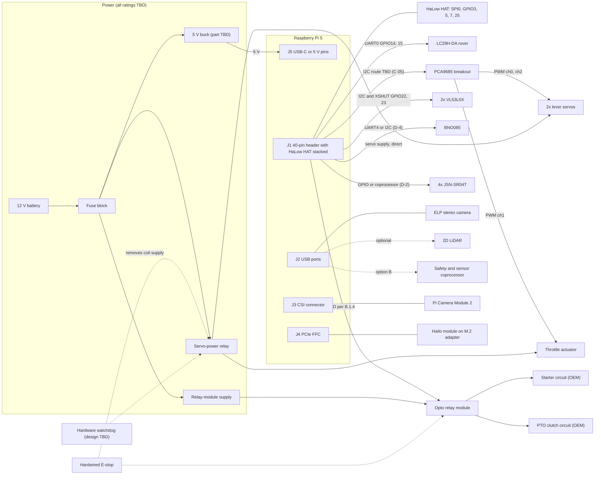
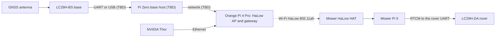
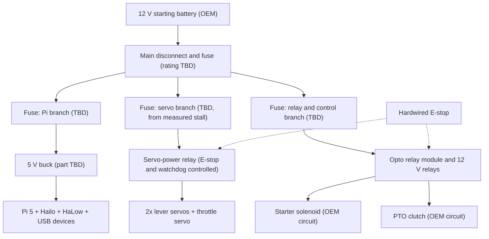
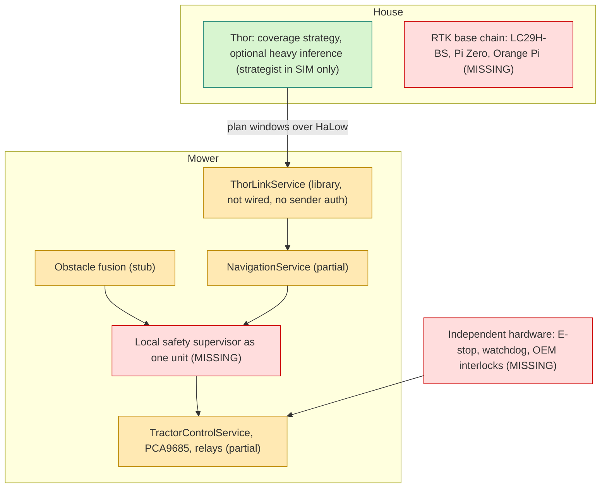
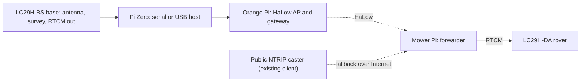
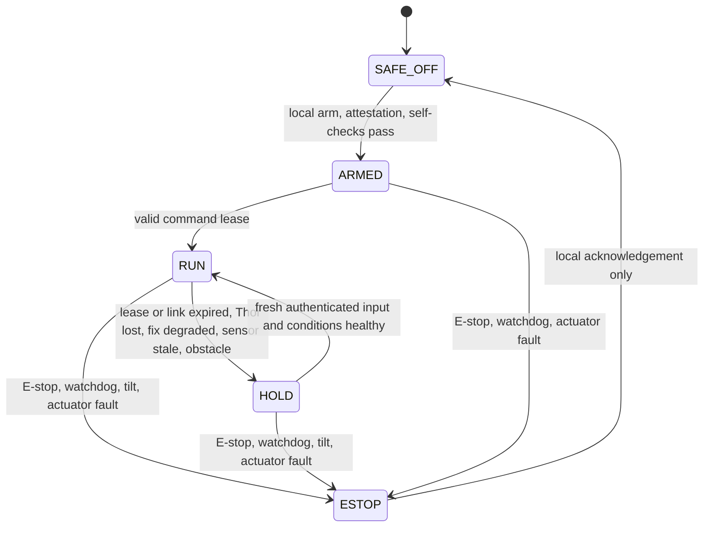
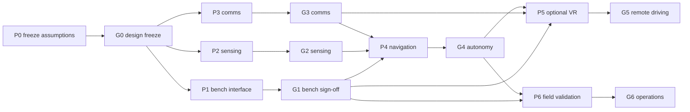

# LawnBerry-pi integration audit — 2026-10-24

**Status:** audit and engineering plan. It is **not** an as-built record and it authorises no powered actuation.
Everything below is traceable to a file in the repository, to a read-only inspection of the deployed Pi, or to the
owner's requirement documents. Anything that is none of those is marked `TBD` (needs a measurement) or `[DS]`
(general datasheet knowledge, not evidenced in this repository; bench-confirm before relying on it).

## Contents

- [0. Scope, baseline and conventions](#0-scope-baseline-and-conventions)
- [Part A. Subsystem status matrix](#part-a-subsystem-status-matrix) (A.1 to A.15)
- [Part B. Phase 3 hardware deliverables](#part-b-phase-3-hardware-deliverables) (B.1 to B.7)
- [Part C. Phase 4 distributed AI and navigation architecture](#part-c-phase-4-distributed-ai-and-navigation-architecture)
- [Part D. Phase 5 safety review](#part-d-phase-5-safety-review)
- [Part E. Prioritised development plan (P0 to P6)](#part-e-prioritised-development-plan-p0-to-p6)
- [Part F. Remaining hardware conflicts and unresolved safety requirements](#part-f-remaining-hardware-conflicts-and-unresolved-safety-requirements)
- [Appendix. Gap register index (H-01 to H-28)](#appendix-gap-register-index-h-01-to-h-28)
- [Implemented in this PR](#implemented-in-this-pr)

## 0. Scope, baseline and conventions

### 0.1 Baseline

| Item | Value |
|---|---|
| Repository baseline | `origin/main` at `765c737` (branch `audit/docs` adds documentation only) |
| Deployed Pi | host `pi5`, checkout `/apps/lawnberry-pi` at `23a6e4d`, kernel `6.12.21-morse+`; **read-only inspection on 2026-10-24**, nothing written, no actuator driven, no hardware config changed |
| Requirement documents | draft PR #18, branch `docs/2026-10-24-hardware-architecture-audit`: `docs/OMP-THOR-HANDOFF-2026-10-24.md`, `docs/2026-10-24-physical-integration-plan.md`, `docs/2026-10-24-development-roadmap.md`, `docs/2026-10-24-compatibility-gap-register.md`. They are **not on this branch**; they are cited by file name and treated as proposed requirements, not as evidence of implementation |
| Gap IDs | **H-01 … H-28** are the register's IDs; **H-02b** and **H-02c** are sub-findings of H-02 introduced here (C-02, C-03). Findings the register does not contain carry **N-01 … N-31** (section A.15); they are proposed additions to the register. Conflicts are **C-xx** (B.1), measurements **M-xx** (B.7), owner decisions **D-n** and safety decisions **SD-n** (B.1.4, F.3), requirements **R-Pnn** (B.3), work packages **WP-Pn-nn** and sign-off gates **G0 … G6** (Part E). The gap register index is in the [Appendix](#appendix-gap-register-index-h-01-to-h-28) |
| Test baseline | `SIM_MODE=1 pytest tests --ignore=tests/soak -p no:cacheprovider`: **530 passed, 69 skipped, 0 failed** (collection: 600 items including 1 soak test). Parallel implementation branches (`audit/checker`, `audit/safety`, `audit/thorlink`) are **not** reflected in the statuses below; the integrator records what landed under [Implemented in this PR](#implemented-in-this-pr) |

### 0.2 Status vocabulary

| Status | Meaning in this document |
|---|---|
| **IMPLEMENTED** | Code exists, is wired to its consumer and has at least one test that exercises it (SIM or hardware). It does **not** mean verified on the machine unless the row says "live" or cites a measurement |
| **PARTIALLY IMPLEMENTED** | Exists, but part of the behaviour, wiring, configuration or test coverage is missing or contradicted |
| **SIMULATED** | Behaviour exists only under `SIM_MODE` or against fakes; no hardware effect |
| **STUBBED** | Placeholder that returns constants or sets flags with no hardware path |
| **MISSING** | No code, configuration or document for the capability |
| **UNVERIFIED** | Claimed in documents or configuration; no evidence either way |

### 0.3 Evidence tags

- **LIVE** = read-only inspection of the deployed Pi on 2026-10-24 (`/boot/firmware/config.txt`, decoded
  `halow-dw.dtbo`, `/sys/kernel/debug/pinctrl`, `gpioinfo`, `lspci`, `lsusb`, `ls /dev`, `ip`, `systemctl`).
  The `pinctrl` CLI was not installed (pin states came from debugfs and `gpioinfo`) and `i2cdetect` was
  deliberately not run. Absence of a device at this site is **not** proof of a design error: most sensors are
  detached there.
- **[DS]** = datasheet or general engineering knowledge, not evidenced in this repository.
- **[INF]** = inference from reading code; not executed.
- **TBD** = unknown; a measurement in B.7 closes it.
- Test counts in parentheses are the passing tests the audit counted for that file. Every passing test named here
  runs on fakes or `SIM_MODE`; none demonstrates a physical outcome.
- **Citations.** `file:line` references are against baseline `765c737`. Documents this PR itself edits (`README.md`,
  `hardware.md`, `docs/hardware-feature-matrix.md`, `docs/hardware-overview.md`, `docs/servo-hat-pins.md`,
  `docs/tractor-platform.md`, `docs/tractor-acceptance-criteria.md`, `docs/field-validation-protocol.md`,
  `docs/RELEASE_NOTES.md`, `docs/ultrasonic-wiring-guide.md`) are cited by section because their line numbers moved.
  Files other branches may change (`spec/hardware.yaml`, `scripts/check_hardware_pin_conflicts.py`,
  `docs/hardware-integration.md`, `backend/src/**`) keep their baseline line numbers.

### 0.4 Release gates carried over from the gap register

1. **No live motion** while H-01 to H-08 are unresolved.
2. **No autonomous mowing** until sensor and RTK health, a physical fail-safe, operator protections and field
   acceptance are proven.
3. **No remote VR driving** until authentication, a dead-man input, measured latency and a local safety override
   are proven.

State of the gates at this baseline: **all three are closed** (see Part F).

## Part A. Subsystem status matrix

### A.1 Backend services and drivers

| Subsystem | Status | Evidence (file:line) | Tests | Gap IDs |
|---|---|---|---|---|
| Application lifespan wiring | PARTIALLY IMPLEMENTED | `backend/src/main.py:67-201`. Tractor service, watchdog and tilt monitor start only if `tractor.enabled` (`:144-170`, shipped `false`); an exception anywhere in that block is logged and swallowed (`:169-170`) while `/api/v2/tractor/*` stays routed (N-05). `ThorLinkService` is never instantiated (no import in `main.py`). Teardown (`:184-201`) stops the monitors and the RoboHAT service but never parks the tractor (N-09) | `tests/unit/test_tractor_safety_monitor.py` | H-08, H-12, H-13 |
| Sensor manager | PARTIALLY IMPLEMENTED | `backend/src/services/sensor_manager.py`: IMU interface `:166-225` (ONLINE only on an I2C ACK at 0x4A/0x4B, `:186-190`), ToF `:228-`, stereo `:795-850`, ultrasonic gating `:858-886` | `tests/unit/test_sensor_presence.py`, `test_sensor_manager_ultrasonic.py` | H-02, H-03 |
| GPS driver (ZED-F9P, LC29H-DA, Neo-8M) | IMPLEMENTED (driver); the fitted receiver is UNVERIFIED | `backend/src/drivers/sensors/gps_driver.py`; modes `F9P_USB`, `F9P_UART`, `NEO8M_UART`, `LC29H_UART` (`backend/src/models/sensor_data.py:37-43`). NMEA only: no LC29H `PAIR`/`PQTM` configuration exists anywhere in `backend/`, `scripts/` or `config/` | `tests/unit/test_gps_driver.py` (5), `test_gps_config_fallback.py` | H-09 |
| BNO085 IMU driver | **STUBBED** | `backend/src/drivers/sensors/bno085_driver.py:1-9` ("simulation stub"), `:69-78` returns zeros and constants on real hardware; presence is decided by an I2C ACK, not by the driver (`sensor_manager.py:186-190`) | none exercises hardware | H-03, N-06 |
| VL53L0X ToF driver (x2) | PARTIALLY IMPLEMENTED | `backend/src/drivers/sensors/vl53l0x_driver.py:262-300` (XSHUT pair addressing), boot hook `backend/src/main.py:78-107`. The interrupt pins (GPIO6, GPIO12) are read by no code. Header I2C is absent on the deployed Pi | `tests/unit/test_sensor_presence.py`; `tests/contract/test_tof_sensors.py` is a skipped placeholder | H-03, H-17 |
| Ultrasonic driver (3x HC-SR04) | PARTIALLY IMPLEMENTED; disabled by configuration | `backend/src/drivers/sensors/ultrasonic_driver.py:80-84` (GPIO4/17, 27/10, 11/9); `config/limits.yaml:17`; fail-closed gating `sensor_manager.py:871-886` | `tests/unit/test_ultrasonic_driver.py` (10), `test_sensor_manager_ultrasonic.py` (SIM, asserts three sensors) | H-02, H-10, H-19 |
| **JSN-SR04T x4** | **MISSING** | No driver, configuration, model or test. `UltrasonicData` is three HC-SR04 values (`backend/src/models/mower_data_frame.py:104-110`) | none | H-10, H-19 |
| BME280, INA3221, Victron | PARTIALLY IMPLEMENTED | `backend/src/drivers/sensors/bme280_driver.py`, `ina3221_driver.py` (CH1 solar, CH3 battery: `:3-6,101`); Victron via the `victron-ble` CLI (`docs/victron-ble-integration.md`, `config/hardware.yaml:34-42`). Header I2C absent on the deployed Pi | `tests/contract/test_ina3221.py`, `tests/unit/test_power_sensor_interface.py` | H-17, N-12 |
| Stereo camera driver | IMPLEMENTED (capture only) | `backend/src/drivers/sensors/stereo_camera_driver.py:40-79` (2560x960 split into 1280x960 per eye; SIM synthetic frames). LIVE: a UVC camera `32e4:9750` enumerates | `tests/unit/test_stereo_camera_driver.py` (4) | H-16, H-26 |
| Camera stream service | IMPLEMENTED (live) | `backend/src/services/camera_stream_service.py`, `systemd/lawnberry-camera.service`, `docs/pi5-csi-camera-libcamera-status.md`. LIVE: `lawnberry-camera` active, imx219 on the RP1 CFE | `tests/unit/test_camera_stream_service.py`, `test_camera_ai.py` | H-17 |
| Hailo driver and inference | IMPLEMENTED (SIM and hardware path) | `backend/src/drivers/ai/hailo_driver.py:55-80` (`detector` = YOLO26 and `scdepthv3` = monocular depth models), `yolo26.py`, `backend/src/services/camera_stream_service.py:899-1034`, `backend/src/services/ai_inference_service.py`. `docs/autonomy-toolchain-matrix.md:87`: `hailortcli benchmark` on the Pi, HailoRT 4.24.0, yolo26s 41.7 FPS. LIVE: `/dev/hailo0` | `tests/unit/test_hailo_driver_lifecycle.py` (4), `test_ai_inference_service.py`, `test_camera_ai.py`, `test_ai_navigation_loop.py` (3); `test_yolo26_decode.py` (1 skipped, no cv2) | H-17 |
| Tractor control service | PARTIALLY IMPLEMENTED | `backend/src/services/tractor_service.py`: levers `:176-203`, blade `:218-231`, engine `:233-256` (no engine-run sensor, `:248`), e-stop `:258-288`. State fields are commanded values, not feedback | `tests/unit/test_tractor.py` (16), `test_tractor_navigation.py` | H-06, H-08, H-21, N-26 |
| Tractor actuators | PARTIALLY IMPLEMENTED | `backend/src/drivers/actuators/tractor_actuators.py`: `ServoActuator` `:42-77` (updates `_us`/`_value` before the write, `:65-69`), `RelayActuator` `:80-125` (gpiozero `OutputDevice(initial_value=False)` `:102`, silent fallback to simulation `:104-108`, unguarded `set` `:111-115`, starter `pulse` with `finally` `:117-124`) | `tests/unit/test_tractor.py` | H-02b, H-21, N-27 |
| PCA9685 driver | PARTIALLY IMPLEMENTED | `backend/src/drivers/actuators/pca9685_driver.py:47-171`: raw smbus2. An absent chip degrades to a silent no-op (`:117-126,155-156`, N-07); a write fault propagates once the chip was seen (`:170-171`). `MODE2 = 0x04` (`:57,111`). `MODE1` is written `0x30` then `0x20` (`:108-112`), which clears the ALLCALL bit [DS]. No `OE` handling, no read-back, no timeout on the thread write (N-28) | `tests/unit/test_pca9685_driver.py` (8) | H-04, H-08 |
| Tractor safety monitor and watchdog | PARTIALLY IMPLEMENTED | `backend/src/safety/tractor_safety_monitor.py:82-115` (20 Hz; feeds the heartbeat unconditionally at `:87`; the tilt edge calls `engage_blade(False)` once, `:103-112`; IMU loss returns silently, `:37-47,98-100`); `backend/src/safety/watchdog.py:54-69` (one-shot: `break` after the first timeout) | `tests/unit/test_tractor_safety_monitor.py` (9), `tests/contract/test_watchdog.py` | H-08, N-04, N-06 |
| RoboHAT service | PARTIALLY IMPLEMENTED (differential-drive platform only) | `backend/src/services/robohat_service.py`: `_maintain_usb_control` re-sends the last PWM every about 0.9 s (`:246-269`, N-14); `emergency_stop` `:441-459`; `shutdown` `:501-` | `tests/unit/test_robohat_service_usb_control.py` | H-08, H-11 |
| RoboHAT JSON driver | STUBBED (not used by the service; protocol mismatch) | `backend/src/drivers/motor/robohat_rp2040.py:84-134` sends JSON `MOTOR_COMMAND`/`EMERGENCY_STOP`; the firmware parser accepts a text protocol (`robohat-rp2040-code/code.py:186-225`) | `tests/unit/test_robohat_rp2040_driver.py` (fake) | H-11 |
| Blade service and IBT-4 driver | **STUBBED** | `backend/src/drivers/blade/ibt4_gpio.py:25-50` (`setup`/`set_active` only set flags; no GPIO library imported). `BladeService.emergency_stop` (`backend/src/services/blade_service.py:46-55`) and `IBT4BladeDriver.set_estop` (`ibt4_gpio.py:103-106`) have no callers (N-03) | `tests/unit/test_ibt4_blade_driver.py` (flags only) | H-02c, H-08 |
| Motor service | PARTIALLY IMPLEMENTED | `backend/src/services/motor_service.py:409-419` command-timeout handler; `control_drive_v2` does not use it (`backend/src/api/rest.py:310-417` calls `robohat.send_motor_command` directly) | none for the REST path | H-08, N-14 |
| Navigation service | PARTIALLY IMPLEMENTED | `backend/src/services/navigation_service.py`: `ObstacleDetector` `:33-82`, `execute_mission` `:175-238` (auto-crank `:188-195`), `go_to_waypoint` `:240-372`, `apply_ai_prediction` `:818-860` | `tests/unit/test_tractor_navigation.py`, `test_return_to_home.py`, `tests/test_nav_*.py` | H-06, H-23, H-26, N-08, N-11 |
| Mission API and service | PARTIALLY IMPLEMENTED | `backend/src/api/mission.py:9-90` (create, start, pause, resume, abort, status, list; no auth dependency), `backend/src/services/mission_service.py` | `tests/test_mission_api.py` | H-14, N-16 |
| Teleop capture and Thor uploader | IMPLEMENTED (software); the Pi capture session was blocked | `backend/src/services/capture_service.py`, `backend/src/services/thor_uploader.py`, `scripts/teleop.py`; `docs/autonomy-toolchain-matrix.md:76` | `tests/unit/test_capture_service.py`, `test_thor_uploader_config.py` | H-16 |
| Sensor-manager systemd unit | **STUBBED** | `systemd/lawnberry-sensors.service:16-17`: `ExecStart` is `echo "...placeholder..." && sleep infinity`. Sensors actually run inside the backend process | none | N-20 |

### A.2 Firmware

| Subsystem | Status | Evidence | Tests | Gap IDs |
|---|---|---|---|---|
| RoboHAT RP2040 firmware (CircuitPython) | IMPLEMENTED for the differential-drive platform; UNVERIFIED on hardware (no RP2040 enumerates at this site) | `robohat-rp2040-code/code.py`: text protocol `pwm,<steer>,<throttle>`, `rc=enable`/`rc=disable`, `blade=...`; hardware watchdog 8 s with RESET (`:98-101`); USB silence of 2 s falls back to RC mode (`:105-107,305-309`); RC signal loss for 1 s centres the outputs (`:111,315-322`); RC channel-5 stop (`:326-336`) is evaluated **only inside `if rc_enabled`** (`:312`), i.e. not while the Pi holds USB control | host side only (`tests/unit/test_robohat_*`); no firmware tests | H-08, H-11 |
| MDDRC10 input state during a firmware WDT reset | UNVERIFIED | TBD: scope the steer/throttle pins during an induced reset (M-23) | none | H-08 |
| Toro platform firmware | MISSING | `code.py` drives GP10/GP11 servo PWM, GP12 blade PWM, GP13 mode, GP8/9 encoder, GP2-7 RC inputs (`:4-7,58-59,72-77,90-91,95`). There is no PCA9685, relay or tractor path in firmware | none | H-11 |
| Safety / sensor coprocessor firmware | MISSING (design option, B.1.4 option B) | no code | none | H-08, H-19 |

### A.3 Hardware configuration (repository and deployed Pi)

| Subsystem | Status | Evidence | Tests | Gap IDs |
|---|---|---|---|---|
| `spec/hardware.yaml` | PARTIALLY IMPLEMENTED; internally contradictory; no platform tag | Mixed registry: mower sections plus a `tractor:` block (`:94-133`). Pin 32 is booked twice (ToF-R interrupt `:142`, BNO085 TX `:144`); BNO085 RX is `rxd: 4` on pin 33 (`:143`). INA3221 `channel_1` battery / `channel_3` solar (`:61-70`) is the reverse of the driver (N-12). GPS ZED-F9P preferred (`:9-12`). Hailo recorded as "Hailo-8 AI Hat" (`:37`). UART1 RoboHAT 38400 (`:155`) vs USB CDC 115200 (`docs/servo-hat-pins.md` section 2). `i2c_addresses` (`:146-151`) omits 0x41, 0x4A/0x4B and 0x70 | none loads it | H-03, H-09, H-11 |
| `config/hardware.yaml` | PARTIALLY IMPLEMENTED (mower) | LC29H-DA on `/dev/ttyAMA0` (`:8-11`) contradicts the spec; INA3221 shunt comments (`:29-33`); a Victron MAC (`:37`, device identification, no key); ToF bus 1 (`:21`) | `tests/unit/test_config_loader.py` | H-09, H-17 |
| `config/tractor.yaml` | PARTIALLY IMPLEMENTED; shipped disabled | `enabled: false` (`:11`; LIVE identical); PCA9685 0x41, bus 1 (`:17-18`); relays BCM5 and BCM26 (`:31,36`); microsecond endpoints are illustrative (`:22-27`); "no clutch/brake pedal" (`:38-39`) contradicts the parking brake at PARK (`docs/tractor-platform.md`, "Physical integration decisions" item 2); PTO "latching" (`:32`) vs the owner-reported momentary switch | none | H-12, H-21 |
| `config/limits.yaml` | PARTIALLY IMPLEMENTED | `ultrasonic_enabled: false` (`:17`; LIVE identical), `estop_latency_ms: 100` (`:4`), `watchdog_timeout_ms: 1000` (`:10`); the comment at `:16` "Trigger e-stop if any sensor reads below this" is false (N-19) | `tests/unit/test_config_loader.py`; `scripts/validate_safety_config.py` | H-02, H-08 |
| Deployed boot configuration (unversioned) | UNVERIFIED in the repository | LIVE `/boot/firmware/config.txt`: `dtparam=i2c_arm=off` (`:23`), `dtoverlay=halow-dw`, `dtoverlay=spi0-1cs`, `enable_uart=1`, `dtparam=pciex1_gen=3`, a `dwc2` overlay, `device_tree=bcm2712-rpi-5-b-morse.dtb`, `kernel=kernel_2712-morse.img`; HaLow pin comments at `:20-31`; **no `uart4-pi5`**. Nothing in the repository versions this file | none | H-02, H-17, H-25 |
| Deployed application configuration | IMPLEMENTED (matches repo) | LIVE `/apps/lawnberry-pi/config/tractor.yaml` and `limits.yaml` identical to the repository; no `config/hardware.local.yaml`, no `.env` | none | H-12 |

### A.4 GPIO and buses

| Subsystem | Status | Evidence | Tests | Gap IDs |
|---|---|---|---|---|
| Pin and address conflict checker | PARTIALLY IMPLEMENTED | `scripts/check_hardware_pin_conflicts.py:53-87` compares only `pins.gpio_used[].gpio`, `config/tractor.yaml relays.*.gpio`, `pins.i2c_addresses` and the tractor PCA9685 address. Rows without a `gpio` key are skipped (`:57-59`); the self-test asserts that rxd/txd rows must not collide (`:129-141`). It never reads HaLow, overlays, `config/hardware.yaml`, `limits.yaml` or physical pin numbers. What-if probes by the audit: moving the starter to GPIO17 or GPIO3 reports nothing | inline `--self-test` only; no file in `tests/` references it | H-01, H-02, H-03 |
| hardware-guard workflow | PARTIALLY IMPLEMENTED; enforces a documented error | Baseline `.github/workflows/hardware-guard.yml:14-59`; the INA3221 step (baseline `:54-59`) requires CH1 = Battery and CH3 = Solar, the reverse of the driver. Rewritten after the baseline: it now runs the pin checker, its self-test and the guard tests, and its `! grep` / `&&` lines were fixed so each check really fails the step (review T-02) | `tests/unit/test_hardware_guard_workflow.py` (runs the real steps under `bash -e` against crafted bad manifests) | N-12, N-22 |
| Header I2C1 on the deployed Pi | **MISSING (disabled)** | LIVE `dtparam=i2c_arm=off`; `/dev/i2c-1` absent (only `i2c-11` = RP1 CSI bus with the imx219 at 0x10, `i2c-13`, `i2c-14` = HDMI DDC) | none | H-02, H-17, H-25 |
| UART0 (GNSS) | IMPLEMENTED (device present) | LIVE `/dev/ttyAMA0`, GPIO14/15 alt4 `uart0`; receiver behind it unverified | `tests/unit/test_gps_driver.py` (SIM) | H-09 |
| UART4 (BNO085) | **MISSING** | LIVE no `uart4-pi5` overlay and no `/dev/ttyAMA4`. `docs/hardware-integration.md` (baseline line 116) says `dtoverlay=uart4`; the Pi's overlay README documents `uart4` as BCM2711-only (GPIO8-11) and `uart4-pi5` as GPIO12-13 (N-13) | none | H-03, N-13 |
| SPI0 and the HaLow radio | IMPLEMENTED (live) | LIVE `halow-dw` + `spi0-1cs`; GPIO8-11 SPI0, GPIO25 IRQ, GPIO5 RESET, GPIO3 WAKE, GPIO7 BUSY | none | H-02, H-17 |
| ToF XSHUT (GPIO22/23) | PARTIALLY IMPLEMENTED | LIVE `lgpio` holds GPIO22 LOW and GPIO23 HIGH; the addressing sequence cannot reach the sensors without an I2C bus | none | H-17 |
| HaLow claims in the pin registry | Baseline **MISSING**; now PARTIALLY IMPLEMENTED | HaLow was absent from `spec/hardware.yaml` at the baseline. The checker branch added 15 `HaLow HAT ...` rows to `pins.gpio_used` (RESET_N, SPI_INT, SPI0 CS0/MISO/MOSI/SCLK, WAKE, BUSY, TRST, RGB x3, UART TX/RX, BUTTON): 6 `verified`, 2 `documented`, 7 `unverified` (the unverified ones only warn, M-02) | `tests/unit/test_hardware_pin_conflicts.py` | H-02, H-17 |
| Hardware self-test | PARTIALLY IMPLEMENTED; unsafe on this Pi | `backend/src/services/hw_selftest.py:36-41,192-255`, route `backend/src/api/routers/maintenance.py:62-69` (N-18) | none | H-02 |

### A.5 Electrical and power

| Subsystem | Status | Evidence | Tests | Gap IDs |
|---|---|---|---|---|
| Servo supply rail | UNVERIFIED; documents contradict | 12 V (`hardware.md` Actuation; `docs/tractor-platform.md` introduction) vs 24 V (`docs/hardware-overview.md`, `docs/tractor-acceptance-criteria.md`, `docs/RELEASE_NOTES.md`, `docs/field-validation-protocol.md`, `docs/servo-hat-pins.md`; **superseded notes added in this PR**). Owner-reported: two matching 150 kg·cm-class servos at nominal 10-12.6 V, possibly 8 A or more stall (not bench-verified) | none | H-05, H-20 |
| Fuses, wire gauges, stall-current budget | **MISSING** | `hardware.md` lists only "inline fuse holders + assorted fuses, 12 AWG, 4-pack" and 14 AWG primary wire; no rating, no per-branch gauge, no budget anywhere in the repository | none | H-20 |
| Independent hardwired E-stop | **MISSING** | No hardware input in code or configuration; `backend/src/safety/estop_handler.py:5-7` ("Hardware GPIO integration will be added later"); `spec/hardware.yaml:87` is a flag with no pin. `hardware.md` (Safety) lists a mushroom button but no circuit | `tests/integration/test_safety_systems.py:14-29` measures a Python flag flip | H-07, H-08 |
| PCA9685 `OE` / servo-power cut | **MISSING** | No `OE` GPIO anywhere (`config/tractor.yaml`, `spec/hardware.yaml`, code); `pca9685_driver.py:21-23`, `docs/tractor-platform.md` (PCA9685 paragraph). The 74HC123 watchdog (`hardware.md` Safety) is a BOM line with "any free GPIO" unassigned | none | H-04, H-08 |
| Relay modules (starter, PTO) | UNVERIFIED | `hardware.md` (Engine and implement): GPIO to opto module to Bosch-style relay; trigger polarity, boot-time state, pull configuration, flyback and contact ratings unknown; software assumes `active_high: true` (`config/tractor.yaml:31,36`) | `tests/unit/test_tractor.py` (fakes) | H-21, H-02b |
| Power monitor (INA3221) | PARTIALLY IMPLEMENTED | `backend/src/drivers/sensors/ina3221_driver.py:3-6,101`; which shunt carries which current is unmeasured (N-12) | `tests/contract/test_ina3221.py` | H-17 |
| Pi 5 V supply | UNVERIFIED | DROK 9-36 V to 5.2 V module (`hardware.md` Power) vs Pololu D24V50F5 (`docs/hardware-overview.md`); neither load-tested. LIVE single idle sample: `vcgencmd get_throttled = 0x0`, `EXT5V_V = 5.13 V` | none | H-17 |
| Grounding and isolation | **MISSING** | No document defines the ground topology (Pi, PCA9685, servo supply, relay supply, sensors) | none | H-20 |
| Battery and charging | UNVERIFIED | mower: 12.8 V 30 Ah LiFePO4 + 30 W solar (`spec/hardware.yaml:47-60`); Toro: the 12 V starting battery and an unmeasured charging stator (`docs/hardware-overview.md` Power) | none | H-05 |

### A.6 AI and navigation

| Subsystem | Status | Evidence | Tests | Gap IDs |
|---|---|---|---|---|
| VLA policy (37M parameters) on the Hailo | UNVERIFIED | Claimed in the README; the repository holds no throughput or accuracy measurement of the policy on the Pi. The only measured Hailo figure is detector throughput (`docs/autonomy-toolchain-matrix.md:87`). Performance tests are gated by `RUN_PERF_TESTS` | 15 + 1 perf tests skipped | H-23 |
| AI inference loop and action mapping | PARTIALLY IMPLEMENTED | `backend/src/services/ai_inference_service.py:494-504` sets `safety_override` when `min_distance_cm < 30`; `backend/src/services/navigation_service.py:735-760` (AI loop) and `:835-860` (`apply_ai_prediction`: override calls `tractor.emergency_stop()` at `:845-849`). `to_tractor_command()` reuses the differential mix; the twin-lever mixing is an open item (`docs/tractor-platform.md`, Configuration section) | `tests/unit/test_ai_inference_service.py`, `test_ai_navigation_loop.py` (3) | H-23, N-25 |
| Local coverage and path planning | IMPLEMENTED (unit) | `backend/src/nav/coverage_planner.py`, `coverage_patterns.py`, `path_planner.py`, `obstacle_avoidance.py:83` (`plan_path_astar`), `geofence_validator.py`, `zone_coverage.py` | `tests/test_nav_*.py`, `tests/unit/test_coverage_planner_angle.py` | H-26 |
| EKF and odometry | IMPLEMENTED (unit) | `backend/src/nav/odometry.py` | `tests/unit/test_ekf.py` (4), `test_odometry.py` | H-26 |
| Mission execution | PARTIALLY IMPLEMENTED | `navigation_service.py:175-238`: RTK fix quality is not a start precondition; the waypoint loop polls mission status only (`:265-284`); the tractor path re-asserts `blade_engaged` every 0.2 s tick (`:354-371`) | `tests/unit/test_tractor_navigation.py` | H-23, N-06, N-08 |
| Obstacle model and fusion | **STUBBED** | `navigation_service.py:33-82`: ToF only (distance < 1000, unit assumed mm and unchecked against the metres in `limits.yaml`), `Position(0, 0)` placeholder (`:51,64`), constant confidence 0.8, `is_path_clear` returns False on any hit and is not called by the mission loop; `go_to_waypoint` (`:240-372`) never reads obstacle state | `tests/contract/test_sensor_fusion.py` skipped placeholder | H-26, N-11 |
| Stereo depth / disparity | **MISSING** | No `StereoSGBM`, `reprojectImageTo3D` or calibration code. `stereo_depth` is never filled (`backend/src/models/mower_data_frame.py:174`); `backend/src/services/perimeter_recorder.py:510-511` reads a `.depth` attribute the driver never sets. Monocular `scdepthv3` HEF support exists (`hailo_driver.py:63,77`) and is unevaluated | none | H-16, H-26 |
| 2D LiDAR | **MISSING** | No driver, configuration, model or document beyond the requirement; no model selected | none | H-15, H-26 |
| ROS 2 / Nav2 | **MISSING** | No `rclpy`, `nav2` or `ros2` code, dependency or configuration anywhere in `pyproject.toml`, `backend/`, `scripts/`, `config/` | none | H-26 |
| Thor coverage strategist | IMPLEMENTED (SIM) | `backend/src/nav/thor_strategist.py:73-262` (boustrophedon plan, no-go zones, replans from uplink detections, pauses unless the fix is `rtk_fixed`, resume) | `tests/unit/test_thor_strategist.py` (4; more than 97 % coverage on a synthetic 60 x 40 m yard) | H-23 |
| Detector output to the Thor uplink | **MISSING** | `ThorLinkService(build_uplink=None)` sends an empty `Uplink` (`backend/src/services/thor_link_service.py:57,150`); nothing builds an uplink from GPS or detections | none | H-23 |
| Manual teleop (keyboard) | IMPLEMENTED | `scripts/teleop.py:36-37` (20 Hz, client-side dead-man 0.25 s, `--confirm-supervised`, REST `/api/v2/tractor/command`); the server has no dead-man (N-14) | none | H-14, H-16 |
| VR stereo streaming and head tracking | **MISSING** | No head tracking, pan/tilt, WebXR or stereo stream endpoint; `camera_stream_service.py` has no stereo path | none | H-16 |
| Agent bridge (PR #16, PR #17) | status only | PR #16: draft, one documentation file. PR #17 `feat/agent-bridge-omp`: draft, 62 files under `tools/agent_bridge/**`, not merged, nothing under `backend/` | not run | H-27 |

### A.7 RTK and GNSS

| Subsystem | Status | Evidence | Tests | Gap IDs |
|---|---|---|---|---|
| Rover: u-blox ZED-F9P | IMPLEMENTED (driver); UNVERIFIED on hardware | `gps_driver.py` (`F9P_USB`, `F9P_UART`); `spec/hardware.yaml:9-12` "preferred"; LIVE: no `/dev/ttyACM*` | `tests/unit/test_gps_driver.py` (5, SIM) | H-09 |
| Rover: Quectel LC29H-DA | PARTIALLY IMPLEMENTED | NMEA path only: `gps_driver.py:77-81`, `backend/src/models/hardware_config.py:74,120-122`, `backend/src/services/websocket_hub.py:98-99`, `config/hardware.yaml:8-11`. No `PAIR`/`PQTM` configuration; no LC29H-specific test | `tests/unit/test_gps_config_fallback.py` | H-09 |
| Base: Quectel LC29H-BS | **MISSING** | Zero hits for `LC29H-BS`, base survey-in or RTCM base-mode handling in `backend/`, `scripts/`, `config/` | none | H-09, H-22 |
| Pi Zero RTK base host | **MISSING** | No code or document in the repository; owner's candidate topology only | none | H-22 |
| Orange Pi 4 Pro HaLow AP / gateway | UNVERIFIED in the repository | Documented as the AP (192.168.1.140, HT-HC01P on SPI3) in `docs/autonomy-toolchain-matrix.md:47-69`; its units live on that host. `halow-link-watch` is the only HaLow unit versioned here | none | H-22 |
| NTRIP forwarder | IMPLEMENTED (client to serial) | `backend/src/services/ntrip_client.py:35-300` (caster to serial RTCM, GGA keepalive, backoff); configured through `.env`, which is absent on the deployed Pi. Serves a public caster only; there is no local base source | no dedicated test file | H-22 |
| GPS degradation handling | PARTIALLY IMPLEMENTED | `backend/src/nav/gps_degradation.py:22-35`: AUTONOMOUS to MANUAL in the in-memory `RobotState` when accuracy is above 5 m or the fix is older than 10 s; no actuator-level stop | `tests/unit/test_gps_degradation.py` | H-09 |
| Correction age and fix-transition handling | **MISSING** | No correction-age metric consumed by navigation; the Thor strategist pauses on a non-fixed position but is not wired | none | H-09 |
| RTK diagnostics | PARTIALLY IMPLEMENTED | `scripts/diagnose_gps_rtk.py`, `scripts/rtk_diagnostics_watch.py` (ZED-oriented; not run by the audit) | none | H-09 |

### A.8 Communications

| Subsystem | Status | Evidence | Tests | Gap IDs |
|---|---|---|---|---|
| HaLow link operations | IMPLEMENTED (operations); measured at two locations | `scripts/halow_link_watch.sh`, `systemd/halow-link-watch.{service,timer}`, `systemd/install_services.sh:34-39,66`. `docs/autonomy-toolchain-matrix.md:30-70`: Pi to Thor 2026-10-06 TCP 4.79 / 4.61 Mbit/s, 50 pings at 5 Hz 0 % loss, RTT 7.3 / 18.0 / 73.2 ms (min / avg / max); Pi to AP 2026-10-13 TCP 4.84 / 5.17 Mbit/s, 30-minute soak 0 % loss. LIVE `halow0` was DOWN at audit time (traffic via `eth0` and `tun0`) | none | H-16, H-17, H-22, H-23 |
| HaLow recovery (power cycle, driver reload, Pi reboot) | UNVERIFIED | Same document: "A real HaLow drop and a Pi reboot were not exercised"; a stopped backend once took the radio down (`:76`); the AP radio vanished after a TX-cap change (`:49`) | none | H-23 |
| Pi-Thor link protocol | IMPLEMENTED (protocol) | `backend/src/models/thor_link.py:22-113`: v1, JSON over UDP, 1200 B cap, 10 Hz uplink, waypoint windows of up to 16 | `tests/unit/test_thor_link.py` (8) | H-13, H-23 |
| Pi-side Thor link service | PARTIALLY IMPLEMENTED; **not wired** | `backend/src/services/thor_link_service.py:49-172`; instantiated only in tests; `current_plan()` (`:115-117`) has no consumer; LIVE no listener on UDP 47101 | `tests/unit/test_thor_link.py` (includes a loopback UDP round trip) | H-13, H-23, N-15 |
| Link authentication and integrity | **MISSING** | `_on_datagram` ignores the source address (`:98-110`); the socket binds `0.0.0.0:47101` (`:54`); no key, HMAC, nonce or source check | none | H-13, H-14, N-15 |
| Replay and stale-plan protection | PARTIALLY IMPLEMENTED | `seq <= _last_rx_seq` drop (`:106-107`); no epoch, plan age or `start_index` check; one datagram with a very large `seq` makes every later legitimate datagram look reordered until the Pi restarts | `tests/unit/test_thor_link.py` (duplicate case) | H-13, N-15 |
| Link-loss to safe hold | IMPLEMENTED (software, fake clock) | `_evaluate_hold` (`:132-145`): `timeout_s = 0.5`, blade off then levers neutral, non-revoking; `tick` swallows exceptions (`:121-130`), so `safe_hold` can read true while actuation failed | `tests/unit/test_thor_link.py` | H-08, H-23 |
| Retransmission and acknowledgement | MISSING | Uplink is fire-and-forget; the Thor re-sends waypoint windows on each uplink (implicit) | none | H-13 |
| REST and WebSocket API | IMPLEMENTED | `backend/src/main.py:227-247` (prefix `/api/v2`); `/ws/telemetry` and `/ws/control` under `/api/v2/` and as legacy root routes (`backend/src/api/rest.py:34-36`); `/ws/control` drains and acknowledges only (`backend/src/api/routers/telemetry.py:175-206`) | `tests/contract/*`, `tests/integration/*` | H-14 |

### A.9 Security

| Subsystem | Status | Evidence | Tests | Gap IDs |
|---|---|---|---|---|
| Operator authentication | PARTIALLY IMPLEMENTED; **disabled in the shipped and deployed unit** | `backend/src/api/deps.py:33-57` (code default is on); `systemd/lawnberry-backend.service:24` sets `OPERATOR_AUTH_REQUIRED=0` (LIVE identical); the backend binds `0.0.0.0:8081` (`:33`) and is reachable over the VPN. `PRODUCT.md:11` and `docs/authentication-config.md` record it as a decision | `tests/integration/test_operator_authz.py`, `test_auth_hardening.py`; TDD skips in `tests/unit/test_websocket_auth.py` and `tests/integration/test_manual_control_auth.py` | H-14 |
| Routes with no auth dependency | PARTIALLY IMPLEMENTED | Missions (`backend/src/api/mission.py:9-90`), AI enable (`backend/src/api/routers/ai_control.py:143-176`), `POST /control/emergency_clear` (`backend/src/api/safety.py:19`), `POST /control/emergency` and `/control/emergency-stop`, the debug injectors for GPS, geofence, ToF and tilt (`backend/src/api/navigation.py:32-100`, `backend/src/api/routers/sensors.py:450-516`), `GET /system/selftest` | none | H-14, N-16 |
| Tractor routes | PARTIALLY IMPLEMENTED | `backend/src/api/routers/tractor.py:36-93`: writes use `require_operator_auth` (off in production); `/tractor/emergency-stop` is unauthenticated by design; `/tractor/clear-emergency` can be called remotely with no local acknowledgement. With auth off, any host that can reach the port can `authorize`, start, command and engage | `tests/integration/test_operator_authz.py` (tractor routes not among the confirmed cases) | H-14, N-10 |
| WebSocket authorisation | PARTIALLY IMPLEMENTED | `backend/src/api/routers/auth.py:318-386` admits localhost, `testserver` or any client under `SIM_MODE=1` as an operator; the HTTP handshake helper `backend/src/api/routers/telemetry.py:96-111` accepts any non-empty bearer string | skipped | H-14, N-16 |
| Default credentials | **present** | `operator123` and `admin`/`admin`: `backend/src/api/rest_v1.py:108`, `backend/src/api/routers/auth.py:396-397`, `backend/src/services/auth_service.py:233` | tests use them | H-14, N-17 |
| JWT secret persistence | PARTIALLY IMPLEMENTED | `auth_service.py:83-85` generates a random key per process start when `LAWN_BERRY_AUTH_SECRET` is unset (no `.env` live); a second mechanism exists (`backend/src/core/secrets_manager.py:81-86`) | none | N-21 |
| CORS | PARTIALLY IMPLEMENTED | `backend/src/middleware/security.py:191-228`: origin allow-list with credentials; `http://<pi-ip>:3000` is not in the defaults unless `LAWN_BERRY_ALLOWED_ORIGINS` is set (not set) | `tests/unit/test_security_middleware.py` | N-21 |
| Pi-Thor link authentication | **MISSING** | see A.8 | none | H-13, N-15 |
| Secret hygiene | PARTIALLY IMPLEMENTED | A local pre-commit hook only (`scripts/pre-commit-secret-scan.sh`); no secret-scanning workflow; no secrets found in tracked files by the audit's search | none | N-22 |

### A.10 Safety

Summary of the safety audit; the full traces are in Part D.

| # | Subsystem | Status | Evidence | H / N IDs |
|---|---|---|---|---|
| 1 | Independent hardwired E-stop | **MISSING** | A.5. The only quasi-independent stop is the RC channel-5 stop on the RP2040 (`code.py:326-336`), inactive while the Pi holds USB control, on the same MCU as the drive output, and irrelevant to the PCA9685 Toro platform | H-07, H-08 |
| 2 | Software E-stop (tractor) | PARTIALLY IMPLEMENTED | `POST /api/v2/tractor/emergency-stop` (`backend/src/api/routers/tractor.py:85-88`) to `tractor_service.py:258-288`: flag, revoke, PTO relay off first, then each channel in its own try/except. A failed channel keeps its last pulse and the reply is still `status: emergency_stop`; `RelayActuator.set` is unguarded (`tractor_actuators.py:111-115`), so a GPIO error raises before the servos are safed | H-08, N-27 |
| 3 | General E-stop routes | **STUBBED / false assurance** | `POST /control/emergency-stop` (`backend/src/api/rest.py:676-692`) only sets flags and replies `motors_stopped: true, blade_disabled: true`; `POST /control/emergency` (`:600-673`) stops the RoboHAT only if its serial link is up and blocks follow-up commands for 0.2-0.3 s; neither touches the tractor or the IBT-4 | N-01, N-02, N-03 |
| 4 | Motor watchdog | PARTIALLY IMPLEMENTED | Event-loop liveness only, tractor-only, one-shot (`watchdog.py:54-69`); `main.py:155-158` gives it a private `MotorAuthorization` nothing else reads; `safety_validator.py:37-38` validates `watchdog_timeout_ms >= estop_latency_ms` (1000 ms vs 100 ms) | H-08, N-04 |
| 5 | Loss of comms | **MISSING** for the operator; Thor link implemented but unwired | A.8; `/tractor/command` has no TTL or lease; `/control/drive` validates `duration_ms` but never schedules a stop (`rest.py:378-388`); the RoboHAT host loop re-sends the last PWM about every 0.9 s (`robohat_service.py:246-269`) | H-13, H-14, N-14, N-15 |
| 6 | Servo neutral and parking brake | PARTIALLY IMPLEMENTED | Neutral is a command (`ServoCalibration` defaults `tractor_actuators.py:30-39`; `config/tractor.yaml:22-27` illustrative values); lever self-centring unverified; a real parking brake exists only at the outboard PARK position, reachable by hand only (`docs/tractor-platform.md`, Physical integration decisions item 2) | H-06, H-08 |
| 7 | PCA9685 `OE` and bus faults | `OE` **MISSING**; bus-fault propagation IMPLEMENTED; silent no-op when absent at boot | A.1, A.5 | H-04, H-08, N-07, N-28 |
| 8 | Safe startup | PARTIALLY IMPLEMENTED | Safe defaults (`tractor_service.py:109-110`), parking in `initialize()` (`:127-136`), start interlocks (`:233-244`). Not latched across restart (N-10); no engine-run sensor (`:248`); mission auto-crank (N-08); parking skipped entirely while `tractor.enabled` is false (`main.py:146`) | H-06, H-12, N-08, N-10 |
| 9 | Safe shutdown | **MISSING** | Teardown never parks the tractor (`main.py:184-201`); `systemd/lawnberry-backend.service:37-44` has no `ExecStopPost`; the relay GPIO state at process exit and SIGKILL is unknown; `finally: set(False)` in `pulse` does not run on SIGKILL (`tractor_actuators.py:117-124`); `MemoryMax=512M` makes OOM kills possible | H-08, N-09 |
| 10 | PTO latching vs momentary | **MISSING / CONTRADICTED** | Software models a latching relay (`config/tractor.yaml:32-36`, `tractor_service.py:228-229`); the owner reports a momentary OEM switch; no PTO feedback; no pulse-to-toggle logic | H-21, N-26 |
| 11 | Operator authentication | PARTIALLY IMPLEMENTED; deployed OFF | A.9 | H-14 |
| 12 | OEM interlock preservation | MISSING in software (documentation only) | Nothing senses the seat, PARK or OEM ROS; `docs/tractor-platform.md` (items 3-4) and `docs/tractor-acceptance-criteria.md` sections 8-9 and 11 record the physical facts. The mission auto-crank contradicts "a human starts the engine with the levers in PARK" (N-08) | H-06, H-07 |
| 13 | Tilt cutoff | PARTIALLY IMPLEMENTED; defeated in autonomous mode | N-06; 30° threshold (`config/limits.yaml:5`); the blade-stop latency is measured only as a function call (`tests/integration/test_safety_systems.py:32-45`) | H-08, N-06, N-24 |
| 14 | Obstacle detection and stop | **MISSING** for actuation | `SafetyTriggerManager.trigger_obstacle`, `trigger_ultrasonic_obstacle`, `trigger_low_battery`, `trigger_high_temp` (`safety_triggers.py:94-141`) have no production callers; thresholds are consumed only by the debug injector (`sensors.py:474`) | H-02, H-10, H-19, H-26, N-11 |
| 15 | Stopping distance | **MISSING** | No speed-dependent stopping distance, reaction time or braking model; fixed constants only (ToF 0.2 m, ultrasonic 30 cm, AI 30/50 cm, navigation 1000 of unclear unit); `ramp_rate` is an unused field (`backend/src/models/motor_control.py:53`) | H-26 |

### A.11 Tests

| Item | Status | Evidence |
|---|---|---|
| Full suite | PASS in SIM | `SIM_MODE=1 pytest tests --ignore=tests/soak -p no:cacheprovider`: **530 passed, 69 skipped, 0 failed**, 68.8 s, 2 warnings (httpx deprecation). HIL and soak were not run |
| Skipped tests | UNVERIFIED paths | 29 + 1 "Placeholder integration test" and 10 "Placeholder contract test" (`RUN_PLACEHOLDER_*`); 15 + 1 perf tests (`RUN_PERF_TESTS`); `_require_bearer_auth` TODO(v3) skips and a legacy `/ws/telemetry` skip (`tests/unit/test_websocket_auth.py:20,27,35,58`; the stated reason is stale because `/ws/telemetry` is registered at `backend/src/api/rest.py:35`); "Auth enforcement not yet implemented - TDD test" (`tests/integration/test_manual_control_auth.py:23,69,119`); hardware self-test (`RUN_HW_TESTS`), 8-hour soak (`RUN_8H_SOAK`), quick soak (`RUN_SOAK_CI`); one test needing `cv2` (`tests/unit/test_yolo26_decode.py:185`) |
| HIL | **MISSING** | `tests/hil/test_hil_probe.py` runs `scripts/hil_probe.py` under `SIM_MODE` and parses a CSV; it is not a hardware test. `pyproject.toml:60` sets `testpaths = ["tests"]`, so the CI `pytest -q` collects `tests/hil` (the SIM probe) and `tests/soak` (skipped without its `RUN_*` flag); no job touches hardware |
| Pin checker | Baseline **UNTESTED**; now TESTED on copies | `tests/unit/test_hardware_pin_conflicts.py` (mutation tests on copies of the registry, config and backend sources, plus CLI tests), `tests/unit/test_hardware_guard_workflow.py`, `tests/unit/test_docs_drift_script.py` and the inline `--self-test`. All run on copies and fakes; none shows the pin state of a real Pi |
| Areas with **no test at all** | MISSING | Stop-distance logic, comms-loss behaviour, shutdown parking, PCA9685-absent reporting in production, tilt re-engagement by navigation, IBT-4 e-stop, PTO momentary behaviour, Thor link authentication |

What the passing safety tests prove and do not prove:

| Area | Tests (all pass, SIM) | What they do not prove |
|---|---|---|
| Servo mapping, relays, interlocks, e-stop sequence | `tests/unit/test_tractor.py` (16) | Any physical outcome |
| PCA9685 arithmetic and fault modes | `tests/unit/test_pca9685_driver.py` (8) | `OE`, power-up state, a real I2C bus |
| Tilt and watchdog wiring | `tests/unit/test_tractor_safety_monitor.py` (9) | A real IMU, re-engagement by navigation, latency |
| Thor link logic | `tests/unit/test_thor_link.py` (8) | Wiring, authentication, consumers, hardware |
| Bare watchdog and bool e-stop | `tests/contract/test_watchdog.py`, `tests/integration/test_safety_systems.py` | Any hardware; the "latency under 100 ms" test times a flag flip (`:14-29`) and the tilt test times a function call (`:32-45`) |
| RoboHAT driver and service | `tests/unit/test_robohat_rp2040_driver.py`, `test_robohat_service_usb_control.py` | The firmware protocol |
| Operator auth | `tests/integration/test_operator_authz.py`, `test_auth_hardening.py` | Tractor, mission, AI and `emergency_clear` routes; WebSocket paths |

### A.12 Documentation

| Contradiction or gap | Where | State after this PR |
|---|---|---|
| GPS receiver (ZED-F9P vs LC29H-DA) | `README.md`, `spec/hardware.yaml:9`, `hardware.md`, `config/hardware.yaml:8-11`, `docs/autonomy-toolchain-matrix.md:14,27`, `.github/copilot-instructions.md` | Annotated as unreconciled in README, matrix and `hardware.md` (H-09). `spec/` and `config/` unchanged: an owner decision with a physical check |
| Servo rail 12 V vs 24 V | `hardware-overview.md`, `tractor-acceptance-criteria.md`, `RELEASE_NOTES.md`, `field-validation-protocol.md`, `servo-hat-pins.md`, `tractor-platform.md` | Superseded notes added; historical text kept (H-05, H-20) |
| `OE` polarity | `tractor-acceptance-criteria.md` section 1 | Corrected, bench measurement added (H-04) |
| Pin 17 voltage, divider schematic and margin, resistor BOM | `ultrasonic-wiring-guide.md` | Corrected; whole guide marked legacy (H-01, H-18) |
| Ultrasonic part and count | guide, matrix, README | Marked legacy / MISSING for JSN-SR04T (H-10, H-19). `spec/hardware.yaml`, `PRODUCT.md:32` unchanged |
| Matrix rows (IBT-4, BNO085, ultrasonic, stereo, GPIO/I2C/UART/USB tables, starter/PTO) | `hardware-feature-matrix.md` | Corrected |
| Ports 8000/3001 vs 8081/3000, `/control/estop`, `/missions`, telemetry routes, fictional config files | `README.md` | Corrected. **Still open:** `docs/deployment-guide.md:172-244` uses 8000 and `ws://localhost:8000/ws/telemetry` |
| `/control/emergency-stop` listed as an e-stop | `docs/OPERATIONS.md:59` | **Open** (N-01): the route only sets flags |
| Damaged paragraph and unqualified "verified conflict-free" | `tractor-platform.md` | Repaired and qualified (H-02b) |
| Platform tagging (differential-drive vs Toro) | README, matrix, hardware-overview, servo-hat-pins, hardware.md | Tags added (H-11). `docs/hardware-integration.md` and `spec/hardware.yaml` are changed on the checker branch, not here |
| Hailo-8 vs 8L | `spec/hardware.yaml:37`, README, `hardware.md`, matrix | Annotated; verify with `hailortcli fw-control identify` |
| HaLow HAT identity | live `config.txt` (Heltec HT-HC01P V2) vs `halow-bringup.service` and `docs/autonomy-toolchain-matrix.md:17,47` (Seeed WM6108 / HT-HC01P) | **Open**, TBD by inspection |
| OS and kernel | `spec/hardware.yaml:3`, `docs/hardware-integration.md` (Bookworm); `docs/autonomy-toolchain-matrix.md:14` (Ubuntu 24.04.4, 6.8.0-raspi); LIVE 6.12.21-morse+ | Annotated in README; **open** |
| Version naming v2 / v3 | README title vs `systemd/*.service` descriptions | **Open** |
| `PRODUCT.md:25` ride-on Craftsman tractor with Ackermann steering | superseded on 2026-09-01 (`docs/RELEASE_NOTES.md`) | **Open** (owner file) |
| `docs/authentication-config.md:650` "emergency123" | not found in code | **Open** |
| Documentation-sync rule for `docs/code_structure_overview.md` | `.github/copilot-instructions.md`; `scripts/check_docs_drift.sh` only checks that some docs file changed | **Open** (N-22) |
| `AGENTS.md` is generic code-index boilerplate | repository root | **Open** |
| `hardware.md` Safety: 74HC123 fed from "any free GPIO" | `hardware.md` | **Open**: no GPIO is assigned (B.1) |

### A.13 Workflows (CI)

| Workflow | Trigger | What it runs | Gap |
|---|---|---|---|
| `sim-tests.yml` | push, PR | `uv sync --frozen`, `SIM_MODE=1 LBY_ACCEL=cpu uv run pytest -q`, an API smoke on port 8000 (`:16-26`) | Includes the 69 skips (auth TDD tests never run); collects the SIM-only `tests/hil` probe and the skipped soak test (`pyproject.toml:60`); no hardware job and no dedicated safety job; port 8000 vs the deployed 8081 |
| `lint.yml` | push, PR | `ruff@0.15.19 check .` and `format --check .` (`:17-19`) | Not run by the audit |
| `hardware-guard.yml` | PR | the pin checker (self-test and real run), the guard tests, then `grep` presence checks on `spec/hardware.yaml` | Checks the manifest, not reality; the INA3221 step enforces CH1 battery / CH3 solar (N-12). Baseline `:39-44` listed the strings "soil", "weather station", "jetson", "movidius", but under `bash -e` the `! grep` lines cannot fail a step, so only the last string ("movidius") blocked; fixed (loop with an explicit `exit 1`, review T-02/D-08) |
| `docs-drift.yml` | PR, push to main | `scripts/check_docs_drift.sh` | Path-regex only; passes if any `docs/**` file changed; does not look at `config/*.yaml`, `hardware/` or `robohat-rp2040-code/`. Baseline: locally `git fetch --depth=0` errored and was swallowed (`:18`), so a local run on an unchanged branch was vacuous. Rewritten: shallow clones are deepened, the base is fetched by explicit refspec, and an unresolvable base, a history too shallow for a merge-base, a failed `git diff` or a push event with nothing to compare exits 2 (never 0); pushes to main pass `github.event.before` (review T-01) |
| `config-lint.yml` | PR | yamllint, dotenv-linter, shellcheck via `ludeeus/action-shellcheck@master` (unpinned, `:14`), `systemd-analyze verify` with ExecStart-missing errors filtered | Does not compare units with the deployed Pi |
| `dep-audit.yml` | PR | `pip-audit` and `npm audit` | Both commands end in `\|\| true` (`:18,28`), so they never fail the job |
| `deps-lock.yml` | PR | `uv.lock` present and locked; forbids `pycoral`/`edgetpu` in `pyproject.toml` (`:22`) | none |
| `webui-build.yml` | PR | `npm run build` and Playwright e2e against a mocked backend (`:16-28`) | vitest unit tests are not run in CI |
| `codeql.yml`, `pr-hygiene.yml`, `todo-policy-check.yml` | various | not individually audited | UNVERIFIED |
| **Absent** | n/a | A hardware-in-the-loop or scheduled soak job that touches hardware, secret scanning, a check that `systemd/` matches the deployed units, any deploy workflow | N-22 |

### A.14 Deployment

| Item | Status | Evidence |
|---|---|---|
| Backend unit vs deployed | PARTIALLY IMPLEMENTED | LIVE unit equals `systemd/lawnberry-backend.service` except `User=kp` (repo `pi`) and comments; both `--port 8081`, `SIM_MODE=0`, `OPERATOR_AUTH_REQUIRED=0`. A live drop-in `/etc/systemd/system/lawnberry-backend.service.d/thor-upload.conf` sets `THOR_UPLOAD_ENABLED=1` (repo: `0`, `:27`) and is not in the repository |
| Installer | PARTIALLY IMPLEMENTED | `systemd/install_services.sh:20-66` copies units verbatim; units hard-code `User=pi` (`lawnberry-backend.service:10-11`; the database unit `chown -R pi:pi`); the deployed user is `kp` and the installer does not substitute it |
| Units installed live | PARTIALLY IMPLEMENTED | Active: backend, camera, database, frontend, sensors (placeholder). `lawnberry-health.service` present but disabled. Not installed: remote-access, cert-renewal and timer, backup and timer, `halow-link-watch` timer, acme-renew, although the installer enables most of them (`:55-66`) |
| HaLow units | UNVERIFIED in the repository | LIVE `halow-bringup`, `halow-failover`, `halow-lan-routes.timer`, `wifi-halow-*`, `wificommand` and a `wpa_supplicant@halow0` drop-in exist on the Pi and are not versioned here |
| Listeners | UNVERIFIED | LIVE: 8081 and 3000 on all interfaces; also 1337, 1377 (wificommand), 5015, 2947 (gpsd, loopback), 11434 (ollama, loopback). Owners of 1337 and 5015 unknown (TBD) |
| Secrets | PARTIALLY IMPLEMENTED | No `.env` live (the unit uses `EnvironmentFile=-`); `config/secrets.json` exists, mode 600, git-ignored |
| Host hardware watchdog | UNVERIFIED live | `systemd/10-watchdog.conf` (`RuntimeWatchdogSec=20s`) reboots a hung host and does not neutralise actuators; whether it is installed on the Pi was not checked |
| Process limits | PARTIALLY IMPLEMENTED | `MemoryMax=512M`, `CPUQuota=80%` (`lawnberry-backend.service:64-65`): an OOM kill is a SIGKILL with no cleanup (N-09) |
| Containers and deploy path | MISSING | No Dockerfile, compose file or deploy workflow |

### A.15 Findings outside the PR #18 register (N-01 to N-31)

These are proposed additions to the gap register. Each cites the file and line (baseline `765c737`).

| ID | Finding | Evidence | Related H |
|---|---|---|---|
| N-01 | General E-stop routes do not actuate everything yet reply that motors and blade are stopped | `backend/src/api/rest.py:600-692` | H-08 |
| N-02 | The e-stop block on follow-up drive and blade commands lasts 0.2-0.3 s and is not latched | `rest.py:175-179,204-222,324,359,503,550,621-627` | H-08 |
| N-03 | The IBT-4 blade is never e-stopped; `BladeService.emergency_stop` and `IBT4BladeDriver.set_estop` have no callers | `blade_service.py:46-55`, `ibt4_gpio.py:103-106`, `rest.py:550-555` | H-08 |
| N-04 | The watchdog heartbeat is the monitor's own loop liveness; the watchdog is one-shot; its `EstopHandler` holds a private `MotorAuthorization` | `watchdog.py:54-69`, `tractor_safety_monitor.py:84-87`, `main.py:155-158` | H-08 |
| N-05 | If tractor initialisation raises, the actuation API stays live with no watchdog and no tilt monitor, and nothing alerts | `main.py:144-170` | H-08, H-12 |
| N-06 | Tilt cutoff: one-shot blade-off, re-engaged by the mission loop within about 200 ms [INF]; IMU loss is fail-open; on real hardware the IMU is a stub that reports zero roll and pitch | `navigation_service.py:354-371`, `tractor_service.py:218-231,304`, `tractor_safety_monitor.py:37-47,97-115`, `sensor_manager.py:186-200`, `bno085_driver.py:69-78` | H-08 |
| N-07 | A PCA9685 absent or unreachable at boot makes every lever command and e-stop a silent success | `pca9685_driver.py:117-126,155-156`, `tractor_service.py:157-172,199-203` | H-04, H-08 |
| N-08 | `execute_mission` cranks the engine whenever `engine_running` is false, and the state is OFF after any backend restart, so a mission start can pulse the starter on a running engine; it contradicts "a human starts the engine with the levers in PARK" | `navigation_service.py:188-195`, `tractor_service.py:109-110,246-250` | H-06 |
| N-09 | No safe shutdown: teardown does not park actuators, no `ExecStopPost`, relay pin state at exit is unknown | `main.py:184-201`, `systemd/lawnberry-backend.service:37-44`, `tractor_actuators.py:95-124` | H-08 |
| N-10 | E-stop is not latched across a restart; `clear-emergency` needs only the (off) operator auth, with no local acknowledgement | `tractor_service.py:109-110,290-293`, `routers/tractor.py:91-93` | H-08, H-14 |
| N-11 | Obstacle triggers are advisory: no production caller, thresholds used only by the debug injector, `go_to_waypoint` ignores obstacle state, the detector uses a `Position(0, 0)` placeholder | `safety_triggers.py:94-141`, `routers/sensors.py:474`, `navigation_service.py:33-82,240-372` | H-10, H-19, H-26 |
| N-12 | INA3221 channel map: spec and CI say CH1 battery / CH3 solar; driver and `config/hardware.yaml` say CH1 solar / CH3 battery | `spec/hardware.yaml:61-70`, `hardware-guard.yml:54-59`, `ina3221_driver.py:3-6,101`, `config/hardware.yaml:29-33` | none |
| N-13 | `dtoverlay=uart4` is the wrong overlay for the Pi 5 (needs `uart4-pi5`); `rpi4_alt_pin: 21/24` are physical pins read as BCM | `docs/hardware-integration.md` (baseline lines 68, 116), `spec/hardware.yaml:143-144`, LIVE overlay README | H-03 |
| N-14 | The RoboHAT host loop re-sends the last PWM about every 0.9 s, defeating the firmware's USB-silence failsafe; `duration_ms` is validated and ignored; `/tractor/command` has no TTL, lease or server dead-man | `robohat_service.py:246-269`, `rest.py:378-388`, `routers/tractor.py:67-70` | H-08, H-14 |
| N-15 | Thor link: any source address accepted, no HMAC or epoch, sequence-poisoning denial of service (a Thor restart that resets `seq` is dropped the same way), hold is non-revoking, `tick` swallows actuation errors, `current_plan()` has no consumer | `thor_link_service.py:45-62,98-145` | H-13, H-23 |
| N-16 | Missions, AI enable, `emergency_clear`, debug injectors and `/system/selftest` have no auth dependency; WebSocket helpers accept any bearer or any `SIM_MODE` client | see A.9 | H-14 |
| N-17 | Hard-coded default credentials | A.9 | H-14 |
| N-18 | `hw_selftest.ultrasonic_probe()` claims and drives TRIG pins GPIO4/27/11 regardless of `ultrasonic_enabled`, with `gpiochip_open(4)` hard-coded | `hw_selftest.py:36-41,192-255`, `routers/maintenance.py:62-69` | H-02 |
| N-19 | `limits.yaml` says an ultrasonic reading "triggers e-stop" and no code does that; `SafetyLimits.ultrasonic_enabled` defaults to True | `config/limits.yaml:16-17`, `models/safety_limits.py:20` | H-02 |
| N-20 | The sensor-manager systemd unit is a placeholder (`sleep infinity`) and reports active | `systemd/lawnberry-sensors.service:16-17` | none |
| N-21 | Deployment drift: undocumented drop-in, unversioned HaLow units, `User=pi` vs `kp`, no `.env` (random JWT secret per restart), CORS defaults exclude the LAN origin | A.9, A.14 | H-11 |
| N-22 | CI blind spots: manifest-only hardware guard, path-regex docs drift, audits that cannot fail, no hardware-in-the-loop, scheduled soak, dedicated safety or secret-scan job | A.13 | H-11 |
| N-23 | Documentation defects beyond those corrected here (A.12 "Open" rows) | A.12 | H-11 |
| N-24 | Unmeasured safety claims: "e-stop latency under 100 ms" times a flag flip; "tilt cutoff under 200 ms" times a function call | `tests/integration/test_safety_systems.py:14-45` | H-08 |
| N-25 | A frame with no ultrasonic data reads as an obstacle at 0 cm, which stops the AI path by accident rather than by design [INF] | `mower_data_frame.py:104-110`, `ai_inference_service.py:494-502`, `navigation_service.py:845-849` | H-26 |
| N-26 | Engine and PTO state are commanded, not sensed; `stop_engine` only sets a flag, there is no ignition-kill actuator | `tractor_service.py:246-256` | H-06, H-21 |
| N-27 | `set_levers` applies left then right with no rollback; `ServoActuator.command` records the state before the write; a relay failure can pre-empt servo safing | `tractor_service.py:196-197`, `tractor_actuators.py:65-69,95-115` | H-08 |
| N-28 | The PCA9685 write runs in a thread with no timeout, so a hung bus can stall the e-stop sequence for as long as the kernel I2C timeout allows [INF, DS] | `pca9685_driver.py:170-171`, `tractor_service.py:272-283` | H-04, H-08 |
| N-29 | The watchdog circuit in `hardware.md` (Safety, "Circuit") does not follow from its own formula: `t = 0.45 x R x C` with 50 kOhm and 1 uF gives 22.5 ms, not "near a 200 ms window", and is shorter than the 50 ms heartbeat period it must ride through. Its GPIO is unassigned. No value from that paragraph may be used; the window is derived from the measured stopping distance (M-43) with the safety reviewer [DS formula as quoted by the repository] | `hardware.md` (Safety, "Circuit"; section cited because this PR edits the file) | H-08 |
| N-30 | Entering safe hold sets `safe_hold` before the actuation awaits. If `engage_blade(False)` raises, the lever call is skipped, and the retry branch re-asserts only the levers (and only while `state.moving`); the blade is never retried, while the uplink reports `safe_hold: true` [INF, not executed] | `thor_link_service.py:132-145,150-160` | H-08, H-13 |
| N-31 | The GPS-degradation monitor does not observe real missions: it acts only when the `RobotState` mode is `AUTONOMOUS`, whose only writer in `backend/src` is the debug route `POST /api/v2/nav/mode`, while missions and the AI loop use a different enum and state (`AUTO`, `AI`); its "fix age" is the age of the whole state's `last_updated`, not of the GNSS fix; when it does fire it changes an in-memory flag and no actuator | `nav/gps_degradation.py:69-89`, `api/navigation.py:93-100`, `navigation_service.py:198`, `models/robot_state.py:18-22`, `models/navigation_state.py:12-22`, `main.py:108-110` | H-09, H-26 |

## Part B. Phase 3 hardware deliverables

Everything in Part B is a **requirement or a proposal**, not an as-built record. No connection below has been
made, measured or energised. Every unverified electrical detail is `TBD`, and ratings are deliberately absent
where the repository has no evidence for them.

### B.1 GPIO allocation and conflict report

#### B.1.1 Evidence base

- Repository: `spec/hardware.yaml` (`pins`), `config/tractor.yaml`, `config/hardware.yaml`, `config/limits.yaml`,
  the drivers, `docs/ultrasonic-wiring-guide.md`, `docs/hardware-integration.md`.
- LIVE, read-only, 2026-10-24: `/boot/firmware/config.txt` (HaLow pin comments: WAKE=GPIO3 at `:20-22`,
  Reset=GPIO5 and IRQ=GPIO25 at `:28`, BUSY=GPIO7 at `:30-31`; `dtparam=i2c_arm=off` at `:23`), the decoded
  `halow-dw.dtbo` (`reset-gpios = <&gpio 5>`, `spi-irq-gpios = <&gpio 25>`), debugfs pinctrl and `gpioinfo`.
- Reported by the checker branch (`audit/checker`, **UNVERIFIED by this document**): the vendor schematic in `~/halow`
  on the Pi suggests the HaLow HAT reference design can also occupy GPIO2, GPIO6 and GPIO16 (RGB LED), GPIO14 and
  GPIO15 (UART header), GPIO21 (button) and GPIO4 (a TRST reference overlay). These are warnings to measure
  (M-02), not facts.
- The physical-pin to BCM mapping is the standard Raspberry Pi header [DS]; every repository table that lists a
  pin agrees with it.

#### B.1.2 The 40-pin header on the deployed Pi

| Pin | Signal [DS] | Claimed by the repository | LIVE 2026-10-24 | Verdict |
|---|---|---|---|---|
| 1 | 3V3 | rail | | rail |
| 2 | 5V | legacy ultrasonic S1 VCC | | rail |
| 3 | GPIO2 / SDA1 | I2C1 SDA: ToF, BME280, INA3221, OLED, PCA9685 (`config/tractor.yaml:18`; PR #18 plan) | `i2c_arm=off`: no header I2C; function none. HAT note: RGB LED? | **BLOCKED** (C-05) |
| 4 | 5V | legacy ultrasonic S2 VCC | | rail |
| 5 | GPIO3 / SCL1 | I2C1 SCL (same list) | **HaLow WAKE** (`config.txt` comment); I2C1 disabled for this reason | **CONFLICT** (C-05) |
| 6 | GND | legacy S1 GND; PCA9685 logic GND (PR #18 plan) | | ground |
| 7 | GPIO4 | legacy S1 TRIG (`ultrasonic_driver.py:81`); `limits.yaml:17` says the HaLow HAT owns it | unclaimed, function none. HAT note: TRST reference overlay? | **UNVERIFIED** (C-01) |
| 8 | GPIO14 / TXD0 | UART0 TX to the GNSS receiver (`config/hardware.yaml:9-11`) | alt4 `uart0` (claimed by `1f00030000.serial`). HAT note: UART header? | in use |
| 9 | GND | | | ground |
| 10 | GPIO15 / RXD0 | UART0 RX from the GNSS receiver | alt4 `uart0`. HAT note: UART header? | in use |
| 11 | GPIO17 | legacy S1 ECHO | unclaimed | free live; legacy claim |
| 12 | GPIO18 | none | unclaimed | **candidate** |
| 13 | GPIO27 | legacy S2 TRIG | unclaimed | free live; legacy claim |
| 14 | GND | legacy S2 GND | | ground |
| 15 | GPIO22 | ToF-L XSHUT (`spec/hardware.yaml:137`, `config/hardware.yaml:25`) | held by `lgpio` (the backend), output LOW | in use |
| 16 | GPIO23 | ToF-R XSHUT (`spec/hardware.yaml:138`) | held by `lgpio`, output HIGH | in use |
| 17 | 3V3 | rail (the legacy guide called it 5 V) | | rail (C-10) |
| 18 | GPIO24 | Blade IN1 (`spec/hardware.yaml:139`) | unclaimed | assigned (mower); driver stub |
| 19 | GPIO10 / SPI0 MOSI | legacy S2 ECHO | alt0 `spi0` (`1f00050000.spi`) | **CONFLICT** (C-01) |
| 20 | GND | legacy S3 GND | | ground |
| 21 | GPIO9 / SPI0 MISO | legacy S3 ECHO | alt0 `spi0` | **CONFLICT** (C-01) |
| 22 | GPIO25 | Blade IN2 (`spec/hardware.yaml:140`) | claimed `mm610x_spi_irq_gpio`, input, IRQ 170 | **CONFLICT** (C-03) |
| 23 | GPIO11 / SPI0 SCLK | legacy S3 TRIG | alt0 `spi0` | **CONFLICT** (C-01) |
| 24 | GPIO8 / SPI0 CE0 | HaLow chip select | claimed `spi0 CS0` | in use (HaLow) |
| 25 | GND | | | ground |
| 26 | GPIO7 / SPI0 CE1 | HaLow BUSY (`config.txt` comment); CE1 disabled by `spi0-1cs` | function none | in use (HaLow); continuity UNVERIFIED |
| 27, 28 | ID_SD, ID_SC | HAT EEPROM | | reserved |
| 29 | GPIO5 | starter relay (`config/tractor.yaml:31`) | function gpio, level high, `gpioinfo` "unused"; the `halow-dw` overlay names it `reset-gpios` | **CONFLICT** (C-02) |
| 30 | GND | | | ground |
| 31 | GPIO6 | ToF-L IRQ (`spec/hardware.yaml:141`) | unclaimed. HAT note: RGB LED? | reserved; no reader (C-08) |
| 32 | GPIO12 | ToF-R IRQ (`spec/hardware.yaml:142`) **and** BNO085 TXD4 (`:144`) | unclaimed, function none | **CONFLICT** (C-04) |
| 33 | GPIO13 | BNO085 RXD4 (`spec/hardware.yaml:143`, `docs/hardware-integration.md:67`) | unclaimed | assigned; overlay absent (C-06) |
| 34 | GND | | | ground |
| 35 | GPIO19 | none | unclaimed | **candidate** |
| 36 | GPIO16 | none | unclaimed. HAT note: RGB LED? | free live; HAT warning |
| 37 | GPIO26 | blade PTO relay (`config/tractor.yaml:36`) | unclaimed | assigned (Toro) |
| 38 | GPIO20 | none | unclaimed | **candidate** |
| 39 | GND | | | ground |
| 40 | GPIO21 | none | unclaimed. HAT note: button? | free live; HAT warning |

#### B.1.3 Conflict register

| ID | Conflict | Evidence | Caught by the checker at baseline? | Gap | Resolution path |
|---|---|---|---|---|---|
| C-01 | Legacy ultrasonic GPIO9/10/11 are the HaLow SPI0 MISO/MOSI/SCLK; the `limits.yaml` claim that the HAT also owns GPIO4 is not supported by the live overlay | `ultrasonic_driver.py:80-84`, `config/limits.yaml:17`, LIVE pinctrl | No: the ultrasonic pins are not in the registry and HaLow is absent from it | H-02 | Retire the legacy pin map. Place the four JSN-SR04T on a coprocessor or on pins that M-02 proves free. Confirm GPIO4 with the HAT fitted |
| C-02 | Starter relay GPIO5 is the HaLow RESET line | `config/tractor.yaml:31`; LIVE `halow-dw` overlay | No | H-02b | Reassign the starter input. Before any relay is attached, scope GPIO5 during a HaLow reset (M-03) |
| C-03 | Blade IN2 GPIO25 is the HaLow IRQ line | `spec/hardware.yaml:140`; LIVE `gpioinfo` | No | H-02c | Mower platform only and the IBT-4 driver is a stub; reassign before that driver is ever completed |
| C-04 | GPIO12 is both the ToF-R interrupt and BNO085 TXD4 | `spec/hardware.yaml:142,144` | No: rxd/txd rows are skipped by design (`check_hardware_pin_conflicts.py:57-59`) | H-03 | Choose one: BNO085 on UART4 via `uart4-pi5`, or on I2C. Drop the ToF interrupt (no code reads it) |
| C-05 | Header I2C1 (GPIO2/3) is disabled and GPIO3 is HaLow WAKE, yet the PCA9685, INA3221, ToF, BME280 and OLED are all configured on bus 1; the PR #18 plan routes the PCA9685 to pins 3 and 5 | `config/tractor.yaml:18`, LIVE `config.txt:23` | No | H-17, H-25 | Decide the bus route (B.1.4); candidate pins TBD |
| C-06 | The Pi 5 needs `uart4-pi5` (GPIO12/13); the docs say `uart4` (BCM2711-only, GPIO8-11) | N-13 | n/a | H-03 | Correct the docs; enable the overlay only after C-04 is decided |
| C-07 | `rpi4_alt_pin: 21 / 24` are physical pins but are read as BCM GPIO 24 / 21 | `spec/hardware.yaml:143-144`, `docs/hardware-integration.md:68` | No | H-03 | Documentation fix |
| C-08 | ToF interrupts GPIO6/12 are reserved but no code reads them | `vl53l0x_driver.py` | n/a | H-03 | Release the pins in the registry unless an interrupt path is built |
| C-09 | `hw_selftest.ultrasonic_probe()` claims and drives GPIO4/27/11 regardless of `ultrasonic_enabled`, with chip 4 hard-coded | N-18 | No | H-02 | Gate on the flag, discover the chip, never drive pins in a probe |
| C-10 | Legacy guide: pin 17 is 3V3, not 5 V | `docs/ultrasonic-wiring-guide.md` | No (prose) | H-01 | **Corrected in this PR** |
| C-11 | The HaLow HAT may also occupy GPIO2, 4, 6, 14, 15, 16, 21 (reported, UNVERIFIED) | `~/halow` on the Pi (via the checker branch) | n/a | H-17, H-25 | Measure with the HAT fitted (M-02) |
| C-12 | PCA9685 at 0x41 sits in the INA3221 strap family 0x40-0x43 [DS]; a re-strap of the INA3221 would collide. The PCA9685 all-call 0x70 is undocumented | `config/tractor.yaml:17`, `spec/hardware.yaml:146-151` | Partly (0x40 only) | H-17 | Confirm both straps (M-20, M-16); register 0x41 and 0x70 |
| C-13 | The header GPIO chip is `gpiochip0` on the deployed kernel (chips 10-14 also exist); `hw_selftest.py` assumes `gpiochip4`; the drivers probe `[4, 0]` | LIVE `/dev/gpiochip*`, `hw_selftest.py:202,214`, `drivers/base.py:14-35` | n/a | H-17 | Probe, do not hard-code |
| C-14 | No GPIO is allocated for PCA9685 `OE`, for the watchdog heartbeat, or for an e-stop state input | A.5 | n/a | H-04, H-08 | Allocate in the Toro profile (B.1.4) |

What the checker saw at baseline (what-if probes by the audit, nothing written): moving the starter to GPIO17 or
GPIO3 reported no conflict; moving it to GPIO12 reported a conflict only because the ToF interrupt is a `gpio:`
row; changing the PCA9685 to 0x29 or 0x40 reported conflicts. The checker also does not validate duplicate physical
pins, `pin` against `gpio` consistency, or any address from `config/hardware.yaml`. A parallel branch
(`audit/checker`) extends it (reviewed conflicts allow-listed in `spec/known_conflicts.yaml`, HAT-occupancy
warnings); it is **not** part of this baseline.

#### B.1.4 Candidate allocation for the Toro build (not approved)

Demand for the Toro build with four JSN-SR04T and the safety I/O the roadmap requires:

| Signal | Count | Allocated today | Note |
|---|---|---|---|
| I2C bus (PCA9685, INA3221, ToF, BME280; BNO085 if I2C) | 2 wires | GPIO2/3, **blocked** | needs a route (decision D-1) |
| Starter relay control | 1 out | GPIO5, **conflict** | reassign |
| PTO relay control | 1 out | GPIO26 | candidate; polarity and boot state unmeasured |
| PCA9685 `OE` control | 1 out | none | a "stop commanding" path only (H-04) |
| Heartbeat to the hardware watchdog | 1 out | none ("any free GPIO" in `hardware.md`) | |
| E-stop state input (monitoring only; the e-stop itself must not depend on it) | 1 in | none | |
| JSN-SR04T x4, trigger/echo mode | 8 (4 TRIG + 4 ECHO) | none | mode UNVERIFIED (M-40); UART mode needs 4 serial ports or a multiplexer |
| ToF XSHUT | 2 out | GPIO22/23 | in use |
| ToF interrupt | 0 to 2 in | GPIO6/12 | no reader; drop |
| BNO085 | UART TX/RX (2) or I2C | GPIO12/13 | transport undecided (D-4) |
| GNSS UART | 2 | GPIO14/15 | in use |

Supply: header GPIOs that are unclaimed on the live Pi **and** not flagged by the vendor-schematic warnings are
**GPIO12, 13, 17, 18, 19, 20, 24, 26, 27** (nine). GPIO26 is the PTO relay; GPIO12/13 carry the BNO085 and
ToF-interrupt claims; GPIO17/27 carry the legacy ultrasonic claims; GPIO24 is the mower's blade IN1. With the BNO085
on I2C and the ToF interrupts dropped, **eight** pins are free of claims, against a new demand of 12 (starter, `OE`,
heartbeat, e-stop input, eight ultrasonic lines) or 14 with an I2C route. Every one of them still needs the
continuity check in M-02. **Conclusion: putting four trigger/echo ultrasonics and the safety I/O on the 40-pin
header does not fit.**

| Option | Description | For | Against | State |
|---|---|---|---|---|
| A | Everything on the Pi header | no extra hardware | does not fit (above); ultrasonic timing in a non-real-time process; the HaLow HAT may block more pins (C-11); I2C needs a re-route that touches the HaLow WAKE strap | not viable as stated |
| B | A USB safety and sensor **coprocessor** (for example an RP2040 board, reusing the CircuitPython and USB-CDC pattern the repository already has for the RoboHAT) owns the ultrasonic timing, the PCA9685 I2C bus, `OE`, the servo-power relay driver, the watchdog heartbeat and the e-stop state input, and generates the servo PWM itself so it can substitute a neutral pulse when the Pi's heartbeat stops | frees the header; hard real time for echoes; I2C isolated from the HaLow HAT; neutral-on-fault becomes possible (D.3) | new firmware, protocol and tests; its own failure modes (the RoboHAT firmware's hardware watchdog is 8 s, `code.py:100`; reset-state pulls must hold relays and `OE` safe); it must **not** be the only stop path | design option, nothing exists (A.2) |
| C | Hybrid: ultrasonics and `OE` on a coprocessor, relays and the GNSS UART on the header | smaller firmware | I2C route and relay pins still unresolved | not evaluated |

Decisions the owner must make before any wiring (none is made here): **D-1** I2C route for the PCA9685; **D-2**
ultrasonic architecture (A, B or C); **D-3** which device owns the relays, `OE` and the watchdog heartbeat; **D-4**
BNO085 transport; **D-5** HaLow HAT occupancy (inspect first, M-01 and M-02).

### B.2 Connector-to-connector wiring proposal (signal level)

> **Proposal only. Not as-built.** It names signals and connectors; it does not give wire gauges, fuse ratings,
> connector part numbers or pin numbers that the evidence does not support. Connector labels `Jn` are local to this
> document. Anything marked `TBD` must be resolved by the measurements in B.7 and by an independent electrical
> review before a wire is cut. The PR #18 plan's rule applies: Pi GPIO must never directly power a starter
> solenoid or a PTO clutch, and no design here bypasses an OEM interlock.



| Net | From | To | Signal and level | Status |
|---|---|---|---|---|
| PWR-12V | battery + via fuse block | each branch (Pi, servo, relay) | 12 V nominal | ratings, gauges, fuse curves **TBD** (B.3) |
| PWR-PI | 5 V buck output | Pi USB-C (J5) or the header 5 V pins | 5 V, current TBD | supply part TBD (DROK vs Pololu); whether the Pi negotiates its USB current limit from a non-PD supply [DS] TBD |
| PCA-I2C | Pi SDA, SCL (route TBD) | PCA9685 SDA, SCL | 3.3 V open-drain, pull-ups TBD | **blocked** on the deployed Pi (C-05) |
| PCA-GND | Pi GND | PCA9685 GND | logic reference | star-point design TBD (R-P07) |
| PCA-VCC | 3V3 or 5 V (pin TBD) | PCA9685 logic supply | breakout-dependent | TBD |
| PCA-OE | GPIO, coprocessor or hardware watchdog | PCA9685 `OE` | active-low: HIGH disables outputs and gives no pulse [DS] | unallocated (C-14); pull state at power-up TBD (M-21) |
| SERVO-SIG | PCA9685 ch0 (left), ch1 (throttle), ch2 (right) | servo signal inputs | 50 Hz, endpoints illustrative (`config/tractor.yaml:23-27`); high level equals the PCA9685 logic supply [DS] | endpoints uncalibrated; servo input threshold TBD |
| SERVO-PWR | fuse, then servo-power relay contacts, then each servo V+ **directly** (not via PCA9685 V+ unless that path is proven for the stall current) | servo supply pins | 12 V class | owner-reported 10-12.6 V, 8 A or more stall; rail, relay rating, gauge **TBD** |
| RLY-IN-START | a Pi or coprocessor output (not GPIO5) | opto-module IN (starter channel) | module polarity unknown; software assumes active-high | TBD (M-17) |
| RLY-IN-PTO | GPIO26 (candidate) or coprocessor | opto-module IN (PTO channel) | as above | TBD (M-17) |
| RLY-COIL | opto-module output | Bosch-style 12 V relay coil | 12 V, flyback TBD | TBD |
| STARTER | relay contacts | OEM starter circuit | OEM; the PARK interlock stays | circuit not traced; supervised manual start remains (H-06) |
| PTO | relay contacts | OEM PTO clutch circuit | momentary vs latching **unknown** | **do not wire** until traced (H-21, M-30) |
| ESTOP-CHAIN | hardwired E-stop NC contact | in series with the servo-power relay and PTO relay coil supplies (proposal: loss of coil supply opens both) | hardware only | **needs design review**; whether it should also act on the engine or park brake is a safety-engineering decision (D.1) |
| WDOG-HB | Pi or coprocessor heartbeat output | watchdog trigger input (74HC123 per `hardware.md`) | pulse train; window TBD | circuit not designed in the repository |
| TOF | I2C (SDA, SCL), XSHUT GPIO22/23, interrupt not used | two VL53L0X boards | 3.3 V logic | bus blocked; XSHUT pulls TBD (M-41) |
| IMU | UART4 GPIO12/13 (needs `uart4-pi5`) or I2C 0x4A/0x4B | BNO085 | 3.3 V; mode straps TBD | transport undecided; driver is a stub |
| GNSS | UART0 GPIO14/15 | LC29H-DA TX/RX | 3.3 V UART | carrier-board pinout, supply, antenna bias TBD (M-50) |
| JSN x4 | per D-2 | four JSN-SR04T | supply, mode and ECHO level TBD (M-40) | **no wiring may be drawn** before M-40 |
| HALOW | J1 stack | HaLow HAT | SPI0 CS0, IRQ, RESET, WAKE, BUSY | HAT revision unverified (M-53) |
| CSI | J3 | Pi Camera Module 2 | 22-pin FFC; the 15-pin camera cable needs an adapter [DS] | connector in use and cable length TBD |
| STEREO | J2 USB | ELP-USB960P2CAM-V90 | UVC; 2560x960 combined | bus speed and power TBD |
| HAILO | J4 PCIe FFC | Hailo module on its M.2 adapter | PCIe Gen3 x1 | adapter identity and clearance beside the HaLow HAT TBD (H-17) |

House side (candidate topology from the owner's 2026-10-24 requirements; nothing here is in the repository):



Only the Orange Pi 4 Pro AP (192.168.1.140, HT-HC01P on SPI3) and the Thor's route to it
(`192.168.50.0/24 via 192.168.1.140`) are documented (`docs/autonomy-toolchain-matrix.md:47-69`). The Pi Zero, the
LC29H-BS and the correction path are owner requirements only. P3a requires a failure analysis of each intermediate
node (base, Pi Zero, Orange Pi, HaLow radio, Thor) and measured correction age and recovery time.

### B.3 Power distribution and fuse requirements

The repository specifies **no** fuse rating, wire gauge or stall-current budget for any branch (A.5). This section
lists what the design must satisfy and what must be measured. It gives no ratings: they follow from M-10 to M-17.



| ID | Requirement | Why | Measurement |
|---|---|---|---|
| R-P01 | Every branch off the battery has its own overcurrent protection, rated to protect the wire of that branch (fuse rating at or below the wire's ampacity under its installed conditions) | `hardware.md` lists "assorted fuses" only; `docs/hardware-overview.md` calls for "three separately-fused taps" without values | M-13 |
| R-P02 | The servo branch is sized from the **measured** stall current of the purchased servos at the real supply, with both lever servos stalled at once (the e-stop worst case), not from the owner-reported "8 A or more" | H-20 | M-10, M-11 |
| R-P03 | The fuse type and curve ride through normal servo inrush and brief stalls, yet open before the wire is damaged | H-20 | M-13 |
| R-P04 | Voltage drop at the servo terminals during stall is measured and the gauge chosen so servo V+ stays above the servo's minimum and the Pi and PCA9685 logic are unaffected | H-05, H-20 | M-11, M-15 |
| R-P05 | The Pi's 5 V rail holds under worst-case load **and** battery sag during an engine crank (the Pi and the starter share the battery; `starter.pulse_ms = 800`, `config/tractor.yaml:31`). Undervoltage is detected (`vcgencmd get_throttled`) and treated as a fault. A Pi brown-out during mowing is a safety event (`hardware.md` Power warning) | H-17 | M-12, M-14 |
| R-P06 | Sensors that need 5 V (JSN-SR04T supply TBD) do not share a rail that sags with the Pi, and their current is counted in the Pi supply budget | H-19 | M-14, M-40 |
| R-P07 | A ground topology is defined: battery negative to a star point; Pi, PCA9685, relay module and sensors referenced to it; servo return current never flows through logic ground wires; chassis bonding and shield/drain handling decided. No document defines this today | H-20 | M-15 |
| R-P08 | Inductive loads (relay coils, starter solenoid, PTO clutch) are suppressed at the load, and the kick is measured to confirm it does not disturb logic rails or I2C | H-21 | M-17 |
| R-P09 | The hardwired E-stop de-energises the servo-power relay and the PTO relay with the Pi powered off and with the Pi hung (Part D.1) | H-07, H-08 | M-24 |
| R-P10 | At power-up, during Pi boot and with GPIOs floating, every relay output defaults OFF; if the modules are active-low this needs a pull-up or an inverting buffer | H-21 | M-17 |
| R-P11 | Input protection against reverse polarity and charging-system transients on the 12 V input is decided and documented | none | M-12 |
| R-P12 | The Toro's battery and charging output is compared with the sustained servo, Pi and relay load | `docs/hardware-overview.md` Power caution | M-12 |
| R-P13 | The mower variant's 12.8 V LiFePO4, solar and INA3221 monitoring (`spec/hardware.yaml:47-70`) stay separate from the Toro power design | H-11 | n/a |

### B.4 I2C, UART, USB, CSI, PCIe inventory (configuration vs the deployed Pi)

**I2C.** The header bus does not exist on the deployed Pi; `i2cdetect` was not run. Addresses below are what the
configuration expects.

| Address | Device | Configured in | LIVE |
|---|---|---|---|
| 0x10 | imx219 (Pi Camera Module 2) | n/a | present on `i2c-11` (RP1 CSI bus), **not the header** |
| 0x29 | VL53L0X left | `spec/hardware.yaml:22,147`, `config/hardware.yaml:22` | header bus absent |
| 0x30 | VL53L0X right (reprogrammed at runtime, `vl53l0x_driver.py:297`) | `spec/hardware.yaml:23,148` | header bus absent |
| 0x3C | SSD1306 OLED (no driver, A.1) | `spec/hardware.yaml:27,149` | header bus absent |
| 0x40 | INA3221 | `spec/hardware.yaml:60,150`, `ina3221_driver.py:26` | header bus absent |
| 0x41 | PCA9685 (A0 bridged) | `config/tractor.yaml:17` | header bus absent; not in the registry |
| 0x70 | PCA9685 all-call (power-on default [DS]; the driver clears ALLCALL in `MODE1`) | not documented | TBD |
| 0x4A, 0x4B | BNO085 if on I2C | `sensor_manager.py:186-188` | header bus absent |
| 0x76 | BME280 | `spec/hardware.yaml:25,151` | header bus absent |

**UART.**

| UART | Configuration says | LIVE |
|---|---|---|
| UART0, GPIO14/15, `/dev/ttyAMA0` | GNSS at 115200 (`spec/hardware.yaml:154`, `config/hardware.yaml:9-11`) | device present, pins alt4 `uart0`; the receiver behind it is unverified |
| "UART1" RoboHAT 38400 | `spec/hardware.yaml:155` | no `ttyAMA1`; the code uses USB CDC `/dev/ttyACM0` at 115200 (`robohat_service.py:86`, `docs/servo-hat-pins.md` section 2): the spec entry is wrong |
| UART4, GPIO12/13, BNO085 at 3 Mbaud | `spec/hardware.yaml:156` | **not enabled**: no `uart4-pi5`, no `/dev/ttyAMA4` |
| `/dev/ttyAMA10` | not documented | present (the Pi 5 debug UART [DS]) |
| `/dev/ttyUSB0` CP2102N `10c4:ea60` | not documented | present; identity of what it connects to unknown (TBD, M-50) |

**USB.**

| Device | Configuration says | LIVE |
|---|---|---|
| GNSS receiver | u-blox ZED-F9P via SparkFun GPS-RTK-SMA (`spec/hardware.yaml:158-159`) | not seen (`/dev/ttyACM*` absent) |
| RoboHAT RP2040 | USB CDC | not seen |
| Google Coral USB accelerator | `spec/hardware.yaml:160` | not seen |
| High-gain Wi-Fi adapter | `spec/hardware.yaml:161` | not seen |
| ELP stereo camera | README, matrix | `32e4:9750 "3D USB Camera"` on Bus 001 (UVC) |
| CP2102N UART bridge | none | `10c4:ea60` on Bus 003 |
| USB-C OTG controller | not documented | `dwc2` overlay loaded; a root hub on Bus 005 |

Absence of the sensors at this site is not proof of a design error: they are detached.

**CSI.** The imx219 is bound through `rp1_cfe` (`/dev/video0` onward); the `cam0_reg` and `cam1_reg` regulators are
claimed, so at least one CSI port is initialised. Which of the two connectors carries the camera is TBD (M-01). The
camera is owned exclusively by `lawnberry-camera.service` (`docs/pi5-csi-camera-libcamera-status.md`).

**PCIe.** `0001:01:00.0 Hailo-8 AI Processor` with `/dev/hailo0` and `dtparam=pciex1_gen=3`; `0002:01:00.0` is the
RP1 south bridge. The adapter between the Pi's PCIe connector and the Hailo module, and its mechanical clearance
against the HaLow HAT on the 40-pin header, are unverified (H-17, H-25; M-01).

**SPI.** `spi0` carries the HaLow radio on CS0 only (`dtoverlay=spi0-1cs`). `spidev10.0` is the BCM2712 boot SPI,
not a header bus.

**Network and OS (LIVE).** `eth0` 192.168.1.171 and `tun0` 10.8.0.2 up; `halow0` and `wlan0` down at audit time;
kernel `6.12.21-morse+` with `device_tree=bcm2712-rpi-5-b-morse.dtb` and `kernel=kernel_2712-morse.img`. The Pi was
documented as Ubuntu 24.04.4 with kernel `6.8.0-raspi` on 2026-10-06 (`docs/autonomy-toolchain-matrix.md:14`).

**Power telemetry (LIVE, one idle sample).** `vcgencmd get_throttled = 0x0`, `EXT5V_V = 5.13 V`.

### B.5 Sensor mounting and coverage requirements

**Known geometry.** Deck cutting width 127 cm (50 in), machine mass 292 kg, maximum rated slope 15°
(`docs/tractor-platform.md`, "Machine data from the manual"). The target machine is the Toro 50 in TimeCutter MAX
MyRIDE, model 77502; the serial plate is to be verified (M-33). The owner's sensor set:

| Sensor | Count | Placement requirement | Source |
|---|---|---|---|
| JSN-SR04T | 4 | Two inner sensors point forward; two outer sensors angle outward on **adjustable** mounts (yaw and pitch) so the union of cones spans the 50-inch deck edges and the approach to trees; weather-sealed, vibration-resistant, clear of deck travel, chute and steering envelope | PR #18 plan, "Four-sensor front mounting geometry" |
| VL53L0X | 2 | Front-left and front-right, 25° cone each (`docs/hardware-overview.md`); sunlight and dust limits unmeasured | repository |
| Stereo camera | 1 | Elevated on the camera tower (`hardware.md` Enclosure: a USB camera is required for the tower because the CSI camera cannot make the run); baseline and calibration unknown | repository, PR #18 |
| Pi Camera Module 2 | 1 | Fixed forward scene | repository |
| 2D LiDAR | 0 or 1 | Optional; model unselected; scan-plane height and blind spots TBD | PR #18 plan |

**Existing printable mounts (`hardware/mounts/`).** The repository holds OpenSCAD sources and STLs for the camera
tower, the stereo and Pi-camera housings, an E-stop bracket, the enclosure, the lap-bar clamps and push-rods, and a
generic drill-to-fit `sensor_carrier` with a tilt foot (ToF at the front corners aimed forward; the IMU rigid near the
middle of the machine and away from servos and high-current wiring: `hardware/mounts/INSTALL.md:378`). **There is no
JSN-SR04T mount:** the module's waterproof probe has no geometry in the repository and no yaw- and pitch-adjustable
fixture exists for the outer pair. The E-stop bracket is a fit fixture whose rail dimensions are unverified
(`hardware/mounts/README.md:44`).

**Coverage condition.** Approximate each ultrasonic beam as a cone about its axis. For sensor `i` at lateral offset
`x_i` (m, positive right), yaw `psi_i` (positive outward right) and half-beam angle `a_i`, the lateral interval it
covers at forward distance `d` is `[x_i + d*tan(psi_i - a_i), x_i + d*tan(psi_i + a_i)]`. The requirement is that for
every `d` between the largest blind zone and the required detection distance, the union of those intervals (from
sensors whose range at that point is above their blind zone and within their reliable range) contains
`[-(W/2 + m), +(W/2 + m)]`, where `W = 1.27 m` and `m` is a lateral margin set by the safety review. This must be
verified on the real mounts by measuring the beam pattern, not by trusting nominal angles.

**Detection distance requirement.** With ground speed `v`, the shortest range at which an obstacle is reliably
detected must satisfy
`d_detect_min >= v*(t_sense + t_compute + t_actuate) + d_coast(v, slope) + d_margin`;
where it does not, the autonomous speed is capped until it does. Ultrasonic cones are not an occupancy map (H-26),
and the stop path must not depend on a single unverified sensor.

| Parameter | Known value | Status |
|---|---|---|
| Deck width `W` | 1.27 m | known |
| Lateral margin `m` | none | TBD (safety review) |
| Sensor positions `x_i`, yaw, pitch | none; no mount geometry is defined and none may be invented | TBD (mount design, M-01) |
| Beam half-angle `a_i` | none | TBD (M-40) |
| Blind zone | about 10 inches (about 25 cm) was discussed by the owner | **unmeasured** (M-40); do not rely on ultrasonics for close-contact safety (PR #18 plan) |
| Reliable range on grass, people, children, pets, low objects | none | TBD (M-40) |
| Sensor update period and filter delay `t_sense` | the legacy HC-SR04 driver assumes a 30 ms echo timeout and about 60 ms per sensor cycle (`ultrasonic_driver.py:76,91`); not a JSN-SR04T figure | TBD (M-40) |
| Compute latency `t_compute` | none | TBD (end-to-end measurement) |
| Actuation latency `t_actuate` (command to neutral, PTO drop) | the constitution budgets 100 ms to issue and 500 ms to settle (`docs/tractor-acceptance-criteria.md` section 2) | **unmeasured** (M-24) |
| Coast distance `d_coast(v, slope)` | none; the field protocol warns the machine creeps after neutral (hydrostatic self-braking only) | TBD (M-43) |
| Maximum autonomous speed `v` | not in the repository | TBD (owner and Toro manual) |

**Hazard classes the coverage tests must include** (PR #18 roadmap P2): children and pets, low objects, negative
obstacles (drop-offs), deck overhang past the sensor line, tall grass (false positives), rain and spray, direct
sunlight (ToF), and obstacles above or below a 2D LiDAR plane.

**Visual package (H-24): not produced here.** Annotated photographs of the actual Pi / HaLow / Hailo stack, a labelled
Toro front view with the four adjustable mounts overlaid, a GPIO riser map and a connector-by-connector as-built
schedule need real photographs and measurements; fabricating mounting holes or presenting a rendering as a photograph
is prohibited by the requirement. The photographs and dimensions needed are M-01, M-33 and the mount survey in P0a
(Part E).

### B.6 Hardware compatibility matrix

One row per component the owner listed. "Documented" means a repository or PR #18 statement; `TBD` means nothing in
the evidence settles it. No electrical rating is asserted unless a source is cited.

| Component | Role and interface | Software support at baseline | Conflicts and risks | Verify before use |
|---|---|---|---|---|
| **Raspberry Pi 5** | Onboard compute and (target) local safety supervisor. 40-pin header (3.3 V GPIO, not 5 V tolerant [DS]), PCIe FFC, CSI/DSI, USB-A, USB-C power. RAM is documented as 8 GB (`docs/hardware-feature-matrix.md`, `docs/autonomy-toolchain-matrix.md:14`) and 16 GB (`docs/hardware-overview.md`, `.github/copilot-instructions.md`) | Backend runs live (`lawnberry-backend` active) | Header carries the HaLow HAT; I2C1 disabled (B.1); OS and kernel drift (B.4) | RAM size, image, 5 V under load (M-14), thermals in the printed enclosure (M-55). H-17 |
| **Hailo AI module** | Onboard detector and monocular depth inference. PCIe Gen3 x1 (LIVE `0001:01:00.0`, `/dev/hailo0`); the M.2 adapter is unknown | IMPLEMENTED (A.1); HailoRT 4.24.0; HEFs compiled for `hailo8l` (`scripts/hailo_compile.sh`) | **Identity:** `lspci` says "Hailo-8" (shared PCI ID), `hailortcli fw-control identify` said `HAILO8L`, part `HM21LB1C2LAE` on 2026-10-06; `spec/hardware.yaml:37` says "Hailo-8 AI Hat". A wrong HEF target is rejected (`HAILO_HEF_NOT_COMPATIBLE_WITH_DEVICE`). Clearance beside the HaLow HAT (H-25); power draw unmeasured | `hailortcli fw-control identify` and a label photo (M-54); adapter identity (M-01). H-17 |
| **NVIDIA Thor (AGX Thor)** | House compute: coverage strategy, optional heavy inference, training; **target** primary navigation and decision computer (H-23). Ethernet to the Orange Pi; not on the mower. Aarch64 Ubuntu 24.04.5, 131.86 GB, driver 595.78 (`docs/autonomy-toolchain-matrix.md:16`) | Strategist IMPLEMENTED in SIM; link service unwired; detections-to-uplink MISSING; TensorRT FP16 verified; Isaac Sim launches but does not render (`:78`) | Link measured at one location only (4.79 Mbit/s); no message authentication; a Thor outage must leave the mower locally safe (D.6) | Far-yard throughput, recovery, plan-age policy (M-52). H-23, H-28 |
| **Heltec HaLow HAT (MM6108)** | Pi to AP/Thor link. SPI0 CS0, IRQ GPIO25, RESET GPIO5, WAKE GPIO3, BUSY GPIO7 (LIVE comments); kernel modules `morse`, `dot11ah`, interface `halow0` | Link-watch units versioned (A.8); bring-up and failover units are not | Occupies GPIO3/5/7/8-11/25; the HAT's identity is inconsistent (Heltec HT-HC01P V2 in `config.txt`, Seeed WM6108 in `halow-bringup.service` and the matrix); a stopped backend once took the radio down and the AP radio vanished after a TX-cap change (`docs/autonomy-toolchain-matrix.md:49,76`); `halow0` down at audit time | HAT label (M-53), pin occupancy (M-02), power-cycle recovery (M-52). H-16, H-17, H-23 |
| **Quectel LC29H-DA (rover)** | RTK rover. UART0 at 115200 per `config/hardware.yaml:9-11`; carrier board, supply, antenna bias, PPS: TBD | NMEA driver; NTRIP forwarder writes RTCM to a serial device; no `PAIR`/`PQTM` configuration; GGA quality is the fix metric (`docs/autonomy-toolchain-matrix.md:27`) | `spec/hardware.yaml`, `hardware.md` and `.github/copilot-instructions.md` still say ZED-F9P (H-09); no receiver verified live | Photograph and label the fitted module (M-50); where RTCM is injected; antenna and sky view. H-09 |
| **Quectel LC29H-BS (base)** | House RTK base; connection to the Pi Zero (UART or USB) TBD | **MISSING** | Survey position error becomes rover absolute error; antenna placement; transport and correction age unknown | Survey-in procedure, RTCM message set, transport, correction age (M-51). H-09, H-22 |
| **Pi Zero base host and Orange Pi 4 Pro gateway** | Base host and HaLow AP/gateway. Orange Pi: HT-HC01P on SPI3, 192.168.1.140, LAN to the Thor (documented, `docs/autonomy-toolchain-matrix.md:47-69`). Pi Zero: nothing documented | AP-side units are not in the repository; no base-host code | Each node is a single point of failure for corrections; the AP radio vanished on 2026-10-08 after its TX cap was removed (documented) | Actual boards, power, service ownership and behaviour on each node failing (M-52). H-22 |
| **BNO085 IMU** | Heading and tilt. UART4 at 3 Mbaud on GPIO12/13 (`spec/hardware.yaml:29,156`) **or** I2C 0x4A/0x4B (the only presence probe, `sensor_manager.py:188`); straps TBD | **STUBBED** | GPIO12 double booking (C-04); `uart4-pi5` absent; the tilt cutoff cannot trip on real hardware (N-06) | Transport, mode straps, reset and interrupt wiring, mounting frame and axes, tilt-to-blade-off latency (M-42). H-03 |
| **2x VL53L0X ToF** | Near obstacles, front-left and front-right, 25° cone, 30-2000 mm (`docs/hardware-overview.md`). I2C 0x29/0x30, XSHUT GPIO22/23; supply and level-shifting TBD | Driver PARTIALLY IMPLEMENTED; interrupts unused; header bus absent | Units (mm vs the metres in `limits.yaml`) unchecked; sunlight limit unmeasured | M-41. H-03, H-17 |
| **4x JSN-SR04T** | Forward and deck-edge obstacles. Supply, trigger/echo vs serial mode, ECHO level, current, blind zone: **all unverified** | **MISSING** | Legacy pins collide with HaLow (C-01); legacy divider unsafe (H-18); blind zone about 10 in discussed; cone range is not a map | M-40, M-02, mount survey. H-10, H-19 |
| **2D LiDAR (optional)** | Planar obstacle scan. Model unselected | **MISSING** | Cannot see above or below its plane; weather and sunlight unknown; needs power and a driver | Model, interface, scan plane, minimum range (M-45). H-15, H-26 |
| **Raspberry Pi Camera Module 2 (IMX219)** | Fixed forward scene. CSI; the 15-pin camera cable needs an adapter for the Pi 5's connector [DS] | IMPLEMENTED (live); libcamera built into a private prefix (`docs/pi5-csi-camera-libcamera-status.md`) | Owned exclusively by `lawnberry-camera.service`; the CSI cable cannot reach an elevated tower (`hardware.md` Enclosure) | Connector in use and cable length (M-01). H-17 |
| **ELP-USB960P2CAM-V90 stereo** | Elevated stereo and possible VR. UVC `32e4:9750`; 2560x960 combined at 30 fps (`stereo_camera_driver.py:48-50`). Documented as USB 2.0 (README): 2560x960 at 30 fps is about 74 MB/s at one byte per pixel, above USB 2.0's 60 MB/s signalling rate [DS], so the camera must deliver a compressed format or fewer frames | Capture only (A.1); no depth, no streaming | Baseline, lens and calibration unknown; HaLow cannot carry the stream (C.5) | Pixel format, fps, bus speed, baseline and calibration (M-44). H-16, H-26 |
| **PCA9685 breakout** | 16-channel 50 Hz PWM, I2C 0x41 (A0 bridged), `OE` active-low [DS], `V+` is a pass-through to all servo headers. Documented part: generic board (`hardware.md`, listing `B07RMTN4NZ`) | PARTIALLY IMPLEMENTED (A.1) | No header I2C on the Pi (C-05); `OE` unallocated (C-14); power-up output state TBD; the `V+` path's current rating is unknown | Straps, `OE` pull and levels, no-pulse servo behaviour (M-20, M-21). H-04, H-08 |
| **Two lap-bar servos** | Left and right drive levers over PCA9685 ch0 and ch2. `hardware.md`: DSSERVO/ANNIMOS RDS51150SG, 12 V, 150 kg, 165 kg·cm at 12 V, 0.21 s per 60° (listing `B0C69W2QP7`). Owner: two matching 150 kg·cm-class servos, 10-12.6 V, possibly 8 A or more stall | Actuator calibration illustrative (`config/tractor.yaml:23-27`) | **24 V instructions in older documents are superseded.** Whether the purchased units are the listed ones is unverified; stall current, neutral pulse and no-pulse behaviour unknown; lever spring return unverified | Label and rating (M-10), stall current and voltage drop (M-11), no-pulse and neutral behaviour (M-21, M-22, M-25). H-05, H-08, H-20 |
| **Throttle actuator** | Third PCA9685 channel (ch1); `hardware.md` makes the third servo optional because the throttle is set once; software default `tractor_engine_throttle` 0.75 | Model **not identified** | Failure state of the throttle on loss of pulse unknown; shares the supply question | Model, rating, travel, failure state (M-10, M-25). H-20 |
| **Toro TimeCutter MAX MyRIDE 50 in, model 77502, OEM controls** | Motion levers move fore and aft and swing outboard to PARK (parking brake); seat/operator-presence switch shuts the engine off within 1 s when the levers are out of PARK and the operator rises; OEM Reverse Operation System; manual choke; PTO switch (owner: momentary); 12 V starting battery; 292 kg, 15° maximum slope (`docs/tractor-platform.md`) | Software interlocks only; nothing senses the seat, PARK or ROS | Autonomous start is physically impossible (H-06); unoccupied travel needs a professionally reviewed safety architecture (H-07); PTO behaviour unknown (H-21); lever self-centring unknown (H-08) | Serial plate and manual revision (M-33), PTO trace (M-30), 1 s cutoff (M-31), ROS (M-32), spring return (M-22), charging output (M-12). H-06, H-07, H-21 |

### B.7 Physical measurements still required

None of these exists in the repository. They are listed so the owner can plan bench time; acceptance values are
**not** set here: they are agreed with the independent safety reviewer before measuring. All actuator tests are
engine-off, PTO/blade disconnected, machine immobilised and wheels clear, with a safety observer, unless a later
commissioning step explicitly says otherwise.

| ID | Measurement | Method | Closes |
|---|---|---|---|
| M-01 | Photograph the full Pi 5 stack (HaLow HAT, Hailo adapter, ribbons, CSI connector in use) from every side; record board revisions and silkscreen | photographs with a scale reference | H-17, H-24, H-25 |
| M-02 | With the HaLow HAT fitted, measure level and continuity of every header GPIO against the HAT schematic; record which pins are tied to the HAT | meter, scope | C-01, C-11 |
| M-03 | Scope GPIO5 and GPIO25 during a HaLow reset and driver reload, with **no** relay attached | scope | C-02, C-03 |
| M-04 | List the pin groups the Pi 5 I2C and UART overlays support on this kernel (read-only overlay help) and which are free of the HAT | `dtoverlay -h <name>` | C-05, D-1 |
| M-10 | Servo label, part number, rated voltage; no-load and stall current at the real supply on the real linkage, both servos stalled together | clamp meter or shunt, supply with current limit | H-05, H-20 |
| M-11 | Voltage at the servo V+ pins during stall; voltage drop along the harness | meter, scope | R-P04 |
| M-12 | Battery open-circuit and under-load voltage; battery sag at the Pi supply input during a starter crank; the Toro's charging output against a representative load | scope on the supply input, meter | R-P05, R-P11, R-P12 |
| M-13 | Wire gauge and fuse rating per branch; fuse curve against the measured stall | inspection, datasheets | R-P01, R-P03 |
| M-14 | Pi 5 V rail under full load (Pi, Hailo, HaLow, camera, USB, sensors): dropout and buck temperature; `vcgencmd get_throttled`, `EXT5V_V` | meter, thermal probe | R-P05, R-P06 |
| M-15 | Ground topology: continuity between the Pi GND, PCA9685 GND, servo return, relay supply return and chassis; logic-ground noise during a servo stall | meter, scope | R-P07 |
| M-16 | INA3221 strap address and which shunt carries battery and solar current | meter, one-channel load test | N-12, C-12 |
| M-17 | Relay modules: trigger polarity, GPIO input current, state with the GPIO floating at boot, reset and Pi power-off, coil kick, contact ratings; starter solenoid current; PTO clutch coil current and inductive kick | meter, scope, datasheets | R-P08, R-P10, H-21 |
| M-20 | PCA9685 address straps A0-A5; confirm 0x41 and the all-call 0x70 once a bus exists | `i2cdetect` after the bus is decided | C-12 |
| M-21 | `OE` level at power-up, during Pi boot and with I2C lost; whether the board has an `OE` pull-down; the output with `OE` high; lever behaviour with servo power on and no pulse (hold, drift or limp); whether the last pulse persists after SDA/SCL loss | scope, observation | H-04, H-08 |
| M-22 | Lever return with servos unpowered, with and without the linkage fitted; time to neutral at the real supply | by hand, then video | H-08 (acceptance section 10) |
| M-23 | RoboHAT and MDDRC10 input states during an induced firmware watchdog reset (differential-drive platform only) | scope | H-08 |
| M-24 | Time from the e-stop command to physical lever neutral (each lever separately) and to PTO drop (relay and clutch), at the deployed supply | high-speed video, position sensor | acceptance sections 2 and 4; R-P09 |
| M-25 | Servo neutral and limit pulse widths per channel, travel stops, linkage geometry | bench calibration | H-20 |
| M-26 | Relay pin state at process exit and at SIGKILL | scope with the backend stopped and killed | N-09 |
| M-27 | Stuck-output behaviour: PWM held with the lever blocked; servo behaviour with no pulse | bench | Part D.8 |
| M-28 | Fault-to-safe-state time per fault class: backend `SIGSTOP`, `SIGKILL`, host hang, heartbeat wire cut, USB or serial loss, SDA or SCL held low during a write (kernel timeout, PCA9685 output, recovery); servo-power cut and lever neutral each timed | scope, high-speed video, position sensor | N-28, Parts D.4 and D.7 |
| M-29 | Hardwired E-stop chain: acts with the Pi unpowered, hung and unplugged; an open wire reads as a stop; release does not re-energise; relay coil-supply and contact states at each step | meter, scope | R-P09, Part D.1 |
| M-30 | Trace the OEM PTO circuit: is a momentary press latched by an OEM controller; how is OFF guaranteed on fault | meter, schematic, engine off, blade disconnected | H-21 |
| M-31 | Observe the seat-switch 1 s engine cutoff on the actual machine (measure it, do not defeat it) | stopwatch, supervised | acceptance section 8 |
| M-32 | Does the OEM Reverse Operation System cut the blade in reverse independently | supervised bench | acceptance section 9 |
| M-33 | Toro serial plate (model and serial) and manual revision | photograph | H-06 |
| M-40 | JSN-SR04T: revision and mode, supply range, ECHO high level at the real supply, current draw, timing, blind zone, beam pattern, range on grass, people, children, pets and low objects, rain | scope, meter, target rig | H-10, H-19, B.5 |
| M-41 | VL53L0X: units against `limits.yaml`, XSHUT pull states, 3.3 V current, sunlight limit | meter, outdoor test | H-03 |
| M-42 | BNO085: transport, straps, reset and interrupt wiring, mounting axes; the machine's rollover angle and the end-to-end tilt-to-blade-off latency | bench, tilt rig | H-03, D.2 |
| M-43 | Stopping distance against speed and slope (hydrostatic coast after neutral) | supervised field test, measured | H-26, B.5 |
| M-44 | Stereo: baseline, calibration, pixel format and frame rate over the actual USB bus, end-to-end latency | calibration target, host tools | H-16, H-26 |
| M-45 | LiDAR (if selected): model, scan-plane height, field of view, minimum range, sunlight and rain behaviour | datasheet, bench | H-15 |
| M-50 | Which GNSS module is physically fitted (photo and label); what the CP2102N on `/dev/ttyUSB0` connects to; LC29H-DA carrier pinout, supply and antenna bias | inspection | H-09 |
| M-51 | RTK: time to fix, fix transitions, correction age, with and without the base, poor sky view, antenna failure | logged runs | H-09, H-22 |
| M-52 | HaLow at far and obstructed yard points; drop and reconnect; Pi reboot; radio power-cycle recovery; link-loss-to-lever-neutral latency end to end | iperf, ping, fault injection, video | H-16, H-23 |
| M-53 | Which board is the HaLow HAT (label and photo) | inspection | H-17 |
| M-54 | Hailo identity (`hailortcli fw-control identify`, label), power draw, temperature in the enclosure | CLI, meter, thermal probe | H-17 |
| M-55 | Pi 5 plus Hailo thermals in the not-IP-rated printed enclosure at hot ambient | thermal probe | `hardware.md` Weatherproofing |

## Part C. Phase 4 distributed AI and navigation architecture

"Target" is the owner's requirement from the PR #18 documents; "implemented" is the baseline in Part A. Nothing in
this part is a claim that a target exists. The authority rule is the owner's and is kept unchanged: **safety
authority stays local.** The Thor may suggest waypoints or model outputs; it may never energise an actuator, clear
an e-stop or override a Pi interlock, and the mower must follow a defined locally safe behaviour when the Thor or
the HaLow link disappears.

### C.1 Authority split



*Legend: green = implemented (in simulation), amber = partially implemented, red = missing.*

| Decision | Target owner | Implemented at baseline | Status | Gap |
|---|---|---|---|---|
| Coverage plan and waypoint windows | Thor, high level | strategist in SIM (`nav/thor_strategist.py`); link service unwired; no consumer of `current_plan()` | PARTIAL | H-23 |
| Re-validation of every plan (geofence, no-go zones, speed, blade permission) | Pi | `nav/geofence_validator.py` exists; not applied to Thor plans | MISSING | H-23 |
| Local obstacle stop | Pi, deterministic, independent of the AI and the Thor | none for actuation | MISSING | H-26, N-11 |
| Speed cap from detection range and stopping distance | Pi | none | MISSING | H-26 |
| E-stop | independent hardware | software only | MISSING | H-08 |
| Clearing an e-stop | local human acknowledgement | remote API call, auth off | MISSING | N-10 |
| Engine start | a human, levers in PARK | auto-crank in the mission start | CONTRADICTED | H-06, N-08 |
| PTO energise | Pi, gated by interlocks and a hardware fail-safe OFF | software relay, no feedback | PARTIAL | H-21 |
| Perception used for safety | Pi, local (Hailo, ToF, ultrasonics, stereo, optional LiDAR) | detector in the camera service; nothing feeds a stop | PARTIAL | H-26 |
| Perception used for planning | Thor, optional | detections-to-uplink MISSING | MISSING | H-23 |

### C.2 Link-loss and degraded-mode behaviour

| Event | Required local behaviour (target) | Implemented at baseline | Gap |
|---|---|---|---|
| Thor silent for more than 0.5 s | Hold: PTO off, levers neutral, authorisation kept; resume only on a fresh, authenticated plan | `ThorLinkService._evaluate_hold` (library; `thor_link_service.py:132-145`) | H-23, N-15 |
| Thor alive but its planner is broken | Plan sanity checks, plan age, local re-validation; hold if the plan disagrees with the Pi's state | none: freshness is "any valid downlink in 0.5 s" | N-15 |
| HaLow link down (Pi isolated) | As for Thor silent, plus an explicit, tested decision on local continuation | not wired | H-23 |
| HaLow radio reset or power cycle | Defined re-association; no unsafe command on rejoin | unverified (`docs/autonomy-toolchain-matrix.md:68`: "not exercised") | H-23 |
| Operator client lost (manual or VR) | Dead-man: the command lease expires, levers go neutral, PTO off | the client stops sending (`scripts/teleop.py:37`); the server keeps the last command indefinitely | N-14 |
| Backend process dies or hangs | An independent hardware path reaches a defined safe state | none (A.5, N-09) | H-08 |
| RTK fix degrades (fixed to float or none) | Speed cap, hold or geofence margin by fix quality | in-memory mode flip only (`nav/gps_degradation.py:22-35`) | H-09 |
| Correction age above its limit | Treated as a degraded fix | no metric consumed | H-09 |
| IMU stale or lost | Fault, then hold (fail closed) | fail-open (N-06) | N-06 |
| Obstacle sensors stale or disagreeing | Fail closed: speed cap or stop | none | H-26 |
| Camera or inference stalled | The deterministic stop path does not depend on it | the AI path stops by accident when ultrasonic data is absent (N-25) | N-25 |
| Battery low, over-temperature | Stop or return | `trigger_low_battery`, `trigger_high_temp` have no callers (`safety_triggers.py:112-141`) | N-11 |
| Pi brown-out | Detect and reach a safe state | `get_throttled` is not read by any service | R-P05 |

### C.3 Secure HaLow and an authenticated Thor link

| ID | Requirement (target) | Status at baseline |
|---|---|---|
| RS-1 | Link-layer authentication and encryption on the HaLow association (AP and station); network identity documented. The AP-side configuration lives on the Orange Pi, not in this repository | UNVERIFIED |
| RS-2 | The Thor-link socket binds the HaLow interface address only and accepts datagrams only from the configured Thor address | MISSING: binds `0.0.0.0:47101` and ignores the source (`thor_link_service.py:54,98-110`) |
| RS-3 | Every datagram is authenticated (for example an HMAC with a pre-shared key held outside git) and carries an epoch or boot id with a sequence number, so a Thor restart and a replay are both handled correctly | MISSING |
| RS-4 | Plan freshness: `plan_id`, an age bound, and `start_index` validated against the Pi's `waypoint_index` | PARTIAL: `seq` only (`:106-107`) |
| RS-5 | Rate limits and bounded sizes | PARTIAL: 1200 B cap (`models/thor_link.py:24,92-100`); rejected counter (`thor_link_service.py:74`) |
| RS-6 | Every accepted plan is re-validated locally (geofence, no-go zones, speed, blade permission); the Thor cannot enable the blade where the Pi forbids it | MISSING |
| RS-7 | The downlink carries no e-stop clear, arm or velocity message | IMPLEMENTED by omission (`models/thor_link.py:70-82`: waypoints and `pause` only) |
| RS-8 | Key storage, rotation and behaviour across reboots | MISSING |
| RS-9 | Counters for rejected, stale and replayed datagrams exposed to observability | PARTIAL |

Without RS-2 to RS-4, a spoofed downlink could inject waypoints with `blade: true` legs or force or release a hold,
and one datagram with a very large `seq` blocks every later legitimate one until the Pi restarts (N-15). The service
is unwired today, so nothing consumes a plan: the exposure is latent and must be closed **before** it is wired.

### C.4 RTK correction distribution (candidate topology)



| ID | Requirement | Status at baseline |
|---|---|---|
| RT-1 | The base antenna position is surveyed or known, and the antenna placement is recorded | MISSING |
| RT-2 | The RTCM message set the LC29H-DA needs is identified from Quectel documentation and the base is configured to emit it | MISSING (no `PAIR`/`PQTM` handling; the documents are not in the repository) |
| RT-3 | Transport from the base to the mower has bounded latency and the rover measures correction age | MISSING (no age metric consumed) |
| RT-4 | The RTCM injection path to the rover is defined (UART0 RX or a second UART) | PARTIAL: `ntrip_client.py` writes to a serial device (`NTRIP_SERIAL_DEVICE`) |
| RT-5 | Failure of each node (base, Pi Zero, Orange Pi, radio, Thor) has a defined result | MISSING |
| RT-6 | Fallback to the public caster when the local base is down | PARTIAL: the caster client exists; the switchover logic does not |
| RT-7 | Alarms for fix transitions, correction age and antenna failure | MISSING |

### C.5 Stereo depth and the bandwidth it implies

Capture is implemented; depth is not. At 2560x960 and 30 fps (`stereo_camera_driver.py:48-50`):

| Representation | Rate | Against the measured 0.60 MB/s HaLow TCP (`docs/autonomy-toolchain-matrix.md:34`) |
|---|---|---|
| 1 byte per pixel | 73.7 MB/s | about 120 times too large |
| 2 bytes per pixel (YUYV) | 147.5 MB/s | about 245 times |
| 3 bytes per pixel (BGR after decode) | 221.2 MB/s | about 370 times |
| Thor link protocol at its worst case | 12 kB/s (`models/thor_link.py:111-113`) | 2 % |

Conclusion: **raw or lightly compressed stereo cannot cross HaLow.** Depth and obstacle extraction must run on the
mower, and only distilled results (detections, a coarse range image, or compressed video at a few Mbit/s) may cross
the link; the throughput at the far yard is unmeasured (M-52). Candidate depth paths, all unevaluated: classical
stereo matching on the Pi at reduced resolution; the monocular `scdepthv3` HEF on the Hailo (driver support exists,
`hailo_driver.py:63,77`); a neural stereo model on the Thor from compressed video (latency-bound). Needed for any
of them: stored intrinsics and extrinsics, rectification, a confidence output, a timestamp, a transform into the
vehicle frame, and validation against measured ranges on real grass (low texture, glare, dust).

### C.6 2D LiDAR (optional) and C.7 ultrasonic

- **LiDAR:** MISSING. Selection criteria to fix first: sunlight and rain rating, minimum range, scan rate, interface
  and power, driver licence, mounting height, and the blind spots above and below its scan plane. A planar scan
  alone cannot cover negative obstacles or objects off the plane (PR #18 plan).
- **Ultrasonic (4x JSN-SR04T):** MISSING. Needed: a driver for the actual module mode, time-division firing so the
  four sensors do not hear each other, per-sensor blind-zone handling (a reading inside the blind zone means
  **unknown**, never "clear"), speed-of-sound compensation if justified by M-40, staleness and outlier handling,
  health reporting, and use as one input among several, never alone (roadmap P2).

### C.8 Fusion

Target: timestamped measurements from every sensor, static extrinsics per sensor into the vehicle frame, one
obstacle representation (range-bearing hits, keep-out polygons or a local occupancy grid), per-source confidence and
staleness, and deterministic rules for the stop path: any valid detection inside the stopping distance `d_stop(v)`
stops the machine; stale or blind readings count as blocked for the speed cap; the AI and the Thor may only reduce
speed further. Implemented: **none** (A.6, N-11, H-26). `tests/contract/test_sensor_fusion.py` is a skipped
placeholder that currently stands in for it.

### C.9 ROS 2 / Nav2 feasibility

Status: **no ROS code, dependency or configuration exists**. Assessment (unevaluated; nothing was built or run):

| Question | Finding |
|---|---|
| Runtime | The repository pins Python 3.11.x (`docs/hardware-integration.md`), while the Pi image documented on 2026-10-06 was Ubuntu 24.04.4 with system Python 3.12.3 (`docs/autonomy-toolchain-matrix.md:14`) and the live kernel suggests a different image. ROS 2 binary distributions are tied to the OS release [DS]; Debian Bookworm (`spec/hardware.yaml:3`) is not a tier-1 target [DS], so a source build or a container may be needed. `rclpy` binds the system Python, not the repository's venv [DS], which implies a separate process. Unknown: which OS image is intended |
| Resource budget | Shares the Pi with the backend (`MemoryMax=512M`, `CPUQuota=80%` in `systemd/lawnberry-backend.service:64-65`), the camera service and the Hailo runtime; unmeasured |
| Kinematics | Nav2 controllers assume differential, omni or Ackermann bases [DS]. At command level the zero-turn machine is a differential drive (`navigation_service.py:333-346` reuses the differential mix), but the lever-to-speed map, hydrostatic lag and coast are unmeasured (M-43), so a controller would need system identification |
| Localisation | RTK-fixed GNSS plus a real IMU feed (BNO085 driver is a stub) and the ROS frame conventions [DS] |
| Obstacle input | Nav2 costmaps accept range, laser-scan and point-cloud inputs [DS]; four ultrasonic ranges, a stereo point cloud and an optional LiDAR are plausible inputs, and **each driver is MISSING** |
| Safety | Nav2 is not a safety system. The deterministic stop path and the interlocked tractor methods must stay outside it (`docs/tractor-acceptance-criteria.md` section 5) |
| Coverage | The repository already has a coverage planner and a Thor strategist; Nav2 coverage add-ons would duplicate them [DS] |
| Verdict | **Feasible in principle, unevaluated, and premature** before the P2 sensor drivers and the P4 stop path. Run a bounded spike on the Thor against recorded data first; decide at gate G4 (Part E) |

### C.10 Coverage planning and C.11 VR teleoperation

- **Coverage planning.** Implemented: a local planner (`nav/coverage_planner.py`, `coverage_patterns.py`,
  `path_planner.py`, `zone_coverage.py`) and a Thor-side strategist that plans a boustrophedon inside the boundary
  minus no-go zones, replans around detections, pauses unless the fix is `rtk_fixed`, and resumes. Target: the Thor
  plans, the Pi validates and executes. Missing: the consumer, the uplink builder, plan-age and `start_index`
  validation, and any run on the machine (H-23).
- **VR and manual driving (P5, optional).** Target: a pan/tilt stereo camera, head tracking, a codec and a measured
  latency and jitter budget, authenticated operator control with a heartbeat and a **server-enforced** dead-man,
  local obstacle interlocks, and no use of the video path as the sole safety feedback. Implemented: keyboard
  teleoperation with a client-side dead-man (`scripts/teleop.py`) and capture logging; no pan/tilt, head tracking,
  stereo stream or server lease (H-16, H-14, N-14). The bandwidth arithmetic is in C.5.

### C.12 Multi-agent automation (H-27) and future compute portability (H-28)

PR #16 is a one-file draft design document. PR #17 (`feat/agent-bridge-omp`) is a draft of 62 files under
`tools/agent_bridge/**`; it is not merged and adds nothing under `backend/`. Do not claim Codex, Claude Code or Oh My
Pi orchestration until it is tested. Agents work in separate Git worktrees, exchange results through draft PRs and
human review, and no agent drives mower hardware because it read a handoff. The HPE server migration (H-28) is a
future optional deployment: it needs containerised services and hardware-agnostic interfaces defined first, and it
must not be confused with the Thor's role.

## Part D. Phase 5 safety review

The review covers the ten topics the owner's handoff names for the safety case (`OMP-THOR-HANDOFF-2026-10-24.md`,
deliverable 3): independent hardwired E-stop, blade/PTO disable, neutral-on-fault, watchdog, loss-of-link,
loss-of-Thor, I2C bus hang, servo stuck-output, GPS/RTK loss and physical bench acceptance. It reads the source at
baseline and the repository's own acceptance criteria; nothing was run against hardware. It does not recommend
bypassing any OEM interlock (seat or presence switch, PARK, Reverse Operation System, PTO switch).

### D.0 Ground rules, target safe-state model and summary

1. **Authority order.** Independent hardware, then a hardware watchdog or coprocessor, then the Pi's safety code, then
   navigation, then the Thor. A higher layer can always stop the machine. A lower layer can never prevent that stop
   or clear it.
2. **Fail-safe direction.** Loss of power, signal, heartbeat or a wire leaves the machine in the safe state: servo
   power off, PTO supply off, every relay output defaulting OFF (R-P10).
3. **Software states are not physical states.** `state.blade_engaged`, the lever values and `engine` are commanded
   values (N-26). A safety property is shown by a physical observation (`docs/tractor-acceptance-criteria.md`,
   preamble); a passing unit test is necessary and never sufficient.
4. **Hold is not E-stop.** Hold: PTO off, levers neutral, authorisation kept, left on a fresh good input. E-stop:
   energy removed, latched across restarts, cleared only by a local act.
5. **Numbers come from measurement.** The only numeric limits used are those the repository already states: relay
   within 100 ms, lever safe-value command within 100 ms, lever physical settle within 500 ms (acceptance criteria
   sections 2 and 4), tilt cutoff within 200 ms (section 7) and the shipped `config/limits.yaml`. Nothing electrical
   or temporal is invented here.

Target safe-state model (**not implemented**: the baseline has only the flags `authorized` and
`emergency_stop_active` in `tractor_service.py:109-110,266-268`, and `safe_hold` in the unwired `ThorLinkService`):



`SAFE_OFF`: actuator power off, outputs default OFF. `HOLD`: PTO off, levers neutral. `ESTOP`: servo power and PTO
supply removed by hardware, latched across restarts.

| # | Topic | Status at baseline | Principal reason | Work packages | Physical evidence |
|---|---|---|---|---|---|
| D.1 | Independent hardwired E-stop | **MISSING** | no input, circuit or GPIO; the software routes do not all actuate (N-01 to N-03) | WP-P0-05, WP-P1-01, WP-P1-05, WP-P0-08 | M-24, M-29; acceptance 2, 4 |
| D.2 | Blade/PTO disable | PARTIALLY IMPLEMENTED; contradicted by the momentary-PTO report | software relay, no feedback, unguarded `set`, tilt defeated by the mission loop | WP-P0-06, WP-P1-07, WP-P1-04, WP-P1-10 | M-17, M-24, M-30, M-32, M-42; acceptance 2, 7, 9 |
| D.3 | Neutral-on-fault | PARTIALLY IMPLEMENTED (command only) | neutral is a number; self-centring unknown; `OE` gives no pulse | WP-P0-05, WP-P1-01, WP-P1-02, WP-P1-09 | M-21, M-22, M-24, M-25, M-27; acceptance 1, 4, 10 |
| D.4 | Watchdog | PARTIALLY IMPLEMENTED (software liveness) | in-process, one-shot, fed unconditionally; circuit values inconsistent (N-29) | WP-P0-05, WP-P1-08, WP-P1-02 | M-23, M-26, M-28; acceptance 1, 7 |
| D.5 | Loss of link (operator, VR, network) | **MISSING** for the operator | commands persist; dead-man only in the client; the host refresh defeats the firmware failsafe | WP-P1-09, WP-P1-11, WP-P5-01, WP-P3-06 | M-52, M-24 |
| D.6 | Loss of Thor | PARTIALLY IMPLEMENTED (library, unwired) | not wired; no authentication; hold retry gap (N-30) | WP-P3-01 to WP-P3-03, WP-P3-06 | M-52, M-51 |
| D.7 | I2C bus hang | PARTIALLY IMPLEMENTED | error propagation only; absent chip is silent; no timeout; no header bus on the deployed Pi | WP-P0-01, WP-P1-03, WP-P1-04, WP-P1-08 | M-20, M-21, M-28; acceptance 3 |
| D.8 | Servo stuck-output | **MISSING** | no feedback, stall detection or per-servo power cut; linkage unqualified for powered use | WP-P0-04, WP-P0-07, WP-P1-01, WP-P1-12 | M-10, M-11, M-22, M-25, M-27 |
| D.9 | GPS/RTK loss | PARTIALLY IMPLEMENTED | the monitor does not see real missions (N-31); no start precondition; no correction age; no local base | WP-P2-04, WP-P2-05, WP-P4-03, WP-P3-06 | M-50, M-51 |
| D.10 | Physical bench acceptance | **MISSING** | procedure written, nothing measured; no harness; no hardware test in CI | WP-P0-07, WP-P1-13, WP-P6-03 | M-10 to M-32; the sign-off table |

### D.1 Independent hardwired E-stop (MISSING)

**Requirement.** A mushroom E-stop whose action does not pass through the Pi, the backend, the I2C bus, a network or
any firmware. It removes the energy that moves the actuators (servo power, the PTO relay coil supply) and is
demonstrated with the Pi powered off, hung and unplugged. It is a normally-closed loop, so a broken wire reads as a
stop [DS: common practice, for the reviewer to confirm]. Releasing it re-energises nothing by itself. Whether it also
stops the engine or applies a brake is a safety-engineering decision (SD-1), not a software one.

**Baseline.** No input, pin or circuit exists: `backend/src/safety/estop_handler.py:5-7` says GPIO integration "will
be added later"; `spec/hardware.yaml:87` is a flag with no pin; `hardware.md` (Safety) lists a mushroom button and
`hardware/mounts/README.md:44-45,100-101` prints a bracket for it (rail dimensions unverified) but no circuit is
defined. The RC channel-5 stop on the RP2040 is evaluated only while `rc_enabled`
(`robohat-rp2040-code/code.py:312,328-336`), shares the MCU with the drive output and does not exist on the PCA9685
Toro platform. `TractorControlService.emergency_stop` (`tractor_service.py:258-288`) is a function in the process it
is meant to supervise; the general routes do not actuate the tractor or the IBT-4 and reply that they did (N-01 to
N-03); the "E-stop latency under 100 ms" test times a flag flip (N-24).

| Event | Baseline behaviour | Required behaviour |
|---|---|---|
| Button pressed | no input | servo-power relay and PTO supply open whatever the Pi is doing; times per actuator measured (M-24) |
| Pi off, hung, backend killed | the PCA9685 holds its last pulse [DS]; relay pin state unknown (M-26); the software e-stop is unreachable | the hardwired path acts as above; the hardware watchdog (D.4) opens the same relays |
| Wire to the button breaks | not applicable | reads as a stop |
| Button released | not applicable | nothing re-energises; re-arm is a local act (WP-P1-05); the software latch survives a restart (N-10) |
| Relay contact welds or its driver fails | not considered | in the hazard analysis (WP-P0-07); monitoring or redundancy is the reviewer's decision |
| Engine keeps running after the stop | by design (`tractor_service.py:259`); no brake reachable by the fore/aft linkage (`docs/tractor-platform.md`, Physical integration decisions 2); coast unmeasured (M-43) | decided by SD-1 and the measured stopping distance |

**Required work:** WP-P0-05 (design, SD-1), WP-P1-01 (build and bench), WP-P1-05 (latch), WP-P0-08 (truthful
routes). **Physical evidence:** M-24, M-29; acceptance sections 2 and 4.

### D.2 Blade/PTO disable (PARTIALLY IMPLEMENTED; contradicted)

**Requirement.** Every stop condition (E-stop, tilt, reverse, loss of link or Thor, watchdog, backend death, power
loss) ends with the PTO off by a path that does not depend on the software state, and the real PTO state is observed.
Engagement needs the engine sensed running, an operator attestation, not-reverse and not-tilted (acceptance
sections 6 and 9). OEM seat, PARK and PTO-switch interlocks stay in force.

**Baseline.** `blade_pto` is modelled as a latching relay on GPIO26 (`config/tractor.yaml:32-36`,
`tractor_service.py:218-231`) and is switched off first and unconditionally in the e-stop (`:269`). But
`RelayActuator.set` is unguarded (`tractor_actuators.py:111-115`), so a GPIO error raises before the servos are safed
(N-27); a failed `OutputDevice` construction falls back silently to a simulated relay while the state still reads off
(`:104-108`); the owner reports a momentary OEM PTO toggle (H-21), and if an OEM controller latches it, dropping the
relay does not disengage the PTO (N-26: no pulse-to-toggle logic, no feedback); the tilt cutoff fires once on the
edge and the mission loop re-engages the blade within about 200 ms (N-06 [INF]) on top of an IMU stub; relay pin
state at process exit and `SIGKILL` is unknown and the `finally` in `pulse` does not run on `SIGKILL` (N-09); the
mower variant's IBT-4 blade driver is a stub that is never e-stopped (N-03); the software reverse interlock exists,
but whether the OEM Reverse Operation System also cuts the blade is unverified (acceptance section 9).

| Event | Baseline behaviour | Required behaviour |
|---|---|---|
| E-stop and the GPIO raises | exception before servo safing (N-27); state may disagree with the pin | each safing step independent and reported; the hardwired chain also removes the PTO supply |
| Relay driver missing or failing in production | silent simulation fallback | fault; arming refused |
| Tilt over the threshold | one-shot blade-off, re-engaged by the mission loop | latched until a local clear; IMU loss fails closed (WP-P1-10) |
| The OEM controller latches the PTO | state says off, the PTO may still be on | trace first (M-30); a fail-safe OFF element in the clutch supply, for example a contactor energised only while commanded (design decision, not made here); observed PTO state |
| Backend killed or Pi power lost | relay pin state unknown | default OFF at power-up, boot and pin release (R-P10); hardwired chain |
| Reverse entered | software disengage | OEM mechanism characterised (M-32); both documented, neither assumed |

**Required work:** WP-P0-06, WP-P1-07, WP-P1-04, WP-P1-10, WP-P1-05 (shutdown), WP-P1-01. **Physical evidence:**
M-17, M-24 (PTO drop, relay and clutch), M-26, M-30, M-32, M-42; acceptance sections 2, 7 and 9.

### D.3 Neutral-on-fault (PARTIALLY IMPLEMENTED, command only)

**Requirement.** On any fault or loss of control authority both drive levers reach neutral and the throttle reaches
idle within the physical settle time the acceptance criteria require (500 ms), by a mechanism that works without
software. "Neutral" is a lever position, not 1500 µs, and the stopping distance after neutral is known (M-43).

**Baseline.** Neutral is a commanded value (`ServoCalibration`, `tractor_actuators.py:30-39`; endpoints are
illustrative, `config/tractor.yaml:22-27`). Whether the OEM levers self-centre is unknown (acceptance section 10), and
the repository itself warns that "a geared servo power cut alone does not prove failsafe return"
(`hardware/mounts/README.md:415-418`). The `OE` mechanism in the acceptance document was wrong (corrected in this PR,
H-04): `OE` is active-low [DS]; high disables the outputs and with `MODE2 = 0x04` gives no pulse at all
(`pca9685_driver.py:57,111`), so it is "stop commanding", and what a servo then does (hold, drift, limp) is
unmeasured (M-21, M-27). No `OE` GPIO is allocated (C-14). `hardware.md` (Safety) intends a 74HC123 watchdog to cut
servo power through a spare relay-module channel and calls it an "unproven failsafe"; the circuit is not designed
(N-29). A parking brake exists only at the outboard PARK position, by hand (`docs/tractor-platform.md`, Physical
integration decisions 2); neutral gives hydrostatic braking only.

| Option | Safe state comes from | Depends on | Open measurement |
|---|---|---|---|
| 1. Servo power cut | servo unpowered; lever return springs or OEM spring return | levers self-centre with the linkage fitted; the servo is back-drivable | M-22; acceptance section 10 |
| 2. Active neutral from an independent controller | a coprocessor outputs the neutral pulse when the Pi heartbeat stops | coprocessor firmware and its reset state; servo power stays on | M-21, M-27; its reset behaviour |
| 3. `OE` high | no pulse | servo behaviour with no pulse | M-21, M-27 |
| 4. Software neutral command | a commanded neutral | the bus, the process and the PCA9685 all alive | none: this is today's behaviour and is not a failsafe |

Options 1 and 2 may be combined. Option 3 alone and option 4 alone are not failsafes. No option is chosen here
(SD-2). Other faults to cover: a Pi crash or I2C break (the PCA9685 holds its last pulse [DS]); servo power cut with
levers that do not self-centre (a runaway, which invalidates option 1); an e-stop with a jammed lever (D.8).

**Required work:** WP-P0-05, WP-P1-01, WP-P1-02 (if option 2), WP-P1-03, WP-P1-09. **Physical evidence:** M-21, M-22,
M-24, M-25, M-27, M-43; acceptance sections 1, 2, 4 and 10.

### D.4 Watchdog (PARTIALLY IMPLEMENTED, software liveness only)

**Requirement.** The watchdog is (a) independent of the supervised process (hardware, or a separate MCU with its own
reset behaviour); (b) fed only by evidence that the control path works: a valid command lease, a completed
safety-supervisor cycle, a good PCA9685 read-back, fresh sensors; (c) wired so that its timeout produces the same
stop as the E-stop; (d) re-armed after a clear; (e) sized from the stopping distance (M-43), not from
`watchdog >= estop_latency`; (f) started and fail-closed even when tractor initialisation fails; (g) backed by a
hardware path for a hung host.

**Baseline.** `Watchdog._run` (`watchdog.py:54-69`) runs in the event loop it supervises and is one-shot (`break`
after the first timeout). `TractorSafetyMonitor` feeds the heartbeat unconditionally every 50 ms
(`tractor_safety_monitor.py:84-87`), so it proves only that the loop turns. Its `EstopHandler` holds a private
`MotorAuthorization` that nothing else reads (`main.py:155-158`), so only `on_timeout=tractor.emergency_stop` has an
effect. `config/limits.yaml:10` sets 1000 ms against `estop_latency_ms: 100`, and the validator checks only
`watchdog >= estop` (`safety_validator.py:37-38`). Any exception in the tractor block of `main.py:144-170` leaves the
actuation API live with no watchdog and no tilt monitor (N-05). `systemd/10-watchdog.conf`
(`RuntimeWatchdogSec=20s`) reboots a hung host and does not neutralise actuators; whether it is installed on the Pi
was not checked. The RoboHAT firmware watchdog (8 s, `code.py:98-101`) protects the MCU only, and the MDDRC10 input
state during its reset is unknown (M-23). The 74HC123 design in `hardware.md` uses an unassigned GPIO and values that
do not agree with their own formula (N-29).

| Event | Baseline behaviour | Required behaviour |
|---|---|---|
| Event loop blocked or process hung | the in-process watchdog is in the same loop and cannot fire | the hardware watchdog window expires; servo power and PTO supply open |
| Process killed | no supervisor | same |
| Tractor initialisation fails | no watchdog, no tilt monitor, API live (N-05) | fail closed: actuation routes refuse; the un-fed hardware watchdog opens the supply |
| Watchdog fires once | one-shot; a later hang is unsupervised | re-armed after a local clear |
| Heartbeat healthy while the command path is broken (hung bus, stuck servo, lost operator) | still fed | not fed |
| Host kernel hang | actuators hold their last state until a host reboot at 20 s [DS] | the hardware watchdog acts within its window |
| MCU watchdog reset (RoboHAT) | output states unknown | measured (M-23) |

**Required work:** WP-P0-05 (window, circuit), WP-P1-08, WP-P1-02, WP-P1-01. **Physical evidence:** M-23, M-26, M-28
(stop the backend with `SIGSTOP`, kill it, hang the host, cut the heartbeat wire; the method is for the reviewer to
confirm); acceptance sections 1 and 7.

### D.5 Loss of link: operator, teleoperation, VR, network (MISSING for the operator)

**Requirement.** Every source that can move the machine (REST, WebSocket, teleoperation, VR) holds a lease that the
**server** enforces: a command carries a validity window, only the client can refresh it, expiry puts the machine in
HOLD, reconnection never resumes motion by itself, and one authenticated controller holds the lease. The window comes
from the measured stopping distance (M-43, SD-6).

**Baseline.** `POST /api/v2/tractor/command` applies a command that persists until another arrives
(`backend/src/api/routers/tractor.py:67-70`, `tractor_service.py:176-203`). The only dead-man is in the client:
`scripts/teleop.py:36-37` stops sending after 0.25 s without a key and does not send neutral, and its exit-time
neutral does not run if the client crashes. `POST /control/drive` validates `duration_ms` and never uses it
(`rest.py:378-388`); `MotorService` has a command-timeout handler (`motor_service.py:409-419`) that the REST path
does not use (`rest.py:310-417`). On the differential-drive platform the host loop re-sends the last PWM about every
0.9 s (`robohat_service.py:246-269`), which defeats the firmware's fall-back to RC mode after 2 s of USB silence and
its centring after 1 s of RC loss (`code.py:305-309,111,315-322`). `/ws/control` drains and acknowledges only
(`routers/telemetry.py:175-206`), so no VR control channel exists. HaLow drop and rejoin were not exercised
(`docs/autonomy-toolchain-matrix.md:68`).

| Event | Baseline behaviour | Required behaviour |
|---|---|---|
| Client dies after a non-neutral command | the lever value persists | the lease expires; HOLD |
| Network partition, operator to Pi | same | same |
| HaLow radio reset, power cycle or AP loss | unexercised (A.8) | same as above; recovery tested (M-52) |
| Reconnect after a loss | no state machine | no automatic resume; a new lease, and a local re-arm if the stop was an E-stop |
| Late or replayed command | commands carry no sequence or time | sequence and validity window; stale commands dropped |
| Unauthenticated client | authentication disabled in the shipped unit | only the authenticated lease holder (WP-P1-11) |

**Required work:** WP-P1-09, WP-P1-11, WP-P5-01, WP-P3-06. **Physical evidence:** M-52 (link loss to lever neutral,
end to end), M-24; the roadmap's P5 acceptance ("no motion on dead-man release").

### D.6 Loss of Thor (PARTIALLY IMPLEMENTED, library only)

**Requirement.** The Thor is never safety authority. Its loss or failure (process, host, AP, radio, an intermediate
node, a wrong plan) leaves the mower locally safe: HOLD by default, and a pre-validated local continuation only if
the owner and the reviewer approve one (SD-3). Every plan is re-validated locally (geofence and no-go zones, speed,
blade permission, plan age, `start_index` against the Pi's waypoint index); datagrams are authenticated; the downlink
can never arm, clear an E-stop or override an interlock (RS-7).

**Baseline.** The protocol (`models/thor_link.py:22-113`) and the service (`thor_link_service.py:49-172`) exist with
eight tests on a fake clock plus a loopback round trip (`tests/unit/test_thor_link.py`). Nothing instantiates the
service outside the tests, nothing consumes `current_plan()`, and `/tractor/*` and `/control/drive` do not consult
`safe_hold`. Defects: any source address is accepted and the socket binds `0.0.0.0:47101` (`:54,98-110`); no MAC or
epoch; `seq <= _last_rx_seq` drops the datagram (`:106-107`), so a spoofed large `seq` or a Thor restart that resets
its counter is dropped until the Pi restarts (N-15); a first `engage_blade(False)` failure skips the lever call and
is never retried for the blade (N-30); `tick` swallows actuation errors (`:121-130`); freshness means "any valid
downlink within 0.5 s" (`:112-113`), so a Thor with a broken planner keeps the link fresh. The service starts in hold
(`:71`), which is the right default. The strategist pauses unless the fix is `rtk_fixed`
(`backend/src/nav/thor_strategist.py:38`) but runs in simulation only. House-side node failures (base, Pi Zero,
Orange Pi) were never analysed (H-22).

| Event | Baseline behaviour | Required behaviour |
|---|---|---|
| Thor silent for more than 0.5 s | `_evaluate_hold` (library) | hold, wired into the backend, with the effects defined in D.0 |
| Thor alive, planner wrong | none | local re-validation; hold on disagreement |
| Spoofed or replayed downlink | accepted by a source-agnostic socket | rejected (MAC, source address, epoch); counters exposed |
| Thor restart | later datagrams dropped until the Pi restarts [INF] | epoch or boot id: accepted once, replays still rejected |
| AP, radio or an intermediate node fails | unexercised | same as silent; recovery tested by power cycle and driver reload (M-52) |
| Link returns | a fresh downlink leaves hold (`:143-145`) | HOLD ends only on a fresh authenticated plan that passes local re-validation (SD-3 decides whether an operator acknowledgement is also needed) |
| Hold entered while actuation fails | `safe_hold` true, blade not retried | each step reported and retried until the hardware stop acts |

**Required work:** WP-P3-01, WP-P3-02, WP-P3-03, WP-P3-06, WP-P4-01. **Physical evidence:** M-52, M-51; the roadmap's
P3 acceptance ("unsafe or stale commands never reach the tractor service").

### D.7 I2C bus hang (PARTIALLY IMPLEMENTED)

**Requirement.** A hung, shorted or absent actuator bus is detected in bounded time, never stalls the stop path, is
reported, and drives the machine to the safe state by a mechanism that does not use that bus. The bus the actuator
driver uses is not shared with sensors whose faults it cannot tolerate (D-1). Bus recovery happens only in a safe
state.

**Baseline.** A write fault propagates once the chip was seen (`pca9685_driver.py:170-171`;
`tests/unit/test_pca9685_driver.py`). But a chip absent at boot degrades to a silent no-op, so every lever command
and the e-stop reply success (`:117-126,155-156`; N-07); the write runs in `asyncio.to_thread` with no timeout, so a
hung transaction can stall the e-stop sequence for the kernel's timeout (N-28 [INF, DS]); there is no read-back of
`MODE1`, `MODE2` or the pulse registers, no retry or re-initialisation, and `hardware_ok` is not surfaced in the
tractor state; the header I2C bus does not exist on the deployed Pi (`dtparam=i2c_arm=off`, GPIO3 is the HaLow WAKE
line: C-05); and the configuration puts the PCA9685, INA3221, ToF, BME280 and OLED on one bus
(`config/tractor.yaml:18`, `spec/hardware.yaml:146-151`), so a sensor fault can wedge the actuator driver.

| Event | Baseline behaviour | Required behaviour |
|---|---|---|
| Chip absent at boot (wiring, power, wrong bus) | silent no-op; the API and the e-stop report success | fault state; arming refused; the e-stop reply names the failure |
| SDA or SCL stuck mid-mission | an exception or an unbounded wait | bounded detection; the hardware path cuts servo power; operator alert |
| A single failed write | exception to the caller | counted; consecutive failures fault |
| Another device wedges a shared bus | not considered | separate bus, multiplexer or coprocessor ownership (D-1, D-3) |
| PCA9685 resets (brown-out) | outputs off until the next write [DS]; unnoticed | a read-back mismatch faults |
| Pi reboot | outputs undefined during boot | a hardware-defined default (R-P10, M-21) |

**Required work:** WP-P0-01, WP-P1-03, WP-P1-04, WP-P1-08, WP-P1-01. **Physical evidence:** M-20, M-21, M-28;
acceptance section 3 (physically interrupt the bus during an e-stop).

### D.8 Servo stuck-output (MISSING)

**Requirement.** A servo or channel that does not follow its command is detected by position or current feedback, not
by a log timestamp (acceptance section 4), and its power can be removed regardless of what the software believes. A
blocked lever cannot overheat the servo, the harness or the supply (R-P01 to R-P04). The mechanical load path is
qualified before the servos are ever powered.

**Baseline.** `ServoActuator.command` records the command before the write (`tractor_actuators.py:65-69`) and the
lever fields of `TractorState` are commanded values. There is no position or current sensing, no stall detection, no
per-servo power switch and no read-back. What a servo does with no pulse is unmeasured (M-21, M-27). Supply, stall
current, fuse and gauge are unknown (A.5). Mechanical gate: the mount documents say that no part of the servo
mounting or adapter is qualified for powered steering, that a single ball-hole bolt does not give positive torque
restraint, and that powered steering is not approved until an anti-rotation connection and the force path are
verified (`hardware/mounts/README.md:406-414`, `hardware/mounts/INSTALL.md:240-244`).

| Event | Baseline behaviour | Required behaviour |
|---|---|---|
| Servo jammed or stalled | nothing detects it | detected; servo power cut; fault latched; stall current inside the fuse budget |
| PCA9685 channel stuck at a pulse | no read-back | a mismatch faults and cuts servo power |
| Servo electronics fail full-travel | not considered | the hardwired chain cuts servo power; travel stops in the linkage |
| Lever blocked at an e-stop | neutral is commanded anyway | the power cut removes drive force; measured with the lever blocked (M-27) |
| Linkage or hitch fails | unqualified | engineering qualification before any powered test (WP-P0-07) |
| PTO or starter relay welds | not considered | PTO state feedback (D.2); a series contactor |

**Required work:** WP-P0-04, WP-P0-07, WP-P1-01, WP-P1-12, WP-P1-03. **Physical evidence:** M-10, M-11, M-22, M-25,
M-27; acceptance section 4.

### D.9 GPS/RTK loss (PARTIALLY IMPLEMENTED)

**Requirement.** Fix quality, accuracy estimate, correction age and antenna health are evaluated continuously.
Autonomy needs the fix quality the owner and the reviewer require (SD-4); losing it produces an actuator-level HOLD
within a bounded time, not a mode flag. Geofence margins are sized from the worst-case measured position error.
Recovery needs hysteresis and a fresh fix. Base, gateway or link outages have a defined result and a documented
fallback.

**Baseline.** NMEA parsing exists for four receiver modes including `LC29H_UART` (`gps_driver.py`,
`models/sensor_data.py:37-43`), the NTRIP client forwards a public caster's RTCM to a serial device
(`ntrip_client.py`) and `GPSDegradationMonitor` exists. Gaps: the monitor acts only on
`RobotState.navigation_mode == AUTONOMOUS`, whose only writer is the debug route, while missions and the AI loop use
another enum and state, and its "fix age" is the age of the whole state (N-31); when it fires it flips an in-memory
flag and no actuator; mission start has no fix precondition and the waypoint loop does not read GNSS quality
(`navigation_service.py:175-238`); `MissionService.create_mission` holds the geofence validation as a comment
(`mission_service.py:19-22`); `config/limits.yaml:11` sets a 0.5 m geofence buffer with no link to measured error; no
LC29H `PAIR`/`PQTM` configuration, correction-age metric, antenna-fault handling or local base exists (A.7, H-09,
H-22).

| Event | Baseline behaviour | Required behaviour |
|---|---|---|
| Fixed to float | no effect (the monitor needs the debug mode and an accuracy above 5 m) | policy by accuracy against the geofence margin: speed cap or hold |
| No fix, antenna fault or jamming | no actuator effect | HOLD within a bounded time; alarm |
| Correction age grows (base, gateway, link) | not measured | a limit from M-51; treated as a degraded fix |
| Base outage | no local base exists | a documented fallback to the caster and its fix policy (WP-P3-06) |
| Implausible jump (multipath, survey error) | no check | cross-check against IMU and odometry; speed limit |
| Mission start without a fix | allowed | refused until the required fix has been held for a period set from field data |

**Required work:** WP-P2-04, WP-P2-05, WP-P4-03, WP-P3-06. **Physical evidence:** M-50, M-51 (time to fix,
transitions, correction age, base off, poor sky view, antenna failure).

### D.10 Physical bench acceptance (MISSING)

**Requirement.** Before any powered actuation beyond the bench, every item of `docs/tractor-acceptance-criteria.md`
(sections 1 to 11) is demonstrated on the machine with measured values logged with date, operator and result, and an
independent reviewer signs; unit tests never stand in. Test conditions: engine off, PTO and blade disconnected,
machine immobilised with wheels clear, a safety observer present (B.7). The roadmap's P1 says engine-off tests while
acceptance sections 1 and 2 say engine running; this document reconciles them by ordering: the engine-running steps
come last and only after the reviewer approves the engine-off results.

**Baseline.** The procedure is written and its 11-row sign-off table is empty. No instrumentation or harness exists;
the only HIL-named test runs a SIM probe (`tests/hil/test_hil_probe.py`); every passing test runs on fakes (A.11); the
mount documents' stop-work gates are open (D.8).

| Step | What | Acceptance section | Measurements | Stop criterion |
|---|---|---|---|---|
| BA-0 | Inspection and photographs; nothing powered | none | M-01, M-33, M-53 | any unknown label or part |
| BA-1 | Rail and passive measurements, actuators disconnected | 4 (supply) | M-10 to M-17 (no load), M-20 | a rail outside the design |
| BA-2 | Servos on a current-limited bench supply, linkage off | 4 | M-10, M-11, M-25 | stall above the fuse budget |
| BA-3 | Linkage fitted, engine off: self-centring and settle times | 10, 4 | M-22, M-24 | levers do not return; settle time over the requirement |
| BA-4 | Fault injection with the hardwired chain: Pi off, hung, killed; bus broken; heartbeat cut | 1, 3, 7 | M-21, M-23, M-26, M-28, M-29 | any fault leaves a lever or the PTO driven |
| BA-5 | PTO relay and clutch circuit, blade disconnected | 2 | M-17, M-24, M-30 | PTO state not observable |
| BA-6 | Interlocks and sequences: reverse, PARK, seat cutoff observation, manual start | 8, 9, 11 | M-31, M-32 | any OEM protection weakened |
| BA-7 | Engine running, immobilised: the e-stop's three effects and per-actuator timing | 1, 2, 4 | M-24 | the reviewer has approved BA-0 to BA-6 |

**Required work:** WP-P0-07, WP-P1-13, WP-P6-03. The sign-off table in the acceptance document stays the single
record.

### D.11 Safety items outside the ten topics

| Item | Status | Where | Required work |
|---|---|---|---|
| Operator authentication and authorisation | PARTIALLY IMPLEMENTED; off in the deployed unit | A.9; N-10, N-16, N-17 | WP-P0-03, WP-P1-11 |
| OEM interlock preservation (seat, PARK, Reverse Operation System, PTO switch) | documentation only | A.10 row 12; H-06, H-07 | SD-5, WP-P0-07 |
| Safe startup and shutdown | PARTIALLY IMPLEMENTED; shutdown MISSING | A.10 rows 8 and 9; N-08, N-09, N-10 | WP-P1-05, WP-P1-06 |
| Tilt cutoff | PARTIALLY IMPLEMENTED; defeated by the mission loop | A.10 row 13; N-06 | WP-P1-10, WP-P2-01 |
| Obstacle stop and stopping distance | MISSING for actuation | A.10 rows 14 and 15; N-11, N-25 | WP-P4-01, WP-P4-02 |
| False assurance (stop routes, latency tests, comments) | present | A.10 row 3; N-01 to N-03, N-19, N-24 | WP-P0-08 |

## Part E. Prioritised development plan (P0 to P6)

Priorities follow the owner's roadmap (P0 to P6; the sub-workstreams P0a, P2a, P3a, P4a and P5a are folded into the
work packages that name them). Each work package (WP) names the files it changes, the tests that must exist, the
observable acceptance and the gaps it closes. The plan is written against baseline `765c737`. Three parallel
branches (`audit/checker`, `audit/safety`, `audit/thorlink`) implement parts of P0 to P3; this document does not
claim what they delivered: the integrator records it under [Implemented in this PR](#implemented-in-this-pr) and
re-marks the affected rows. Paths are existing files unless marked "new". A test addition extends the named existing
test file where one exists. Nothing in this plan authorises powered actuation.

### E.1 Sign-off gates



Every gate needs the owner and an **independent** safety reviewer (a qualified person who did not author the change).
A gate is a human decision on recorded evidence; passing tests never close one.

| Gate | Closes | Evidence required | Signed by | Unlocks |
|---|---|---|---|---|
| G0 | P0 | signed netlist and pin matrix; measured supply rails; risk register; independent stop-test procedure; every P0 gap closed or explicitly blocked (roadmap P0 acceptance); a mechanical-qualification statement for the linkage and hitch | owner, independent reviewer | building the P1 stop chain and powering actuators on the bench under the B.7 conditions (engine off, PTO and blade disconnected, machine immobilised, observer). It does not permit machine motion |
| G1 | P1 | acceptance sections 1 to 4, 7 and 10 demonstrated with measured values in the sign-off table; no unsafe motion on any injected fault; OEM protections functional (roadmap P1 acceptance) | owner, independent reviewer, a second software reviewer for WP-P1-03 to WP-P1-11 | release gate 1 (no live motion) for supervised, restricted tests only, and only for H-01 to H-08 each closed or blocked with evidence |
| G2 | P2 | recorded datasets, time sync, health alarms, measured detection zones and stop margins; no autonomy on a single unverified sensor (roadmap P2 acceptance) | owner, independent reviewer | contributes to release gate 2 |
| G3 | P3 | repeated disconnect and reconnect fault tests with logs; unsafe or stale commands never reach the tractor service (roadmap P3 acceptance) | owner, independent reviewer | contributes to release gates 2 and 3 |
| G4 | P4 | replay and simulation, adversarial sensor loss, manual override, supervised blades-disabled tests (roadmap P4 acceptance); the ROS 2 / Nav2 decision recorded | owner, independent reviewer | contributes to release gate 2 |
| G5 | P5 (optional) | measured end-to-end latency and jitter, loss-of-video and loss-of-control tests, no motion on dead-man release (roadmap P5 acceptance) | owner, independent reviewer | release gate 3 (remote VR driving) |
| G6 | P6 | reproducible test records, rollback procedure, maintenance schedule, as-built wiring, operator handbook (roadmap P6 acceptance) | owner, independent reviewer | the only gate that can close release gate 2, and only for the scope the sign-off names |

### E.2 P0 - freeze dangerous assumptions (documents, decisions, guards, measurements)

Goal: nothing is powered until the unknowns that can injure someone or damage the machine are closed or explicitly
blocked. Rollback: documents and guards only; revert the commits.

| WP | Work | Files | Tests | Acceptance | Closes |
|---|---|---|---|---|---|
| WP-P0-01 | Record D-1 to D-5 and SD-1 to SD-8; one platform-tagged pin and bus registry for the Toro build; retire the legacy ultrasonic map from the registry | `spec/hardware.yaml`, `config/hardware.yaml`, `config/tractor.yaml`, `docs/hardware-integration.md` | the checker run (WP-P0-02) | decisions signed; every header pin has one owner; `gpioinfo` with the HAT fitted matches (M-02) | H-02, H-03, H-11, C-01 to C-08, C-14 |
| WP-P0-02 | Extend the checker: HaLow and overlay awareness, physical pins, boot configuration, `limits.yaml` claims, platform scope; reviewed conflicts in an allow-list. In flight on `audit/checker` | `scripts/check_hardware_pin_conflicts.py`, `spec/known_conflicts.yaml` (new), `.github/workflows/hardware-guard.yml` | new `tests/unit/test_check_hardware_pin_conflicts.py`: the starter on GPIO5, ultrasonics on GPIO9/10/11, a duplicate physical pin and a duplicate I2C address each fail | the B.1.3 what-if probes all report a conflict; CI fails on them | H-01 to H-03 |
| WP-P0-03 | Gate the hardware self-test (no pin driving by a probe, chip discovery, `ultrasonic_enabled` honoured); disable the injection and debug routes and the default credentials unless `SIM_MODE=1` | `backend/src/services/hw_selftest.py`, `backend/src/api/routers/maintenance.py`, `backend/src/api/navigation.py`, `backend/src/api/routers/sensors.py`, `backend/src/api/routers/auth.py`, `backend/src/api/rest_v1.py`, `backend/src/services/auth_service.py` | new unit tests: the probe claims no GPIO when the flag is false; the injection routes return 404 with `SIM_MODE=0`; no default credential authenticates | `GET /system/selftest` on the Pi leaves SPI0 untouched (scope SCLK) | N-16 (part), N-17, N-18, C-09, C-13 |
| WP-P0-04 | Power measurements and the signed power tree and fuse schedule | new wiring schedule under `docs/` | none (measurement) | M-10 to M-17 recorded; each branch has a measured stall budget and a fuse and gauge chosen from it; R-P01 to R-P13 each answered | H-05, H-17, H-20 |
| WP-P0-05 | Stop-mechanism design: E-stop chain, watchdog circuit and window, neutral-on-fault option (SD-1, SD-2) from the measurements | `docs/tractor-acceptance-criteria.md` (independent stop-test procedure), `hardware.md` | none | M-21, M-22, M-27, M-28, M-29 recorded; the reviewer signs the design and the test procedure | H-04, H-07, H-08, N-29 |
| WP-P0-06 | Trace the OEM PTO circuit and design a fail-safe OFF; decide the `blade_pto` model | `docs/tractor-platform.md`, `config/tractor.yaml` (schema, after the trace) | none (measurement) | M-30 recorded; a drawing the reviewer signs | H-21, N-26 |
| WP-P0-07 | Hazard analysis and risk register by a qualified person; OEM interlock decision (SD-5); mechanical qualification of the servo linkage and hitch anti-rotation | new risk register under `docs/`; the stop-work gate in `hardware/mounts/INSTALL.md:240-244` is recorded, not edited | none | the register covers every Part D topic; the stop-work gate is closed by an engineering statement, not by a hand fit | H-06, H-07, H-08 |
| WP-P0-08 | Make the stop API and its tests truthful | `backend/src/api/rest.py`, `backend/src/api/safety.py`, `backend/src/services/blade_service.py`, `config/limits.yaml` (comment), `tests/integration/test_safety_systems.py`, `docs/OPERATIONS.md` | new tests: `/control/emergency-stop` stops the RoboHAT and the IBT-4 and reports what failed; the block is latched, not 0.2 s; the "latency" tests are renamed to what they measure | no route claims an outcome it did not cause | N-01 to N-03, N-19, N-24 |
| WP-P0-09 | As-built visual package (P0a) and documentation closure | photographs, labelled placement, mount overlay; the A.12 open rows in `docs/deployment-guide.md`, `PRODUCT.md`, `spec/hardware.yaml` | `scripts/check_docs_drift.sh` made meaningful (WP-P6-03) | every visual traceable to a measured part (roadmap P0a gate) | H-24, N-23 |

### E.3 P1 - bench-only tractor interface

Goal: a stop chain that works without the Pi, and a software stack that fails loudly, proven on the bench. Rollback:
keep `tractor.enabled: false` (shipped default, `config/tractor.yaml:11`); every software change is inert behind
that flag; hardware: disconnect the actuators and the servo supply; revert the commits.

| WP | Work | Files | Tests | Acceptance | Closes |
|---|---|---|---|---|---|
| WP-P1-01 | Build and bench the E-stop chain and the servo-power cut; the PTO coil supply runs through the same chain | the wiring schedule (WP-P0-04); `hardware/mounts/estop_bracket.scad` for fit only | bench: M-24, M-29 | with the Pi off, hung and unplugged, servo power and PTO supply open; times per actuator recorded | H-07, H-08 |
| WP-P1-02 | Safety coprocessor, only if D-2, D-3 or SD-2 choose it: owns `OE`, the servo-power relay driver, the heartbeat, the e-stop state input, optionally the ultrasonic timing | new firmware directory beside `robohat-rp2040-code/`, new `backend/src/services/safety_coprocessor_service.py`, `backend/src/drivers/actuators/pca9685_driver.py` | host side with a fake serial port: heartbeat loss, protocol errors, reset; bench: reset state of every output | outputs default safe in reset and brown-out; its own watchdog behaviour measured | H-04, H-08, H-19 |
| WP-P1-03 | PCA9685 driver: `OE` control, `MODE1`/`MODE2` and pulse read-back, bounded I/O, an explicit fault when the chip is absent in production, re-initialisation | `backend/src/drivers/actuators/pca9685_driver.py`, `config/tractor.yaml` | extend `tests/unit/test_pca9685_driver.py`: an absent chip with `SIM_MODE=0` faults; a blocking fake bus times out; a read-back mismatch faults | M-20, M-21; acceptance section 3 on the bench | N-07, N-28, H-04 |
| WP-P1-04 | Tractor service: a fail-loud stop path (per-step results and a degraded status, guarded relay, state recorded after the write succeeds, lever pair applied with rollback, no silent simulation fallback in production) | `backend/src/services/tractor_service.py`, `backend/src/drivers/actuators/tractor_actuators.py` | extend `tests/unit/test_tractor.py`: a failing relay, a failing channel and both together each produce a failure report and never a false neutral state | acceptance sections 2 and 3 on the bench | N-27, N-07, N-03 |
| WP-P1-05 | E-stop latched across restarts and cleared only locally; safe shutdown (park, PTO off) and safe boot defaults | `backend/src/services/tractor_service.py`, `backend/src/api/routers/tractor.py`, `backend/src/main.py`, `systemd/lawnberry-backend.service` (`ExecStopPost`) | a restart with the latch set; teardown parks; the `SIGTERM` path; bench M-26 for `SIGKILL` | the machine comes up stopped; relay pins default OFF with the Pi unpowered, booting and killed | N-09, N-10, R-P10 |
| WP-P1-06 | Remove the mission auto-crank; an operator-confirmed "engine running" input (a human starts the engine with the levers in PARK) | `backend/src/services/navigation_service.py`, `backend/src/services/tractor_service.py` | extend `tests/unit/test_tractor_navigation.py`: a mission start never pulses the starter | acceptance section 11 | N-08, N-26, H-06 |
| WP-P1-07 | PTO per the traced circuit, with state feedback; momentary or latching selected by configuration | `backend/src/services/tractor_service.py`, `config/tractor.yaml` | fakes for each OEM behaviour: off must be observed, not assumed | acceptance section 2 (PTO drop measured) | H-21, N-26 |
| WP-P1-08 | Watchdog: fed by end-to-end evidence, re-armed, fail-closed startup, window from M-43; correct the validator | `backend/src/safety/watchdog.py`, `backend/src/safety/tractor_safety_monitor.py`, `backend/src/safety/safety_validator.py`, `backend/src/main.py` | new tests: re-arm after a trigger; a failed tractor initialisation refuses actuation routes; a broken command path stops the heartbeat | acceptance section 7; M-28 | N-04, N-05, N-29 |
| WP-P1-09 | Server-enforced command lease and expiry for every manual command; the RoboHAT host loop stops refreshing non-neutral commands | `backend/src/api/routers/tractor.py`, `backend/src/services/tractor_service.py`, `backend/src/services/robohat_service.py`, `backend/src/api/rest.py`, `backend/src/services/motor_service.py` | a fake clock: a command expires and the server cannot refresh it | M-52, M-24 | N-14 |
| WP-P1-10 | Tilt: latched against re-engagement by the mission loop; IMU loss fails closed | `backend/src/safety/tractor_safety_monitor.py`, `backend/src/services/tractor_service.py`, `backend/src/safety/safety_triggers.py` | extend `tests/unit/test_tractor_safety_monitor.py`: the mission loop cannot re-engage while tilted; no IMU reading holds the blade off | M-42 | N-06, N-24 |
| WP-P1-11 | Operator authentication and a local arming act on every actuating and safety route; WebSocket helpers verify tokens | `backend/src/api/mission.py`, `backend/src/api/routers/ai_control.py`, `backend/src/api/safety.py`, `backend/src/api/deps.py`, `backend/src/api/routers/auth.py`, `backend/src/api/routers/telemetry.py`, `systemd/lawnberry-backend.service` | extend `tests/integration/test_operator_authz.py` to the tractor, mission, AI and clear routes; remove the TDD skips | an unauthenticated client reaches no actuating route | H-14, N-10, N-16 |
| WP-P1-12 | Actuator feedback and stall detection: lever position and servo-branch current; fault latch and servo-power cut | a new driver under `backend/src/drivers/sensors/`, `backend/src/services/tractor_service.py` | fakes: a stalled or non-following servo faults | M-10, M-25, M-27 | D.8 |
| WP-P1-13 | Bench harness and HIL tests; execute acceptance sections 1 to 4, 7 and 10 and sign the table | new tests under `tests/hil/` behind `RUN_HIL=1`, the sign-off table in `docs/tractor-acceptance-criteria.md` | the HIL tests skip without the rig and log their results | G1 | H-01 to H-08 |

### E.4 P2 - localisation and obstacle sensing

Goal: every sensor the safety and navigation path will trust exists as a driver with health, timestamps and measured
coverage. Rollback: new drivers are off by default (the pattern of `ultrasonic_enabled: false`); revert per driver.

| WP | Work | Files | Tests | Acceptance | Closes |
|---|---|---|---|---|---|
| WP-P2-01 | BNO085 driver on the chosen transport (D-4); calibration status; mounting frame and axes | `backend/src/drivers/sensors/bno085_driver.py`, `backend/src/services/sensor_manager.py`, boot configuration (`uart4-pi5` if UART) | unit tests on recorded byte streams; the stub's zeros can no longer read as a level machine | M-42 recorded; tilt-to-blade-off latency measured | H-03, N-06, N-13 |
| WP-P2-02 | JSN-SR04T driver (mode from M-40), four-sensor model, time-division firing, a blind-zone reading means unknown, staleness and outlier handling, health | new `backend/src/drivers/sensors/jsn_sr04t_driver.py`, `backend/src/models/mower_data_frame.py`, `backend/src/services/sensor_manager.py`, `config/hardware.yaml` | new `tests/unit/test_jsn_sr04t_driver.py`: blind zone, crosstalk schedule, stale data fail closed | measured detection zones (WP-P2-08) | H-10, H-19, H-02 |
| WP-P2-03 | VL53L0X: units fixed against `limits.yaml` (mm versus m), interrupt decision, health | `backend/src/drivers/sensors/vl53l0x_driver.py`, `backend/src/services/navigation_service.py` | a unit test of the unit conversion and the threshold | M-41 | H-03 |
| WP-P2-04 | LC29H-DA rover and LC29H-BS base: receiver configuration, RTCM source and injection path, correction-age and fix-transition metrics, survey procedure | `backend/src/drivers/sensors/gps_driver.py`, `backend/src/services/ntrip_client.py`, a new base-side script under `scripts/`, `docs/gps-ntrip-setup.md` | recorded NMEA and RTCM replays: transitions, age, antenna fault | M-50, M-51 | H-09, H-22 |
| WP-P2-05 | Sensor health model and a common time base: timestamp, age, validity and fault code per sensor in telemetry; alarms | `backend/src/services/sensor_manager.py`, `backend/src/services/websocket_hub.py`, `backend/src/models/sensor_data.py` | stale and lost sensor tests | health alarms demonstrated | roadmap P2 |
| WP-P2-06 | Obstacle data model and fusion contract: extrinsics, confidence, staleness; replaces the placeholder detector | new `backend/src/services/obstacle_fusion.py`, `backend/src/services/navigation_service.py` | replay datasets; `tests/contract/test_sensor_fusion.py` made real | no autonomy on a single unverified sensor | H-26, N-11 |
| WP-P2-07 | Stereo depth evaluation (P2a), LiDAR selection (H-15) and a ROS 2 / Nav2 spike on recorded data | new scripts under `scripts/`; no safety-path code | an evaluation report with accuracy and latency against measured ranges | documented accuracy and latency; input to G4 | H-15, H-16, H-26 |
| WP-P2-08 | Hazard-class coverage tests and recorded datasets: children and pets, low objects, negative obstacles, deck overhang, tall grass, rain, sunlight, off-plane objects (B.5) | field data; replay under `tests/` | measured detection zones and stop margins | M-40, M-43, M-44, M-45 | H-10, H-26 |

### E.5 P3 - reliable Pi-to-Thor communications

Goal: an authenticated, bounded, loss-tolerant link whose failure leaves the mower in HOLD. Rollback: the link
service starts only when configured; revert the commit; the mower stays in safe hold without it.

| WP | Work | Files | Tests | Acceptance | Closes |
|---|---|---|---|---|---|
| WP-P3-01 | Authenticated link: an HMAC with a key held outside git, an epoch or boot id, a source check, binding to the HaLow address, bounded rates; an attacker cannot block legitimate datagrams | `backend/src/models/thor_link.py`, `backend/src/services/thor_link_service.py`, a `config/` template | extend `tests/unit/test_thor_link.py`: spoofed source, bad MAC, replay, huge `seq`, Thor restart | RS-2 to RS-5 and RS-8 satisfied | H-13, N-15 |
| WP-P3-02 | Wire the service into `main.py`; `/tractor/*` and the control routes consult hold; hold reports each step and retries the blade | `backend/src/main.py`, `backend/src/services/thor_link_service.py`, `backend/src/services/tractor_service.py` | new tests for the lifespan wiring and for a failing `engage_blade` during hold | M-52 | H-13, N-30 |
| WP-P3-03 | Plan validation: age, `plan_id`, `start_index` against the waypoint index, geofence and no-go re-validation, speed and blade permission; only then a consumer of `current_plan()` | `backend/src/nav/geofence_validator.py`, `backend/src/services/navigation_service.py`, `backend/src/services/thor_link_service.py` | adversarial plans never reach `TractorControlService` (roadmap P3 acceptance) | G3 | H-23, RS-6 |
| WP-P3-04 | Uplink builder (GNSS, detections, battery, e-stop, link counters) inside the bandwidth budget | `backend/src/services/thor_link_service.py`, `backend/src/models/thor_link.py` | a byte-budget test against `worst_case_link_bytes_per_second` | measured at the far yard (M-52) | H-23, H-16 |
| WP-P3-05 | HaLow identity and encryption on both ends, with versioned units (bring-up, failover, AP side) | `systemd/`, `docs/autonomy-toolchain-matrix.md` | none (configuration review) | identity and encryption verified from both ends | H-22, RS-1 |
| WP-P3-06 | Loss and rejoin fault tests (radio power cycle, dead link, latency, stale plan) and the failure analysis of base, Pi Zero, Orange Pi, radio and Thor with measured correction age (P3a) | `scripts/`, `docs/` | a fault-injection harness with logs | repeated tests pass; each node failure has a defined result | M-51, M-52, RT-5 |

### E.6 P4 - navigation, autonomy and AI

Goal: a deterministic local stop path that the AI and the Thor cannot lengthen. Rollback: the stop path is additive
(it only reduces speed or stops); revert the commit.

| WP | Work | Files | Tests | Acceptance | Closes |
|---|---|---|---|---|---|
| WP-P4-01 | Deterministic obstacle stop path and a speed cap from detection range and stopping distance; stale or blind readings count as blocked; independent of the AI and the Thor; applied inside `TractorControlService.apply` so the navigation loop cannot bypass it | new `backend/src/safety/obstacle_stop.py`, `backend/src/services/tractor_service.py`, `backend/src/services/navigation_service.py`, `backend/src/safety/safety_triggers.py` | replay per hazard class; adversarial sensor loss; blind-zone and stale cases | M-43; stop margins measured | H-26, N-11, N-25 |
| WP-P4-02 | Stopping-distance model and limits from measurement | `config/limits.yaml`, `backend/src/models/safety_limits.py`, `backend/src/models/motor_control.py` | monotonicity and boundary tests | M-43 at several speeds and slopes | H-26 |
| WP-P4-03 | Mission preconditions (fix quality held, geofence validated, sensor health, operator attestation) and a GNSS-quality HOLD at the actuator level; replace the inert monitor | `backend/src/services/navigation_service.py`, `backend/src/services/mission_service.py`, `backend/src/nav/gps_degradation.py`, `backend/src/main.py` | extend `tests/unit/test_gps_degradation.py` and `tests/unit/test_tractor_navigation.py`: a fix loss during a mission holds the levers | M-51 | N-31, H-09 |
| WP-P4-04 | AI output to twin-lever mapping; Hailo identity; on-device policy throughput and accuracy | `backend/src/services/ai_inference_service.py`, `backend/src/services/navigation_service.py`, `backend/src/models/tractor_control.py` | mapping tests; a hardware measurement | M-54; `hailortcli fw-control identify` | H-17, H-23 |
| WP-P4-05 | Supervised blades-disabled series, adversarial replay, manual override; the ROS 2 / Nav2 decision (G4); optional containerised portability (P4a) | `docs/field-validation-protocol.md`, `scripts/` | replay and simulation reports | roadmap P4 acceptance | H-26, H-28 |

### E.7 P5 - optional stereo VR and manual driving

Goal: remote driving only behind authentication, a server-enforced dead-man and a local override. Rollback: the
control channel is disabled by default.

| WP | Work | Files | Tests | Acceptance | Closes |
|---|---|---|---|---|---|
| WP-P5-01 | Authenticated control channel with a heartbeat and a server-enforced dead-man; one controller at a time | `backend/src/api/routers/telemetry.py` (`/ws/control`), `backend/src/api/deps.py`, `backend/src/services/tractor_service.py` | dead-man release stops motion; a second controller is refused | roadmap P5 acceptance | H-14, H-16 |
| WP-P5-02 | Stereo streaming, pan/tilt and head tracking; codec and latency budget from the bandwidth arithmetic (C.5) | `backend/src/services/camera_stream_service.py`, `backend/src/drivers/sensors/stereo_camera_driver.py`, new pan/tilt hardware | measured end-to-end latency and jitter | M-44, M-52 | H-16 |
| WP-P5-03 | Local obstacle interlocks and loss-of-video and loss-of-control tests in remote mode; video is never the only safety feedback | `backend/src/safety/obstacle_stop.py` | fault tests | no motion on dead-man release | H-14, H-16 |
| WP-P5-04 | Multi-agent rules (P5a): separate worktrees, draft PRs and review; PR #16 and PR #17 inspected before any use | `tools/agent_bridge/**` exists only on PR #17 (not merged here) | none | no agent drives mower hardware | H-27 |

### E.8 P6 - field validation and operations

| WP | Work | Files | Tests | Acceptance | Closes |
|---|---|---|---|---|---|
| WP-P6-01 | Supervised commissioning and the field series (tractor addendum tests 6 and 7, plus new ones) | `docs/field-validation-protocol.md` | recorded runs | reproducible test records | roadmap P6 |
| WP-P6-02 | Observability: e-stop state, GNSS quality, sensor health, power, network, Thor plan age, actuation faults, authentication events | `backend/src/services/websocket_hub.py`, `backend/src/api/routers/telemetry.py`, `frontend/src/` | alarm tests | alarms demonstrated | roadmap P6 |
| WP-P6-03 | CI: hardware-in-the-loop (manual, with the rig), a scheduled soak, a safety test job, secret scanning, systemd-versus-deployed drift, a docs-drift check that sees `config/`, `hardware/` and firmware | `.github/workflows/`, `scripts/check_docs_drift.sh` | the jobs themselves | CI fails on the cases in A.13 | N-22 |
| WP-P6-04 | Deployment hygiene: installer user substitution, versioned drop-ins and HaLow units, `.env`, the CORS origin, a listener audit | `systemd/install_services.sh`, `systemd/`, `backend/src/middleware/security.py` | `systemd-analyze verify` plus a comparison with the deployed units | the repository equals the deployment | N-21 |
| WP-P6-05 | Rollback procedure, maintenance schedule, as-built wiring update, operator handbook | `docs/` | none | G6 | roadmap P6 |

## Part F. Remaining hardware conflicts and unresolved safety requirements

Everything below is open at this baseline. Documentation corrections made by this PR are noted; none of them changes
a configured pin, an actuator calibration or `tractor.enabled`.

### F.1 Hardware conflicts that remain (C-01 to C-14)

| ID | Conflict | State after this PR | Closes with |
|---|---|---|---|
| C-01 | Legacy ultrasonic GPIO9/10/11 are the HaLow SPI0 lines | open; the guide is marked legacy and do-not-wire; the self-test still drives the pins (N-18) | WP-P0-01, WP-P0-03, M-02 |
| C-02 | Starter relay GPIO5 is the HaLow RESET line | open; `config/tractor.yaml` pin values unchanged (comment blocks and the `command_deadman` block were added); documents warn; the pin checker allow-lists it and rejects `enabled: true` while it stands; no relay may be attached (M-03) | WP-P0-01 |
| C-03 | Blade IN2 GPIO25 is the HaLow IRQ line | open (mower variant, driver stub) | WP-P0-01 |
| C-04 | GPIO12 is both the ToF-R interrupt and BNO085 TXD4 | open | D-4, WP-P0-01 |
| C-05 | Header I2C is disabled and GPIO3 is the HaLow WAKE line; the actuator bus has no route | open; this blocks the whole actuator bus | D-1, M-04 |
| C-06 | `uart4` versus `uart4-pi5` | open here; the documentation fix is on `audit/checker` | D-4, WP-P2-01 |
| C-07 | `rpi4_alt_pin` physical pins read as BCM | open here; documentation fix on `audit/checker` | WP-P0-01 |
| C-08 | ToF interrupts reserved, no reader | open | WP-P0-01 |
| C-09 | The self-test drives GPIO4/27/11 regardless of the flag | open code defect | WP-P0-03 |
| C-10 | Legacy guide: pin 17 is 3V3, not 5 V | documentation corrected in this PR; the physical rail still to be metered | M-02, M-14 |
| C-11 | The HaLow HAT may occupy more pins (reported, unverified) | open | M-02 |
| C-12 | PCA9685 0x41 in the INA3221 strap family | open | M-16, M-20 |
| C-13 | The header GPIO chip is `gpiochip0` here; code assumes 4 | open code defect | WP-P0-03 |
| C-14 | No GPIO for `OE`, the watchdog heartbeat or the e-stop state input | open | D-3, WP-P0-05 |

### F.2 Unresolved safety requirements

| ID | Requirement | Why it is unmet at the baseline | Closed by | Gate |
|---|---|---|---|---|
| S-01 | An independent hardwired E-stop | no circuit, input or GPIO | WP-P0-05, WP-P1-01 | G1 |
| S-02 | Neutral-on-fault proven physically | self-centring unknown; neutral is a command | WP-P0-05, WP-P1-01, WP-P1-02 | G1 |
| S-03 | PTO fail-safe OFF with the circuit traced and the state observed | momentary versus latching unresolved; no feedback | WP-P0-06, WP-P1-07 | G1 |
| S-04 | A watchdog independent of the process and fed by end-to-end evidence | software liveness only | WP-P1-08 | G1 |
| S-05 | Bounded I2C failure handling | silent no-op; unbounded writes | WP-P1-03 | G1 |
| S-06 | Stuck-output detection and a servo-power cut | none | WP-P1-12, WP-P1-01 | G1 |
| S-07 | A server-enforced command lease | commands persist | WP-P1-09 | G1 |
| S-08 | E-stop cleared and arming done locally and authenticated | remote clear; authentication off | WP-P1-05, WP-P1-11 | G1 |
| S-09 | A latched e-stop; safe boot and shutdown | none | WP-P1-05 | G1 |
| S-10 | No auto-crank; a human starts the engine | missions crank | WP-P1-06 | G1 |
| S-11 | Tilt latched; a real IMU that fails closed | stub; defeated by the mission loop | WP-P1-10, WP-P2-01 | G1, G2 |
| S-12 | A measured and fused power tree | no ratings anywhere | WP-P0-04 | G0 |
| S-13 | Relay outputs default OFF at power-up and boot | unknown | WP-P0-04, WP-P1-05 | G0, G1 |
| S-14 | OEM interlocks preserved; the seat and PARK decision made by a qualified reviewer | SD-5 undecided | WP-P0-07 | G0 |
| S-15 | Mechanical qualification of the servo linkage and hitch | the stop-work gate is open | WP-P0-07 | G0 |
| S-16 | An obstacle stop path independent of the AI and the Thor, with a speed cap | advisory only | WP-P4-01, WP-P4-02 | G4 |
| S-17 | Four-sensor ultrasonic coverage measured | no driver | WP-P2-02, WP-P2-08 | G2 |
| S-18 | An authenticated Thor link and local plan re-validation | none | WP-P3-01 to WP-P3-03 | G3 |
| S-19 | A GNSS-quality HOLD at the actuator level | the monitor is inert (N-31) | WP-P4-03, WP-P2-04 | G2, G4 |
| S-20 | A truthful stop API and honest tests | false assurance (N-01 to N-03, N-24) | WP-P0-08 | G0 |
| S-21 | Bench acceptance signed | the sign-off table is empty | WP-P1-13 | G1 |
| S-22 | Remote VR driving behind a dead-man and authentication | no control channel | WP-P5-01 | G5 |

### F.3 Open decisions

| ID | Decision | Decided by | Needed before | Inputs |
|---|---|---|---|---|
| D-1 | I2C route for the PCA9685 | owner | any actuator wiring | M-04, B.1.4 |
| D-2 | Ultrasonic architecture (A, B or C) | owner | the JSN driver | M-40, M-02 |
| D-3 | Which device owns the relays, `OE` and the watchdog heartbeat | owner and reviewer | WP-P0-05 | M-21 to M-29 |
| D-4 | BNO085 transport | owner | WP-P2-01 | M-42 |
| D-5 | HaLow HAT occupancy | owner | any GPIO assignment | M-01, M-02, M-53 |
| SD-1 | Whether the E-stop also stops the engine; whether a positive parking brake is needed | reviewer | WP-P0-05 | M-43, the hazard analysis |
| SD-2 | The neutral-on-fault mechanism | reviewer | WP-P0-05 | M-21, M-22, M-27 |
| SD-3 | Behaviour on loss of Thor or link: hold or a bounded local continuation; the resume rule | owner and reviewer | WP-P3-02 | M-43, M-52 |
| SD-4 | Required fix quality per phase; geofence margins | owner and reviewer | WP-P4-03 | M-51 |
| SD-5 | How the seat and presence switch is handled for unoccupied operation | a qualified reviewer | G0 | M-31, the OEM manual |
| SD-6 | The command-lease window and speed caps | reviewer | WP-P1-09, WP-P4-02 | M-43 |
| SD-7 | Who may clear an E-stop and how | owner and reviewer | WP-P1-05 | none |
| SD-8 | The authentication posture per platform (differential-drive LAN-only versus the Toro build) | owner | WP-P1-11 | a threat model |

### F.4 Release gates at this baseline

| Release gate | State | Blocking items |
|---|---|---|
| 1. No live motion while H-01 to H-08 are unresolved | **CLOSED** | H-01 documentation corrected, physical rail check open; H-02 open (live SPI0 conflict); H-03 open; H-04 documentation corrected, no `OE` or E-stop design; H-05 24 V text superseded, label and stall unmeasured; H-06 documented, contradicted by the mission auto-crank; H-07 unresolved (SD-5); H-08 unresolved (S-01 to S-06) |
| 2. No autonomous mowing until sensor and RTK health, a physical fail-safe, operator protections and field acceptance are proven | **CLOSED** | S-01 to S-21; no obstacle stop path; no JSN driver; the BNO085 is a stub; no local base |
| 3. No remote VR driving until authentication, a dead-man, measured latency and a local override are proven | **CLOSED** | S-07, S-08, S-22; no control channel; no latency measurement (M-52) |

### F.5 Limits of this audit

- The deployed Pi was inspected read-only. `i2cdetect` and the `pinctrl` CLI were not run and most sensors are
  detached at that site, so absence of a device is not evidence of a design error.
- No bench instrument was used and no photograph was taken. Owner-reported values (the two 150 kg·cm servos, 10 to
  12.6 V, 8 A or more stall) are unverified.
- Only simulation tests were run. Parallel branches are not reflected; line numbers are against baseline `765c737`.
- Statements tagged [DS] or [INF] are datasheet knowledge or inference from reading code; none was executed.
- `codeql.yml`, `pr-hygiene.yml`, `todo-policy-check.yml`, the frontend beyond its route usage and the training and
  workshop code were not audited.

## Appendix. Gap register index (H-01 to H-28)

The register is in draft PR #18 (`https://github.com/khryptorgraphics/lawnberry-pi/pull/18`, branch
`docs/2026-10-24-hardware-architecture-audit`, file `docs/2026-10-24-compatibility-gap-register.md`). H-02b and
H-02c are sub-findings of H-02 introduced by this audit.

| ID | P | Register finding | State at this baseline | Where |
|---|---|---|---|---|
| H-01 | P0 | Ultrasonic guide says pin 17 is 5 V | documentation corrected in this PR; the rails are still to be metered | A.12, B.1 (C-10), M-02, M-14 |
| H-02 | P0 | Ultrasonic GPIO10/11/9 collide with the HaLow radio | confirmed live (SPI0 alt0); guide marked legacy; the self-test still drives the pins | A.4, B.1 (C-01, C-09), WP-P0-01 to WP-P0-03 |
| H-02b | P0 | Starter relay GPIO5 is the HaLow RESET line (sub-finding) | open; no relay may be attached | B.1 (C-02), WP-P0-01 |
| H-02c | P0 | Blade IN2 GPIO25 is the HaLow IRQ line (sub-finding) | open (mower variant, driver stub) | B.1 (C-03), WP-P0-01 |
| H-03 | P0 | GPIO12 double booking; UART4 mapping | open; `uart4` versus `uart4-pi5` found (N-13) | A.3, A.4, B.1 (C-04 to C-08), D-4, WP-P2-01 |
| H-04 | P0 | PCA9685 `OE` polarity | acceptance text corrected in this PR; no `OE` allocated; mechanism undecided | D.3, D.7, WP-P0-05, WP-P1-03 |
| H-05 | P0 | 12 V versus 24 V servo rail | 24 V text superseded in this PR; label, supply and stall unmeasured | A.5, B.3, M-10, WP-P0-04 |
| H-06 | P0 | Lever linkage cannot reach PARK; no autonomous start | documented constraint; the mission auto-crank contradicts it (N-08) | A.10, D.11, WP-P1-06 |
| H-07 | P0 | Seat and presence switch versus unoccupied travel | unresolved; a qualified review is required | D.1, D.11, SD-5, WP-P0-07 |
| H-08 | P0 | PCA9685 holds the last PWM; no independent failsafe | unresolved; Part D is the safety case | Part D, F.2, WP-P0-05, WP-P1-01 to WP-P1-13 |
| H-09 | P1 | GPS receiver mismatch (ZED-F9P versus LC29H) | annotated as unreconciled in this PR; owner decision and physical check open | A.7, B.6, D.9, WP-P2-04 |
| H-10 | P1 | Three sensors in the guide, four required | guide marked legacy; the four-sensor model is missing | A.1, B.5, WP-P2-02 |
| H-11 | P1 | Differential-drive and Toro variants mixed | platform tags added in README, matrix, overview, servo-hat-pins and hardware.md; `docs/hardware-integration.md` carries the platform note on its first lines; `spec/hardware.yaml` still has no per-row platform tag (WP-P0-01), the checker only gates by owner (`tractor`, `ibt4`) | A.3, A.12, WP-P0-01 |
| H-12 | P1 | `enabled: false` default | confirmed in the repository and live | A.3 |
| H-13 | P1 | Thor link documented | exists as a library, unwired and unauthenticated (the register's direction is corrected) | A.8, C.3, D.6, WP-P3-01 to WP-P3-03 |
| H-14 | P1 | Authentication off by decision | confirmed; more unauthenticated routes found | A.9, D.5, WP-P1-11, SD-8 |
| H-15 | P2 | LiDAR unspecified | no model selected | B.6, C.6, WP-P2-07 |
| H-16 | P2 | Stereo and VR workflow | capture only; bandwidth arithmetic in C.5 | A.6, C.5, C.11, WP-P5-01, WP-P5-02 |
| H-17 | P1 | The stack competes for header, PCIe, USB and power | inventoried; photographs and measurements open | B.4, B.6, M-01, M-14, M-54 |
| H-18 | P1 | Divider schematic inconsistent | legacy guide corrected; not a validated divider for the JSN hardware | A.12, M-40 |
| H-19 | P0 | Four JSN-SR04T required | driver missing; electrical interface unverified | A.1, B.5, WP-P2-02, M-40 |
| H-20 | P0 | Two 150 kg·cm servos, high stall current, fuse and gauge | unmeasured; no ratings anywhere | A.5, B.3, WP-P0-04 |
| H-21 | P0 | Momentary PTO versus a latching relay | contradicted in code; trace first; do not wire | D.2, WP-P0-06, WP-P1-07 |
| H-22 | P1 | Pi Zero base and Orange Pi gateway | unverified in the repository; failure analysis open | A.7, B.2, C.4, WP-P3-05, WP-P3-06 |
| H-23 | P1 | Thor as primary navigation compute | target; strategist in simulation; link unwired | A.6, C.1, WP-P3-03, WP-P4-04 |
| H-24 | P1 | Visual package | not produced; it needs photographs and measurements | B.5, WP-P0-09 |
| H-25 | P1 | HAT stacking blocks signals | unverified | B.1 (C-05, C-11), M-01, M-02 |
| H-26 | P1 | No measured fused obstacle model | missing | A.6, B.5, C.8, WP-P2-06, WP-P4-01 |
| H-27 | P2 | Multi-agent automation, PR #16 | PR #16 and PR #17 are drafts, not merged; nothing under `backend/` | A.6, C.12, WP-P5-04 |
| H-28 | P2 | HPE server migration | future optional deployment | C.12, WP-P4-05 |

## Implemented in this PR

Part A and Part E describe baseline `765c737`. This section records what this PR changes on top of it; where a row
below disagrees with Part A, this section is the current state. Nothing here was exercised on mower hardware: every
item is software behaviour proven in `SIM_MODE` against fakes. Physical stopping, neutral and power removal remain
unverified (gates G0-G1).

| Branch | Commits | What changed | Gaps advanced or closed |
|---|---|---|---|
| `audit/docs` | `f4a7c52` `9371078` `79a545a` `81fe90b` `302a867` `45c2e1b` `3883f36` `17d4378` | Ultrasonic guide marked legacy / DO NOT WIRE, pin 17 = 3.3 V, divider fixed; PCA9685 `OE` active-low corrected; 24 V servo rail superseded (12 V-class pending label); feature matrix and README corrected; platform tags; this document | H-01, H-04, H-05, H-18 (documentation); H-10/H-19 (documented, not designed); H-11 |
| `audit/checker` | `65a189c` `bb2edda` `4c6de02` | `spec/hardware.yaml` gains HaLow HAT, UART0/UART4, ultrasonic and I2C1 claims, each with evidence and status, plus a `deployment` block from the live Pi; checker rewritten (txd/rxd, tractor relays, ultrasonic only when enabled, I2C availability); reviewed allow-list `spec/known_conflicts.yaml` that fails on new or stale entries and on tractor conflicts once `enabled: true`; `check_docs_drift.sh` no longer fails on `fetch --depth=0` (it still passed on an unresolvable base and on a push to main until review T-01, fixed in "Review-fix track tooling"); guard workflow runs checker and tests | H-02, H-03, H-17, H-25 now **detected** (not resolved). Gated: GPIO5 (tractor relay) and the actuator bus (header I2C1/GPIO3) while `enabled: true`, GPIO25 while `ibt4.gpio_enabled: true`; GPIO12 (H-03) is detected and allow-listed only (review T-03) |
| `audit/safety` | `3a9dfdf` `fe3ea6d` `f70d315` `615bb90` `2095702` | Truthful per-subsystem E-stop on `/control/emergency*` (`services/emergency_stop_service.py`); authenticated `emergency_clear`; PCA9685 absent/failed raises and tractor motion commands are rejected; tractor command deadman (`command_deadman` in `config/tractor.yaml`, 500 ms default, 2 s ceiling) returns levers to neutral and throttle to idle; RoboHAT commands expire, no blind PWM resend; tilt/E-stop latch blocks blade re-engagement until an authenticated clear; shutdown parks actuators; repo unit sets `OPERATOR_AUTH_REQUIRED=1`, `admin/admin` alias removed | H-08 (software side), H-14, loss-of-comms, false-assurance E-stop |
| `audit/thorlink` | `6cc2076` `2deae0f` `dc3941f` | HMAC-SHA256 datagrams (`THOR_LINK_KEY`, refuses to start without a key outside SIM); Pi session id + uplink echo replaces `seq`, so replays and seq poisoning are rejected and Thor restarts are accepted; 1.0 s plan age; bounded size and waypoint count; optional geofence; failed safe-hold neutral surfaced as `hold_fault`. Still **not wired** into `main.py` | H-13 (protocol hardened), H-23 (unchanged: not live) |

### Status changes against Part A

| Part A row | Baseline | After this PR |
|---|---|---|
| General E-stop routes | STUBBED / false assurance | PARTIALLY IMPLEMENTED: invokes tractor, RoboHAT and blade service; reports `stopped/simulated/unconfirmed/failed/not_present/not_enabled`; IBT-4 GPIO is still a stub so blade reports `unconfirmed` outside SIM |
| Independent hardwired E-stop | MISSING | MISSING (hardware work, G0) |
| PCA9685 `OE` / servo-power cut | MISSING | MISSING in hardware; absent-PCA9685 is now reported instead of silent success |
| Loss of comms (operator) | MISSING | SIMULATED: tractor deadman and RoboHAT command expiry, tested with fakes |
| Tractor safety monitor | PARTIALLY IMPLEMENTED | PARTIALLY IMPLEMENTED: blade re-engagement after tilt now blocked by a latch; watchdog still event-loop liveness only |
| Safe shutdown | MISSING | SIMULATED: lifespan teardown parks actuators (tested through the real `lifespan`) |
| Operator authentication | disabled in shipped unit | Enabled in the repo unit; **the deployed Pi still runs `OPERATOR_AUTH_REQUIRED=0` until the operator installs the unit and sets credentials** |
| Pi-Thor link authentication | MISSING | IMPLEMENTED (protocol, tests); not wired |
| Replay and stale-plan protection | PARTIALLY IMPLEMENTED | IMPLEMENTED (protocol, tests) |
| Pin and address conflict checker | PARTIALLY IMPLEMENTED | IMPLEMENTED: reports GPIO5, GPIO25, GPIO12, GPIO3 conflicts and the disabled header I2C bus; tested |

### Verification (integrated branch)

| Check | Command | Result |
|---|---|---|
| Full suite | `SIM_MODE=1 pytest tests -o addopts="" -p no:cacheprovider --ignore=tests/soak -W ignore` | 762 collected: **693 passed, 69 skipped, 0 failed, 0 errors** (baseline 530 passed, 69 skipped) |
| Pin checker | `python scripts/check_hardware_pin_conflicts.py` / `--self-test` | exit 0; 4 allow-listed conflicts (GPIO 25, 12, 5, 3), 2 deployment warnings, 4 unverified-overlap warnings; `self-test OK` |
| Lint | `ruff check backend tests scripts workshop`; `ruff format --check` on changed files | All checks passed; 36 files already formatted |
| Docs drift | `bash scripts/check_docs_drift.sh` | `code_changed=true, docs_changed=true` (non-vacuous) |

The suite rewrites the tracked `verification_artifacts/001-integrate-hardware-and/telemetry_integration_evidence.json`
on every run; it was restored and is not part of this PR.

### Finish track nav

Branch `finish/nav` (goal T2 items 1-4). Everything below is software behaviour proven on fakes in `SIM_MODE`;
nothing was run on mower hardware and every number in the stopping-distance model and the GNSS thresholds is
**UNVALIDATED** (M-43, M-50/M-51). All four items are implemented in software. What software cannot give is listed
under "Not done / owner actions": above all the **hardware watchdog (O-7)**, which is required whatever the software
does.

| Item | Commit | What changed | Tests | Gaps advanced |
|---|---|---|---|---|
| T2.2 stopping-distance model | `707099a` | `safety/stopping_distance.py`: `stop_distance(v) = v*(reaction + reading age + actuation) + v^2/(2a) + sensor uncertainty + margin`, a slow band, and the exact inverse (speed cap for a free range; 0 below `min_motion_speed_mps` = hold). Parameters in `config/limits.yaml` `obstacle_stop` (`StoppingDistanceLimits`); unknown keys fail loudly; all defaults `validated: false` | `tests/unit/test_stopping_distance.py` (37): formula, monotonicity in speed and reading age, inverse round trip, numerically sound for a slow actuator, boundaries at the hold distance, each pessimistic parameter lowers the cap, config load/typo/nonsense rejection | H-26 (model exists; numbers unmeasured), WP-P4-02 |
| T2.1 obstacle stop wired for real | `9298331` | `safety/obstacle_stop.py`: one fail-closed `ObstacleGuard` (stale, blind, unknown, missing or erroring required sensor = hold; release only after `clear_dwell_s`). `ObstacleStopMonitor` (20 Hz, lifespan-started) samples the sensor manager's cached ToF/ultrasonic readings, publishes the obstacle interlocks (first production caller of `trigger_obstacle`/`trigger_ultrasonic_obstacle`) and drives blade off + levers neutral when a hold begins. `go_to_waypoint`, `apply_ai_prediction` and `set_speed` read the cap and hold (the mission still honours pause/abort and resumes after the dwell). `TractorControlService.set_levers/engage_blade/apply` enforce the same guard for every non-manual source, so a Thor plan driven through the service interface cannot outrun it; neutral, reverse, blade-off and the E-stop are never limited. Default command source is now `unspecified` (autonomous); the REST router labels manual commands `operator`. The VL53L0X interface no longer stamps a replayed value `valid` (`stale`) | `tests/unit/test_obstacle_stop.py` (43): guard fail-closed cases, dwell/hysteresis, cap vs reading age, sampler (ToF offline/error/stale/unknown, ultrasonic `verdict` contract), tractor chokepoint (scaling, hold, blade refuse+drop, Thor-plan labels, failing limiter, `enforce_motion_hold` incl. a failing relay), nav loop (obstacle appears mid-leg, hold, resume; cap respected; pause during a hold; broken guard), differential `set_speed`, monitor (interlocks, sensor fault is not an obstacle, survives handler/provider failures), lifespan attach/detach | H-26 (partly), N-11, N-25 (a missing reading is a hold, not 0 cm by accident), N-19 (`limits.yaml` comment now says hold, not E-stop) |
| T2.3 N-30 | `8ccaed0` | The hold's retry branch keyed on `state.moving` (needs the commanded engine flag, which reads OFF after any backend restart), so a lever moved while held was never re-neutralised. It now keys on the levers and the blade directly. The blade half (retry until confirmed, no resume while unconfirmed) was already in the code since `2deae0f`; it is now pinned by a fault-injection test | `tests/unit/test_thor_link.py` +2: flaky blade relay retried every tick, a good plan cannot end the hold, hold ends only after the relay confirms; engine-flag-off lever re-neutralised (fails on the old predicate) | N-30 |
| T2.3 N-31 | `583af76` | `nav/gps_degradation.py`: `GPSDegradationMonitor.observe(reading)` is fed the real `GpsReading` by `NavigationService.update_navigation_state` (the old monitor read `RobotState`, written only by a debug route). Fix age is the reading's own timestamp, so a replayed reading keeps ageing; `NO_FIX`/`DEAD_RECKONING`, a missing position or an unknown accuracy are unusable; leaving the degraded state needs `resume_dwell_s` of healthy fixes and the monitor starts degraded. The verdict joins the obstacle verdict in `NavigationService._motion_gate()`, so `go_to_waypoint`, the AI loop and `set_speed` hold the levers and blade exactly like an obstacle hold; while degraded with autonomy running the monitor task calls `hold_for_gnss` every cycle (no waiting for the planner); `execute_mission` refuses to start without a healthy fix; `last_gps_fix` is the fix's own timestamp. Thresholds from `limits.yaml` `gps_degradation` (`GpsDegradationLimits`, UNVALIDATED). The legacy `RobotState` fallback is kept | `tests/unit/test_gps_degradation.py` (26, was 2): fix age is the fix's age and a replayed reading keeps ageing (fails if fix age is taken from arrival), no fix / `NO_FIX` / `DEAD_RECKONING` / poor or unknown accuracy, resume only after the exact dwell, hold of a running leg between planner ticks, mission start refused, a raising monitor holds, the lifespan wires the real monitor into navigation and its hold | N-31, H-09, H-26 (D.9), WP-P4-03 |
| T2.4 watchdog | `6db8cb5` | `safety/watchdog.py`: a multi-source `Watchdog(required_sources=...)`; every source must be fresh. It never exits its loop: while a source is silent it repeats the stop every `retrip_interval_s` (a failed neutral is retried until it lands), abandons a hung stop callback at a deadline, re-arms by itself when all sources are fresh. `EstopHandler` now revokes the tractor's own authorization (it held a private `MotorAuthorization` nothing read; N-04). **`actuation`** is fired by `TractorControlService.supervise_once` (a periodic actuator control loop, `supervise_interval_s` = 0.25 s) only when the servo outputs read back from the PCA9685 (`PCA9685Driver.verify_pwm_us`: a reset chip, FULL OFF/ON flags, a dead read path) match what was commanded, no write fault is outstanding, an armed command hold has a running, not-overdue deadman, and a latched E-stop / blade interlock really is at the safe state. **`safety_monitor`** is fired by `TractorSafetyMonitor` only after a completed tilt cycle (a failing or hung check is not a heartbeat; `stop()` no longer hangs on a hung IMU read). `main.py` wires both, labels the watchdog's stop `watchdog`, refuses a `watchdog_timeout_ms` shorter than three self-check periods, and **fails closed when the tractor safety wiring does not start (N-05)**: E-stop plus `TractorControlService.lock_out`, which refuses every actuation until restart (`clear_emergency` cannot lift it) | `tests/unit/test_watchdog_sources.py` (16, fake clock + real loop), `tests/unit/test_tractor_actuation_watchdog.py` (18: chip reset trips, rewrites neutral and re-arms; dead bus is stopped again and again until the neutral lands; a failed operator stop is finished by the watchdog; a dead actuation loop trips while the tilt monitor keeps beating; deadman dead/overdue, unconfirmed latch, outstanding write fault, hung read-back, crashing check, no race with commands; lock-out; lifespan wiring, fail-closed, too-short window refused), `test_pca9685_driver.py` +6 (register-file fake: FULL OFF after reset, wrong pulse, reserved bits, bus error), `test_tractor_safety_monitor.py` +4. Mutation checks (one-shot loop, unconditional monitor beat, no read-back, no lock, no safe-state/deadman check) each fail named tests | N-04, N-05, H-08 (software part only), WP-P1-08 |

Behaviour changes the owner should know about:

* With the lifespan's guard attached, **autonomous motion needs every required obstacle source fresh and valid**.
  On a machine whose ToF sensors are offline (the deployed Pi has no header I2C bus) missions, the AI and Thor plans
  hold; manual operator/teleop drive is unaffected (set `obstacle_stop.apply_to_manual: true` to limit it too).
  Dropping a source from the required set (`obstacle_stop.ignored_sources`) is explicit and logged CRITICAL.
* With the shipped UNVALIDATED defaults the slowest useful speed needs about 0.69 m of proven free range and the
  1.0 m detection reach caps autonomous speed at about 0.35 m/s. They are conservative guesses, not measurements.
* After an obstacle hold the blade is re-engaged by the navigation loop once the path has been clear for
  `clear_dwell_s` (2 s). Whether resumption must instead need an operator acknowledgement is a reviewer decision.
* Ultrasonic channels follow the sensor interface's own `verdict` (`clear`/`obstacle`/`unknown`, owned by the JSN
  work); the guard only ever tightens it. Soft targets are invisible to ultrasonics and nothing senses behind the
  machine, so reverse is not limited.
* With the lifespan's monitor attached, **autonomous motion also needs a healthy GNSS fix**: usable status, fix younger
  than `max_fix_age_s` (2 s), `accuracy_m` at most `max_accuracy_m` (1.0 m; an unknown accuracy fails), and healthy
  for `resume_dwell_s` (3 s) after any loss. A mission will not start otherwise. On a machine without RTK these shipped
  guesses may refuse every mission; the bound is the owner's and reviewer's decision (SD-4).
* With `tractor.enabled`, the watchdog now needs **two** heartbeats. A PCA9685 brown-out, a bus that stops answering
  reads, a dead supervision loop, a hung tilt check or an unconfirmed E-stop now trips it: blade off, levers neutral,
  throttle idle, authorization revoked, repeated every second until the outputs verify again, with the E-stop latch
  left for an operator clear. The window is still `watchdog_timeout_ms` = 1000 ms, not derived from the stopping
  distance (M-43).
* If the tractor's safety wiring raises at start-up, the tractor is e-stopped and **locked out until the backend is
  restarted**: the actuation routes and `clear_emergency` refuse (N-05).
* `PCA9685Driver.verify_pwm_us` decodes the LEDn registers from the datasheet and has only run against a fake
  `smbus2`. If the real bus rejects the 4-byte block read, the self-check fails and the machine e-stops (fail closed)
  until the driver is fixed: bench-confirm it with M-28 before powered use.
* With `tractor.enabled` but no PCA9685 answering (the deployed Pi has no header I2C bus), the actuation self-check
  can never pass, so the watchdog stops the machine every second and the E-stop latch re-asserts itself after every
  operator clear. That is fail closed by design; enable the tractor only with the chip present. A
  `watchdog_timeout_ms` shorter than three self-check periods (0.75 s at the default 0.25 s) is refused at start-up
  the same way (E-stop plus lock-out), because it would trip a healthy machine.

Not done / owner actions:

* **A hardware watchdog (audit O-7) is required whatever the software does.** The software one runs in the event loop
  it supervises: it cannot act if that loop is blocked or the process or kernel hangs, and the PCA9685 keeps emitting
  its last pulse. It must be independent of the Pi and open the servo power and the PTO supply; its window and circuit
  are WP-P0-05. This is a Human-gated hardware item, not software.
* **Window sizing (rest of WP-P1-08).** `watchdog_timeout_ms` is unchanged and `safety_validator.py` still only checks
  `watchdog >= estop_latency`; deriving the window from the measured stopping distance needs M-43.
* **The self-check proves the chip's registers, not the servo.** A stalled or slipped servo, a broken linkage or a
  lever that does not follow is invisible without feedback (WP-P1-12). The read-back is also unverified on hardware
  (see above).
* **IMU loss still fails open (WP-P1-10, N-24).** A tilt cycle with no IMU reading counts as completed, so the
  `safety_monitor` source keeps beating; only a failing or hung check withholds it.
* **Reviewer decisions.** Whether resumption after an obstacle or GNSS hold needs an operator acknowledgement instead of
  the clear dwell; the accuracy bound (SD-4); the E-stop-versus-hold response to a missed heartbeat (D.4 requires the
  same stop as the E-stop, which is what is wired).

Verification (branch `finish/nav`, worktree `lf-nav`):

| Check | Command | Result |
|---|---|---|
| Full suite | `env -u PYTEST_ADDOPTS SIM_MODE=1 timeout 900 python -m pytest tests -o addopts="" -p no:cacheprovider --ignore=tests/soak -W ignore --junitxml=/tmp/finishnav.xml` | junit: 912 tests, **843 passed, 69 skipped, 0 failures, 0 errors** (baseline 762 collected, 693 passed, 69 skipped; +150 new tests: 82 for T2.1-T2.3 (obstacle stop, stopping distance, N-30), 24 for N-31, 44 for the watchdog) |
| Lint | `ruff check backend tests scripts workshop`; `ruff format --check backend tests scripts workshop` | `ruff check`: All checks passed. `ruff format --check`: 395 files already formatted, 1 would be reformatted: `workshop/isaac_sdg.py`, which this branch does not touch (pre-existing) |
### Finish track deploy

Branch `finish/deploy` (goal T3: deployment and security hygiene, repo side). Software behaviour proven by tests that run
the real scripts against temp directories (`--dry-run`, `--destdir`); nothing was installed on the mower Pi, which was
unreachable (last row). Test counts are in the final summary of the PR.

| Item | What changed | Evidence | Rows advanced |
|---|---|---|---|
| Units are templates | `User=pi`, `Group=pi`, `chown -R pi:pi` and `/apps/lawnberry-pi` replaced by `@LB_USER@`, `@LB_GROUP@`, `@LB_ROOT@` in every unit (camera keeps `Group=video`); unit descriptions no longer carry a version | `tests/unit/test_install_services.py::test_repo_units_carry_no_hard_coded_account_or_checkout` | A.14 "Installer", N-21, A.12 "Version naming" |
| Installer renders and installs | `systemd/install_services.sh --user/--group/--root/--destdir/--dry-run`; account defaults to `$SUDO_USER`, then the checkout owner, never root; values validated before they reach `sed`; explicit unit manifest plus a drift test; `<unit>.d/*.conf` drop-ins are rendered and installed; the removed `lawnberry-sensors.service` is disabled and deleted on upgrade | 43 tests in `test_install_services.py`: rendering, modes, manifest drift, drop-ins, unknown-token abort, `systemd-analyze verify` of every rendered unit | A.14, N-21 |
| `--dry-run` | prints every rendered unit and action, writes nothing, needs no root; its exit status is what a real run would return (0 ok, 3 refused) | `test_dry_run_*` | T3 acceptance |
| Persistent signing secret | `scripts/provision_env.py`: `LAWN_BERRY_AUTH_SECRET` (64 hex) generated once into `<root>/.env` (0600), kept across installs, replaced only by `--rotate-auth-secret`; a short existing secret is refused; atomic write, every other line untouched, never printed | `test_provision_env.py` (41), `test_the_signing_secret_is_generated_once_and_persists_across_installs` | A.9 "JWT secret persistence", N-21 |
| Credential refusal | the installer exits 3, with nothing installed or written, for a missing, empty, published-default or weak operator credential (under 12 characters, under 5 distinct characters, or a default word plus digits or punctuation), whether it comes from the environment, `--operator-credential-file` or an existing `.env` | `test_default_weak_or_empty_credentials_refuse_the_install` (8 cases), `test_no_credential_at_all_refuses_and_says_how_to_fix_it`; mutation checks (refusal ignored, default list emptied, minimum length 3) fail the suite | A.9 "Default credentials", N-17 |
| No built-in credential in code | `AuthService` and `/api/v1/auth/login` no longer fall back to `operator123`; unset or a published default disables operator login (fail closed, E-stop routes unaffected, CRITICAL log without the value); `JWTManager` warns once about an ephemeral or weak signing key; `backend/src/core/credential_policy.py` is the single policy; the suite configures an explicit credential | `test_auth_no_default_credential.py` (18), `test_credential_policy.py` (27) | A.9, N-17 |
| Manual-control unlock was fail-open | `POST /api/v2/control/manual-unlock` with `method: password` accepted any non-empty password when neither a bcrypt `password_hash` nor `MANUAL_CONTROL_PASSWORD` was configured (the default), and the session it returned passes `/control/drive` and `require_operator_auth`, i.e. it bypassed the operator credential for every operator-gated write (found by `FinishJsn.IntegrationPlaceholders`, confirmed by probe). `_validate_manual_password` now checks the password against `password_hash`, else `MANUAL_CONTROL_PASSWORD`, else the operator credential (`AuthService.verify_operator_credential`), and against nothing when none is usable; a blank password is a 400 at every security level. `OPERATOR_AUTH_REQUIRED=0` and `SIM_MODE` behave as before | `tests/integration/test_manual_unlock_fails_closed.py` (8; two mutations, fail-open and blank accepted, fail 3 tests each) | A.9 "Routes with no auth dependency" / "WebSocket authorisation" family, N-16; new finding |
| Placeholder unit | `lawnberry-sensors.service` (`ExecStart` = echo + `sleep infinity`) removed; backup/restore scripts and docs drop it; guard: no unit's `ExecStart` may be a placeholder | `test_no_unit_runs_a_placeholder_command` | A.1 "Sensor-manager systemd unit", N-20 |
| Unit defects found by verifying timers | `lawnberry-cert-renewal.timer` had `Documentation=README.md` (invalid URI); `lawnberry-acme-renew.timer` fired at 00:00 and 00:12, not 12:00 | `test_installed_units_have_valid_systemd_syntax`; `systemd-analyze calendar` | A.13 |
| CI | `config-lint` verifies the units the installer renders, timers included, and shellchecks the installer | `.github/workflows/config-lint.yml` | A.13 "config-lint" |
| Documentation (A.12) | `deployment-guide.md`: ports 8081/3000, unit names, installer, E-stop and interlock claims as audited, "Names and versions"; `OPERATIONS.md`: `/control/emergency-stop` described as the software E-stop it is; `PRODUCT.md`: auth enforced, Toro variant, safety and fusion statements; `authentication-config.md`: "emergency123" and the default credential removed; README API intro, installation guide | A.12 rows below | A.12 |
| Live-only HaLow units | **Not done, blocked on owner action O-8.** `halow-bringup`, `halow-failover`, `halow-lan-routes.{service,timer}`, `wifi-halow-*`, `wificommand`, the `wpa_supplicant@halow0` drop-in and `lawnberry-backend.service.d/thor-upload.conf` were not read: on 2026-10-24 `ssh kp@10.8.0.2` gave `ssh: connect to host 10.8.0.2 port 22: Connection timed out`, `ssh kp@192.168.50.20` gave `ssh: connect to host 192.168.50.20 port 22: No route to host`, and the AP forward `ssh -p 2222 kp@192.168.1.140` gave `No route to host` while the AP itself answered ping (2/2). Reading them from the workshop box is not possible and nothing is invented. The installer already carries `<unit>.d/*.conf` drop-ins; once the Pi is reachable run (read-only) `ssh kp@<pi> 'systemctl cat lawnberry-backend.service wpa_supplicant@halow0.service halow-bringup.service halow-failover.service halow-lan-routes.service halow-lan-routes.timer wificommand.service; systemctl list-units --all "wifi-halow-*" --no-legend'`, strip credentials (PSK/SAE), add the files under `systemd/` and to the installer manifest (the drift test fails until it is). | `ssh` output above | A.14 "HaLow units" and "Backend unit vs deployed" stay UNVERIFIED |

| A.12 row | After this track |
|---|---|
| Ports 8000/3001 vs 8081/3000 in `docs/deployment-guide.md` | Closed: 8081 (API) and 3000 (UI), `ws://.../api/v2/ws/telemetry` |
| `/control/emergency-stop` listed as an e-stop (`docs/OPERATIONS.md`) | Closed: described as the software E-stop with its per-subsystem reply, not as a hardware stop |
| Version naming v2 / v3 | Closed for the units: descriptions carry no version; the README "v3" (project generation), `/api/v2` (API) and constitution 4.0.0 are documented as separate axes in `deployment-guide.md`. Whether the product should be renamed is the owner's call |
| `PRODUCT.md:25` Craftsman tractor | Closed: Toro TimeCutter, bench-only, `enabled: false` |
| `docs/authentication-config.md` "emergency123" | Closed: no such feature; the real recovery is the installer |

Deployed Pi after merge (T4, not done): `OPERATOR_AUTH_REQUIRED` stays `0` there and no `.env` exists until the owner runs
`sudo bash systemd/install_services.sh --operator-credential-file ...` with the credential from O-2.

Verification on `finish/deploy`: `env -u PYTEST_ADDOPTS SIM_MODE=1 pytest tests -o addopts="" -p no:cacheprovider --ignore=tests/soak -W ignore`
collected 899: **830 passed, 69 skipped, 0 failed, 0 errors** (baseline 762 / 693 / 69 / 0; the 137 new tests are 43 installer, 41
`provision_env`, 27 policy, 18 auth and 8 manual-unlock), `ruff check .` clean, `shellcheck -x systemd/install_services.sh` clean,
`systemd-analyze verify` clean on every rendered unit. `ruff format --check .` still reports `hardware/mounts/build_printables.py`
and `workshop/isaac_sdg.py`, which this track did not touch.

Observed, not changed (outside this track; reported by `FinishJsn.IntegrationPlaceholders`, verified in `backend/src/api/rest.py`
`control_drive_v2`): `POST /api/v2/control/drive` without a `session_id` takes the legacy branch, which needs no operator
authentication even under `OPERATOR_AUTH_REQUIRED=1`. It does not call the RoboHAT, so nothing moves, but it returns computed motor
speeds, writes an audit row and sets the in-memory `_legacy_motors_active` flag that the blade interlock tests read. The legacy
integration tests depend on that contract, so closing it (reject, or require the operator gate) is a decision for the safety/API owner.
### Finish track jsn

Branch `finish/jsn`, goal T2 items 6-8. Everything here is software behaviour proven in `SIM_MODE` against fakes; **none of it
has run on mower hardware**. The mower Pi was unreachable when checked read-only on 2026-10-24 (`ssh kp@10.8.0.2`:
`Connection timed out`; `ssh kp@192.168.50.20`: `No route to host`; owner action O-8) and none of these items needed it.
No pin, calibration or `tractor.enabled` value was changed, and `ultrasonic_enabled` stays `false`.

| Item | What changed | Tests | Gaps advanced or closed |
|---|---|---|---|
| T2.6 four JSN-SR04T over a USB MCU | `firmware/ultrasonic-mcu/` (CircuitPython for an RP2040): time-division firing (never two sensors at once), per-sensor echo timeout, per-sensor health, INFO heartbeat, hardware watchdog, framed protocol v1 (sync, version, type, seq, length, CRC-16/CCITT-FALSE). MCU `TRIG_PINS`/`ECHO_PINS` ship `None` (**TBD, owner**): zero sensors, nothing fired, the host refuses the link. Host: `drivers/sensors/jsn_sr04t_driver.py` (handshake, supervision, reconnect with backoff, MCU-reset detection, blind zone, range, staleness, link-down all UNKNOWN), independent codec `ultrasonic_mcu_protocol.py`, `UltrasonicSensorInterface` with 4 channels and one fail-closed entry per channel (`obstacle` beats `unknown` beats `clear`; silence and a blind-zone echo are never `clear` under the shipped policy), typed `ultrasonic:` block in `config/hardware.yaml`, pin checker claims no Pi pin for `mcu_usb`, bench tool `scripts/ultrasonic_mcu_probe.py` for M-40 | `test_ultrasonic_mcu_protocol.py` 72 (host codec vs firmware codec byte-identical, corrupt/truncated/garbage frames, resync, flood), `test_ultrasonic_mcu_firmware.py` 30 (real firmware core on a simulated HAL: sequencing, timeouts, dead sensor, disable/re-enable), `test_ultrasonic_mcu_cp_hal.py` 19 (CircuitPython HAL against fake `board`/`digitalio`/`pulseio`/`usb_cdc`), `test_jsn_sr04t_driver.py` 47 (fake serial: corrupt frames, timeout, dead sensor, hung MCU, MCU reset, unplug and reconnect, wrong sensor count), `test_ultrasonic_interface.py` 20, `test_ultrasonic_mcu_probe.py` 3, `test_hardware_config_blocks.py` 24, `test_hardware_pin_conflicts.py` 34 | H-19 (software side only: mode, voltage and blind zone are measured with the probe, M-40), H-02 (no Pi pin, so no HaLow collision), WP-P2-02 (driver, health, staleness) |
| T2.7 IBT-4 `lgpio` driver | `drivers/blade/ibt4_lgpio.py`: `lgpio` imported only inside `setup()`, claims IN1/IN2 at level 0, reads both back, all-or-nothing; `set_active()` returns only after a readback confirms it, else frees the lines, drives low and raises `IBT4GpioError` naming the pin. Armed only by `ibt4.gpio_enabled: true` (ships `false`, never in `SIM_MODE`); unarmed it stays the flag-only stub. E-stop reports the blade `stopped` only after a confirmed write and readback (`failed` otherwise, `unconfirmed` for the stub); an armed service that was never initialised claims the lines itself on E-stop/park (never `not_present`). Pins stay GPIO24/25; GPIO25 is the HaLow HAT SPI IRQ line (C-03, **O-5**), so arming is expected to fail closed on the deployed Pi | `test_ibt4_lgpio.py` 83 (fake `lgpio`: claim/write/readback failures, partial ON rolled back, busy GPIO25, concurrent stops, import-time safety), `test_ibt4_blade_driver.py` 9, `test_emergency_stop_service.py` 49 | N-03, H-08 (blade output truthfulness); C-03 and O-5 unchanged |
| T2.8 `lawnberry-sensors.service` | No standalone entrypoint exists: the sensor manager is constructed inside the backend by `WebSocketHub`, and `backend/src/cli/sensor_commands.py` is a diagnostic table, not a daemon. The unit (`ExecStart` = `echo ... && sleep infinity`) is therefore **removed**, with its install, backup/restore and doc references, on `finish/deploy` (it owns `systemd/`); this branch deliberately does not touch `systemd/` | `finish/deploy` guard that no unit's `ExecStart` is a placeholder | N-20 |
| T2.8 placeholder tests (A.11) | 41 placeholder items resolved (below): 21 implemented as real fault-injected tests, 20 deleted with a recorded reason. The `RUN_PLACEHOLDER_CONTRACT`/`RUN_PLACEHOLDER_INTEGRATION` skip hooks are gone (`tests/contract/conftest.py` now holds isolation fixtures; `tests/integration/conftest.py` deleted). `backend/src/api/status.py`: `tilt_detected` and `obstacle_detected` were hard-coded `False` beside a `safety_interlocks` list; they now derive from ACTIVE interlocks | `tests/contract` 98 collected / 11 skipped to 152 / 1 skipped (the 8 h soak); `tests/integration` 124 / 51 skipped to 121 / 21 skipped (16 `RUN_PERF_TESTS`, 1 `RUN_HW_TESTS`, 3 TDD auth). Every new test was mutation-checked (about 110 source mutations, all killed) | H-11, N-23 |

Fate of every placeholder (**I** = implemented as a real test, **D** = deleted):

| Placeholder | Fate | Why / what the replacement catches |
|---|---|---|
| `contract/test_geofence::test_position_outside_boundary_triggers_stop` | I (+3) | breach not stopping, inside/outside inverted, lat/lon swapped, fence activated late, silent auto-resume; the old assertions read keys that do not exist and passed vacuously |
| `contract/test_gps::test_gps_accuracy_under_5m` | I (+4, over all `GpsMode`) | altered fix, missing accuracy reported as good, poor fix masked, driver fault serving a cached fix |
| `contract/test_waypoint_navigation::test_waypoint_arrival_detection` | I (+3) | wrong haversine units, fixed 1 m threshold, arrival before any fix, no 422 on bad threshold |
| `contract/test_navigation_modes::test_navigation_mode_transitions` | I (+1) | mode not written, `/nav/status` vs `/status` disagreeing, unknown mode accepted |
| `contract/test_sensor_fusion::test_sensor_fusion_outputs_fused_position_with_accuracy` | I (+2) | unfed filter labelled good, corrections not applied, quality threshold, no downgrade on poor sensor health |
| `contract/test_tof_sensors::test_tof_obstacle_triggers_emergency_stop_within_threshold` | I, renamed `..._raises_the_obstacle_interlock` (+2) | threshold units, `<=` flipped, interlock not synced to `RobotState`; it never was an E-stop |
| `contract/test_tof_sensors::test_tof_timeout_reports_degraded_health` | I (+1) | raising ToF must give `error`, a silent bus `offline` |
| `contract/test_imu_tilt::test_imu_tilt_stops_blade_within_200ms` | I, renamed `..._raises_the_tilt_interlock` (+4); the blade-stop and 200 ms half **D** | the stop is covered by `tests/unit/test_tractor_safety_monitor.py`; `control_blade_v2` never reads interlocks |
| `contract/test_bme280::test_bme280_reports_environmentals_and_handles_timeouts` | I (3 tests) | humidity/pressure swap, implausible values, failure not reported as `error`, silent bus not `offline` |
| `contract/test_ina3221::test_ina3221_reports_power_channels_and_timeouts` | I (3 tests) | battery/solar mix-up, silent bus not `offline`, fabricated readings; asserts nothing about channel numbers (N-12 is an owner decision) |
| `unit/test_placeholders::test_unit_scaffold_placeholder` | D | `assert True` |
| `integration/test_acme_tls::test_acme_http01_challenge_handling` | I | nginx serves `/.well-known/acme-challenge/` on port 80 without a redirect; webroot matches `ACMEService` |
| `test_acme_certificate_provisioning` | I | fake `certbot`: exact argv, staging by default, recorded expiry is the PEM's own notAfter |
| `test_acme_automatic_renewal` | I | 29 d renews, 31 d does not; one `renew` call per run; `--dry-run` leaves the cert alone |
| `test_acme_fail_closed_behavior` | I | failed challenge records no cert; failed renewal exits 1, keeps the old PEM, `/api/v2/health` `acme` degraded |
| `test_acme_domain_configuration` | D | passed only because `PUT /settings/system` stores any key; nothing reads an `acme` key (tautology) |
| `test_acme_port_80_availability` | D | bound a port then skipped unconditionally; covered by the nginx test |
| `test_acme_systemd_timer_configuration` | I | maintained `lawnberry-cert-renewal.*`: at least daily, `Persistent=true`, script exists, `bash -n`, 30 d / 7 d thresholds |
| `test_acme_challenge_file_serving` | I | challenge file written with exactly the key authorization, removed on cleanup |
| `test_acme_certificate_validation` | I (6 params + 3) | real `openssl` certs: healthy/degraded/critical by days left, expired, unreadable, `LB_DOMAIN` selection |
| `test_autonomous_operation::..._fail_initially` | D | `pytest.skip` stub; real coverage in `test_autonomy.py`, `test_navigation_modes.py`, `test_return_to_home.py` |
| `test_edge_cases::..._fail_initially` | D | `pytest.fail` stub; covered by fault-injection, e-stop and sensor-presence tests |
| `test_gps_loss_policy::test_gps_loss_dead_reckoning_grace_period` | D | the 2-minute policy (FR-002) is implemented nowhere |
| `test_dead_reckoning_reduced_speed` | D | no GPS-aware speed cap exists |
| `test_dead_reckoning_stricter_obstacles` | D | obstacle thresholds do not depend on GPS state (FinishNav's code) |
| `test_gps_loss_grace_period_timeout` | D | no GPS-loss timer, stop or alert exists |
| `test_gps_recovery_resumes_normal_operation` | D | dead-reckoning exit on a fix is already covered; nothing else to restore |
| `test_manual_override_during_gps_loss` | I | lost fix: no coordinates, dead reckoning, unlock with a test-local password (wrong one 401), drive 202 with speed cap and audit, forged session 401, recovery shown |
| `test_gps_loss_alert_generation` | D | no GPS-alert code exists |
| `test_hardware_compliance::..._fail_initially` | D | `pytest.fail` stub; real checks are the pin-conflict and sensor-presence tests |
| `test_map_cost_control::test_google_maps_default_provider` | I | the old assertion defaulted to `google` when the key was absent (could only pass); now asserts the exact defaults on a private data dir |
| `test_adaptive_map_usage_throttling` | D | no throttle or cost code exists |
| `test_osm_fallback_when_google_unavailable` | I | Google 429/403/connect error serves the OSM tile with the right User-Agent and counters |
| `test_map_cost_threshold_monitoring` | D | counters exist but no cost estimate or threshold; counters asserted elsewhere |
| `test_map_tile_caching` | I | one upstream call per tile, per-provider cache, `clear_cache()`, bypass makes no external request |
| `test_map_provider_switching_preserves_zones` | I | uses the real `PUT /settings/maps`; zones and map config unchanged across a switch |
| `test_google_maps_api_key_validation` | D | `validate_api_key` is a prefix check with no caller |
| `test_map_provider_performance_comparison` | D | no per-provider latency tracking exists |
| `test_migration_v1_to_v2::..._fail_initially` | D | the documented `lawnberry-pi migrate` importer does not exist; replaced by `test_persistence_schema_migration.py` (3 tests: v1 database upgraded in place, reopening reapplies nothing, a failed migration is not swallowed and is retried) |
| `test_power_budget::test_power_budget_structure_only` | D | asserted constants defined inside the test (25.2 W <= 30 W); the only "30 W" in the repo is the solar panel rating; motor draw is TBD (O-6) |
| `test_webui_experience::..._fail_initially` | D | `pytest.fail` stub; the UI is covered by the frontend e2e and unit specs |

New findings from the placeholder rework (**not fixed here**; each is evidenced in the tests that expose it): stale
readings are reported as online (VL53L0X, BME280 and INA3221 drivers swallow I/O errors and return their last sample);
`ERROR` is latched and never re-initialised; `GPSSensorInterface` with no driver reports `ONLINE` with a fabricated
position (40.7128, -74.0060); `POST /control/emergency` does not reach `RobotState` (`status.py` hard-codes
`emergency_stop_active: False`); a geofence breach is state-only (no interlock); `/api/v2/fusion/state` lists sources
that have not contributed; `MapsService` is wired to no router and `attempt_provider_fallback()` has no caller;
`acme_renew` renews nothing without `--domain`; `tls_status` reports an expired certificate as "expiring soon (-40
days)" and falls back to the first Let's Encrypt directory when `LB_DOMAIN` has no certificate; Settings -> System
saves `ui.map_provider`, which nothing reads (maps use `/settings/maps`).

Still UNVERIFIED, owner action needed: arming `ibt4.gpio_enabled` (needs GPIO25 moved, **O-5**, and the IBT-4 truth
table, whether the motor needs PWM or an enable line, and the power-stage behaviour measured, **O-6/O-7**); the
JSN-SR04T revision, mode (trigger/echo vs serial), supply and ECHO logic level, blind zone and open-air behaviour (run
`scripts/ultrasonic_mcu_probe.py`, M-40), the MCU board, its `TRIG_PINS`/`ECHO_PINS` and any ECHO level shifting in
`firmware/ultrasonic-mcu/usonic_config.py`, and the sensor mounting geometry (B.5). Do not set `ultrasonic_enabled` to
`true` before those are measured.

| Check (this branch) | Command | Result |
|---|---|---|
| Full suite | `env -u PYTEST_ADDOPTS SIM_MODE=1 pytest tests -o addopts="" -p no:cacheprovider --ignore=tests/soak -W ignore --junitxml=/tmp/jsn.xml` | 1152 collected: **1123 passed, 29 skipped, 0 failed, 0 errors** (baseline 762 / 693 / 69; the skip count fell by exactly the 40 removed placeholder skips) |
| Lint | `ruff check` and `ruff format --check` on the 49 touched or new Python files | All checks passed; 49 files already formatted |
### Finish track thor

Goal item T2.5 of `docs/GOAL-2026-10-24-finish.md`: the Thor link wired behind a flag, its plan consumed only
through the local navigation path, a Thor-side client, and an end-to-end test from plan to link loss to recovery over
real UDP. The same caveat applies as above: this is `SIM_MODE` software on fakes and loopback sockets. Nothing ran on
the mower or on HaLow, and the link has no REST route yet (`app.state.thor_link.status()` only).

| Item | Commits | What changed | Gaps advanced or closed |
|---|---|---|---|
| T2.5 wiring, default off | `b699ae7` | `backend/src/services/thor_link_wiring.py`, `config/thor_link.yaml` (`enabled: false`), `main.py` lifespan. The link starts only if enabled **and** `tractor.enabled`, the tractor safety monitor is running, `THOR_LINK_KEY` is configured (outside SIM there is no public-key fallback) and, outside SIM, a geofence exists; otherwise `ThorLinkStartError`, a CRITICAL log, `app.state.thor_link_error`, and the backend carries on with local control. Defaults are closed: bind `127.0.0.1`, accept only the Thor's address, blade forbidden, `rtk_fixed` only. Unknown keys, hostnames, IPv6 and `uplink_hz > 50` are errors. Stopped before the shutdown park | H-13 and H-23 (link now instantiated, SIM-tested); WP-P3-02 wiring part (the REST routes still do not consult the hold); RS-2 (loopback bind, Thor-only allowlist), RS-8 (key from environment or secrets file, still no rotation) |
| T2.5 consumer of `current_plan()` and local re-validation | `db37db0`, `b603afe`, `ff06cb3` | `thor_plan_follower.py` is the only consumer. It drives each leg through `NavigationService.go_to_waypoint` (new keyword-only `should_continue` gate, polled every tick, soft stop on the first False, no mission-service lookup), so E-stop latch, tilt latch, deadman and any limiter at `set_levers` stay in the path. Per-tick local gate (reasons in `docs/tractor-platform.md`); `start_index` adopted per plan and then required to contain the Pi's own index (`out_of_sync` stands still); speed is local; the blade is forced off unless `allow_blade`; the fence check covers the mower's position and each straight leg, with no-go zones and an inward margin (`geofence_validator`: `no_go`, `inset_m`, `segment_within`). Uplink builder: position, fix, heading, progress, with a stale GNSS reading reported as no fix | N-15 (consumer exists); RS-6 partly (waypoints and legs in the fence and clear of no-go zones, `start_index`, blade permission, local speed; plan age was already the link's); WP-P3-03; WP-P3-04 partly (no detections, battery or link counters) |
| T2.5 Thor-side client | `1f57d85` | `scripts/thor_link_client.py`: key from a 0600 file or `THOR_LINK_KEY` (no key, no start; `--sim` needs `SIM_MODE=1`), authentication, per-`sid` replay drop, one echoing answer per uplink (windows or pause), pause on no `rtk_fixed`/e-stop/hold fault/planner failure, `--plan` and `--boundary` (strategist, first transit from the reported position), SIGUSR1/2 pause/resume | H-23 Thor side (minimal); the Thor-side obligations of RS-3 now exist in code and are listed in `docs/tractor-platform.md` |
| T2.5 tests | `76750f0` and the commits above | 205 new tests, 0 failing. `tests/integration/test_thor_link_e2e.py` (21): real UDP, plan accepted and driven, link loss to hold (neutral and stays neutral) to recovery with progress kept, Thor pause, a fake Thor that reads every uplink but lacks the key, forged/unsigned/oversized/replayed/other-host datagrams, plan outside the fence, leg across a no-go zone, and against a Thor that never pauses: E-stop, tilt latch, stale GNSS, dead navigation feed, degraded fix, leaving the fence, a running mission, no authorization or engine, a limiter at `set_levers`. Unit: follower 80, wiring and real `lifespan` 42, client incl. real subprocess CLI 45, `go_to_waypoint` gate 7, geofence +10. 53 source mutations of the new code were run by a scratch harness (not committed); every one is caught, the one the first e2e run missed (stop without the blade drop) now is | the roadmap P3 acceptance "unsafe or stale commands never reach the tractor service", in SIM |
| T2.5 docs | the commit that adds this section | `docs/tractor-platform.md` (enable steps, how a plan becomes motion, what wins, Thor side and what remains), `code_structure_overview.md`, `CODEMAPS/backend.md`, `autonomy-toolchain-matrix.md` | |

Status changes against Part A (rows this track touches):

| Part A row | Before | After |
|---|---|---|
| Application lifespan wiring | `ThorLinkService` is never instantiated | instantiated only when `config/thor_link.yaml` enables it and the preconditions hold; stopped before the park |
| Pi-side Thor link service | PARTIALLY IMPLEMENTED; **not wired** | PARTIALLY IMPLEMENTED; wired behind a default-off flag and tested over real UDP in SIM; not run on hardware |
| Re-validation of every plan (C.1) | MISSING | PARTIAL: see the consumer row. Still open: speed or blade veto from sensors, obstacle input, operator acknowledgement (SD-3) |
| Detector output to the Thor uplink | MISSING | PARTIAL: position, fix, heading and progress; no detections, battery or link counters |
| Link-loss to safe hold | IMPLEMENTED (software, fake clock) | also exercised with the follower on a real clock over UDP: the leg ends within a tick, the mower stays neutral, a new Thor recovers it. No latency measured |
| Thor coverage strategist | IMPLEMENTED (SIM) | also driven end to end over UDP through the client; still no detections fed to it |

Findings from this track, not fixed here:

- **Steering sign and heading convention unverified.** `go_to_waypoint` mixes `left = v(1 - e/45)`, `right = v(1 + e/45)`
  from `e = bearing - yaw`. A pure-kinematics check of that law (ideal differential drive, compass heading, 0.2 s ticks,
  target 14 m away) never arrives from headings 0, 90 and 225 degrees, while the mirrored law arrives in 171 to 188 ticks;
  with a counter-clockwise yaw convention it fails too. The BNO085 driver is a stub, so the convention is unknown, and
  `tests/unit/test_tractor_navigation.py` pins the current sign. It affects missions as much as Thor plans. Evidence: an
  ad hoc script (not committed). Needs a bench check with the drive wheels off the ground before any powered run (owner
  action O-7 gates powered actuation).
- **The tractor service does not gate lever commands on authorization or a running engine** (`set_levers`,
  `tractor_service.py:411-461`); only the blade and the starter check them. The follower therefore gates on both itself.
- **`get_mission_service()` called with no argument before the singleton exists** builds it around a FastAPI `Depends`
  object (`mission_service.py:129-135`). Nothing reaches it that way today; a gated leg now never calls it.
- **Resume after a hold is automatic** on a fresh plan; whether a person must acknowledge first is the open decision SD-3.
  With `allow_blade: true` the blade can come on by itself when a Thor returns, so the shipped value is `false`.

Verification (this track, branch `finish/thor`):

| Check | Command | Result |
|---|---|---|
| Full suite | `env -u PYTEST_ADDOPTS SIM_MODE=1 pytest tests -o addopts="" -p no:cacheprovider --ignore=tests/soak -W ignore --junitxml=/tmp/FinishThor.xml` | 967 collected: **898 passed, 69 skipped, 0 failed, 0 errors** (baseline 762 / 693 / 69 / 0) |
| Real-time tests under load | the follower unit tests and the e2e file, 6 runs with a busy loop on every core (`nproc` = 14) | 101 passed, six times |
| Lint | `ruff check backend tests scripts workshop`; `ruff format --check` on the touched files | All checks passed; 12 files already formatted |
| Pin checker | `python scripts/check_hardware_pin_conflicts.py` (+ `--self-test`) | unchanged: exit 0, `self-test OK` |
### Finish track detector

Goal T5 (`docs/GOAL-2026-10-24-finish.md`), workshop box `kp@192.168.1.53`, 2026-10-24. Branch `finish/detector`.
The run is **in flight, not finished**: the SDG shards, training and the full-level DALI compile are detached jobs
(table below); the Pi gate is blocked on owner action O-8. Every number here was read from a command on that box.

| Item | Commit | What changed or was measured | Evidence |
|---|---|---|---|
| Box health (T5.1) | n/a | RTX 3080 Ti still unusable (O-4): 415.2-415.5 W at 0 % utilisation in 5 samples, `clocks_event_reasons 0x4` (SW power cap), PCIe Gen3 **x4** (LnkCap x16, `lspci` "downgraded"), 11617 of 12288 MiB held by another user's PID 62466 (`drama3-offload-studio ... serve.py 7860`). P100 26 W, V100 25 W, both x16. The box rebooted at 06:50 | `nvidia-smi --query-gpu`, `lspci -vv` |
| Isaac launcher after the reboot | `6ac2869` | `$LB` is on ntfs-3g (`uid=1000,umask=002`); the image user uid 1234 is "other" there, and the image's `/tmp` is `ubuntu(1000):775`, so every SDG job died with `PermissionError: /data/...` and `No usable temporary directory`. `ISAACSIM_USER=1000:1000` passes `docker --user`; default unchanged | smoke log before/after |
| Isaac on the P100 | n/a | Cannot render: `Raytracing is not supported on GPU: 0`, `No device could be created`, `Minimum GPU compute capability 7.0 is required` (PhysX). Container hangs, no frames | `logs/t5/sdg-scale-p100.log` |
| SDG on the V100 (T5.3) | n/a | `rtxRequired=false`, RT 2.0, accum 16, ID-pass labels: 4-frame smoke 4/4 labelled; single process ~20 s/frame warm (15 s beauty + 4.8 s ID pass); 4 concurrent shards keep the card at 100 % and finish ~11-13 s/frame aggregate. Production run (4 shards x 550 frames, seeds 101-104, `/data/sdg/v2-full-s0..3`) started 10:58:08 CDT. Image quality: visibly grainy (16-sample average, no denoiser; noise proxy 8.1 on the smoke vs 0.17 on the 3080 Ti v1); overlay check of the smoke frames showed boxes on shed, ladder, bed, driveway, drop-off | `logs/t5/sdg-smoke-v100.log`, overlays |
| Exposure aborts | n/a | `isaac_sdg.py` aborts a shard (no manifest) when more than 10 % of its first 30+ frames are rejected; procedural houses/walls swallow the camera more often than the asset classes did. `post_sdg2.sh` relaunches replacement shards (new seed) and tops up to 2000 images | `logs/t5/post_sdg.log` |
| `stage_dataset` dropped frames | `84f3b4b` | Every SDG run names frames `000000.jpg` upward; the old staging skipped an existing destination yet counted the file, so training on v1 + v2 silently used only v1's frames for shared names. Staged files are prefixed `s<i>_` and the staged counts are verified. 4 of the 5 new tests fail on the old code | `tests/unit/test_train_detector_stage.py` |
| Per-class recall always null | `84f3b4b` | `metrics.box.recall` does not exist in Ultralytics (it is `.r`), and `ap50` was indexed by class id although it is compact over `ap_class_index`. `per_class_metrics` fixes both; verified on a real 1-epoch run (recalls populated, manifest `per_class_val_error: null`) | `tests/unit/test_train_detector_metrics.py`, `logs/t5/train-t5smoke.log` |
| `merge_sdg`, `make_calib` | `69920e9` | Shard merge (manifests must agree, label counts must equal the manifest) and an exactly-1024-image calibration folder: the zoo's `ImageFeed` sorts the folder and keeps the first `calibset_size` files, so one big folder calibrates on v1 only and v1 has no house, wall or drop-off | 16 tests |
| Gate and baseline verdicts | `aff2e08` | `run_eval` tested end to end with a scripted backend: tier gates, `--baseline` drop, `--min-gt` | `tests/unit/test_eval_detector_gate.py` |
| `--backend har` | `d8c43a3` | DFC fixed-point emulation of the quantized HAR through the same decode/gate/baseline code; the report says `kind: dfc-emulation`. Not a device measurement; it is the substitute evidence while the Pi is unreachable | `tests/unit/test_eval_detector_har.py` |
| Pi reachability (T5.5) | n/a | **Blocked, O-8.** `ssh kp@10.8.0.2`: `Connection timed out`; `ssh kp@192.168.50.20`: `No route to host` (Thor routes the /24 via 192.168.1.140, whose ARP for the Pi fails: the Pi is not associated on HaLow, as in the 2026-10-22 journal entry). From the workshop both pings lose 100 %. `192.168.1.140:2222` is `No route to host`; the AP's `:22` wants a key | exact errors, `ip route get` |

Detached chain on the box (`$LB/logs/t5/`): `post_sdg2.sh` (supervise shards, merge, `dataset_stats`, train `yolo26s`
on v1 + v2-full with `--smoke-sdg-val`, V100) then `post_train.sh` (ONNX baseline eval, calibration folder, DALI check,
`hailo_compile.sh --tag sdgv1v2 --gpu 2` at the zoo default opt level 4 + adaround, HEF/sidecar sha256, HAR emulation
eval on the P100, Pi bundle `data/hailo/pi-bundle-sdgv1v2.tar` with `RUN_ON_PI.md`). Prior adaround rate on this box
without DALI is 33.5-34 min/block over 116 blocks (57-62 h); DALI measured 15 to 21 batches/s, so about 24 min/block
(about 46 h) is expected. The SDG-only validation split makes every recall figure a recipe check, not a recall gate.
Measured SDG throughput: 108 frames from the four shards in the first 28 minutes (about 13.9 s/frame aggregate including
the ~3 min start-up); an earlier sample at 11:08 gave 11.3 s/frame and did not hold. The cause was not investigated.
Owner actions still open for this track: **O-4** (3080 Ti), **O-8** (Pi reachable for the HEF gate); the live
`detector.hef` is untouched.

### Review-fix track tooling

Branch `fix/tool` (worktree `lr-tool`), 2026-10-24: the tooling, CI and documentation findings of the independent review of
PR #19 (`T-01`..`T-12`, `D-01`..`D-12`; the review's line numbers are at `d85d4fc`). Each finding was re-located and
re-verified on the finish-merged tree before it was fixed. Regression tests were proven against the old code: the old
script or workflow was restored over the fix and the new tests failed; for the checker the same crafted trees were run
through the old and the new CLI (old exit 0 where the new one exits 1).

| ID | Result | Evidence | Test |
|---|---|---|---|
| T-01 | FIXED | Reproduced: no `origin/main` and a push to main (HEAD == `origin/main`) both printed "No changed files detected", exit 0. `check_docs_drift.sh` now exits 2 for an unresolvable base or head, a shallow history without a merge-base, a failed `git diff` and a push event whose base is the pushed commit; `origin/<branch>` is fetched by explicit refspec; `docs-drift.yml` passes `github.event.before` on pushes | `test_docs_drift_script.py::{test_unresolvable_base_is_a_hard_failure, test_a_base_that_only_exists_on_origin_is_fetched, test_push_event_without_a_pre_push_base_is_an_error_not_a_pass, test_push_to_main_compares_the_pushed_commits}` (5 of the new tests fail on the old script) |
| T-01 (extra, was the review's S-3) | FIXED | Confirmed: a code-only `backend/é.py` passed (git quotes non-ASCII paths, so neither regex matched). `git diff -z` now; `--no-renames` so a move out of `backend/` is a code change | `test_non_ascii_paths_are_classified`, `test_moving_code_out_of_backend_is_a_code_change` |
| T-02 | FIXED | Reproduced under `bash -e`: soil / weather station / jetson present, or `channel_1` / `channel_2` missing, passed every step (only the last line of a step gated); actionlint's shellcheck pass flags the old lines (SC2251). Loop with an explicit `exit 1`, INA3221 lines through a function with an explicit exit | `test_hardware_guard_workflow.py` (34 tests; 7 fail on the old workflow: `test_each_forbidden_term_fails_the_block_step[...]`, `test_several_forbidden_terms_fail_the_block_step`, `test_a_missing_ina3221_channel_key_fails_its_step[channel_1\|channel_2]`) |
| T-03 | FIXED | Claims carry an `owner` (`tractor`: everything read from `config/tractor.yaml`; `ibt4`: spec rows tagged `owner: ibt4`); a known conflict is BLOCKED while a claimant's owner is armed (`enabled: true`, `ibt4.gpio_enabled: true`), whatever the claim's label says. An enabled tractor whose PCA9685 bus does not exist on the deployed Pi is BLOCKED too (no claim can express that). Old CLI: starter moved + `enabled: true` + GPIO5 entry dropped exit 0; new exit 1. GPIO25 is the IBT-4's (differential-drive mower), not the tractor's: its owner action said otherwise | `TestOwnerGating::*`, `TestCheckerMutations::{test_enabled_tractor_with_the_starter_moved_is_still_blocked, test_ibt4_armed_blocks_the_blade_in2_conflict, test_a_bus_the_pi_does_not_have_blocks_an_enabled_tractor, test_the_tractor_being_enabled_does_not_block_the_ibt4_conflict}` |
| T-04 | FIXED | Relay on GPIO 31 / 99 / 0 / 1 / `true`, two servos on one channel, channel 99 and a deleted `pca9685` address or section all exited 0 on the old CLI; now exit 1 (omitted keys mean the runtime default: a deleted address is the driver's 0x40 and collides with the INA3221). An empty registry no longer passes | `TestTractorValidation::*` (relay GPIO / channel / address parametrisations, `test_a_deleted_pca9685_address_is_the_driver_default_that_collides`, `test_an_empty_registry_does_not_pass`) |
| T-05 | FIXED | The registry is hand-maintained; the module docstring and `hardware-integration.md` now say so. The promised cross-validation exists (`uart_overlays` pin <-> GPIO, txd/rxd rows <-> overlays, ultrasonic `pin_trig`/`pin_echo`), and the registry is compared with `config/hardware.yaml` (IBT-4 pins, ToF XSHUT/address/bus) and the pins hard-coded in `ultrasonic_driver.py`, `hw_selftest.py`, `motor_service.py` and `ibt4_gpio.py` (a changed value is an error, a moved file or symbol a warning). Old CLI: each of these mutations exit 0 | `TestRegistryValidation::*`, `TestRegistryDrift::*`, `test_real_repo_every_source_is_found_and_cross_checked` |
| T-06 | FIXED | The ToF bus is read from `config/hardware.yaml` (the spec has no `sensors.tof_config`), and `deployment.uart_overlays_enabled` is compared by UART name (`uart4`), not the overlay string (an overlay name there is now an error) | `TestDeploymentChecks::*` |
| T-07 | FIXED | `--self-test` asserted `13 in detected or 12 in detected or not detected`; it now asserts the two GPIOs and no collision, and fails when `HEADER_PIN_TO_GPIO[33]` is made 12 | `test_the_self_test_fails_when_the_header_map_collides_rx_and_tx` |
| T-08 | FIXED | `test_shallow_clone_is_deepened_not_vacuous` now starts from a depth-1 checkout without `origin/main` and a main that moved on with a docs-only commit; it fails when the unshallow block is deleted (new script: exit 2; old script: tip-to-tip fallback), both shown | `test_docs_drift_script.py::test_shallow_clone_is_deepened_not_vacuous` |
| T-09 | FIXED | I2C claims are keyed by bus (`bus1:0x40`); registry rows sit on `deployment.header_i2c_bus` unless they name a `bus`; allow-list `i2c_address` entries need a `bus`. Old CLI: the PCA9685 on bus 13 at 0x40 against the INA3221 on bus 1 was a NEW CONFLICT | `TestBusAwareI2C::*` |
| T-10 | FIXED | The owner actions no longer name GPIO26/12/13/17/27; the checker rejects an `owner_action` that names a claimed GPIO and its report lists the header GPIOs no row claims (18, 19, 20 today, each still needs M-02) | `TestOwnerActions::*` |
| T-11 | FIXED | `spec/hardware.yaml` note and `hardware-integration.md`: the Pi 4B `uart4` pins are GPIO 8/9 (physical pins 24/21); the checker validates the Pi 4 entry and `rpi4_alt_pin` | `TestRegistryValidation::{test_the_pi4_pins_are_checked_too, test_an_rpi4_alt_pin_that_is_not_the_pi4_uart_pin_is_rejected}` |
| T-12 | FIXED | The CLI tests spawn `sys.executable` | `TestCheckerCLI::*` |
| D-01 | ALREADY-FIXED | `README.md` "API Reference" says operator authentication is enforced; `systemd/lawnberry-backend.service:33` sets `OPERATOR_AUTH_REQUIRED=1` (finish/deploy, `e4fdc75`) | n/a (documentation) |
| D-02 | FIXED | README E-stop table rewritten for the routes as they are (fan-out through `execute_emergency_stop`, six statuses incl. `not_enabled`, authenticated `emergency_clear`); no line numbers | n/a |
| D-03 | FIXED | Feature-matrix cites that moved or were wrong (`hardware-guard.yml:54-59`, `config/tractor.yaml:31` x2, `spec/hardware.yaml:142,144`, `hardware-integration.md:54-57`, `sensor_manager.py:197-200`, `navigation_service.py:33-82,354-361`, `ibt4_gpio.py:25-50`, `tractor_actuators.py:80-125`) now name the step, key, row or class. Claims behind them that were false at HEAD were corrected: the IBT-4 driver is a flag-only stub only as shipped (an `lgpio` adapter exists behind `ibt4.gpio_enabled`), `ObstacleGuard` (not `ObstacleDetector`) stops the mission loop, `test_sensor_fusion.py` is no longer a skipped placeholder, the pin checker's registry includes the HaLow HAT | n/a |
| D-04 | FIXED | Audit A.4 row "HaLow claims in the pin registry": 15 HaLow rows exist (6 verified, 2 documented, 7 unverified) | n/a |
| D-05 | FIXED | Audit A.11 row "Pin checker": tested (see T-01..T-12) | n/a |
| D-06 | FIXED | Audit F.1 C-02: pin values in `config/tractor.yaml` are unchanged, comment blocks and `command_deadman` were added | n/a |
| D-07 | FIXED | Audit A.4 hardware-guard row, A.13 `docs-drift.yml` row and H-11 row now say the workflow and script were rewritten and `spec/` and `docs/hardware-integration.md` are merged | n/a |
| D-08 | FIXED | Audit A.13 `hardware-guard.yml` row: only the last forbidden string blocked at the baseline (T-02) | n/a |
| D-09 | FIXED | Implemented-table `audit/checker` row: the drift script still passed on an unresolvable base and on pushes until T-01; gating is per owner (GPIO5, the actuator bus, GPIO25), GPIO12 is only detected | n/a |
| D-10 | FIXED | Part A comparison row lists all six statuses (`NOT_ENABLED = 'not_enabled'`, `emergency_stop_service.py:57`) | n/a |
| D-11 | FIXED | Audit B.4: the `i2c_addresses` cites were each +1 against baseline `765c737` (`147`/`148`/`149`/`150`/`151`) | n/a |
| D-12 | FIXED (text); depends on fix/act | `known_conflicts.yaml`: GPIO25 no longer says the tractor must stay disabled (it is the IBT-4's, gated by `ibt4.gpio_enabled`); GPIO5 says `enabled: false` keeps the tractor off the pin because the tractor service claims no GPIO while disabled (audit SF-05, fix on `fix/act`: `tests/unit/test_tractor_disabled_platform.py`, confirmed by FixActuation). The `config/tractor.yaml` comment (the checker rejects `enabled: true`) was accurate | `test_enabled_tractor_blocks_listed_tractor_conflict`, `test_ibt4_armed_blocks_the_blade_in2_conflict` |

Full suite on this branch: 1831 collected, **1802 passed, 29 skipped, 0 failed, 0 errors** (baseline at the start of the branch:
1688 collected, 1659 passed, 29 skipped); `ruff check` and `ruff@0.15.19 format --check .` clean; `actionlint` clean on both workflows.

Left and why:

- **A.4 row "Pin and address conflict checker"** still reads as the baseline ("never reads HaLow, overlays, `config/hardware.yaml`...", "no file in `tests/` references it"): it is not named in D-01..D-12, so it is left for the integration owner to consolidate (T-05 and D-05 above give the current state).
- **Review S-1** (`uart1` recorded on GPIO14/15 with `dtoverlay=uart1`, the same pins as `uart0`; `serial_uart_used` says UART1 = RoboHAT): not changed. It needs the Pi 5 overlay README on the mower Pi (`uart1` versus `uart1-pi5`) and that Pi is unreachable (O-8); the registry value is untouched.
- **Review S-4** (the tests hard-code `starter.gpio == 5`, `enabled is False`, `known_gpios == {3, 5, 12, 25}`): intended. Moving a pin (owner action O-5) must update those tests and the allow-list together; the checker now also names that in its BLOCKED/STALE output.
- **Not mine, stale:** `docs/tractor-platform.md` still says the pin checker's registry omits the HaLow HAT and header-I2C availability (it now includes both): FixActuation's file.
- **Owner actions unchanged:** O-5 (pin moves: starter off GPIO5, blade IN2 off GPIO25, an I2C route) and the audit M-02 continuity check for every GPIO the report lists as unclaimed.
### Review-fix track thor

Branch `fix/thor`, worktree `lr-thor`. Findings from the independent reviews of PR #19 (`local://pr19-review-*`), re-located and
re-verified on the finish-merged tree before fixing. "Old" below is `HEAD` (`7922650`) run through the same behavioural probe as the
fixed tree (`/tmp/fixthor/probe_all.py`: a fake clock and socket, public API only). Full suite after the track: **1,873 collected,
1,844 passed, 29 skipped, 0 failed** (junit XML; baseline on this branch was 1,688 / 1,659 / 29 / 0); `ruff check` and
`ruff format --check .` clean. Nothing was run on the mower Pi or on hardware.

| ID | Result | Evidence (old -> new) | Tests |
|----|--------|----------------------|-------|
| THOR-01 | FIXED | Reproduced: 16 detections with 24-character names and full-precision GPS came to 1,278 B; old `tick()` sent **0** uplinks and counted `uplink_errors=1` (heartbeat stops, mower holds). Now lat/lon/heading are quantised on the wire (1e-7 deg, 0.1 deg), `fit_uplink` clips class names (never below 8 characters), then drops the least confident detections (farthest first among equals) and reports the number as `Uplink.detections_dropped`; the service sends the thinned uplink (`uplinks_degraded`, `detections_dropped` counters, a rate-limited WARNING). The 16-character shipped class names fit untouched (1,150 B). Names of 1 to 24 characters all fit; 400 seeded random schema-legal uplinks (non-ASCII and escaped names, extremes) always fit | `test_thor_link_uplink_fit.py`: `test_the_review_repro_fits_for_every_class_name_length_up_to_the_schema_limit` (24 cases), `test_a_scene_full_of_long_class_names_does_not_stop_the_heartbeat` (fails on old: `uplink_errors == 1`, nothing sent), `test_the_least_confident_detections_are_dropped_last_and_the_count_is_reported`, `test_among_equally_confident_detections_the_farthest_goes_first`, `test_no_uplink_the_schema_allows_ever_fails_to_fit`, `test_dropped_detections_are_reported_to_the_thor_and_counted_by_the_pi` |
| THOR-02 | FIXED | Old `validate_key` accepted `00`x32, `aa`x32 and `password`x4. Now `validate_key` refuses all zero, one byte repeated, a repeating unit under 16 bytes and under 16 distinct byte values, each with its own message that never echoes the key; 60,000 seeded random keys of 32 to 128 bytes were never refused. The published `SIM_LINK_KEY` is refused outside `SIM_MODE` by `parse_key`/`resolve_link_key`, the service and `thor_link_client.load_key` (the client used to accept its hex from the environment or a file). Cached, so the per-datagram revalidation costs a dict lookup | `test_thor_link_keys.py` (`test_a_degenerate_key_is_refused_with_an_explicit_reason`, `test_every_entry_point_refuses_the_same_keys`, `test_the_limits_sit_where_the_documentation_says`, `test_the_published_sim_key_passes_validation_but_not_outside_simulation`, `test_the_environment_cannot_smuggle_the_published_key_in_outside_simulation`); client `test_a_weak_key_and_the_published_key_are_refused_wherever_they_come_from` |
| THOR-03 | FIXED | Old: a plan with a waypoint 3 m outside a fence carrying `buffer_distance_m=5` was **accepted**; so was a U-shaped yard plan whose two waypoints are inside and whose leg crosses the notch. Now `build_shape` never grows the boundary (`GeofenceShape.enforced` = boundary pulled in by `inset_m`; the `Geofence`'s own outward buffer is ignored, documented), the link checks every waypoint **and every leg between consecutive waypoints** (`path_within`) against the inset fence and the no-go zones, and `inset_m` must be finite. API cutover: `buffered`/`use_buffer` became `enforced`/`use_margin` (only Thor code used them) | `test_nav_geofence_validator.py`: `test_a_point_3_m_outside_a_fence_with_a_5_m_buffer_is_refused`, `test_a_leg_across_the_notch_of_a_u_shaped_yard_is_refused_though_both_ends_are_inside`, `test_a_path_is_refused_for_any_one_bad_waypoint_or_leg`; `test_thor_link.py`: `test_a_plan_whose_leg_crosses_the_notch_of_a_u_shaped_yard_is_rejected_whole`, `test_a_waypoint_3_m_outside_a_fence_with_a_5_m_buffer_is_rejected`; e2e `test_a_plan_whose_leg_crosses_the_no_go_zone_is_refused_whole_by_the_link` (the follower's own-position leg keeps `test_a_leg_from_the_mower_across_the_no_go_zone_is_never_driven`) |
| S-3 | FIXED (work bounded), residual stated | Measured (3 s loopback flood of 1,200 B datagrams against the real socket, this box): old 357,034 datagrams received, **357,034 HMAC checks**, ~8.3 us per datagram, ~89 % of a core, timer lag max 0.5 ms (the loop is not starved). Now a token bucket per source (20/s or 2x uplink rate, burst 18) and one per port (4x) sit before the HMAC, 64 sources remembered (LRU), the last accepted peer skips the port bucket: 519,121 received, **78 HMAC checks**, ~5.7 us per datagram; with 200 rotating sources 312. A handler bug is counted (`rejects["internal"]`) and logged once, not raised per datagram. Service default bind is now loopback. **Not fixed:** a saturating flood still keeps ~90 % of a core busy because asyncio's receive path dominates; an nftables rate limit on the HaLow interface is the real defence and nothing was measured on the Pi | `test_thor_link_bounds.py`: `test_a_flood_from_one_source_reaches_the_hmac_only_up_to_the_budget` (5,000 old, <= 18 new), `test_a_flood_that_rotates_its_source_is_stopped_by_the_port_bucket`, `test_the_peer_already_accepted_is_not_starved_by_a_flood_of_strangers`, `test_a_real_loopback_flood_leaves_the_loop_responsive_and_the_hmac_idle`, `test_a_failure_inside_the_datagram_handler_is_counted_not_raised`, the budget unit tests; `test_rejection_logging_is_rate_limited` (both causes one line per 5 s) |
| S-4 | FIXED | Old `ip_network(strict=False)`: `192.168.1.64/24`, `0.0.0.0/0` and `10.0.0.0/8` were all accepted (the first silently the whole /24). Now `parse_allowed_sources` is strict: host bits, `/0` (always; write `any`), IPv4 shorter than /16 or IPv6 shorter than /64 (unless `allow_wide_sources` acknowledges it), non-strings and an empty list are errors with a message naming the fix; the wiring validator uses the same parser, so a bad list is a config error at start-up. Thor client `--pi` is one IP address per use | `test_thor_link_bounds.py`: `test_a_host_written_as_a_wider_network_is_refused_not_widened`, `test_an_entry_that_matches_everyone_is_refused_even_when_wide_is_allowed`, `test_a_network_wider_than_one_lan_needs_to_be_acknowledged`, `test_the_review_repro_a_typo_no_longer_opens_the_whole_subnet`; wiring `BAD_CONFIGS` (host bits, `/0`, `/8`); client `test_pi_addresses_are_single_ip_addresses_or_an_error` |
| Test quality (`test_thor_strategist.py:20-32,70-83`) | FIXED | `_fixed()` made `seq == waypoint_index`, so `ack=self.state.next_index` was invisible. Mutation run on a copy of `HEAD` with that mutant: the old `test_every_answer_echoes_the_uplink_it_answers` **passes** (mutant survives); the new tests **fail** (`(sid, 3) != (sid, 9000001)` and `(778021, 3) != (778021, 1021)`). The same coupling in `test_thor_link.py::test_every_window_the_real_strategist_emits_fits_one_datagram` was removed | `test_the_ack_is_the_uplinks_seq_and_never_the_plans_progress`; `_fixed(s, idx, *, seq=None, sid=4242)` defaults `seq=1000+7*idx` |
| Re-check: unbounded work, swallowed failures | | | |
| - non-finite timings | FIXED | Old: `timeout_s=inf`, `FollowerConfig(max_position_age_s=inf)` and `thor_link.yaml: timeout_s: .inf` were all **accepted** (a timeout that never fires). Now refused by the service, the follower config and the wiring (`allow_inf_nan=False`) | `test_a_timing_that_is_not_finite_would_mean_never_time_out_and_is_refused` (12), `test_a_follower_timing_that_is_not_finite_would_never_expire_and_is_refused` (6), wiring `BAD_CONFIGS` |
| - uplink rate / memory | FIXED | Old accepted `uplink_hz=1e9` (a busy loop flooding the link; the 50 Hz ceiling lived only in the wiring, now `MAX_UPLINK_HZ` in the protocol module and enforced by the service). The table of sent uplinks scaled with `plan_max_age_s * uplink_hz`; it is capped at 1,024 | `test_an_uplink_rate_that_would_make_the_slow_loop_a_busy_loop_is_refused`, `test_a_huge_plan_age_cannot_grow_the_table_of_sent_uplinks_without_limit` |
| - heartbeat depends on the state builder | FIXED | Old: a raising builder meant **0** uplinks (`uplink_errors=1`). Now a bare heartbeat goes out (`builder_errors`, one logged traceback per 5 s) | `test_a_failing_state_builder_still_sends_a_heartbeat`, `test_a_builder_payload_that_cannot_be_made_to_fit_becomes_a_bare_heartbeat` |
| - follower on a non-finite position | FIXED | `_blocked` accepted a NaN or infinite navigation position (only a configured fence stopped it by accident); it is now `no_position` | `test_a_non_finite_navigation_position_is_no_position_even_without_a_fence` |
| - `main.py` Thor block | FIXED | An unexpected exception was logged as one CRITICAL line with no traceback; a `ThorLinkStartError` still is | `test_lifespan_keeps_the_traceback_of_a_bug_but_not_of_a_plain_refusal` |
| - Thor client | FIXED | Old: 100 failing uplinks wrote **100** ERROR tracebacks, new **1** per 5 s; a planner answer that does not echo `sid`/`seq` was sent as silence-to-the-Pi, now a pause with the right echo; unbounded HMAC work per datagram bounded like the Pi's; mistyped `--pi`/`--listen` exit 2 with a message | `test_a_planner_that_fails_on_every_uplink_logs_once_per_interval`, `test_a_planner_answer_that_does_not_echo_the_uplink_becomes_a_pause_that_does`, `test_a_flood_reaches_the_hmac_only_up_to_the_budget_and_the_known_pi_is_not_starved`, `test_the_command_line_refuses_a_mistyped_address_a_weak_key_and_the_public_key` |
| - strategist (Thor) | FIXED | Old: every sighting of the same obstacle appended a keep-out and replanned against the growing union: 1 to 5 sightings took **10.4, 18.3, 24.9, 31.9, 38.3 s** per uplink on this box (123.7 s cumulative) and the list never shrank. New: one keep-out per obstacle (merge distance = `obstacle_radius_m`), at most `max_obstacles` (256) remembered, oldest first out: 100 sightings gave 1 obstacle, 0.00 s per repeat | `test_the_same_obstacle_reported_on_every_uplink_is_one_keep_out_and_one_replan`, `test_the_number_of_remembered_obstacles_is_capped_and_the_oldest_go_first` |

Left, and why. (1) A CPU bound on the receive path and any nftables rule: needs the Pi and a deployment decision (owner, with O-8 for reachability); no code in this repository can remove asyncio's per-datagram cost. (2) No upper ceilings were put on `timeout_s`, `plan_max_age_s` or `max_position_age_s` (only NaN, infinity and non-positive values are refused): a ceiling is a safety-policy number the owner should set (audit M-43/M-51). (3) No-go zones are not inflated by the fence margin (`geofence.margin_m` pulls in the boundary only); whether a clearance around zones is wanted is a design decision for the owner. (4) IPv6 allowlist entries parse and are range-checked, but the link's sockets are IPv4-only. (5) `asyncio.wait_for` is still used for the neutral commands and the stop waits in these files; no defect was shown for them, so they were not rewritten.

### Review-fix track FixActuation

Worktree `/home/kp/thordrive/lr-act`, branch `fix/act` (base `7922650`). Every finding was re-located in the current code and
re-verified before fixing: all reproduced, none was already fixed. "Old code" is the base export `7922650` with the new test files copied
in. Per-file old-code results (failed / passed): `test_tractor_estop_durability` 11 / 4, `test_tractor_disabled_platform` 4 / 2,
`test_tractor_park_latch` 4 / 0, `test_tractor_config_validation` 30 / 9 (a one-line `TractorConfigError` stub was needed so the file could
import), `test_tractor_clear_gate` 5 / 3, `test_estop_clear_api` 8 / 2, `test_robohat_estop_race` 11 / 1 (the passing ones are premise
guards that must hold on both). Mutation run on a copy of the fixed code: 12 mutants, 12 killed, the pristine copy stays green (35 passed).

Measured with the stalled-bus fake (`tests/unit/_tractor_fakes.py`: bus write stalled 0.6 s while an E-stop is issued; same scenario on both
trees, three runs each, identical to the millisecond):

| | PTO and starter relays open | first servo neutral write | stop returned | left channel at the end | `complete` |
|---|---|---|---|---|---|
| old (`7922650`) | 251 ms | 251 ms | 251 ms | 1950 us (lever driven forward) | `true` |
| new | 0 ms | 51 ms | 602 ms, after the stalled write landed and neutral was re-asserted | 1500 us (neutral) | `true` only after the re-assert |

| ID | Result | Evidence | Tests |
|---|---|---|---|
| SF-01 (S1) | FIXED | Old code: the stop said `complete: true` at 251 ms and the stalled write then drove the left channel to 1950 us. Now every lever/throttle write captures `_stop_generation` (bumped by stop, park and lock-out), refuses to land if it changed (checked inside the lock and around each non-neutral write), the stop writes neutral after `ESTOP_LOCK_WAIT_S` (0.05 s) and, when a write was in flight, waits for the lock (bounded by `ACTUATION_TIMEOUT_S` + `ESTOP_REASSERT_MARGIN_S`) and re-asserts neutral; `complete` only when confirmed, a holder that never frees the lock gives `complete: false` naming the fault. Mutants killed: generation guard removed, re-assert removed. | `test_a_write_in_flight_when_the_stop_lands_cannot_leave_the_output_off_neutral` (levers and throttle), `test_a_stop_that_cannot_reassert_neutral_after_a_stuck_holder_is_not_complete`, `test_a_command_queued_before_the_stop_is_refused_even_after_the_latch_was_cleared`, `test_a_refused_stale_command_leaves_no_trace`, `test_the_tractor_estop_route_runs_to_completion_when_the_request_is_cancelled` |
| SF-02 (S1) | FIXED | Old code: a drive or blade-on command waiting for the RC to USB handshake landed after the stop and the hold re-sent it. Now the hold is re-checked after the handshake and again immediately before the write (no await between), a command whose write was in flight when the stop latched is not recorded as the one in force, and the hold re-sends the constant neutral, never `_last_pwm`. Mutant "no post-handshake hold re-check" killed. | `test_a_drive_command_waiting_for_the_usb_handshake_cannot_land_after_the_estop`, `test_a_blade_on_waiting_for_the_usb_handshake_cannot_land_after_the_estop`, `test_the_hold_resends_neutral_never_a_stale_command` |
| SF-04 (S2) | FIXED (software ordering) | PTO and starter relays now open FIRST, independent of the PCA9685 lock: 251 ms to 0 ms in the table above, first servo neutral 251 ms to 51 ms. Mutants "relays after a 250 ms wait" and "starter never opened" killed. The physical 100 ms (Principle VI) figure is not measured by this: it needs the bench run in `docs/tractor-acceptance-criteria.md` section 4 (O-7). | `test_the_estop_opens_the_pto_relay_before_it_waits_for_a_stalled_write` (relay open under 100 ms while the stalled write still holds the lock, relay before the first servo write), `test_the_estop_opens_the_starter_relay_too` |
| SF-05 (S2) | FIXED as the conservative default; final policy OWNER-DECISION O-5 | With `enabled: false` outside SIM_MODE, `emergency_stop()`, `park()` and the unauthenticated `POST /tractor/emergency-stop` claim and drive no GPIO (the fake records no claim on pins 5 and 26) and answer `not_enabled`; relays are built `armed=False`; the `/tractor` write routes answer `rejected`. Old code claimed and drove GPIO5 and GPIO26 (4 of 6 tests fail on it). O-5 decides whether a disabled platform should still be able to cut its relays once the pins move off the HaLow and ToF lines. | `test_a_disabled_tractor_estop_claims_no_gpio_outside_sim`, `test_a_disabled_tractor_park_claims_no_gpio`, `test_the_http_estop_on_a_disabled_tractor_claims_no_gpio`, `test_unarmed_relays_never_claim_a_pin`, `test_an_enabled_tractor_still_drives_both_relays`, `test_sim_mode_keeps_a_disabled_service_a_simulated_tractor` |
| SF-06, SEC-08 (S2) | FIXED | `park()` latches (only neutral, idle and blade-off until `initialize()`); `main.lifespan` now stops the Thor follower, then the mission, AI and navigation tasks (`_stop_autonomy()`, bounded by `AUTONOMY_STOP_TIMEOUT_S` 3 s), then parks. Old code: the 5 Hz navigation loop re-commanded the levers after the park (4 of 4 tests fail). The RoboHAT `park()` latches the same way. | `test_park_latches_so_a_surviving_loop_cannot_recommand_the_machine`, `test_a_navigation_loop_that_outlives_the_park_writes_nothing_after_it`, `test_a_command_in_flight_when_the_park_lands_cannot_leave_the_output_off_neutral`, `test_the_lifespan_stops_a_running_mission_before_it_parks` (real `main.lifespan`), `test_a_parked_robohat_accepts_only_neutral_and_blade_off` |
| SF-07 (S2) | FIXED | The expiry task sleeps on an event that a command with a shorter window sets, so it re-arms. Wall-clock mutant (`time.monotonic` to `time.time`) killed. | `test_a_shorter_command_window_pulls_the_expiry_forward`, `test_the_command_window_is_not_defeated_by_a_wall_clock_step_backwards` |
| SF-09 (S3) | FIXED | `start_engine()` captures the stop generation; a stop that lands during the crank leaves the engine `OFF` and answers `rejected` instead of `running`. | `test_a_stop_during_the_crank_leaves_the_engine_not_running` |
| SF-10 (S3) | FIXED | The hold keeps USB control and the constant neutral alive by itself, even when USB maintenance had already dropped control. | `test_the_hold_keeps_neutral_alive_even_after_usb_maintenance_was_dropped` |
| SF-11 (S3) | FIXED | New `services/tractor_config.py`: strict types, ranges and uniqueness, every problem reported at once. Old code (30 failures): `enabled: "false"` did not raise (became true), an empty `default_hold_ms:` raised `TypeError` from the constructor so the E-stop route answered 500, a hold had no upper bound (now at most 10 s). An invalid file now yields a disabled, locked-out service (`TractorControlService.misconfigured`), so `get_tractor_service()` and the E-stop route never raise. `config/tractor.yaml` itself is untouched. | `test_an_invalid_config_is_an_explicit_error_not_a_coercion` (20 cases), `test_every_problem_is_reported_at_once`, `test_a_broken_config_file_does_not_take_the_estop_route_down`, `test_a_config_file_that_is_not_a_mapping_is_an_explicit_error`, `test_valid_configs_still_load`, `test_the_shipped_config_reaches_the_service` |
| SF-12 (S3) | FIXED | NaN and inf are refused instead of becoming full scale: `ServoActuator.microseconds` (`ValueError`), `set_levers`/`set_throttle` (rejected before the chip), `/control/drive` (422), RoboHAT `_mix_arcade_to_pwm` and `_scale_to_pwm` (`last_error=non_finite_command`). Old code: a NaN lever demand left `left_lever: 1.0`. | `test_a_servo_refuses_a_non_finite_command_instead_of_clamping_it_to_full_scale`, `test_non_finite_levers_and_throttle_are_rejected_before_the_chip`, `test_the_drive_route_refuses_non_finite_input`, `test_mixing_refuses_non_finite_wheel_speeds`, `test_a_non_finite_drive_command_is_refused_and_nothing_is_sent` |
| SEC-06 (S2) | FIXED | `clear_emergency()` consults a clear gate (`TractorSafetyMonitor.interlock_clear_veto`): while the latest tilt reading is over the threshold, missing, older than 1 s, or the monitor is attached but has no valid reading, the blade latch stays and the clear answers `partial` with the reason; NaN readings are no reading. A stopped monitor no longer vetoes. 5 of 8 tests fail on old code. Mutants "clear ignores the tilt gate" and "monitor stops retrying blade-off" killed. | `test_a_clear_on_a_tilted_machine_cannot_reopen_the_blade_path`, `test_the_estop_is_released_but_the_tilt_latch_stays_while_tilted`, `test_a_clear_keeps_the_blade_latch_while_the_tilt_sensor_is_unavailable`, `test_a_clear_on_a_level_machine_with_a_fresh_reading_releases_the_latch`, `test_a_clear_before_any_valid_reading_keeps_the_blade_latch`, `test_a_nan_reading_is_no_reading_and_proves_nothing`, `test_a_stopped_monitor_no_longer_vetoes_a_clear`, `test_the_monitor_keeps_retrying_a_blade_off_the_relay_refused` |
| SEC-07 (S2) | FIXED | `/control/emergency_clear` computes `still_latched` before the idempotent early return and answers `EMERGENCY_STILL_LATCHED` (or `EMERGENCY_PARTIALLY_CLEARED` after clearing the flag) instead of `EMERGENCY_CLEARED`; `_tractor_still_latched()` fails closed: an unreadable tractor state is reported as latched, never as clear. | `test_the_idempotent_clear_does_not_say_cleared_while_the_tractor_is_latched`, `test_the_idempotent_clear_with_nothing_latched_is_still_cleared`, `test_an_unreadable_tractor_state_is_reported_as_latched_never_as_clear`, `test_general_clear_reports_a_tractor_latch_it_does_not_release` (pinned status updated in `test_emergency_stop_service.py`) |
| SEC-11 (S3) | FIXED | Every clear is audit-logged with its reason and outcome: `control.emergency_clear` (cleared, refused, status, still_latched) and `tractor.clear_emergency`; the tractor clear route gained an optional `reason` body (`ClearBody`); the general clear already accepted one. | `test_a_general_clear_is_audited_with_its_reason`, `test_a_tractor_clear_is_audited_with_its_reason` |
| SEC-12 (S3) | FIXED | The orchestrator tracks stops still driving outputs (`stop_in_flight()`, `stop_epoch()`; a path that overran `PATH_TIMEOUT_S` keeps running and still counts); a clear arriving mid-stop answers 409 `EMERGENCY_STOP_IN_PROGRESS`, a stop that starts while a clear runs wins, and the tractor refuses its own clear while its stop runs. | `test_a_clear_arriving_mid_stop_is_refused_and_does_not_undo_the_latch`, `test_a_stop_that_starts_while_the_clear_runs_wins`, `test_the_tractor_refuses_a_clear_while_its_own_stop_is_running` |
| SEC-13 (S3) | FIXED | `/control/emergency` answers `accepted: true, result: "accepted"` only when the stop is complete; an incomplete stop answers `accepted: false, result: "incomplete"` with the faults. | `test_the_v2_estop_response_does_not_say_accepted_for_an_incomplete_stop`, `test_the_v2_estop_response_still_says_accepted_for_a_confirmed_stop` |
| Surviving mutants and the tautology (safety review section 3) | FIXED | Each survivor now has a test that fails when the mutation is applied to the fixed code: deadman `time.monotonic` to `time.time`, the in-lock stop re-check in `set_levers` and in `set_throttle`, the tilt monitor retrying a blade-off, the stop opening the starter relay, `PCA9685Driver({})` ignoring its config. `test_service_pca9685_config_matches_yaml` asserted only `_pca9685 is not None`; it now checks that the shipped address 0x41, bus and frequency reach the driver, and a sibling checks the shipped deadman values (500 and 2000). | `test_the_deadman_is_not_defeated_by_a_wall_clock_step_backwards`, `test_a_refused_stale_command_leaves_no_trace`, `test_the_monitor_keeps_retrying_a_blade_off_the_relay_refused`, `test_the_estop_opens_the_starter_relay_too`, `test_the_pca9685_config_reaches_the_driver`, `test_service_pca9685_config_matches_yaml`, `test_service_deadman_config_matches_yaml` |

Left for the owner, with the reason: the physical E-stop latency (100 ms) and every PCA9685 output behaviour after a process death still need
bench measurement on the real machine and the hardwired E-stop, OE line and servo-power cut (O-7); a disabled platform deliberately touches no
pin until the pin moves of O-5 are decided; the mower Pi was not touched.
### Review-fix track auth

Branch `fix/auth` (worktree `lr-auth`), findings SEC-01 to SEC-05, SEC-09 and SEC-10 of the PR #19 security review
(line numbers there refer to `d85d4fc`; every finding was re-located and re-run on the merged tree first).
Contract sent to `FixFrontend`: bearer-only `require_operator_auth`, the unlock request shape is unchanged (bearer token
now required as well), Cloudflare dropped, tractor command routes get their own rate bucket.

| ID | Result | Evidence (repro on the merged tree before the fix, then the fix) | Tests |
|----|--------|-------------------------------------------------------------------|-------|
| SEC-01 | **FIXED** (the password half was **ALREADY-FIXED** by `b9c7ec0`; the Cloudflare half and the session semantics were not) | Before: `OPERATOR_AUTH_REQUIRED=1`, real credential: `manual-unlock {password: "x"}` -> 401, but `manual-unlock {method: "cloudflare"}` with a forged `CF-Access-Jwt-Assertion` -> **200 + session**, and that id on `X-Session-Id` -> `POST /tractor/clear-emergency` **200**; `GET /manual-unlock/status` with the header `garbage` -> authorized. Now: the unlock is a step-up (bearer token AND the credential, throttled per peer); `require_operator_auth` accepts bearer tokens only (`X-Session-Id` is not read); the session id is random (it was `sha256` of the password and peer, so a leaked id, which the camera stream URL carries, allowed offline guessing); Cloudflare Access assertions unlock nothing (`method: cloudflare` 501, status probe `authorized: false`, the WebSocket helper's header branch removed). Nothing configured -> 401 | `test_manual_unlock_fails_closed.py` (19: `test_a_forged_cloudflare_assertion_unlocks_nothing`, `test_unlock_needs_a_logged_in_operator_even_with_the_right_password`, `test_the_operator_credential_unlocks_but_the_session_is_not_an_operator_login`, `test_session_ids_are_random_and_not_derived_from_the_password`, `test_a_credential_that_vanished_unlocks_nothing`, throttle and TOTP tests), `test_auth_posture.py::test_an_unverified_cloudflare_header_is_not_an_operator` |
| SEC-02 | **FIXED** | Before: 37 mutating routes had no dependency (route enumeration of `backend.src.main.app`: missions x5, `/maintenance/imu/calibrate`, `/ai/enable\|disable\|model\|metrics/reset`, `/nav/mode\|waypoints`, the four `/debug/*` injectors, `/control/drive\|blade`, map zones/locations, recording x5, `/telemetry/ping`, `/motors/drive`, `/api/v1` zones and jobs). Now every POST/PUT/PATCH/DELETE route is gated except 7 reviewed ones: the two login routes, `/auth/logout` and `/auth/refresh` (they verify the bearer themselves) and the three E-stop POSTs (must work with no credential). The unit comment and `docs/authentication-config.md` now match | `test_operator_auth_coverage.py`: the enumeration fails on an unreviewed route or a stale allow-list entry, 401 matrix over all gated routes (`json={}`, with an anonymous and a forged bearer/`X-Session-Id`), a real login passes the gate, E-stop set == rate-limit-exempt set; `test_manual_control_auth.py` (the two TDD skips are now enforced assertions) |
| SEC-03 | **FIXED** | Before: same `X-Client-Id` x10 -> `[401 x5, 429 x5]`, rotating id x25 -> all 401 and the correct credential -> **200**; limiter tables 27/26 entries after 26 attempts; v1 login (`!=`, ahead of any limiter) 30 rotating guesses -> all 401, no lockout. Now: login lockout, unlock throttle, `/api/*/auth` limiter and the global limiter count per TCP peer (`core/peer_address.py`: IPv6 per /64, no header read); tables bounded (`MAX_TRACKED_KEYS`/`MAX_BUCKETS`, idle entries dropped); v1 login goes through the same service (one limiter, constant-time bcrypt, `accept_simulated=False`). **Consequence:** the shipped web UI server proxies from 127.0.0.1, so all browsers behind it share one budget and one lockout; a trusted-proxy `X-Forwarded-For` mode was NOT added (a forged header is as forgeable as `X-Client-Id`; it would need `xfwd: true` in `frontend/server.mjs` and an owner-set trusted-proxy list) | `test_auth_peer_keyed_limits.py` (`test_rotating_client_ids_do_not_reset_the_login_lockout`, `test_v1_login_counts_against_the_same_limiter_whatever_the_client_id`, `test_the_auth_prefix_limiter_ignores_client_ids`, `test_the_global_limiter_ignores_client_ids`, bounded-state tests, `peer_key` cases) |
| SEC-04 | **FIXED** | Before: 5 concurrent failed logins stalled the loop **1337 ms** (about 270 ms each, inline `bcrypt.checkpw`). Now bcrypt runs on a dedicated 2-thread pool (not the default executor the PCA9685/RoboHAT writes share): same 5 logins take 0.80 s wall and the longest loop stall is **6 ms**. Same for the unlock's `password_hash` check and credential rotation | `test_auth_off_event_loop.py` (blocking stand-in: stall < 125 ms, thread is not the main thread and is named `auth-hash*`) |
| SEC-05 / SF-03 | **FIXED** | Before (shipped defaults 2/s, burst 20): after 20 polls `POST /tractor/emergency-stop`, `/control/emergency-stop` and `/control/emergency` -> **429**. Now the three E-stop POSTs are exempt by exact path from the global limiter and the input-validation middleware, whatever `GLOBAL_RATE_LIMIT_EXEMPT` says; the authenticated `/control/emergency_clear` stays limited (a prefix match would have exempted it). Tractor command POSTs (`left-lever`, `right-lever`, `throttle`, `command`, `blade`, `starter`, `stop-engine`, `authorize`, `revoke`) get their own bucket (30/s, burst 90) per peer, as `FixFrontend` asked | `test_auth_peer_keyed_limits.py::test_the_real_estop_routes_answer_after_the_shipped_limiter_ran_dry` (real routers, shipped defaults, 105 stops after 30 polls), `test_the_estop_posts_are_never_rate_limited_even_with_a_custom_exempt_list` (150), `test_tractor_commands_have_their_own_bucket` |
| SEC-09 | **FIXED** | Before: `OPERATOR_AUTH_REQUIRED` = `true`, `TRUE`, `yes`, `on`, empty, ` 1`, `0`, `false` -> OPEN. Now only `0`/`false`/`no`/`off` disable (`core/auth_posture.py`); ambiguous values stay enforced and log a WARNING; CRITICAL at start-up whenever auth is disabled outside SIM_MODE (`main.py` lifespan calls `log_auth_posture()`); `/health` and `/api/v2/health` report `operator_auth` (the key is not `auth`: the response sanitizer redacts that name) | `test_auth_posture.py` (flag parse, 11 values x anonymous write -> 401, explicit false still open, start-up log cases, `/health`) |
| SEC-10 | **FIXED** (scope: auth) | Before: `SIM_MODE=1` with a real credential configured: `_validate_credential("x")` -> True; any WebSocket client was an operator. Now both need `LAWN_BERRY_SIM_OPEN_AUTH=1` as well (set by `tests/conftest.py`), ignored when `LAWNBERRY_ENV=production`; CRITICAL for `SIM_MODE=1` in a production environment, on a non-loopback bind (`--host`, `UVICORN_HOST`) or with an unknown launcher outside pytest; the v1 login never accepts it. **Not changed (not mine):** `emergency_stop_service` still treats `simulated` as confirmed and the Thor link still falls back to the public key under SIM_MODE | `test_auth_no_default_credential.py` (`test_sim_mode_alone_does_not_accept_any_credential`, opt-in and no-effect matrix, v1), `test_auth_posture.py` (WebSocket and start-up cases) |

Follow-up changes on the same branch (asked for after the first report; each has its own regression test):

| Item | Result | Evidence | Tests |
|------|--------|----------|-------|
| Client address behind the UI server (SEC-03 follow-up) | **FIXED** | Before: every browser behind `frontend/server.mjs` reached the backend from 127.0.0.1, so one wrong-password lockout or one exhausted rate bucket hit all of them. Now `core/peer_address.py` believes `X-Forwarded-For` only from a peer in `LAWN_BERRY_TRUSTED_PROXIES` (default the loopback), takes the LAST hop that is not itself a trusted proxy, and ignores everything to its left and the header from any other peer. uvicorn applies the same rule first (`--proxy-headers`, trusting `FORWARDED_ALLOW_IPS`, default 127.0.0.1). FixFrontend's `server.mjs` deletes inbound forwarding headers and sets its own (`xfwd: true`) | `tests/integration/test_ws_tickets_and_proxy_peer.py` (39 tests, one of them wraps the app in uvicorn's `ProxyHeadersMiddleware`). Mutations: header never read 14 fail, every peer trusted 6, first hop instead of last 5 |
| WebSockets (SEC-10 follow-up) | **FIXED** | Before: the login token went into the URL (`?access_token=`, logged by uvicorn), `/ws/control` admitted any loopback peer with no credential, and `/api/v2/ws/status` checked nothing. Now `POST /api/v2/auth/ws-ticket` (bearer required) mints a 30 s single-use ticket bound to the login session; `?ticket=` or an `Authorization` header is honoured on every socket, a presented bad credential is always refused, the URL token is no longer read, `/ws/control` needs a credential whenever operator auth is on, and `/ws/status` is authorized before it is accepted. Read-only streams admit a loopback peer or the simulator opt-in; the peer is what uvicorn presents (its proxy-headers handling replaces the UI server's loopback address with the forwarded browser address), so a LAN browser behind the UI server needs a ticket and a browser on the mower itself does not. No WebSocket handler changes mower state | same file. Mutations: control socket not command-capable 2 fail, status stream not authorized 1, URL token honoured again 1, ticket reusable 2 |
| WebSocket ticket calls vs the `/api/*/auth` limiter (found by the end-to-end run) | **FIXED** | The UI asks for a ticket before every WebSocket (re)connect and the new route sits under the limited prefix. Measured against the real stack (lockout set to 3 failures): three ticket requests with a bad token, then 429 on the fourth and on the login. With the shipped defaults (6 attempts per 45 s window, lockout after 5 failures) the same happens after five failures, or a seventh request inside the window, so an expired token or a reconnect storm would have locked the operator out of the login that renews the token. `POST /api/v2/auth/ws-ticket` is now outside that limiter (`middleware/security.py::UNLIMITED_AUTH_PATHS`); the global limiter still applies | `test_ticket_requests_are_not_counted_by_the_auth_prefix_limiter` (fails when the exemption is ignored), `test_every_path_exempt_from_the_auth_limiter_is_a_real_post_route` |
| End-to-end run (scratch script, not in the suite: it needs node and the `fix/fe` worktree) | **29 checks pass** | Real `frontend/server.mjs` (`fix/fe` @ 3fb4f7f) proxying to a real uvicorn backend from this branch (`SIM_MODE=1`, strict auth, lifespan off, loopback only, throwaway credential) with a LAN client and a loopback client of different addresses: per-client lockout, a spoofed `X-Forwarded-For` stripped by the UI server, the ticket flow on `/api/v2/ws/telemetry`, legacy `/ws?ticket=`, `/api/v2/ws/status` and `/api/v2/ws/control`, single use, dead after logout, a reconnect storm, an E-stop reachable by a locked-out client. Anonymous LAN browser on the read-only stream 401, with a ticket 101, loopback browser 101. Against the old middleware the same script fails the ticket and limiter checks | not committed (machine-specific addresses) |
| `/debug/*` injectors in production (was left alone) | **FIXED** | 404 unless `SIM_MODE=1` or `LAWNBERRY_ENABLE_DEBUG_ROUTES=1`, listed before the auth dependency; `/health` reports `debug_routes_enabled`. Bench use on the mower needs the flag in `<root>/.env` | `tests/integration/test_debug_routes_and_ping_bounds.py` (17 failed on the old code) |
| `POST /telemetry/ping` `sample_count` (was left alone) | **FIXED** | `Field(default=10, ge=1, le=100)` | same file |
| `scripts/provision_env.py` auth-flag warning (was left alone) | **FIXED** | reads the flag through `core/credential_policy.parse_operator_auth_flag`, the one parser the backend uses too: `true` no longer warns "DISABLED", an ambiguous value is flagged | `tests/unit/test_provision_env_auth_flag.py` (11 failed on the old code) |
| `main.py` lifespan call (was left alone) | **FIXED** | the real lifespan runs with the rest of the backend stubbed; `log_auth_posture()` runs first | `tests/unit/test_auth_posture_lifespan.py` (3 of 4 fail when the call is removed) |

Left alone, and why:

| Item | State | Needed |
|------|-------|--------|
| Real Cloudflare Access verification | dropped, not implemented | **Owner decision** (SEC-01, with O-2): verifying needs the Access issuer, audience and signing keys plus RS256 (`cryptography` is not in the venv or `pyproject.toml`); until then the Control view's Cloudflare gate cannot unlock and the security level `cloudflare` leaves manual control unavailable (set the level to `password`) |
| Anonymous read-only WebSocket from a LAN browser | now refused (401) | with the UI server's `xfwd: true` and uvicorn's proxy headers a browser that is not logged in has no ticket and is no longer admitted as a loopback hop on `/ws/telemetry` and `/ws/status` (a browser on the mower itself still is); the UI falls back to REST polling (FixFrontend informed). **Owner decision** if the dashboard must stream to visitors who are not logged in: put the UI behind a login, or accept REST polling (N-16, WP-P1-11) |
| `LAWN_BERRY_TRUSTED_PROXIES` default (the loopback) | **deploy ordering** | a UI server that passes a client-written `X-Forwarded-For` through unchanged (the `server.mjs` before FixFrontend's change) would let a client pick its own limiter bucket through port 3000. Deploy `frontend/server.mjs` and the backend together, or set `LAWN_BERRY_TRUSTED_PROXIES=` (empty) and `FORWARDED_ALLOW_IPS=` (uvicorn's own list) until the UI server is updated; every browser then shares one budget. Never set `FORWARDED_ALLOW_IPS=*` (uvicorn then takes the first hop, which the client wrote) |
| `emergency_stop_service` and the Thor link under `SIM_MODE` | not my files | the E-stop service still treats `simulated` as confirmed and the Thor link falls back to the public key under `SIM_MODE` (SEC-10 residue for the actuation and Thor owners) |

Verification (worktree `lr-auth`, `env -u PYTEST_ADDOPTS SIM_MODE=1 pytest tests -o addopts="" -p no:cacheprovider --ignore=tests/soak --ignore=tests/agent_bridge -W ignore --junitxml=...`):
first report 1867 collected, 1841 passed, 0 failed, 26 skipped (branch start: 1688 / 1659 / 0 / 29; the three TDD skips for drive, blade and refresh are now
assertions). After the follow-ups and the ticket-route limiter exemption: **1963 collected, 1937 passed, 0 failed, 26 skipped** (read from the junit XML). An
intermediate full run, taken while the other tracks' test runs held the machine at a load average of 7 to 10, had failed the wall-clock rate tests
`tests/integration/test_dashboard_telemetry.py::test_telemetry_5hz_frequency` and `::test_telemetry_scalable_to_10hz` (>= 4.5 Hz and >= 8 Hz); they failed
identically on the base commit `7922650` run at the same time (3.0 Hz and 3.5 Hz, then 2.7 Hz and 2.3 Hz, against 2.6 Hz and 4.6 Hz, then 2.2 Hz and 4.5 Hz on this branch)
and pass at a load average of about 6. `ruff check backend tests scripts workshop firmware`
and `ruff@0.15.19 format --check .` clean. Before the first fix, run against the pre-fix backend (tracked `backend/` stashed): `test_operator_auth_coverage` 2 failed,
`test_auth_peer_keyed_limits` 11 failed, `test_auth_off_event_loop` 5 failed, `test_auth_posture` 15 failed, `test_manual_unlock_fails_closed` import error (new API),
`test_manual_control_auth` 2 failed, `test_auth_no_default_credential` 7 failed, `test_gps_loss_policy` 1 failed. A first full run exposed one leak of my own E-stop test (the stop's
0.2 s drive-block TTL made the next test's `/control/drive` answer 403); the test now resets it.
### Review-fix track Frontend

Branch `fix/fe` (worktree `lr-fe`), 2026-10-24, files under `frontend/**` only. Findings come from the PR #19 reviews
(`SF-08`) plus the frontend half of the auth contract agreed with the `FixAuth` track (`SEC-01`, `SEC-02`, `SEC-03`).
"Old" below is the tree at `7922650`, replayed in a scratch copy with the new specs (no stash: other tracks share the repo).

| ID | Result | Evidence | Test |
|---|---|---|---|
| SF-08 (S2) the Vue tractor page posted each slider once; levers/throttle fell back to neutral after the 0.5 s hold while the slider still showed the old value | **FIXED** | New `composables/useTractorHold.ts` + `TractorControlView.vue`. While a control is commanded the page re-sends it every third of the `hold_ms` the backend echoes in each accepted reply (150 ms until the first echo; clamped 50..250 ms), one request at a time, levers left then right. Hold-to-run: releasing a slider sends neutral (the **Latch** checkbox keeps a slider where it was left). Neutral + stop on: slider back in the 0.05 detent, window `pointerup`/`pointercancel`, slider blur/keyup, `visibilitychange` hidden, `pagehide`, `offline`, unmount, a failed or timed-out request (timeout = the echoed hold, 300..1000 ms), a rejected reply (reason shown), a backend E-stop tick (no writes). Nothing resumes by itself. The sliders show what the page commands; "Backend is holding" lines show `GET /tractor/state`. The E-stop button is no longer disabled while another request is in flight; "Both levers to neutral" is sequential (the backend reads the other lever before taking its lock). | `tests/unit/TractorControlView.hold.spec.ts` (34, fake timers): old page **32 of 34 fail** (`expected 1 to be greater than or equal to 6` = posted once; `expected 0.6 to be +0` = no neutral on hidden/unmount/lost link/rejection; E-stop button disabled while busy; the 2 that pass are the pure interval helpers, which are new); `tractorStore.spec.ts` (+5), `TractorControlView.spec.ts` (2 updated: sliders no longer adopt backend values at mount; a held slider is needed to command) |
| SF-08 follow-ups: E-stop/clear replies | **FIXED** | `complete:false` E-stop, `partial` clear (+ `still_latched`) and `not_enabled` are shown, not read as success; a non-rejected clear re-reads the state (`types/control.ts` `TractorSafetyResponse`) | `TractorControlView.hold.spec.ts` "E-stop and clear replies" (2), `tractorStore.spec.ts` `clearEmergency` (3) |
| SEC-02 frontend side: every call to a newly gated route carries the operator Bearer | **VERIFIED, 0 defects** | All callers go through the shared `ApiService` (`Authorization: Bearer` from the auth store): missions x5 (`stores/mission.ts`), `maintenance/imu/calibrate`, `ai/enable\|disable\|model\|metrics/reset\|datasets/export` (`AIView.vue`), `control/drive\|blade` (`stores/control.ts`), `control/manual-unlock`, all `/tractor/*` writes. No frontend caller exists for `/nav/mode`, `/nav/waypoints`, `/debug/*`, `/map/zones`, `/map/locations`, `/recording/*`, `/api/v1/*`. Raw `fetch` calls are GET-only on open routes. E-stop calls need no token | `tests/unit/authCallSites.spec.ts` (83; real `ApiService` + recording adapter; includes a static guard that fails on any non-GET `fetch`/`axios`/XHR outside `services/api.ts`, proved by injecting one): old code **15 of 83 fail** (signed-out text, lockout) |
| SEC-02 UI flows (a signed-out operator sees "Sign in required", not a generic failure or nothing) | **FIXED** | `utils/apiErrors.ts` (`describeApiError`): 401 -> sign-in text, 429 -> Retry-After, no response -> "no response from the backend". Applied to missions (the store swallowed every error and `createMission` returned nothing), AI, IMU calibrate (error text was wiped by the next status poll), drive/blade/E-stop, tractor page. `control` store no longer sets the un-clearable safety lockout for 401/429/authorization-class 403 (a safety 403 still locks) | `missionStore.spec.ts` (38), `MissionPlannerView.spec.ts` (13), `AIView.spec.ts` (31), `dashboardUnits.spec.ts` (+7), `controlStore.spec.ts` (+10), `apiErrors.spec.ts` (9); each fails on old code (mission store `expected undefined to be true`; Dashboard `expected null to be 'Sign in required...'`; control store `expected true to be false`) |
| SEC-01 frontend side: manual unlock is a step-up re-authentication, Cloudflare gate fails closed | **FIXED** | `ControlView` unlock errors: signed-out 401 -> sign-in text + "Sign in first" notice (`SecurityGateCard` prop `signedIn`), signed-in 401 -> backend detail, 429 -> Retry-After, 501 -> detail; `cloudflare_access_not_verified` -> explicit message, never unlocks; E-stop reply `accepted:false`/`incomplete` -> "NOT every output was confirmed". A 401 on `/control/manual-unlock`, `/auth/login`, `/auth/logout`, `/auth/refresh` is no longer refreshed-and-retried (the retry double-counted wrong passwords; a dead Bearer produced a refresh/logout request storm) | `ControlView.unlock.spec.ts` (31, old: 12 fail), `SecurityGateCard.spec.ts` (10, old: 4 fail), `apiRefreshRetry.spec.ts` (9, old: 5 fail, storm = 41 requests vs 3) |
| SEC-03 (client address, frontend side) | **FIXED** | `server.mjs` drops client `X-Forwarded-For` / `Forwarded` / `X-Real-IP` first on HTTP and on WebSocket upgrades and sets `xfwd: true` on all proxies, so the backend sees one hop: the real socket address. Upgrades are now dispatched by one explicit `upgrade` listener (`/api/v2/ws/*` as is; legacy `/ws[/channel]` -> `/api/v2/ws/<channel>` **keeping the query**; anything else destroyed) with `ws:false` on the proxies: a bare `prependListener` as first suggested would have stopped WebSockets working, because http-proxy-middleware only subscribes to `upgrade` after a plain request reaches its own mount (measured: cold first upgrade timed out on the old server). The old `/ws` rewrite also threw the query away | `tests/unit/serverProxy.spec.ts` (5, runs the real `server.mjs`): old server **5 of 5 fail** (`'6.6.6.6'` forwarded, cold upgrade `no response`, `/ws/telemetry?ticket=` arrives without the query) |
| WebSocket tickets: the 8 h login JWT travelled in the WS URL (uvicorn logs the query) | **FIXED** | `services/websocket.ts` fetches `POST /api/v2/auth/ws-ticket` (Bearer attached by `ApiService`) before every connect attempt (first, each reconnect, the alternate `/ws/...` candidate) and connects with `?ticket=`; `access_token` in the URL is gone (also from `useWebSocket`). Signed out or ticket call failed: connects without one. The backend route is FixAuth's; not exercised end to end here | `tests/unit/websocketTicket.spec.ts` (5): old code **4 of 5 fail** |

Verification (`frontend/`, Node v24.16.0, `npm ci` from the lockfile): `npm run type-check` exit 0; `npm run lint` exit 0 with
**0 errors** (baseline 3 pre-existing errors, fixed) and 315 warnings (baseline 300; all `no-explicit-any` / `no-non-null-assertion`
in specs and the view); `npm test` **32 files, 415 tests, 0 failed** (baseline 23 files, 132 tests); `npm run build` ok;
`npx playwright test` (with `LB_CHROME_PATH`, docs/TESTING.md) **12 passed** (same 12 as the baseline run).

Left for the owner or other tracks: (1) **rate limiter** - the page sends up to ~18 requests/s from one client
(3 per 166 ms tick); the stock limiter (2/s, burst 20, one bucket per client) would 429 the page after about 3 s, which the page treats as a
lost link and stops. `FixAuth` (owner of `middleware/rate_limiting.py`) confirmed the fix on `fix/auth`: the tractor write routes
share their own bucket (`TRACTOR_COMMAND_GROUP`, 30/s, burst 90 per client). The page depends on that branch being merged with this one;
until then `GLOBAL_RATE_LIMIT_*` must be raised. The WebSocket ticket route and the proxy header contract were likewise agreed with `FixAuth`. (2) The
blade is still not touched by the backend deadman or by this page's stop paths (design decision, review SF-08 text). (3) On `pagehide`
the neutral request is an ordinary XHR; if the browser cancels it the backend hold (500 ms) is the stop. (4) Hold-to-run on two
sliders needs two pointers (touch) or the Latch checkbox (mouse); the default is the safe one. (5) Nothing in this track was exercised
against hardware. `FixAuth` ran `server.mjs` at `3fb4f7f` against its real backend (SIM_MODE, strict auth): 29 checks passed (spoofed
`X-Forwarded-For` stripped on HTTP and upgrades, `ws-ticket` through the proxy, `?ticket=` accepted on `/api/v2/ws/telemetry`,
`/ws` (query kept), `/api/v2/ws/status` and `/api/v2/ws/control`, a reused or bogus ticket is 401). (6) **Behaviour change for signed-out
visitors:** with `xfwd` the backend sees the browser's own address instead of the proxy's loopback, so an anonymous browser on the LAN
is refused (HTTP 401) on the read-only `/api/v2/ws/telemetry` and `/ws/status` upgrade; signed in (ticket) or on the mower itself it
opens. The page cannot read a handshake status, so it sees an ordinary failed socket: `WebSocketService` stops after 5 reconnect
attempts (linear 1-5 s back-off, no ticket request when signed out) and each view keeps whatever REST polling it already has; there is
no live socket for a visitor who has not signed in.

### Review-fix round 2 AuthA

Branch `fix2/authA` (worktree `lw-authA`, base `d77e758`), findings SEC20-01, SEC20-06, SEC20-08, SEC20-14 (browser-origin and audit-attribution half), the route-coverage survivors and TOOL-13 of the second-round reviews
(`pr20-review-security.md`, `pr20-review-tooling.md`). Every finding was re-run on the base tree first and reproduced. "Old" = the base export of `d77e758` run with the new tests.

| ID | Result | Evidence (old behaviour, then the fix) | Tests |
|----|--------|----------------------------------------|-------|
| SEC20-01 (S1) anonymous GET returns the tunnel token, ngrok authtoken and Maps key | **FIXED** | Old: with a stored token, anonymous `GET /settings/remote-access` -> 200 with `cloudflare_token` and `ngrok_token`, `GET /settings/maps` -> 200 with `google_api_key`, `GET /settings` embedded the maps store; the seeded scan also found `totp_secret`, `password_hash` and `backup_codes` returned anonymously by `GET /settings/security`. Now a value under a secret NAME (`core/secret_redaction.py`, any depth) is in no response; `GET /settings/maps` and `/settings/remote-access` need the bearer and report `<name>_set` (+ `<name>_last4` for 16+ characters); the open reads drop secret names entirely; PUT keeps the stored value on an empty field, clears on `null`, never stores an echoed `_set`/`_last4`; store files are written atomically, 0600 (they were 0644); the response sanitizer no longer exempts `/api/v2/settings` (backstop). Through the real `frontend/server.mjs` proxy (15 checks, scratch script): anonymous `GET /settings/remote-access` 401, operator GET `cloudflare_token_set: true` without the value, PUT reply does not echo it | `test_settings_secrets.py` (13; old: 10 of 12 fail), `test_secret_redaction.py` (60), `test_get_routes_expose_no_secrets.py::test_no_read_route_returns_a_seeded_secret` (old: 34 leaks listed) |
| SEC20-01 GET audit: every GET/HEAD/OPTIONS route of `backend.src.main.app` | **FIXED** (4 more routes gated or redacted, the rest reviewed) | 70 read routes enumerated (API routes, the 4 plain Starlette routes, no mounts, 5 websockets). Found and fixed: (1) **the whole `/api/v2/docs/*` hub was anonymous**: `docs/GOAL-2026-10-24-finish.md` quotes the sudo password of two machines and the folder holds LAN addresses and runbooks; now gated, only `.md` inside the folder is served, and the `startswith` traversal check (a sibling `docs-private` through a symlink was served) is `is_relative_to`; (2) `GET /system/selftest` is a GET that opens `/dev/tty*` (draining the GPS stream), probes I2C and claims and DRIVES GPIO 4/27/11 (`lgpio.gpio_write`): gated (still a GET; cross-site `` can no longer fire it); (3) `GET /sensors/gps/rtk/diagnostics` lazily creates the sensor manager and can start the NTRIP forwarder, and shows caster host, mountpoint, serial device and raw NMEA: gated; (4) `GET /health`, `/api/v2/health` and `/readiness` echo whole `hardware.yaml` blocks (`detail: <gps block>`) to anyone: a secret-named key an operator keeps there (`ntrip_password`, `api_token`) came out verbatim, now dropped. Reviewed open with a reason each (list in `OPEN_READS`): state/telemetry/health, map geometry, schedules, the camera, `/metrics`, settings (redacted). Seeds that never appeared in any read: environment secrets, the secrets file, session ids, tickets, the login token | `test_operator_auth_coverage.py` (101: `test_every_read_route_is_gated_or_reviewed`, `..._have_no_stale_or_contradictory_entries`, `test_the_reads_that_must_stay_gated_are_gated`), `test_get_routes_expose_no_secrets.py` (9: scan of every read route anonymous and operator, GET/HEAD/OPTIONS plain and CORS-preflight, WebSocket first frames, docs closed to anonymous, docs traversal, a scan that catches a route dumping the environment, echoing the credential header or leaking in a header), `test_operator_authz.py` (rewritten to the reviewed contract: `OPEN_READS` stay open, `MUST_BE_GATED_READS` need the token; `test_reads_remain_open` asserted maps readable) |
| SEC20-06 (S2) body-less logout and refresh get 415, logout never revokes | **FIXED** (server and UI) | Old (real stack, scratch e2e): `POST /auth/logout` and `/auth/refresh` with no body and no Content-Type -> 415, the "logged out" token still passes `GET /auth/profile` and a ticket minted before the logout is admitted. Now `SecurityMiddleware` enforces the JSON content type only when the request has a body (`Content-Length` > 0 or `Transfer-Encoding`; `InputValidationMiddleware` applies the same rule app-wide), refresh/logout are no longer under the limited set, and `authApi.logout/refresh` send `{}` (axios drops `Content-Type` for `data === undefined`: `node_modules/axios/lib/adapters/xhr.js:137`; the browser step itself is INFERENCE from that source line, no Chromium was driven). Real `frontend/server.mjs` + uvicorn (strict auth): body-less refresh 200, body-less logout 200 -> `GET /auth/profile` 401; logout with `{}` 200 | `test_auth_credential_counting.py::test_a_body_less_logout_revokes_the_session_and_its_tickets`, `::test_a_body_less_refresh_works`, `::test_json_bodies_still_work_on_both_routes`, `::test_the_content_type_rule_applies_when_there_is_a_body`, `::test_the_whole_app_also_accepts_the_body_less_posts` (23 of 31 tests of the file fail on old code); `frontend/tests/unit/authBodyLessPosts.spec.ts` (2; old: both fail, body `undefined`) |
| SEC20-08 (S3) any 401 under `/api/*/auth/*` counts as a failed login | **FIXED** | Old: 6 x `GET /auth/profile` (or refresh, or logout) with a dead token -> `[401 x5, 429]`, then the correct login 429; a 200 on those routes reset a guesser's counters. Now only the credential routes (`POST /auth/login`, v1 and v2) are limited and counted; `refresh`, `logout`, `profile`, `ws-ticket` are `UNLIMITED_AUTH_PATHS` (a new route under the prefix is limited until it is listed, pinned by `test_every_route_under_the_auth_prefixes_is_classified`). Real proxy: 12 dead-token refresh/logout/profile calls all 401, the operator's correct login 200 right after; wrong passwords still lock (`[401 x5, 429]`). Agreed with Fix2AuthB: no bearer exemption on login, the token routes are never gated, `services/auth_service.py` is theirs | `test_auth_credential_counting.py::test_a_dead_token_on_a_token_route_never_locks_the_login_out` (x4), `::test_the_whole_restart_scenario_leaves_the_correct_login_open`, `::test_another_clients_failures_never_block_a_token_holder`, `::test_a_success_on_a_token_route_does_not_reset_a_guessers_failure_count`, `::test_wrong_passwords_still_lock_the_login_out`; `test_ws_tickets_and_proxy_peer.py::test_every_path_exempt_from_the_auth_limiter_is_a_real_route` |
| SEC20-14 (S3) browser-origin controls and audit attribution trust client input | **PARTLY FIXED here; two parts owned by other tracks** | Fixed: (a) default CORS named `app.lawnberry.ai` and `control.lawnberry.ai` with credentials (they appear nowhere else in the repo); the default is now the UI's own `http://localhost:3000` and `http://127.0.0.1:3000` (`LAWN_BERRY_ALLOWED_ORIGINS` adds more); a preflight from either external origin or an evil one gets 400 and no `Access-Control-Allow-Origin`; (b) the caller-chosen `X-Correlation-ID` / `X-Request-ID` (any length, any characters) was echoed in every log line and response header: kept only if at most 64 characters of `[A-Za-z0-9._:=+/-]`, else a fresh uuid (also the one raw read in `telemetry.py`). **Not mine, agreed by message:** the WebSocket `Origin` check lives in `_authorize_websocket` (Fix2AuthB adds it and imports `_default_allowed_origins()`), and the audit rows that take `X-Client-Id` before the peer address (`safety.py::_audit_clear`, `routers/tractor.py::tractor_clear_emergency`) are Fix2Nav's (they switch to `client_host(request)`) | `test_auth_credential_counting.py::test_a_correlation_id_is_kept_only_when_short_and_plain` (12), `::test_the_caller_cannot_choose_a_long_or_hostile_correlation_id` (x2), `::test_the_default_cors_origins_are_the_uis_own`, `::test_the_real_app_grants_cors_to_its_own_origin_only` |
| Route-coverage survivors M-ROUTE and M-WS | **FIXED** | The enumeration saw `APIRoute` only. `tests/integration/_route_walk.py` now walks API routes, plain Starlette routes, websockets and `Mount`/`Host` sub-applications (an opaque mount fails); every websocket must be in `WEBSOCKET_CONTRACT`, start with `await _authorize_websocket(...)` (`command_capable=True` exactly for the command socket) and refuse at the handshake: an anonymous LAN peer, a bad ticket or bearer for anyone, a credential-less command socket even from the loopback. **Mutants on the real `main.py` (scratch copies):** M-ROUTE (`Route("/api/v2/backdoor", POST)` calling `set_levers(0.9, 0.9)`) -> old test 67 passed (blind), new test 2 failed incl. `test_every_mutating_route_is_gated_or_reviewed`; M-WS (`@app.websocket("/api/v2/ws/backdoor")` actuating, no authorizer) -> old 67 passed, new 4 failed incl. `test_every_websocket_route_is_reviewed_and_starts_with_the_authorizer`. The walk is also proven on COPIES of the app inside the suite (plain POST route, mounted sub-app, opaque mount, unlisted read, unauthorized websocket, a command socket that forgets `command_capable`) | `test_operator_auth_coverage.py` (101) |
| TOOL-13 `LAWN_BERRY_SIM_OPEN_AUTH=0 pytest` claimed to work, 4 tests failed | **FIXED, measured** | `test_auth_login_success` ("secret"), `test_auth_login_rate_limit` ("ok"), `test_writes_accepted_with_bearer_token` ("operator"), `test_emergency_clear_requires_operator_auth_but_estop_does_not` ("operator") now log in with the `operator_credential` fixture (also the lockout test's final login). `tests/conftest.py` comment (L64-70) updated, the env block untouched (Fix2Tool owns the isolation fixtures). Strict run below | the four tests above |

Verification (worktree `lw-authA`, official command, junit XML): **default** `2533 collected, 2507 passed, 0 failed, 0 errors, 26 skipped` (base: 2386 / 2360 / 0 / 26); **strict**, the same command with `LAWN_BERRY_SIM_OPEN_AUTH=0`: `2534 collected, 2508 passed, 0 failed, 0 errors, 26 skipped` (one test, the sanitizer backstop, was added after the default run began). Frontend (`frontend/`, `npm ci` first): `npm run type-check` exit 0; `npm run lint` exit 0, 0 errors / 318 warnings (315 before; `any` in `SettingsView.vue`); `npm test` 33 files / 417 tests (32 / 415 before); `npm run build` ok. `ruff check` clean and `ruff@0.15.19 format --check` clean on every touched file. The end-to-end script (real `frontend/server.mjs` + uvicorn, SIM_MODE, strict auth, LAN and loopback clients, 15 checks) is a scratch file and is not committed.

Left, with the reason:

| Item | State | Needed |
|------|-------|--------|
| Google basemap in the Vue UI | **OWNER-DECISION** (new, not O-1..O-8) | The Maps JavaScript API cannot draw without the key in the browser, and the settings API now never returns it (the review's fix direction). `MapsView`/`MissionMap`/`BoundaryEditor` therefore fall back to OpenStreetMap whenever a key is saved, and the Settings page says so. Options: (a) accept a deliberate, operator-only delivery of a referrer-restricted Maps JS key (a one-line exception in `core/secret_redaction.py` plus the scan's allow-list), (b) bake a public browser key into the frontend build, (c) OSM only. The key is used by nothing in the backend (`MapsService` is never instantiated by the app) |
| Camera stream, map geometry/home position, live telemetry readable without a login | **OWNER-DECISION** | An `` cannot send a bearer, so gating the stream needs a ticket scheme like the WebSocket's; the UI has no login gate (`router/index.ts`). Listed with the reason in `OPEN_READS` |
| The self-test still drives GPIO 4/27/11 (`ultrasonic_probe`) for an authenticated operator | Not changed | The pins belong to the old HC-SR04 array and are unreviewed (audit M-02, O-5): the probe should read, not claim and write, which is hardware-safety work for the owner of that registry |
| `GET /api/v2/ws/{telemetry,control,settings,notifications}` HTTP handshake emulations accept ANY bearer-shaped header | Not changed | They return only a computed `Sec-WebSocket-Accept`, no data; listed as open with that reason |
| First anonymous read of `/sensors/*` and `/dashboard/telemetry` can create the sensor manager (racy under concurrent first calls) | Not changed | The lifespan's telemetry loop does it first in production; a lock in `websocket_hub._ensure_sensor_manager` belongs to the owner of that file |
| `/metrics` renders the TLS domain into a label unescaped; recording status shows server paths | Not changed | Information only, not secrets |
| Browser behaviour of axios for SEC20-06 | INFERENCE | Confirm by capturing the logout request in the Playwright setup (`LB_CHROME_PATH`); the server accepts both shapes either way |
### Review-fix round 2 blade

Branch `fix2/blade` (worktree `lw-blade`, base `d77e758`), findings BL-01..BL-05, BL-07..BL-13 and the blade-driver mutants of the
PR #20 safety review (`local://pr20-review-safety.md`, merged `BladeDriverReview`). Every finding was re-located and re-run on the base
first; all reproduced. Nothing ran on the mower or on real GPIO: the IBT-4 adapter is exercised against `tests/unit/fake_lgpio.py` and the
PCA9685 against a register-file fake with datasheet MODE1 semantics (datasheet knowledge, not a bench measurement). "Old code" = the base
export `d77e758` with the new test files copied in (per-file failed/passed on old: `test_blade_supervision` 19/1, `test_blade_control_route`
17/1, `test_pca9685_mode_registers` 5/3, `test_blade_config` 8/2, `test_blade_shutdown_paths` 2/4; the passing ones are premise guards and
mutant-killers of code that was already right). Mutation run (`/tmp/blade-mut.py`, 26 one-line mutants applied to the fixed code, each run
against its tests): 26 killed, 0 survived, including L22, B09, E07, E14, P01, P02, P07, T03, T04.

| ID | Result | Evidence | Tests |
|---|---|---|---|
| BL-01 (S2) | FIXED | Old (`r4_silo`): pad stayed `{24:1,25:0}` after the GNSS hold, obstacle hold, tilt latch, tractor E-stop and tractor park; ON had no deadman and no state. Now `BladeService` supervises a running blade every 50 ms and drops it (confirmed on the pads) on the process E-stop latch, the tractor `emergency_stop_active` / `interlock_latched` / lock-out / park (so tilt latch, watchdog trip, `/tractor/emergency-stop` and `_fail_closed` reach it with no hook in the tractor), the RoboHAT hold, an attached permit (a raising one forbids), a pad that stops reading ON, and a missed ON refresh (**deadman**, `ibt4.deadman_ms`, default 2000: the client must repeat the ON). The navigation holds are events: `BladeService.request_blade_off(reason)` (sync, confirmed before it returns, no-op if nothing was claimed) is the API; `Fix2Nav` calls it from `navigation_service.py` (that file is theirs, not touched here). `main._fail_closed` calls it too. An unconfirmed OFF stays pending, is retried every tick and blocks any ON. `GET /api/v2/control/blade/status` and `BladeService.status()` give the visible state. | `test_blade_supervision.py`: `test_a_blade_on_that_is_not_repeated_is_switched_off_by_the_deadman`, `test_every_tractor_stop_path_switches_the_ibt4_off[emergency_stop/tilt_latch/park/lock_out]`, `test_the_process_estop_latch_and_the_robohat_hold_drop_the_blade`, `test_an_attached_permit_that_raises_forbids_the_blade`, `test_a_hold_request_drops_the_blade_before_it_returns`, `test_an_off_that_cannot_be_confirmed_stays_pending_and_blocks_the_next_on`, `test_a_failed_start_up_switches_the_ibt4_off_too` |
| BL-02 (S2) | FIXED | `{"active": "false"}`, `"0"`, `"off"`, `0`, `null` ... switched the blade ON (`bool()`); now only a JSON boolean is accepted, anything else (and an `action` that disagrees with `active`) is 422 before anything is touched. | `test_blade_control_route.py::test_a_non_boolean_active_never_switches_the_blade_on` (11 values), `test_a_disagreeing_action_and_active_is_refused`, `test_real_booleans_and_action_words_still_drive_the_blade` |
| BL-03 (S2) | FIXED | An audit-store failure after the write was answered 423 `blocked` (or 500) with the blade ON. The answer is now built from the pad readback after the write; the audit write has its own guard and only adds `audit_logged: false`. Body gains `reason` (when refused) and `blade_state`. A blade OFF is never refused in the emergency window (ON still is, 423). | `test_a_failing_audit_store_cannot_turn_a_running_blade_into_a_blocked_answer`, `test_a_refused_command_reports_why_and_the_real_pads`, `test_a_blade_off_is_never_refused_but_an_on_is_blocked_in_an_emergency_window` |
| BL-04 (S2) | FIXED | `/control/emergency_clear` answered `EMERGENCY_CLEARED` with a stuck-high pad and the next ON was accepted. `clear_emergency()` now releases the latch only over a CONFIRMED OFF (drive low + readback; `clear_refusal` says why not); `api/safety.py` lists a latch that stays as `blade_service_latched: ...` in `still_latched` (status `EMERGENCY_PARTIALLY_CLEARED`); an ON is written only over a pad that READS off, never from an unconfirmed OFF. | `test_the_estop_clear_is_refused_while_the_off_is_unconfirmed`, `test_an_on_is_never_written_over_a_pad_that_does_not_read_off`, `test_blade_control_route.py::test_the_general_clear_does_not_say_cleared_over_an_unconfirmed_blade_off` |
| BL-05 (S2) | FIXED | uvicorn `--workers 1` exits on SIGHUP without the lifespan shutdown (re-measured here with a minimal app: SIGTERM -> marker written, SIGHUP -> no marker), so `systemctl reload` skipped `park_actuators`. `ExecReload` is removed from `systemd/lawnberry-backend.service` with a comment (restart is the only way). Residual: a SIGHUP from elsewhere (a dropped ssh session of a hand-started server) still skips the park; `BladeService.startup()` re-claims the lines at the next start. | `test_blade_shutdown_paths.py::test_the_backend_unit_has_no_reload_verb`, `test_uvicorn_runs_the_lifespan_shutdown_on_sigterm_but_not_on_sighup[SIGTERM/SIGHUP]` |
| BL-06 (S2) | not mine (= SAF-07, `Fix2Gnss`) | | |
| BL-07 (S2) | FIXED (software; bench M-28) | `verify_pwm_us` read only LEDn. It now also requires MODE1 `& 0xF0 == AUTOINCREMENT` (SLEEP, RESTART, EXTCLK clear, auto-increment kept) and PRESCALE == configured; the heartbeat can no longer be green with the oscillator off. OE stays unobservable (hardwired E-stop, O-7). | `test_pca9685_mode_registers.py`: `test_the_readback_catches_a_chip_that_went_to_sleep_behind_our_back`, `..._a_changed_pwm_rate`, `..._a_pending_restart_a_lost_autoincrement_and_extclk` |
| BL-08 (S3) | FIXED | A stop cancelled in its first loop turn ran no path (the `gather` children never started) although the latch was set and `stop_in_flight()` was False. `_run_all` now creates the three path tasks synchronously (`_start_path`) before its first await; only `_run_path` was replaced by `_start_path`/`_await_path` (report shape unchanged). The BL-01 blade latch itself is now set before any await in `BladeService.emergency_stop`. | `test_blade_shutdown_paths.py::test_cancelling_the_stop_in_its_first_loop_turn_still_runs_every_path`, `test_a_stop_cancelled_while_its_paths_run_leaves_them_running_to_the_end` |
| BL-09 (S3) | FIXED | `main.lifespan` calls `BladeService.startup()` (armed: claim both lines at level 0, drive off, read back; failure logged CRITICAL and the blade stays refused); `park()` latches (`parked`) until `startup()`; `_fail_closed` drops the IBT-4. Pin state AFTER process exit / SIGKILL is unmeasured (SUSPECTED S-3, below). | `test_start_up_claims_both_lines_low_and_the_shutdown_park_latches`, `test_start_up_of_an_unarmed_service_touches_nothing` |
| BL-10 (S3) | FIXED | Health was a cache (`pad forced high -> active False, state_confirmed True`; after `stop()` the same although the lines were freed). `IBT4BladeDriver.health_check()` / `BladeService.status()` read both pads: `observed` (`off/on/mixed/unobservable/error`), `pad`, `active` (False only when read low), `state_confirmed` (observed == last commanded); released/unclaimed real lines are unknown. | `test_the_status_reads_the_pads_instead_of_a_cache`, `test_the_status_of_an_armed_service_that_could_not_claim_its_lines_is_unknown`, updated `test_ibt4_lgpio.py` driver tests |
| BL-11 (S3) | FIXED | A one-off unreadable `ibt4:` block cached the stub for the process life and the stub answered `accepted`. `get_blade_service()` re-reads an unreadable block at most every 1 s and rebuilds (E-stop latch and park carried over); outside SIM_MODE a flag-only stub REFUSES ON ("not armed ...", reason in the REST body). | `test_blade_config.py::test_a_one_off_config_failure_is_retried_instead_of_cached`, `test_a_readable_config_is_never_rebuilt`, `test_ibt4_lgpio.py::test_get_blade_service_with_an_unarmed_config_never_touches_lgpio` (now asserts the refusal) |
| BL-12 (S3) | FIXED (`on_levels`); coast vs brake and the OR in `blade_disabled` OWNER-DECISION | `on_levels` must have exactly one input high in the config model (`Ibt4Levels`) and in the adapter (the (1,1) tests of the old suite were removed on purpose). OFF stays both-low = coast on a half-bridge: whether a brake is needed needs the fitted board's truth table and a measured coast-down (O-6/O-7). `blade_disabled` is `any confirmed and none failed` in `emergency_stop_service._summarize` (`Fix2Nav`'s file): the correct rule needs the configured `blade_controller` (`ibt-4` vs `robohat-rp2040`) to say which path IS the blade; left for that owner decision, not changed here. | `test_blade_config.py::test_ibt4_on_levels_need_exactly_one_input_high`, `test_ibt4_defaults_and_deadman_bounds`, `test_ibt4_lgpio.py` invalid-config case `(1, 1)` |
| BL-13 (S3) | FIXED (tests); SUSPECTED S-4 bench | The relay code was right (`initial_value=False`, `active_high` passed); mutants T03/T04 survived for lack of an assertion. A fake `gpiozero` now records the claim arguments for both polarities. The physical claim glitch of an active-low relay under the real gpiozero/lgpio factory is not demonstrable on a fake: scope the pin at the first claim (bench). | `test_blade_config.py::test_a_relay_is_claimed_inactive_and_with_its_configured_polarity[True/False]` |
| L22, B09, E07, E14, P01, P02, P07, T03, T04 | KILLED | Each by a test that fails when the mutation is applied to the fixed code (harness above). L22: an ON whose pad never rises; B09: a confirmed clear really releases the latch; E07/E14: an overrunning path stays a stop in flight and is never cancelled; P01/P02/P07: FULL ON / FULL OFF flag set over intact counts. | `test_an_on_write_that_never_reaches_the_pad_is_not_confirmed`, `test_the_estop_clear_is_refused_while_the_off_is_unconfirmed`, `test_an_overrunning_path_counts_as_a_stop_in_flight_and_is_never_cancelled`, `test_a_full_flag_with_intact_counts_is_not_the_commanded_pulse[full_on/full_off/both]`, `test_a_relay_is_claimed_inactive_and_with_its_configured_polarity` |
| S-1 (SUSPECTED) | FIXED against the datasheet model; bench M-28 | `initialize()` slept the chip and woke it without RESTART: a backend restart against a running chip left every channel halted while writes ACKed and the old verify passed. `initialize()` now ends with the datasheet RESTART write (`MODE1 = AI \| RESTART`; harmless on a fresh chip). Bench: scope a servo channel after `systemctl restart` with the chip powered and read MODE1 bit 7. | `test_a_backend_restart_against_a_running_chip_restarts_its_channels`, `test_a_pending_restart_is_what_the_readback_reports_when_the_restart_never_came` |
| S-2 (SUSPECTED) | FIXED for the IBT-4; bench `gpioinfo` | `open_gpiochip(fallback=False)` (new keyword, default unchanged for every other caller) probes only chip 4 (or the first `LAWNBERRY_GPIOCHIP` entry): a dead chip 4 no longer "confirms" GPIO24/25 on chip 0. Bench: `gpiodetect`/`gpioinfo` on the Pi to see which chip owns the header GPIO24/25 (expected `pinctrl-rp1` = gpiochip4). | `test_a_chip_that_cannot_be_opened_is_not_replaced_by_another_bank`, `test_blade_config.py::test_open_gpiochip_without_fallback_*` |
| S-3 (SUSPECTED) | OWNER / bench (M-26, O-7) | Pin state after `gpio_free`, process exit and SIGKILL cannot be shown on a fake. Software now claims both lines low at every start and latches the park; only a hardware pull-down on the IBT-4 inputs covers SIGKILL and power loss. Needed: the M-26 scope test on GPIO24/25 with the IBT-4 unpowered. | (none possible without hardware) |
| S-4 (SUSPECTED) | bench | see BL-13. | |

Hunks in files other agents own (agreed by message): `main.py` (import, `startup()` near the config load, `_fail_closed` one call),
`api/safety.py` (only the `clear_emergency()` call-site and `blade_service_latched`), `emergency_stop_service.py` (only `_run_path`/`_run_all`),
`systemd/lawnberry-backend.service` (only the `ExecReload` line). New config key `ibt4.deadman_ms` (default 2000) in `config/hardware.yaml`.
Behaviour changes the owner should know: a blade ON must be repeated within `deadman_ms`; outside SIM_MODE the unarmed stub refuses ON; `on_levels`
(1,1) is refused; `systemctl reload lawnberry-backend` no longer exists.

Ultrasonic stack, same round (sub-agents `UsonicHost` on `fix2/blade-uh` and `UsonicFw` on `fix2/blade-fw`, both merged into `fix2/blade`;
findings US-01, US-03..US-12 and the UsonicReview mutants). Every row below was re-verified on the base with the reviewer's repro scripts
(`/tmp/usonic-exp/exp/*.py`) and each regression test was shown red with only the source stashed; mutants were applied by hand to the fixed code.
Nothing ran on an RP2040, a JSN-SR04T or the mower. Shipped policy defaults (`no_echo_is_clear`, `out_of_range_is_clear`, `ultrasonic_enabled`) are unchanged.

| ID | Result | Evidence | Tests |
|---|---|---|---|
| US-01 (S2) | FIXED; hold time OWNER-DECISION (M-40) | Old (`e1b_guard`, `no_echo_is_clear=True`): the guard released at t=3.82 s with cap 0.31 m/s toward an object last seen at 28 cm. Now silence after a NEAR echo (< 2 x max(stop threshold, blind zone)) reads `blind_zone`/UNKNOWN for `ultrasonic.near_hold_s` (new, 5..600, default 30, an unvalidated pick) or until a far echo, whatever the `*_is_clear` flags say; `alive` ignores pulses from near echoes and the near memory survives link loss and reboot. New run: 0 `guard status=clear` lines for the shipped policy and both flag variants; a trusting owner still gets `clear` after the hold. | `test_jsn_sr04t_driver.py` (4-policy matrix, hold expiry, far-echo release), `test_ultrasonic_interface.py` + `test_ultrasonic_guard_intake.py` guard end-to-end tests (13 red on old) |
| US-03 (S3) | FIXED | A disabled channel held the guard for ever. `UltrasonicSensorInterface.channel_ids` now lists fitted channels only; 3 fitted channels reach `clear` (cap 0.33); all disabled still holds and the driver aggregate is UNKNOWN (D25). | `test_ultrasonic_interface.py`, `test_ultrasonic_guard_intake.py` |
| US-04 (S3) | FIXED | At 1 Hz telemetry the guard was in HOLD 100% of a 60 s clean-air run. `last_readings` is now a property that snapshots the driver without I/O when the mcu_usb backend is enabled (assignment still works for the legacy backend/tests): 2.5% (the initial dwell) at 10/2/1/0.5 Hz; a dead service loop still ages out and holds. | `test_ultrasonic_guard_intake.py` cadence tests |
| US-05 (S3, partly SUSPECTED) | FIXED | A backlog of old valid frames all got age 0 (`e4`). `poll()` drains all waiting bytes (at most 64 reads); each reading is dated by the MCU `t_ms` (uint32 wrap handled, 500 ppm drift allowance, baseline reset by a new `boot_id`/connection/`initialize()`); a reading older than the newest by more than one cycle, or not newer than its channel's last, is refused and counted in `stats.readings_stale_mcu`. `ChannelReading.as_dict()` gains `measured_mono`. Not tested: a CRC-valid garbage frame can poison the per-link baseline, which fails closed (readings go stale). | `test_jsn_sr04t_driver.py` (10 red on old) |
| US-06 (S3) | FIXED; advisory lock limit | The MCU stayed at 10 ms/5 ms after a second writer with the link still ACTIVE. Every INFO `enable_mask` and every CONFIG_ACK (also outside HANDSHAKE) is compared with what the host verified: a drift clears the channels, counts `stats.config_drifts` and re-sends CONFIG on the same port (no reconnect). `open_pyserial` passes `exclusive=True` (a second opener now fails with a reported `open_failed`); pyserial's exclusivity is an advisory `flock`, so it does not stop a process that ignores it (the GPS autodetect, SUSPECTED SAF-S1). | `test_jsn_sr04t_driver.py` (config drift, exclusive kwargs with a fake `serial`, a real pty second open) |
| US-07 (S3) | FIXED; bounds OWNER-DECISION | `SafetyLimits.ultrasonic_obstacle_distance_cm` rejects NaN/inf/0/negative (`ge=10`); `UltrasonicConfig` bounds `min_range_cm >= 10`, `stale_after_ms <= 5000`, `link_timeout_ms <= 10000`, `alive_window_s <= 60`, `handshake_timeout_s <= 30`, no NaN/inf, and `stale_after_ms >= (window+gap) x channels + 100` (the 2400 ms-cycle example is refused). The numbers are the sub-agent's picks pending M-40; the shipped `hardware.yaml` / `limits.yaml` still load (tested through `ConfigLoader`). | `test_hardware_config_blocks.py` |
| US-08 (S3) | FIXED | `online` with all four channels dead (`e10`). Status is ONLINE only while the link is OK and every fitted channel is serving (an echo, a blind-zone/out-of-range reading, or silence the owner's policy vouches for); there is no DEGRADED in `SensorStatus`, so a degraded array reads ERROR. | `test_ultrasonic_interface.py` |
| US-09 (S3) | FIXED | Centre 200.0 / min 150.0 with `inner_left` dead (`e13`). A sector is 0.0 unless every fitted channel feeding it is valid (centre needs both inner sensors); `min_distance_cm` is 0.0 if any fitted channel is invalid. Consumers (`ai_inference_service.py`, `perimeter_recorder.py`) read 0.0 as an obstacle: fail-closed, no edit needed. | `test_jsn_sr04t_driver.py` |
| US-10 (S3, latent) | FIXED | NO_FALL no longer counts as proof of life, so `out_of_range_is_clear` cannot clear a shorted/stuck ECHO; a NO_FALL after in-range echoes still follows the policy. D42 and D06 pinned. | `test_jsn_sr04t_driver.py` |
| US-11 (S3) | FIXED | After `shutdown()` a late `read_ultrasonic()` reopened the port (`opens = 2`, `e14`). `shutdown()` disables the interface first and the driver refuses to open the port after `stop()`/`close()` until `initialize()` (`opens = 1`). | `test_ultrasonic_interface.py`, `test_jsn_sr04t_driver.py` |
| US-12 (S3) | FIXED; CircuitPython version UNVERIFIED | (a) `usonic_main.run()` now catches an exception out of `core.start()` / `feed_watchdog()` / `core.poll()` and forces a reset through the new `CpHal.reboot()` (`microcontroller.reset()`; new `boot_id`, reset reason SOFTWARE); if the reset is unavailable it stops feeding the watchdog and spins so the armed watchdog bites; `KeyboardInterrupt`/`SystemExit`/reload propagate. An exception before the loop (e.g. a bad pin name in `build()`) still depends on the CircuitPython release: the README names the bench check (which release the board runs, watchdog behaviour after an exception there). (b) `CpHal.write()` retries a short write (3 non-blocking retries, about 3 ms) and abandons a frame that still does not fit, counted in `short_writes`, never glued to the next (old: 21 CRC errors and 399 garbage bytes in the slow-host run). | `test_ultrasonic_mcu_firmware.py`, `test_ultrasonic_mcu_cp_hal.py` (9 + 4 red on old) |
| D25, D42, D06, D17, D26, D35, D37, G04, G06, G07, G10, I01, I03, I04, I05, I06 | KILLED | Each fails at least one test when applied to the fixed code (the guard-intake ones G04/G06/G07/G10 as mutations of an `obstacle_stop.py` copy; that file is `Fix2Gnss`'s and was not edited). About 70 extra mutants of the new code were also killed; the only survivor, `US07-limits-nan`, is equivalent. | `test_ultrasonic_guard_intake.py`, `test_jsn_sr04t_driver.py`, `test_ultrasonic_interface.py` |
| C04, H10, C17, M02 | KILLED | C04: trigger spacing 8/8/13/29 ms against the required 30/60/100/30 with the window bound dropped; H10: the TRIG high time is asserted at 1 us resolution (the old `>= 10_000 ns` check could not see a 1000x too short pulse because the fake clock stepped 50 us); C17: a half-received host frame is abandoned after `partial_timeout_ms` through `Core.poll`; M02: `start()` emits the boot INFO and the heartbeat period is honoured. | `test_ultrasonic_mcu_firmware.py`, `test_ultrasonic_mcu_cp_hal.py` |
| SUSPECTED (UsonicReview) | partly FIXED, rest bench | A `PulseIn` width of 0 us / longer than the window / 65535 is now `ST_STUCK`, never a distance; a missing `os.urandom` no longer stops the boot. ECHO already high at `resume()`, the real TRIG width (CircuitPython `monotonic_ns()` resolution is about 30.5 us on the RP2040 by source reading, not measured), `os.urandom` on the board and the `usb_cdc` short-write rate are README bench rows; the dead-zone far-echo and floating-ECHO risks need the M-40 probe. | `test_ultrasonic_mcu_cp_hal.py` |

The probe (`scripts/ultrasonic_mcu_probe.py`) now says in plain words when another process (the backend or a second probe) holds the exclusively opened data port; its CSV and `link=` output are unchanged.

| Check (round 2 blade, merged `fix2/blade`) | Command | Result |
|---|---|---|
| Full suite | `env -u PYTEST_ADDOPTS SIM_MODE=1 pytest tests -o addopts="" -p no:cacheprovider --ignore=tests/soak --ignore=tests/agent_bridge -W ignore --junitxml=/tmp/fix2blade.xml` | 2599 collected: **2573 passed, 26 skipped, 0 failed, 0 errors** (start of this round: 2386 / 2360 / 26 / 0) |
| Lint | `uvx ruff@0.15.19 check backend tests scripts workshop firmware`; `uvx ruff@0.15.19 format --check .` | All checks passed; 467 files already formatted |
| Blade mutants | `/tmp/blade-mut.py` (26 one-line mutants of the fixed blade, PCA9685, e-stop and REST code) | 26 killed, 0 survived |
### Review-fix round 2 gnss

Second-round review findings SAF-04 .. SAF-12, SAF-S1, SAF-S2, TOOL-02 and TOOL-11 (`pr20-review-safety.md`, `pr20-review-tooling.md`), branch
`fix2/gnss`, worktree `lw-gnss` (start `d77e758`). Each finding was re-located and re-reproduced on the start commit before it was fixed (fake
`serial` module, fake clocks, a recording `ConfigLoader`; nothing touched hardware or the mower). Every new test was run against the old code
(fixes stashed) and fails there; 18 targeted mutants of the new code (`/tmp/gnss-scratch/mut.py`) are all killed. Nothing here was exercised on
a mower: every threshold is the owner's UNVALIDATED value (audit D.9, M-43), the sensor figures need the bench.

| ID | Result | Evidence | Test |
|---|---|---|---|
| SAF-04 | FIXED | Repro on `d77e758`: a plain fix (`GGA` quality 1, HDOP 0.8, GST sigma 4.2 m) came out of `GPSDriver.read_position` with `accuracy=0.8` and the GNSS monitor called it healthy. `GpsReading.accuracy` is now the larger of the receiver's own GST horizontal sigma (checksum-verified, one UTC epoch) and the RTK-status figure (`RTK_FIXED` 0.03 m, `RTK_FLOAT` 0.20 m: the RTK-fixed requirement is unchanged), and `None` otherwise; HDOP is kept as a geometry field and is no accuracy in the driver, `websocket_hub` telemetry or `GPSDegradationMonitor` (`_usable_accuracy`: finite, above 0, not a bool; `MANUAL`/`SIMULATION` fixes are unusable). An unknown accuracy is unhealthy. Consequence: with a receiver that does not send GST a plain non-RTK fix holds autonomy until GST is enabled on the receiver (receiver configuration on the mower, not done here). | `test_gnss_round2.py`: `test_a_plain_fix_with_a_good_hdop_is_not_reported_as_accurate`, `test_a_plain_fix_without_gst_has_no_accuracy_and_the_monitor_refuses_it`, `test_an_rtk_fix_keeps_its_typical_figure_unless_the_receiver_says_worse`, `test_the_accuracy_is_the_larger_of_the_receivers_sigma_and_the_rtk_figure`, `test_the_gst_sigma_is_a_finite_non_negative_error_estimate_or_nothing`, `test_a_gst_with_a_bad_checksum_is_not_believed`, `test_an_accuracy_that_is_not_a_positive_finite_number_is_unknown_never_healthy`, `test_a_receiver_in_manual_or_simulator_mode_is_not_a_position_fix` |
| SAF-05 (= US-02) | FIXED | Repro: a reading stamped in the future stayed `clear` (age clamped to 0) and a replayed GNSS fix stayed healthy across a backward wall-clock step. Wall-clock stamps are now read once, when a reading is first seen (`core/freshness.ReceiptAges`), and aged on the consumer's monotonic clock: the obstacle guard (ToF samples; ultrasonic entries use their own `measured_mono` when they carry it), the GNSS monitor, and the drivers' `last_read_age_s` + the ToF re-init spacing (`vl53l0x`, `bme280`, `bno085`, `ina3221`, `api/routers/sensors.py`). A stamp from the future or no stamp is unknown (a fault named in the verdict) and stays unknown for that stamp; a negative age is never clamped to fresh. The wall-clock ISO `timestamp` fields of the sensor interfaces remain as the external contract (telemetry); no staleness decision is taken from them any more. | `test_obstacle_guard_round2.py`: `test_a_backward_wall_clock_step_cannot_make_a_dead_sensors_last_reading_fresh`, `test_a_reading_stamped_in_the_future_is_unknown_and_stays_unknown`, `test_a_measurement_time_ahead_of_the_clock_is_a_fault_never_clamped_to_fresh`, `test_an_ultrasonic_entry_is_aged_on_the_monotonic_clock_when_it_carries_that_time`, `test_an_ultrasonic_entry_with_no_monotonic_time_still_cannot_be_revived_by_a_step`; `test_gnss_round2.py`: `test_a_backward_wall_clock_step_cannot_revive_a_replayed_fix`, `test_a_fix_stamped_in_the_future_is_unusable_and_stays_so_when_wall_time_catches_up`, `test_a_fix_with_no_timestamp_is_unusable_not_fresh`; `test_sensor_read_ages.py` (9 tests) |
| SAF-06 | FIXED | Repro: `read_position()` against a serial port that never answers blocked the event loop for 13.5 s (a ticker task saw one 13.5 s stall; deadman, watchdog, obstacle monitor and E-stop HTTP all share that loop). All serial and gpsd I/O now runs on one daemon worker thread (`_IoWorker`) with a bounded wait: `read_position()` returns the last reading while the worker is busy and adopts the late result on the next call; a failed autodetect is not repeated on every telemetry tick (`AUTODETECT_RETRY_S`) and a failed open waits `REOPEN_DELAY_S`. | `test_a_receiver_that_never_answers_cannot_stall_the_event_loop` (a ticker task, worst stall bounded), `test_the_reading_a_slow_receiver_produces_late_is_adopted_by_the_next_call`, `test_a_failed_probe_is_not_repeated_on_every_tick` |
| SAF-07 (= BL-06) | FIXED in this track's files; OPEN in two other tracks' files (OWNER: Fix2Nav/Fix2Blade merge) | Repro matrix over `true/True/TRUE/yes/2/''`: `is_simulation_mode()` said simulation for `true`/`True`, `auth_posture.sim_mode()` said the opposite, and the `!= "0"` readers said simulation for everything but `0`. `core/simulation.py` is now the only reader: exactly `1` is simulation, everything else (`true`, `yes`, `on`, `2`, a typo) is NOT simulation and an unrecognised value is logged once with what to write; `auth_posture.sim_mode` and every raw `os.getenv`/`os.environ` read in this track's files (api routers, `fusion`, `persistence`, `auth_service`, `camera_stream_service`, `ai_inference_service`, `hailo_driver`, the four sensor drivers, `main`, `websocket_hub`) call it. A tree scan fails on any new raw read. **Still raw, in other tracks' files, ceilinged by the scan (one line each, to be converted by their owners; when a file reaches 0 the scan skips with a message to drop its ceiling): `ultrasonic_driver.py` 4, `jsn_sr04t_driver.py` 1, `sensor_manager._sim` 1 (Fix2Blade); `navigation_service.py` 5, `calibration_service.py` 1 (Fix2Nav).** `navigation_service.py` still has two `os.getenv("SIM_MODE", "0") != "0"` reads (lines 276 and 934 at `d77e758`): there `SIM_MODE=true` is still simulation, so BL-06 is closed only when that hunk lands. | `test_simulation_mode_parser.py`: `test_only_the_exact_value_1_is_simulation`, `test_every_reader_agrees_that_an_ambiguous_value_is_not_simulation`, `test_the_value_1_is_simulation_for_every_reader`, `test_an_unrecognised_value_is_logged_once_and_says_what_to_write`, `test_nothing_in_backend_reads_sim_mode_except_through_the_shared_parser`, `test_the_scan_sees_the_shapes_it_is_there_to_catch` |
| SAF-08 | FIXED | Repro: `limits.yaml` accepted `tilt_threshold_degrees: .nan`, a 24 h watchdog timeout, `.inf` stopping-distance and obstacle fields. Every number in `SafetyLimits`, `StoppingDistanceLimits`, `ObstacleStopLimits` and `GpsDegradationLimits` is now finite (`allow_inf_nan=False`) and inside a physical range, with the field named in the error; unknown keys are errors at every level, flags are real booleans, `ignored_sources` must name real sources. Ranges bound the value, they do not choose it (`config/limits.yaml` values are unchanged: only a comment for the new knob). | `test_limits_and_config_strict.py`: `test_a_top_level_limit_that_is_not_a_sane_number_is_refused_by_name`, `test_an_obstacle_stop_limit_that_is_not_sane_is_refused_by_name`, `test_a_gnss_limit_that_is_not_sane_is_refused_by_name`, `test_the_shipped_limits_and_the_edges_of_the_ranges_are_accepted` |
| SAF-09 | FIXED | Repro: with `LAWNBERRY_CONFIG_DIR` set, `ConfigLoader()` (the lifespan's) still read `./config` and fell back to defaults on a missing file. A bare `ConfigLoader()` reads `LAWNBERRY_CONFIG_DIR`; outside `SIM_MODE` a missing, unreadable or empty `limits.yaml` raises `ConfigFileError` naming the path and the directory (the built-in defaults are not the shipped values, e.g. `ultrasonic_enabled`); a file that exists but cannot be read is an error in every mode; in `SIM_MODE` a missing file is the defaults with a WARNING. | `test_a_bare_loader_reads_the_directory_the_unit_names`, `test_a_missing_or_empty_limits_file_is_an_error_on_the_mower`, `test_a_limits_file_that_cannot_be_read_is_an_error_in_every_mode`, `test_in_simulation_a_missing_limits_file_is_defaults_with_a_warning` |
| SAF-10 | FIXED | Repro: `observe_clear` with a horizon of `0`, `-0.05`, NaN or `None` read as clear to the full 1.0 m detection range (`status clear, cap 0.348`). A clear verdict needs a finite horizon above 0 (clamped to the detection range): anything else, including `inf` and a bool, is unknown (blocked), and the sampler no longer turns an ultrasonic `clear_to_cm` that is missing, 0, negative or NaN into a free path. | `test_obstacle_guard_round2.py`: `test_a_clear_verdict_without_a_usable_horizon_is_unknown_not_clear` (None, 0, -0.05, NaN, inf, True), `test_the_sampler_does_not_turn_a_missing_horizon_into_a_free_path` |
| SAF-12 | FIXED | `start_thor_link(..., safety_monitor_running=...)` was `app.state.tractor_safety_monitor is not None`: true for a monitor whose watchdog, supervision or tilt task never started. `main.py` now sets it only once the watchdog, the actuation supervision and the tilt monitor have all started (a start that raises leaves it false and the link refuses to start). | `test_round2_safety_misc.py`: `test_the_thor_link_is_told_the_safety_monitor_is_running_only_once_it_started`, `test_a_monitor_object_that_failed_to_start_is_not_a_running_monitor` |
| SAF-S1 | FIXED (confirmed with fakes; hardware confirmation open) | Repro: with no receiver found, the probe opened `/dev/serial0, ttyACM0, ttyACM1, ttyACM9, ttyAMA0, ttyS0` (18 opens per round) at three bauds each, and `websocket_hub` pointed `GPS_DEVICE` at the first existing `ttyACM*`. Autodetect now skips every port another driver owns (`ROBOHAT_SERIAL_PORT`/`ROBOHAT_PORT`/`LAWN_ROBOHAT_PORT`, `GPS_EXCLUDE_DEVICES`, the ultrasonic port in config, USB vendor `0x2E8A` = RoboHAT/ultrasonic MCU; symlinks resolved) and opens every probe exclusively (a port locked elsewhere is skipped unread); `websocket_hub` hints the device by identity (`preferred_gps_device`: the hardware UART for UART-wired receivers, the u-blox VID for a ZED-F9P), never an ACM number; `RoboHATService` opens its port with `exclusive=True` so a second reader cannot steal its acknowledgements. **Not in this track's files, flagged to Fix2Blade: `jsn_sr04t_driver.py:84` `serial.Serial(..., exclusive=True)`.** Not exercised on the mower (unplug the F9P and watch `RoboHATService._acks` and the ultrasonic frame-error counter is still the confirmation). | `test_the_probe_never_opens_a_port_another_driver_owns`, `test_every_probe_is_exclusive_and_a_port_locked_elsewhere_is_skipped_unread`, `test_the_preferred_device_is_found_by_identity_not_by_acm_number`, `test_the_robohat_service_opens_its_port_exclusively` |
| SAF-S2 | FIXED (detector + knob); default UNVALIDATED | A VL53L0X that keeps ACKing a constant register read as `valid` forever. `ObstacleGuard` now treats a ToF source that repeats one in-range distance for `obstacle_stop.frozen_reading_count` distinct fresh readings (default 50, range 10..100000, `limits.yaml`) as unknown (blocked); replays of the same stamped reading do not count, a changed value restarts the run, a constant "no target" value and a near obstacle are not called frozen. The default is conservative and UNVALIDATED: the mm-level repeat rate of a real VL53L0X on a stationary mower is a bench measurement (a stationary mower facing a wall can repeat a value; the failure direction is a hold), so the number stays the owner's (with M-43). | `test_obstacle_guard_round2.py`: `test_a_tof_that_repeats_one_in_range_distance_is_frozen_after_the_configured_count`, `test_replays_of_one_reading_do_not_count_and_a_changed_value_restarts_the_run`, `test_a_constant_no_target_value_and_a_near_obstacle_are_not_called_frozen`, `test_the_frozen_reading_count_comes_from_the_limits` |
| TOOL-02 | FIXED (tests) | `test_obstacle_stop.py:74-85` only looked inside the 2 s initial dwell. New tests hold the guard for 6 s (the 2 s dwell plus the 1 s stale window, and far beyond) with no data and with no sources configured, and require a hold with a zero speed cap throughout; the two `cap = 0.0` mutants (`no data`, `no obstacle sources configured`) were applied and fail them. | `test_obstacle_guard_round2.py`: `test_no_data_at_all_is_a_hold_for_as_long_as_it_lasts`, `test_no_sources_configured_is_a_hold_for_as_long_as_it_lasts` |
| TOOL-11 (G7, G7b, G11b, W6, O20) | FIXED (tests); survivors dead | The G7/G7b/G11b mutation sites were rewritten by SAF-04 (`_usable_accuracy`); their equivalents on the new code are killed: `math.isfinite` dropped, `> 0.0` dropped (negative/zero accuracy accepted: now unknown), `MANUAL`/`SIMULATION` usable, smaller accuracy wins. W6: watchdog `>` -> `>=` killed; O20 `valid` without a distance read as clear: killed; stop line `<=` -> `<` killed. | `test_an_accuracy_that_is_not_a_positive_finite_number_is_unknown_never_healthy` (None, NaN, inf, -inf, 0, negative, bool, string), `test_a_heartbeat_exactly_one_window_old_is_not_yet_stale_one_tick_later_it_is`, `test_a_valid_reading_without_a_distance_is_unknown`, `test_a_reading_exactly_on_the_static_stop_line_is_an_obstacle_not_a_slow` |

Mutants applied to the new code, each killed by the test named in its row (all 18 killed): obstacle `no data`/`no sources` without `cap = 0.0`, stop line `<`,
`valid` without distance as clear, unusable horizon as clear, future age clamped to fresh, stamps aged on the wall clock each call, future stamp
clamped to 0, frozen detection off, `isfinite` dropped, `> 0` dropped, `MANUAL`/`SIMULATION` usable, smaller accuracy wins, probe not exclusive,
owned ports not skipped, RoboHAT not exclusive, watchdog `>=`, `safety_monitor_running` = "monitor object exists".

Left, with the exact reason: (1) the raw `SIM_MODE` reads listed under SAF-07 are in Fix2Blade's and Fix2Nav's files; the scan skips (does not
fail) once they convert, and says which ceilings to delete. (2) `frozen_reading_count`, `max_accuracy_m` and the GST-based accuracy gate are
UNVALIDATED numbers (owner decision; bench measurement; M-43, SD-4). (3) A receiver that does not send GST never passes the accuracy gate
without RTK (by design: HDOP is no accuracy); enabling GST on the receiver is a configuration step on the mower, not done here.
(4) `jsn_sr04t_driver.py` exclusive open: Fix2Blade. (5) Hardware confirmation of SAF-S1 (unplug the F9P, watch the RoboHAT acks and the ultrasonic
frame-error counter): needs the mower, not touched.
### Review-fix round 2 nav

Branch `fix2/nav` (worktree `lw-nav`), 2026-10-24, from `d77e758`. Findings of the second-round review of PR #20 (`969f236`) for the navigation,
mission, E-stop and status files. Every regression test below was run against the pristine `backend/src` (my changes stashed) and fails there;
all pass with the fix. Verification: `ruff check` and `ruff format --check` clean; full suite 2472 passed, 26 skipped, 0 failed (2498 collected;
baseline 2386 collected, 2360 passed). This track ran out of its request budget before it finished: the rows marked NOT DONE or "not tested" are
open work, not results.

| ID | Result | Evidence | Test |
|---|---|---|---|
| SAF-01 | FIXED (three layers) | (a) lever, throttle and blade commands from every non-operator source (`navigation`, `ai`, `thor_plan`, `mission`, unlabeled) are refused with `not_authorized` while the tractor is not authorized; the REST `operator` and `teleop` sources keep their documented behaviour (their own levers need no `authorize()`; blade and starter still do). (b) `safety/stop_events.record_stop` is called by the E-stop orchestrator, the tractor E-stop, park, lock-out, revoke and the tilt latch; `NavigationService` ends the missions (`MissionService.abort_all`) and the AI run and sets the mode to `idle`; runs refuse to start under a latch. (c) a clear releases the latch only. Pristine source: levers moved while unauthorized, mission status stayed `running` after the stop, AI mode stayed `ai`. Open: a watchdog trip on a platform whose tractor is disabled (RoboHAT) calls `tractor.emergency_stop`, which answers `not_enabled` and records no stop event; the AI loop's own epoch check is only exercised through the listener. | `test_estop_ends_autonomous_run.py`: `test_an_unauthorized_tractor_refuses_every_autonomous_source` (5), `test_the_operator_source_keeps_driving_an_unauthorized_tractor`, `test_an_estop_ends_the_mission_and_a_clear_does_not_restart_it` (tractor repro), `test_an_estop_ends_a_mission_on_the_robohat_platform_and_a_clear_does_not_restart_it` (RoboHAT repro, real service over a fake serial, SIM_MODE off), `test_a_clear_never_authorizes_and_autonomous_commands_stay_refused`, `test_a_safety_stop_ends_the_ai_run`, `test_no_autonomous_run_starts_while_a_latch_is_set`; `test_tractor_interlock_latch.py::test_navigation_loop_does_not_reengage_the_blade_after_a_tilt` (now asserts the tilt latch ends the run) |
| SAF-02 | FIXED | the last waypoint completes the mission (mode `idle`, path `completed`); mission end, pause and abort switch the blade off first, then levers neutral; `_update_path_execution` no longer advances a mission's waypoints. Pristine: the mission never completes (timeout), the blade stays engaged after pause and abort. | `test_mission_end_blade_off.py`: `test_the_final_waypoint_completes_the_mission_blade_off_first`, `test_a_paused_mission_stops_the_blade_and_the_drive`, `test_an_aborted_mission_stops_the_blade_and_the_drive` |
| SAF-03 | FIXED on the navigation side; IBT-4 half belongs to Fix2Blade | the differential platform's blade is sent only after the gate is clear and only on a change; a hold drops the blade, then neutral, and the release restores the blade. Pristine: blade-on was commanded under a hold and neutral went out before blade-off. Every stand-down also calls `BladeService.request_blade_off(why)` (Fix2Blade's API; it does not exist on this branch, so until the branches merge the call is swallowed with a warning, and no test here asserts it). | `test_mission_end_blade_off.py`: `test_a_gate_that_holds_from_the_start_never_switches_the_blade_on`, `test_a_hold_drops_the_blade_before_the_drive_and_the_release_restores_it` |
| SAF-11 | NOT DONE | `calibration_service.py` scripted drive not touched; it still has to go through `NavigationService._motion_gate` and the limiter. | none |
| SAF-13 | FIXED | `core/safety_status.collect_safety_status` feeds `/api/v2/status`, `ws /api/v2/ws/status`, `/api/v1/status`, `dashboard/status` and `dashboard/metrics` (sub-agent `Fix2StatusTruth`; 15 of its 17 tests fail on pristine). A stale-heading hold is listed as `obstacle_hold`. | `test_status_reports_real_safety_state.py` (17) |
| SAF-14 | FIXED | `NavigationState.heading_updated_at` takes the IMU reading's own timestamp; `heading_age_s()`; `_motion_gate` holds above `max_heading_age_s` (2 s); `navigation_state.timestamp` moves only on a new GPS fix or IMU reading. A heading nobody ever stamped (set directly) has no age and is not held. | `test_nav_heading_age.py` (4) |
| SAF-15 | service half FIXED; route half implemented, not tested | `RoboHATService.clear_emergency` gets USB control first and drops the hold only after the handshake; a failed clear keeps the hold and returns `False`. `POST /control/emergency_clear` lists a failed RoboHAT clear as `robohat_hold` in `still_latched` (status `EMERGENCY_PARTIALLY_CLEARED`): no test covers that route path. | `test_estop_ends_autonomous_run.py::test_a_robohat_clear_that_does_not_get_usb_control_keeps_the_hold` |
| SAF-16 | FIXED | `safety/latch_store.py`: atomic 0600 write (temp file, fsync, `os.replace`, directory fsync) on one writer thread, mirrors process E-stop, tractor E-stop, tilt interlock with its reason and RoboHAT hold, removed when nothing is latched; restored in the `main.py` lifespan before `tractor.initialize()`; authorization is never restored; a corrupt file fails closed; a failed write is reported (`latch_persisted: false`). Open: the RoboHAT-hold restore path (`restore_emergency_hold`) and the clear route's persist beyond the idempotent contract test are not covered by a test. | `test_latch_store.py` (7), including `test_the_real_lifespan_restores_what_the_last_process_left_latched` |
| SEC20-03 | FIXED (sub-agent `Fix2EstopRoutes`) | client-keyed E-stop state is a hard-capped (256) TTL/LRU map keyed on a digest, header-less requests are never stored, audit rows for the unauthenticated stop are coalesced off the loop; the stop itself is never delayed or dropped. | `test_estop_route_state_bounds.py` |
| SEC20-05 | FIXED (same helper) | the three E-stop routes latch before reading any body: form, text/plain, JSON list, string, number and invalid JSON all latch (old code answered 422 and did not). | `test_estop_route_bodies.py` |
| N6, N6b | NOT DONE | no dedicated `set_speed` hold-zero test. | none |
| N11b, N15b, N17, N18, N19 | covered by the SIM-free RoboHAT tests, not mutation-run | differential blade handling is observed as the lines reaching the fake serial with SIM_MODE off. | the SAF-01 RoboHAT and the SAF-03 tests above |
| T15 | covered, not mutation-run | the blade is refused when unauthorized for every autonomous source. | `test_an_unauthorized_tractor_refuses_every_autonomous_source` |
| T30, T43, T38, M10, M12 | NOT DONE | no test written. | none |

Behaviour changes and notes. Existing tests updated to the new semantics: `test_tractor.py` (a clear never authorizes), `test_tractor_actuator_health.py` and
`test_go_to_waypoint_gate.py` (an unlabeled lever command needs `authorize()`; a leg waiting for a fix sends neutral, not a motion command),
`test_tractor_interlock_latch.py` (a tilt latch ends the run). `tests/conftest.py` gains three autouse fixtures: a per-test latch file
(`LAWNBERRY_LATCH_FILE`), a reset of the shared navigation singleton's IMU stamp, and a reset of the process E-stop latch and the blade
service, because the status routes now report real state. `docs/code_structure_overview.md`: rows added for `stop_events`, `latch_store`,
`safety_status` and replaced for `navigation_service` and `mission_service`; the `tractor_service`, `emergency_stop_service`,
`robohat_service` and `api/safety.py` rows do NOT yet mention the authorization gate, `withdraw_authorization`, `restore_latches`,
`restore_emergency_hold` or the `latch_persisted` keys.
### Review-fix round 2 tool

Branch `fix2/tool` (worktree `lw-tool`, base `d77e758`): `TOOL-01`, `TOOL-03`, `TOOL-04`, `TOOL-05`, `TOOL-06`, `TOOL-07`, `TOOL-10`, `TOOL-12` and the
order-dependent tests of the second-round tooling review (`local://pr20-review-tooling.md`, run at `969f236`). Every finding was re-located and re-run on the
base first; all reproduced except `TOOL-12`. "Old" below is `d77e758` run through the same probe as the fixed tree (`/tmp/fix2tool/repro/*.py`, `/tmp/fix2tool/base`).
Nothing was run on the mower Pi or the workshop box; no pin, calibration or `tractor.enabled` value was touched.

| ID | Result | Evidence | Tests |
|---|---|---|---|
| TOOL-01 (S2) `eval_detector --gate` / `--baseline` passed vacuously | **FIXED** | The review's bypasses through `eval_detector.main()` (`repro/eval_bypasses.py`). Old: V1 labels dir with no files, V2 one tier-1 box, V3 `--iou 0`, V4 10-name spec, V5 baseline = train manifest: **rc 0, 0, 0, 0, 0** (control, labels present and nothing found: 1). Now: V1 **3** ("20 of 20 images have no label file"), V2 **3** ("tier-1 classes need at least 150 ground-truth boxes each, found: person 1, pet 0, wildlife 0"), V3 **2** ("--iou must be in (0, 1]"), V4 **3** ("class id 22 but the spec has 10 classes"), V5 **4** ("not a detector-eval report (schema 'train-v1'"). Exit codes: 0 passed, 1 the model failed, 2 setup/usage/backend crash (a crash used to exit 1), 3 images, labels, `--expect` boxes or spec cannot support a verdict, 4 the baseline cannot be compared. Gate: every tier-1 class needs `--gate-min-gt` boxes (default **150**: zero misses in 149 boxes is the least that shows recall 0.98 at 95 % confidence), at least `--min-images` (100) images for a gate or a baseline, the spec must be `workshop.classes.NAMES` in order. Labels: a file per image (empty = no objects), none without an image, rows exactly `cls cx cy w h`, finite, class id < spec classes, box area > 0. Baseline: a `detector-eval/1`/`/2` report with the same classes, image count, per-class ground truth, IoU and conf, finite recalls, at least one class with `--min-gt` boxes; NaN/Infinity literals refused. `--gate`/`--baseline` with `--predict`, `--expect` with `--images`, an empty `--expect` list, `--iou`/`--conf`/`--min-iou`/`--max-recall-drop`/`--min-*` out of range are refused. An invalid run still writes a report (`verdict: invalid`, the problems) so a stale passing report cannot stay. Report `detector-eval/2`: `verdict`, per-check `status`, `tier1_gt`, `min_gt`, `compared`, `skipped`, `not_evaluated`, `images_dir`, `labels_dir`. **Behaviour change for T5.5:** the gate on an SDG-only validation split is refused unless it holds 150 boxes per tier-1 class or `--gate-min-gt N` is given (that is the point; the report records N); old `detector-eval/1` baselines are still accepted when images, ground truth, IoU and conf match | `test_eval_detector_gate.py` (71), `test_detector_eval.py` (92); old code: both modules fail to import the new API, the probe above is the old/new proof |
| TOOL-03 (S3) manifest `gate_failures: []` meant "nothing failed" | **FIXED** | `repro/train_gate.py` through the real `main()` with a fake `ultralytics`. Old: broken extraction -> `gate_failures []`; only `rock` validated at recall 0.99 -> `[]`. Now `train-v2` manifest `gate.status`: `not_evaluated` (reasons: "per-class extraction failed: AttributeError ...", "tier-1 classes without validation samples: person, pet, wildlife"); only-rock 0.99 -> `not_evaluated`; only-rock 0.0 -> `failed` (a measured failure is not hidden by gaps); `--smoke-sdg-val` is never `passed`. `gate_failures` is gone (clean cutover); no reader exists in `scripts/`, `workshop/` or `docs/` (grep); `export_detector onnx` merges into the manifest key-agnostically. **Any script on the workshop box that reads `gate_failures` must read `gate.status`** (not visible from here). Docs: module docstring, code structure row, toolchain matrix row | `test_train_detector_gate.py` (44) |
| TOOL-04 (S3) `make_calib --count` above 1024 defeated the sorted-prefix rule | **FIXED** | `repro/calib_prefix.py` (2 x 1500 images). Old `--count 2048`: the zoo's first 1024 sorted files = source 0/1 **1024/0**; now **512/512** (names `<position>_c<source>_<name>`, positions round-robin, so every sorted prefix is balanced to within one). `make_calib --verify DIR` checks the files against the manifest and the prefix against the rule (also accepts the old `c<k>_` names, balanced only up to 1024 files); `hailo_compile.sh` runs it when the folder has a manifest (fatal, a warning under `--dry-run`) and warns for a manifest-less folder with more than 1024 files. Surviving mutant "`--count 2048`" killed | `test_make_calib.py` (25), `test_hailo_compile_calib.py` (7; 5 fail on the old script) |
| TOOL-05 (S3) `merge_sdg` accepted a shard twice and dropped `labels_idpass/` | **FIXED** | Old `merge(out, [a, a])`: 6 images from 3 frames, seeds `[101, 101]`; a `labels: both` shard lost its second label set. Now: the same shard (any spelling: `a/../a`, symlink, trailing slash) and shards with one seed are refused before anything is written; `labels_idpass/` and the `--save-id` `idpass/` are merged as `sh<k>_...` and the manifest must agree that `labels_idpass/` exists; anything else in a shard is listed under `not_merged` and warned on stderr | `test_merge_sdg.py` (+11, all fail on old) |
| TOOL-06 (S3) HAR report did not record the DFC context; docstring overstated the default | **FIXED** (context, docstring); **input scaling stays unverified** | Report has `har_context` (`quantized`/`bit-exact`, null for other backends) and `kind: dfc-emulation`; the docstring says only `bit-exact` reproduces the device arithmetic and that a HAR report is evidence, not the HEF gate. Surviving mutant "HAR feed `/255` or not" killed: the HAR runner gets the letterbox tensor as float32 0..255 NHWC, the ONNX session NCHW /255 (both pinned, 3 mutants killed). **Needs a bench run:** whether the HAR carries the zoo normalisation layer (the `[SUSPECTED]` item) can only be shown with `hailo_sdk_client` (DFC 3.34 env on the workshop box, absent here) and a compiled HAR evaluated on the same images as an ONNX report; not one of O-1..O-8 | `test_eval_detector_har.py` (10; +4), `test_eval_detector_gate.py::test_the_report_records_the_har_context_and_that_it_is_emulation` |
| TOOL-07 (S3) `deps-lock.yml:19` could not fail | **FIXED** | Crafted `pyproject.toml` through the old and new step under `bash -e`: `pywin32` old **0** new **1**; only a `win32` marker 0 / 1; `msvc` 0 / 1; `win_amd64` 1 / 1; `pycoral` 1 / 1; clean 0 / 0. Both bans loop with an explicit `exit 1`. A scan of every workflow for a bare `! cmd` that is not the last command found no other offender (actionlint: only style findings remain in `sim-tests.yml` SC2046 and `todo-policy-check.yml` SC2236). Surviving mutant G3 (INA3221 channel_1/3 names swapped in the spec passed) killed: the step now reads the `name:` line after `channel_N:` | `test_workflow_steps.py` (20; 15 fail on old), `test_hardware_guard_workflow.py` (+4 fail on old) |
| TOOL-10 (S3) docs missed spots | **PARTLY FIXED; two hunks with Fix2AuthB** | `docs/ai-architecture.md` and `docs/field-validation-protocol.md`: `POST /ai/enable` now carries a Bearer token and port 8081 (the guide's); `field-validation-protocol.md` also called a `control/emergency_stop` route that does not exist (`emergency-stop`). The two `docs/deployment-guide.md` hunks (`ai/enable` without Bearer ~L252, five E-stop statuses ~L395 without `not_enabled`) were taken by `Fix2AuthB`, who owns that file; they were **not in `lw-authB` when last read**: the integrator must check them. Same defect left alone (not my file): `README.md:234,245` (`ai/enable`, `ai/disable` without a Bearer) | n/a (documentation) |
| TOOL-12 (S3) vitest not run by a workflow | **ALREADY-FIXED** | `webui-build.yml` runs `npm test` (`vitest run`) after `npm ci` and before `npm run build` since `1c8c94b`/`d77e758`; no `continue-on-error` | `test_workflow_steps.py::test_the_webui_workflow_runs_the_frontend_unit_tests_before_building` |
| Order-dependent tests (pre-existing) | **FIXED** | `scripts/run_tests_shuffled.py --seed N --mode module\|item\|reverse` (seeded, prints an order digest). Six fixed shuffles of the whole suite, base `d77e758`: module 11 **5 failed**, module 44 **3**, module 77 **4**, item 22 0, item 33 **1**, reverse **4**; the failures are `test_auth_security_levels_unit::test_password_authentication_{success,failure}` (`auth_service._failed_attempts` locks `admin` out after five failures) and `test_control_manual_flow::test_manual_drive_command_with_joystick_input` / `test_rest_api_control::test_post_drive_command_returns_audit_id_and_snapshot` (403, the 0.2 s / 0.3 s drive-block window an E-stop test arms in `rest`); module 11 also failed `test_thor_link_e2e::test_accepted_plan_is_driven_...` (a lever-read race under load, passes 25/25 alone, not order related; reported to Fix2AuthB: `test_thor_link_e2e.py:288` reads both levers between the two `_apply_servo` awaits). An autouse fixture in `tests/conftest.py` resets the auth facade (failed attempts, sessions, invalidated ids, init flag, config) and `rest._emergency_until` / `_client_emergency` before every test and touches only modules already imported. After (final tree `040e9e1`, the same six seeds, 2668 tests each): module 11, 44, 77, item 33 and reverse 0 **0 failed**; item 22 had **1 failed**, my own new `test_hailo_compile_calib::test_a_folder_whose_first_1024_files_are_one_dataset_stops_the_compile`: its faked `sha256sum` was a script written a moment before it ran and the exec failed ("FATAL: DFC wheel sha256 mismatch" from the faked tool; ETXTBSY when another thread forks in between); the fake is now a symlink to `true` (`0513f36`) and item 22 and module 11 re-run on that tree: **0 failed**, **0 failed**. | `test_conftest_isolation.py` (6, one runs a real pytest process with the conftest as plugin; 5 fail on the old conftest), `test_run_tests_shuffled.py` (15) |

Mutation check of the new tests: 111 mutants over the eight changed files (the gate and baseline checks, label parsing, exit codes, report fields, the tri-state, interleave and verify, the compile script, merge, the workflow steps, the isolation fixtures, the shuffler), each applied to a copy and run against its tests: the first run left four alive (baseline-only image floor, baseline conf compared with a constant, the exact recall-drop boundary, a redundant teardown reset); the tests were strengthened or the dead code removed and **all 111 are killed**.

Verification (worktree `lw-tool`; `env -u PYTEST_ADDOPTS SIM_MODE=1 pytest tests -o addopts="" -p no:cacheprovider --ignore=tests/soak --ignore=tests/agent_bridge -W ignore --junitxml=...`, counts read from the XML): default order **2668 collected, 2642 passed, 26 skipped, 0 failed** (baseline at the start of the track: 2386 / 2360 / 26 / 0; +282 tests). `ruff check backend tests scripts workshop firmware` and `uvx ruff@0.15.19 format --check .` clean; `actionlint` clean on `deps-lock.yml` and `hardware-guard.yml`; `shellcheck -x scripts/hailo_compile.sh` clean; `verification_artifacts/` restored.

Left, and why: (1) the HAR input scaling (TOOL-06) needs a run with a real HAR in the DFC env; (2) the two `deployment-guide.md` hunks wait for `Fix2AuthB` (and `README.md`'s AI examples carry the same missing Bearer); (3) a workshop-box script that reads `gate_failures` from a training manifest, if one exists, must switch to `gate.status`; (4) the default `--gate-min-gt 150` means the SDG-only validation split of T5.5 cannot pass the gate without an explicit, recorded `--gate-min-gt`; the owner decides whether a real validation set is built first (O-4/T5 unchanged); (5) `TOOL-02`, `TOOL-08`, `TOOL-09`, `TOOL-11`, `TOOL-13` are not in this track.
### Review-fix round 2 authB

Branch `fix2/authB` (worktree `lw-authB`), PR #20 second-round security review, findings SEC20-02, -04, -07, -09 to -14 (every one
re-located and re-run on `d77e758` first). Evidence beyond the unit tests: the real `uvicorn` with the unit's `ExecStart` flags behind the
real `frontend/server.mjs` (second instance declaring `127.0.0.1=last`), probed from the LAN address `192.168.1.64` and the loopback.

| ID | Result | Evidence | Tests |
|----|--------|----------|-------|
| SEC20-02 | **FIXED** | Before: a loopback peer (every tunnel or nginx visitor) opened `/ws/telemetry`, `/api/v2/ws/telemetry`, `/api/v2/ws/status` with no credential, shared one lockout and bucket, and sockets/subscriptions/status ticks were unbounded. After, end to end: anonymous WebSocket from the loopback, from the LAN, with a forged `X-Forwarded-For: 127.0.0.1`, straight to the backend: all 401; with a ticket: 101; one login session gets 8 sockets then 503 + `Retry-After`; a 1 kB-topic `subscribe` flood is closed (1008) after 201 frames, backend RSS 212 to 215 MiB; an attacker rotating `X-Forwarded-For` gets `[401 x5, 429, 429]` while the operator on another address logs in (200); 60 anonymous lever POSTs from one address leave the authenticated operator's 20 POSTs unthrottled (logged-in traffic is counted as `session:<id>`, `AuthService.peek_session`). Anonymous read-only telemetry is an explicit opt-in (`LAWN_BERRY_ANONYMOUS_TELEMETRY=loopback|any`, Origin-checked), switching `OPERATOR_AUTH_REQUIRED` off no longer opens sockets. Residual: with no declared forwarder all visitors share one login lockout, so an anonymous visitor can delay a LOGIN (a logged-in operator is unaffected); declare the forwarder (SEC20-07). | `tests/integration/test_ws_admission_limits.py`, `tests/integration/test_limiter_session_keys.py`, `tests/integration/test_ws_tickets_and_proxy_peer.py`, `tests/unit/test_auth_posture.py::test_a_loopback_websocket_needs_the_explicit_opt_in` |
| SEC20-04 | **FIXED** (backend); the hardwired E-stop is still independent of host load only if built (**O-7**) | `ulimit -n 256`, 400 idle sockets: stock uvicorn answered the E-stop POST with a reset 5 of 5 times (3 of 3 ten seconds later) and held 243 sockets; `LawnBerryHttpProtocol` answered 200 in 2 to 3 ms throughout and held 131. Idle sockets are evicted oldest-first at the cap, closed after a 10 s header deadline, a reserve is kept for the E-stop, `--limit-concurrency` stays unset on purpose; UI server: deadlines and a longest-idle eviction cap. `uvicorn[standard]>=0.36.0` (older `--http` rejects an import string). Residual in `docs/deployment-guide.md` (SYN/CPU floods need the packet filter, held-open requests up to the soft cap). | `tests/unit/test_connection_guard.py` (169), `tests/integration/test_connection_guard_e2e.py` (14), `tests/unit/test_units_network_posture.py` |
| SEC20-07 | **FIXED** (tunnel setups documented, none verified against a live Cloudflare/ngrok edge: **OWNER-DECISION** which tunnel the owner runs) | Nobody is trusted by default; `LAWN_BERRY_TRUSTED_PROXIES` / `UI_TRUSTED_PROXIES` are `ADDRESS[/PREFIX][=single|last]`, hop count validated per shape, each forwarder on its own source address (UI server `127.0.0.2`, nginx `proxy_bind 127.0.0.3`), uvicorn proxy handling off, nginx WebSocket locations now send `X-Forwarded-For`. Real server pair: a declared `127.0.0.1=last` believes only the last hop (6 distinct client-written first hops all counted against one address, 6th is 429). Settings per setup in `docs/authentication-config.md`. | `tests/unit/test_peer_address_trust.py` (93), `tests/unit/test_units_network_posture.py`, `frontend/tests/unit/proxyTrust.spec.ts` (41), `frontend/tests/unit/serverProxy.spec.ts` |
| SEC20-09 | **FIXED** (a forger that writes the Thor's address, this run's sid and a live ack can still shed answers above 1000 checks/s: ingress filtering is the only complete answer, **O-6** network) | Free cleartext pre-filters, a verified-datagram cache, a global HMAC ceiling, per-peer authentic buckets; fake-clock repro: authentic answers accepted 1/10 to 10/10 (blind 400/s), 0/50 to 50/50 (4000/s, sniffing, replay); 7.5 to 9.9 microseconds per worst forgery here (a Pi 5 was not measured). | `tests/unit/test_thor_link_spoof_budget.py` (16), `tests/unit/test_thor_link_bounds.py`, `tests/unit/test_thor_link.py` |
| SEC20-10 | **FIXED** | A key in `thor_link.yaml` is refused by setting name (never echoed); validation errors carry location and reason only, nothing chained; 24 yaml positions x 2 key shapes checked for any 6-character substring in `str`/`repr`/traceback/`caplog`. | `tests/unit/test_thor_link_key_logging.py` (71) |
| SEC20-11 | **FIXED** | Structural gate: default words repeated, joined, separated or disguised (`P@ssw0rd`, `mylawnberry`), repeated blocks, keyboard walks and runs; all review repros refused at install and at backend start. Generated credentials pass: 0 of 300 000 per generator for the dictionary and block rules, at most 14 of 300 000 (12 random digits) for the walk rule, over six generators. The signing secret skips the repetition and walk rules (generated, and existing fixtures repeat blocks). | `tests/unit/test_credential_policy.py` |
| SEC20-12 | **FIXED** | An invalid entry (`0.0.0.0/0`, wider than /24 or /64, host bits, unknown shape, non-address) empties the whole list with an ERROR naming each problem; nothing is widened. | `tests/unit/test_peer_address_trust.py` |
| SEC20-13 | **FIXED** | `--dry-run --root /usr/local` printed `chown -R kp:kp /usr/local` and said it would succeed; now exit 2 in every mode, realpath re-checked, system trees and their containers refused, the database unit runs as the service account, ownership fixed once without following symlinks. 49 mutants, 49 killed. | `tests/unit/test_install_root_validation.py` (26 functions, 239 cases), `tests/unit/test_install_services.py` |
| SEC20-14 | **FIXED** | A browser page on another origin could read the stream (CORS does not cover WebSockets): anonymous admission now needs an allowed `Origin`. | `tests/integration/test_ws_admission_limits.py` |

### Review-fix round 3 nav

Branch `fix3/nav` (worktree `lw-nav2`), 2026-10-24, start `cf982d6` (all wave-2 tracks merged), finishing what `Fix2Nav` did not get to and testing the cross-track
integration. "Old" = the pristine export of `cf982d6` (`/tmp/fix3nav/base`) run with the new tests; "new" = this branch. Nothing ran on a mower, on real GPIO or on a real RP2040: the
RoboHAT is the real `RoboHATService` over a fake serial with `SIM_MODE` off, the IBT-4 pads are `tests/unit/fake_lgpio.py`, the tractor is the real service over `StallablePCA9685`.
Commits: `aae88ea` (SAF-11), `7e5d455` (watchdog stop, tractor-platform IBT-4 hold), `0f905e2`, `bf0a491`, `d335637` (tests), `363bfba` (docs).

| ID | Result | Evidence | Tests |
|---|---|---|---|
| SAF-11 (S3) scripted motion bypasses the limiter | **FIXED** | The only scripted drive is the IMU calibration (`rest.py /control/drive` is the operator's joystick, manual by design; `MotorService` has no caller; the self-test drives only the old ultrasonic TRIG pins). Old (`/tmp/fix3nav/proof/saf11_old_vs_new.py`, real routine, obstacle hold injected 1.0 s in): the routine drove all four steps (spin back, forward sweep, reverse sweep), **first neutral on the wire at t=13.01 s**, result `pending`. New: **neutral at t=1.02 s**, result `aborted`, the other steps never run. The routine now drives through `NavigationService.drive_scripted`: refused (`CalibrationRefusedError`, route 423, nothing sent) while a stop latch, the obstacle guard's hold or an autonomous run is in force or the tractor platform is enabled; the command is re-sent every tick (a dead caller lapses in 0.5 s, not step+0.5 s); each tick checks the stop epoch and the guard (hold -> blade off, neutral, routine ends; cap -> forward speed scaled, reverse not limited); the obstacle monitor's `enforce_motion_hold` stops a scripted drive too; blade-off before the first command; a stop between steps ends the routine; an aborted routine never resumes; a mission and a scripted drive exclude each other. GNSS and heading age are NOT inputs (open-loop drive; the heading age would block calibrating a dead IMU). `calibration_service` read `SIM_MODE` raw: now `core.simulation`, and `PENDING_OTHER_TRACKS` is empty (every conversion done). | `test_scripted_drive_gate.py` (31, incl. `test_an_obstacle_hold_that_appears_mid_drive_ends_the_calibration_within_one_tick`: order proof, no clear verdict and no moving line between the first hold verdict and the neutral) |
| SAF-03 cross-track: nav stand-downs -> `BladeService.request_blade_off` -> CONFIRMED OFF on the pads | **FIXED where the tests exposed a gap; the rest ALREADY WORKING** | Matrix on both platforms: obstacle hold and GNSS hold (through the running mission loop, and through the monitor's handler with no loop), E-stop (orchestrator and `POST /control/emergency-stop`), tilt latch (tractor only: nothing tilt-monitors the RoboHAT, pre-existing), watchdog trip. Each asserts the pads read OFF and `status()` says `observed off, confirmed, commanded off`. The blade `deadman_ms` is set to its 10 s maximum so a pass cannot come from the blade's own ON timing out (the first version of the matrix passed on the 2 s deadman: caught by running it on the old tree). Old tree: **3 fail**: (1) tractor platform + obstacle monitor handler: `NavigationService.enforce_motion_hold` returned at once for an enabled tractor and the tractor's handler never asks the IBT-4: the IBT-4 stayed ON until the next planner tick (or for ever with no loop) -> fixed: the handler asks `request_blade_off` on that platform; (2),(3) watchdog trip (see below). Everything else passed on the old tree: the SAF-03 integration worked as built. Deadman: after a hold's release the pad stays OFF with nothing repeating ON (no auto-restore); an operator ON after a hold works (a hold is no latch); after an E-stop, tilt latch or watchdog trip ON is refused until the services' own clears, then re-sent ON works. | `test_ibt4_stand_down_integration.py` (17 + 1 skipped, N/A tilt on the RoboHAT) |
| Watchdog trip on a platform whose tractor is disabled | **DECIDED + FIXED** | The trip called `tractor.emergency_stop`, which answers `not_enabled` for a disabled tractor: nothing stopped, no stop event (a mission went on), the RoboHAT never told. Decision: a trip stops the whole machine. `main._watchdog_stop` = `execute_emergency_stop(source="watchdog")` (tractor when enabled, RoboHAT, IBT-4; process latch; stop event; persisted latch). Not added: a software watchdog for the differential platform, because nothing feeds a heartbeat there and a false trip latches an E-stop on a machine I cannot test; its failsafe is the firmware's 2 s USB timeout and the hardware watchdog (O-7). Old: differential trip left the IBT-4 ON and no stop recorded. | `test_a_watchdog_trip_on_a_platform_with_no_tractor_stops_the_robohat_and_is_recorded`, `test_a_watchdog_trip_switches_the_ibt4_off_on_either_platform[differential]` |
| N6 / N6b `set_speed` hold no longer zeroes | **KILLED** (survived the existing suite) | Pure reverse under a hold is neutral; every demand shape; a cap is not a hold (control). Also found: `set_speed(nan, nan)` clamped to **full forward** (`min`/`max`); now `ValueError`, nothing sent. | `test_differential_platform_blade.py::test_set_speed_under_a_hold_is_neutral_whatever_the_demand`, `..._refuses_a_non_finite_demand...` |
| N11b, N17, N18 | **ALREADY KILLED** (the review's selection predates the SAF-03 tests) | Killed by `test_a_hold_drops_the_blade_before_the_drive_and_the_release_restores_it`, `test_mission_leg_holds_for_an_obstacle_that_appears_then_resumes_when_clear`; the new tests also kill them. | existing + `test_differential_platform_blade.py` |
| N15b nav `enforce_motion_hold` no-op, N19 leg blade flag | **KILLED** (survived) | The handler stands a running mission down by itself in order (blade off, neutral), throttled to 250 ms, leaves a manual drive alone; a blade-less leg never sends `blade=on`, a mowing leg then a transit leg sends on then off, once each. | `test_differential_platform_blade.py` (16) |
| T15, T16, T30, T38, T43, T9 | T15 **ALREADY KILLED** for autonomous sources, **KILLED** for `operator`/`teleop` + `/tractor/revoke` (new); T16, T30, T38, T43, T9 **KILLED** (survived) | T16 clean `rejected` for NaN/inf (no write, no deadman armed); T30 crashed deadman -> E-stop labelled `deadman`; T43 raising clear gate keeps the tilt latch (`partial`, `clear gate failed`); T38 `set_levers(0.0, 0.5)` with the left write in flight when the E-stop lands: the second write never lands (the existing tests only covered the first); T9 lock-out with a command in flight; revoke route stops the blade and an autonomous lever command, leaves the operator's drive. | `test_tractor_survivors.py` (15) |
| M10, M12 | M10 **KILLED** (survived); M12 **ALREADY KILLED** (`test_gps_degradation.py::test_lifespan_wires_the_real_gnss_monitor_...` exists; the review's selection omitted that file) | M10 through the REAL `lifespan` with the real obstacle monitor sampling a live fake ToF: a lever command in force (8 s hold, no planner running) and the PTO are stopped by the tractor's handler within the monitor cycle. | `test_round3_gaps.py::test_the_real_lifespan_wires_the_tractors_hold_handler_...` |
| SAF-15 route half | **TESTED** | `POST /control/emergency_clear`: a RoboHAT clear that answers False or raises is `EMERGENCY_PARTIALLY_CLEARED` with `robohat_hold` in `still_latched` and the hold stays set; a clear the firmware accepts is `EMERGENCY_CLEARED`. Mutants X3/X4 (either listing removed) killed. | `test_a_robohat_clear_that_fails_is_listed_as_robohat_hold_not_cleared` |
| SAF-16 RoboHAT-hold restore | **TESTED** | Persist -> a fresh process -> `latch_store.restore`: the hold is latched again, drive and blade-on refused, the maintenance loop asserts NEUTRAL (never a stale command), only the authenticated clear releases it and removes the file; an unreadable file fails closed. Mutant X5 killed. Not done: `restore_emergency_hold` does not send `blade=off` (see Left). | `test_a_robohat_hold_the_last_process_left_is_a_real_hold_after_the_restart`, `test_an_unreadable_latch_file_restores_the_robohat_hold_too` |
| SAF-01 end to end after all merges | **VERIFIED** | Repro (`/tmp/fix3nav/repro/saf01_repro.py`, output below). AI loop: the real `_ai_inference_loop` ends with the E-stop; after the clear and after an explicit `authorize()` nothing is written; the loop's own epoch check ends a run the listener never told (the gap Fix2Nav listed). Thor follower: after an E-stop it idles `estop`, after the clear `not_authorized`, and resumes the plan only after an explicit `authorize()` (that is the human's go-ahead, by design). | `test_round3_gaps.py::test_an_estop_ends_the_ai_loop_...`, `..._own_epoch_check_...`, `..._thor_follower_drives_nothing_after_an_estop_...` |

SAF-01 repro on the integrated tip (tractor over `mowing_tractor()`, RoboHAT over the fake serial, real `MissionService`/`NavigationService`):

```
TRACTOR mowing:        levers 0.458 0.042 blade True authorized True
TRACTOR after E-stop:  levers 0.0 0.0 blade False authorized False | mission aborted | task done True
TRACTOR clear: ok
TRACTOR 1.0 s after clear: authorized False non-neutral pulses [] regs {1: 1000, 0: 1500, 2: 1500}
TRACTOR 1.0 s after authorize(): non-neutral pulses [] | mission aborted
ROBOHAT driving: ['blade=on', 'pwm,1427,1612'] | mission running
ROBOHAT E-stop latched = True | mission aborted
ROBOHAT clear: True
ROBOHAT 1.0 s after clear: driving lines [] | task done True
```

Mutation run of the new tests (`/tmp/fix3nav/mut.py`, `m_new.py`, each mutant applied to a scratch copy): **32 mutants, 32 killed**: N6/N6b, N15b, N17/N11b, N18, N19, T9, T15, T16, T30, T38, T43, M10, M12, S11a..S11l (start refusal in `drive_scripted` and in the calibration, stop epoch ignored, hold ignored, heading age counted, GNSS counted, handler ignores a scripted drive, no blade-off first, routine goes on after an abort, fresh epoch per step, mission may start over a scripted drive, no stand-down), X1 (tractor-platform handler never asks the IBT-4), X2 (tractor-only watchdog stop), X3/X4 (RoboHAT hold not listed), X5 (hold not restored). The first pass left S11k and X1 alive; S11k got its test, X1 only survived because the matrix passed on the blade's own deadman (fixed, re-run killed).

Other findings (not in the assignment): (1) `NavigationService.set_speed` clamped NaN to full speed (fixed above). (2) `models/action_prediction.py::ActionPrediction.__post_init__` clamps with `max/min`, so a NaN model output becomes `steering 1.0, throttle 1.0, confidence 1.0` (measured: `NaN prediction -> 1.0 1.0 1.0`): full throttle at full confidence from a broken model, limited only by the obstacle cap. Not my file: needs a `math.isfinite` check at construction (OPEN). (3) The differential platform has no tilt cutoff and no software watchdog at all (both wired only for an enabled tractor; pre-existing, hardware-gated by O-7).

Left, with the reason: (a) **OWNER-DECISION**: an IBT-4 ON that a client keeps repeating is accepted while an obstacle/GNSS hold is active (holds are events for the blade service, not standing reasons; manual sources are exempt from the limiter by policy). Closing it needs a `BladeService` permit tied to the navigation gate while autonomy runs (`attach_permit`; note `get_blade_service()`'s rebuild does not carry permits over): the owner decides whether the operator's ON may override a hold. (b) `RoboHATService.restore_emergency_hold` re-latches and holds neutral but does not send `blade=off`; after a crash with an RC receiver alive the firmware may still run the blade (its own failsafe only fires on RC loss). One `blade=off` in `_maintain_usb_control` fixes it; not done for lack of budget in this run. (c) The `docs/code_structure_overview.md` rows for `tractor_service`, `robohat_service`, `emergency_stop_service` and `api/safety.py` still do not mention the authorization gate, `withdraw_authorization`, `restore_latches`, `restore_emergency_hold` or `latch_persisted` (round-2 debt; only the navigation and calibration rows were updated here). (d) A software watchdog for the differential platform (see above).

Regression the full suite caught in my own first version of the watchdog change: `execute_emergency_stop` stops the process singleton, so the lifespan's injected tractor was not the one stopped (`test_lifespan_runs_a_two_source_watchdog_fed_by_the_actuation_self_check` failed, the blade track's `_tractor` stubs failed on a changed call shape). `execute_emergency_stop(..., tractor=None)` now takes the instance the watchdog supervises (the lifespan passes it; the two-argument call is kept for the default).

Verification (worktree `lw-nav2`, official command, counts read from `/tmp/fix3nav.xml`): **3416 collected, 3389 passed, 27 skipped, 0 failed, 0 errors** (start of the round: about 3328 collected, 0 failed; +88 tests: `test_scripted_drive_gate` 31, `test_ibt4_stand_down_integration` 18 (1 skipped), `test_differential_platform_blade` 16, `test_tractor_survivors` 15, `test_round3_gaps` 8). `uvx ruff@0.15.19 check backend tests scripts workshop firmware` and `format --check .` clean (505 files); `verification_artifacts/` restored. Proofs: `/tmp/fix3nav/proof/saf11_old_vs_new.py` (old 13.01 s vs new 1.02 s), `/tmp/fix3nav/repro/saf01_repro.py`, mutation runs `/tmp/fix3nav/m_pre.py` (the review's survivors against the existing suite) and `/tmp/fix3nav/m_new.py` (the new tests).
