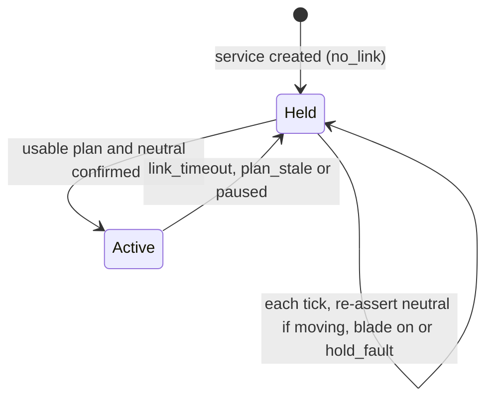
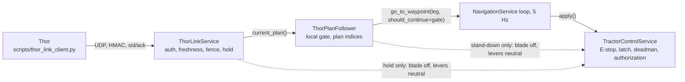

# Ride-on Zero-Turn Mower Platform (Toro TimeCutter conversion)

The tractor platform is a converted 50" Toro TimeCutter zero-turn mower
(ZTR) — a gas-engine vehicle with twin-lever hydrostatic drive — not a
differential-drive robot and not an Ackermann-steered tractor. There is no
steering wheel, gas pedal, clutch, or gear selector: each of the two drive
levers independently commands its own side's ground speed and direction, and
the mower's own hydrostatic transaxles turn that into motion (push a lever
forward to drive that side forward, pull it back to reverse it, center it to
stop that side). The engine and both hydrostatic transaxles are kept stock, and two high-torque servos
physically push/pull the existing lap-bar drive levers (header comment of `config/tractor.yaml`).
The current mechanical BOM in `hardware.md` selects ANNIMOS/DSSERVO RDS51150SG
12 V units; the printable stationary-side interface uses a **photo-derived six-hole
rear bracket** (photo aa8b43) with **six M2.5 through-bolts** and OD6 washers/AF5
nuts on the inboard face, not the listing's 24 × 24 mm drawing pattern. The moving
member is the U crossplate, carrying a printed adapter with the **same six-hole pattern
as the arm heads**, in double shear on an M6 pin at 55 mm radius; face 45° = neutral, face 90°
= full reverse. This still requires a purchased-revision fit check.
The older ASMC-04B **24 V** power design in other platform documents (`docs/hardware-overview.md`,
`docs/tractor-acceptance-criteria.md` §4, `docs/RELEASE_NOTES.md`) is **superseded** and must not be used
(H-05, H-20). The purchased servo label, rated voltage and stall current are still to be verified before any
power is connected; the owner reports two matching 150 kg·cm-class servos at nominal 10–12.6 V with possibly
8 A or more stall current (owner-reported, not bench-verified).
The platform exposes the five discrete actuators below.

## Actuators

| Actuator | Type | Drive | Range / semantics |
|----------|------|-------|-------------------|
| left_lever | positional | PCA9685 I2C PWM (ch 0) | −1 (full reverse) .. 0 (neutral) .. +1 (full forward) |
| throttle | positional | PCA9685 I2C PWM (ch 1) | 0 (engine idle) .. 1 (full RPM) |
| right_lever | positional | PCA9685 I2C PWM (ch 2) | −1 (full reverse) .. 0 (neutral) .. +1 (full forward) |
| starter | momentary relay | GPIO | engine crank pulse |
| blade_pto | latching relay | GPIO | engage / disengage |

Direction is intrinsic to each lever's own position — there is no separate
steering, gas-pedal, clutch, or gear actuator. **Reverse is defined as BOTH
levers negative.** One lever negative while the other is at or above neutral
is a routine zero-radius pivot turn made while otherwise mowing forward, not
reverse — this distinction matters directly for the Reverse Operation System
interlock below.

Positional actuators are PCA9685 I2C PWM channels (0-indexed, `config/tractor.yaml`'s
`pca9685:` block sets the I2C address/bus/frequency — moved off the PCA9685's 0x40
power-on default, which collides with the INA3221 power monitor, to 0x41). The
blade-PTO relay's GPIO was moved off pin 6 (collides with the ToF Left Interrupt)
to GPIO 26. `scripts/check_hardware_pin_conflicts.py` (wired into `.github/workflows/hardware-guard.yml`)
reports no collision between those rows and the rest of `spec/hardware.yaml` / `config/tractor.yaml` — **but
that registry omits the HaLow HAT and header-I2C availability; see the audit notes below.** Calibrate each channel's
`us_min/us_center/us_max` on the bench.

> **Audit notes (2026-10-24) — read before relying on the statements in this section.**
>
> - **GPIO5 (starter relay) is the HaLow radio's RESET line, and GPIO25 (the blade IN2 in `spec/hardware.yaml`)
>   its IRQ, on the deployed Pi** (live Pi, read-only audit: the `halow-dw` overlay sets `reset-gpios = <&gpio 5>`
>   and GPIO25 is claimed as `mm610x_spi_irq_gpio`; H-02b, H-02c). Energising, or merely claiming, GPIO5 can reset
>   the radio, and a radio driver reload can pulse the starter input. Do not connect the starter relay input to
>   GPIO5 until the allocation is redone.
> - **There is no header I2C bus on the deployed Pi** (`dtparam=i2c_arm=off`, GPIO3 is the HaLow WAKE line,
>   `/dev/i2c-1` absent), so `bus: 1` in `config/tractor.yaml` addresses a bus that does not exist there. With the
>   PCA9685 unreachable the driver degrades to a silent no-op
>   (`backend/src/drivers/actuators/pca9685_driver.py:117-126,155-156`) and `TractorControlService` still returns
>   `status: ok` (`backend/src/services/tractor_service.py:157-172,199-203`).
> - **`OE` polarity:** the PCA9685 `OE` input is active-low (HIGH disables the outputs; disabled means no pulse,
>   not neutral). See `docs/tractor-acceptance-criteria.md` §1 (H-04). The "watchdog driving the board's `OE`
>   pin" in the next paragraph means driving it HIGH.
> - **PTO:** `blade_pto` is modelled as a latching relay (table above). The owner reports a **momentary** OEM
>   PTO switch; the OEM circuit must be traced before anything is wired to it (H-21).

A PCA9685 board holds its last commanded pulse if the I2C bus or host is lost —
it does not fail safe on its own. `PCA9685Driver` propagates any write failure
that occurs after hardware was confirmed present (as opposed to a tolerated
no-op when no board is wired up at all) so a real transport fault is visible to
callers, but a physical bus-fault failsafe (e.g. a watchdog driving the board's
`OE` pin) is a separate, not-yet-built hardware-phase requirement — see
`docs/tractor-acceptance-criteria.md` item 1.

## Safety interlocks (standard lawn-tractor, ANSI/OPEI-style)

- **Engine start** only when *authorized + both levers neutral + blade off*.
  A hydrostatic ZTR has no clutch pedal, so there is no separate
  clutch-pressed condition to check.
- **Blade/PTO** engages only with the *engine running* and *not in reverse*;
  entering reverse (both levers negative — see the actuator table above)
  **auto-disengages the blade** (Reverse Operation System). A one-lever pivot
  turn is not reverse and does not, by itself, disengage the blade. Note the
  mower's own OEM mechanical Reverse Operation System may also cut the blade
  in reverse independently of this software interlock; which one actually
  fires (or both) must be confirmed on the bench, not assumed — see
  `docs/tractor-acceptance-criteria.md`.
- **Emergency stop** has three effects: disengages the blade/PTO, returns
  both drive levers to neutral, and idles the throttle — **the engine keeps
  running** (configurable); authorization is revoked and further commands are
  blocked until cleared. Unlike the superseded Craftsman-class design, there
  is no clutch/brake actuator for `emergency_stop()` to press — levers-to-neutral
  gives only the hydrostatic transaxles' own self-braking, not a positive
  parking brake (see "Physical integration decisions" below).

## Physical integration decisions

Sourced from the Toro operator's manual (**TimeCutter Max 50 in, form
3465-589**) plus items still open at bench time. The manual settled several
questions that were previously guesses — those are marked **confirmed**.

1. **Lever kinematics — two axes (confirmed).** The motion-control levers
   move fore/aft (Fast – Slow – NEUTRAL – Reverse) *and* swing **outboard to
   PARK**. Per the manual, PARK is both the parking brake and a condition of
   the engine-crank interlock. The servo linkage in `hardware/mounts/`
   deliberately actuates **fore/aft only** and is designed to stay clear of
   the outboard swing (ball joints at both rod ends plus a quick-release
   clevis pin at the lever). Verify the full outboard sweep by hand, with
   the linkage fitted, before running the engine.
2. **A positive parking brake exists, but this linkage cannot reach it
   (confirmed).** Contrary to an earlier revision of this document, the
   machine is **not** limited to passive hydrostatic self-braking: moving
   the levers outboard to PARK engages a real parking brake. It is simply
   not reachable by a fore/aft-only actuator, so **engaging the parking
   brake remains a manual action**. `emergency_stop()`'s levers-to-neutral
   therefore yields hydrostatic braking only, and the documented slope
   limit still applies to autonomous operation — but the machine itself has
   a proper brake, and a future outboard actuator could reach it.
3. **Autonomous engine start is physically impossible with this linkage
   (confirmed).** The manual's interlock requires the blade switch OFF *and*
   the levers **in PARK (outboard)** before the engine will crank. Software's
   `require_levers_neutral_to_start` checks levers **centred** — a different
   position. These are not equivalent and must not be conflated. The starter
   relay can energise the solenoid, but the OEM interlock will refuse to
   crank unless a human has first placed the levers in PARK. **Operating
   sequence: human starts the engine with levers in PARK, moves them to
   centre, then hands over to autonomous control.**
4. **Seat / operator-presence switch (confirmed behaviour, decision open).**
   The manual specifies the engine shuts off **within 1 second** whenever the
   levers are out of PARK and the operator rises from the seat. Empty-seat
   autonomy therefore cannot work until this circuit is deliberately
   addressed. Whichever way it is resolved — satisfy vs. bypass — MUST be
   documented here once decided, and MUST be explicitly paired with the
   Constitution's operator-attestation gate (Principle VI) as the
   compensating control: bypassing a physical presence switch is only
   acceptable alongside a logged, enforced software attestation that stands
   in for it. **Status: undecided — open item.** For supervised bring-up the
   simplest and safest answer is to ride along, leaving the interlock intact.
5. **Manual choke (confirmed).** The machine has a separate, manual choke
   control. No actuator drives it; **cold starting is a human action in every
   phase** of this build.
6. **Lever self-centring — UNVERIFIED, and it gates the failsafe design.**
   The bus-fault failsafe assumes that cutting servo power lets the levers'
   own return springs pull them to neutral (the Constitution's "spring-return
   actuator hardware" option). The manual does not state whether these levers
   self-centre. **If they do not, cutting servo power leaves the levers where
   they sat — a runaway, not a failsafe** — and the failsafe must be
   redesigned. Check this by hand before building anything that depends on
   it. **Status: open, highest-priority bench check.**

### Machine data from the manual

| Value | Figure |
|---|---|
| Weight | 292 kg (644 lb) |
| Maximum rated slope | 15° |
| Cutting width | 127 cm (50 in) |
| Throttle | continuous-variable lever, SLOW–FAST |
| Bypass levers | both sides of the engine; disengage hydro drive for pushing |

**Model**: the deployment target is the **Toro 50 in TimeCutter MAX MyRIDE, model 77502**. Its
current operator's manual is **3483-555**, which covers both the TimeCutter MAX and MyRIDE variants
and repeats the confirmed lever, PARK and interlock behaviour above; form 3465-589 is the earlier
TimeCutter MAX manual. Toro publishes no lap-bar coordinates, so the printed pushrods use the
photo-and-specification estimate in `hardware/mounts/TORO_77502_LINKAGE.md`; measure the serial
plate and linkage before fabricating.

## Configuration

`config/tractor.yaml` maps actuators to PWM channels / GPIO relays and sets the
interlock flags. Set `enabled: true` on the converted mower. When enabled, the
autonomous AI loop drives the tractor via `ActionPrediction.to_tractor_command()`
(mapped into left/right lever + throttle + blade PTO) instead of differential
motors. The AI model's own action-prediction output space still describes a
single differential-style steering axis (see `docs/ai-architecture.md`); owning
the steering-to-twin-lever mixing inside `to_tractor_command()` is an open item
for the actuation/navigation workstream, not yet resolved here.

The Pi ↔ Thor link has its own file, `config/thor_link.yaml`, **off by default**; see
[Enabling the Thor link](#enabling-the-thor-link).

## API & UI

- REST: `/api/v2/tractor/*` — state, per-actuator setpoints (left lever, right
  lever, throttle), blade, starter, authorize/revoke, emergency-stop/clear.
  Exact route names are owned by the actuation workstream's implementation,
  not fixed by this document.
- UI: the **Tractor** dashboard view (`/tractor`).

## Pi ↔ Thor link (autonomy W7)

The Thor runs strategy (coverage plan, waypoints); the Pi keeps every safety
decision. `backend/src/models/thor_link.py` defines protocol **v2**, the
authenticated one (the unauthenticated v1 was never wired into `main.py`, so v2
replaces it with no compatibility path): one UDP datagram per message, at most 1,200 B
including a 32-byte authentication tag. Three pieces cooperate on the Pi:

- `backend/src/services/thor_link_service.py` is the slow loop: socket, authentication,
  freshness, and **safe hold** (below). Its only actuation authority is the hold; it never
  moves the mower. It is separate from `TractorSafetyMonitor` and the watchdog and never
  feeds them.
- `backend/src/services/thor_plan_follower.py` is the **only consumer of the plan**. It turns
  each accepted window into legs and drives them through the local navigation loop, behind a
  local gate ([How a plan becomes motion](#how-a-plan-becomes-motion)).
- `backend/src/services/thor_link_wiring.py` reads `config/thor_link.yaml`, checks the
  preconditions and starts both from `main.py`. It is **off by default**
  ([Enabling the Thor link](#enabling-the-thor-link)).

On the Thor, `scripts/thor_link_client.py` is the minimal counterpart
([Thor side](#thor-side)). Both ends were exercised together over real UDP on loopback in
`SIM_MODE` (`tests/integration/test_thor_link_e2e.py`); nothing has run on HaLow or on the
mower.

### Message set

Compact JSON, raw imagery never crosses HaLow. There are no other message types: no
e-stop command, no arm, no velocity, and no acknowledgement beyond the `sid`/`ack`
echo described below.

Uplink, Pi → Thor, 10 Hz (doubles as the Pi's heartbeat):

| Field | Meaning |
|---|---|
| `v` | protocol version, `2` |
| `sid`, `seq` | Pi session id (random 48-bit, new per service run) and uplink counter (0, 1, 2, …) |
| `t_ms` | Pi monotonic clock, ms |
| `lat`, `lon`, `heading_deg`, `fix` | position, heading, RTK quality (`none`/`gps`/`dgps`/`rtk_float`/`rtk_fixed`) |
| `detections` | at most 16 × `{c, b, r, p}`: class, bearing °, range m, confidence |
| `estop`, `safe_hold`, `hold_fault`, `blade` | Pi state; `hold_fault` = the hold could not confirm neutral |
| `waypoint_index` | the Pi's progress along the plan |

Downlink, Thor → Pi (one per uplink):

| Field | Meaning |
|---|---|
| `v`, `sid`, `ack` | version, and the `sid` and `seq` of the uplink this answers (echoed) |
| `plan_id` | at most 32 characters |
| `start_index`, `waypoints` | window of at most 16 `{lat, lon, blade}` starting at plan index `start_index`; lat/lon are quantised to 1e-7° (≈1.1 cm) on the wire |
| `pause` | hold; any waypoints are ignored |

Worst-case datagrams, from `tests/unit/test_thor_link.py`: uplink 1,177 B (16 detections,
full-precision doubles), downlink window 1,009 B; the uplink bound at 10 Hz is
12 kB/s. The budget rests on HaLow measured at one site so far
(`docs/autonomy-toolchain-matrix.md`).

### Authentication

A datagram is `tag(32) ‖ json`, with `tag = HMAC-SHA256(key, direction-label ‖ json)`.
The label differs per direction, so the Pi's own uplink reflected back at it fails; the
tag covers the exact bytes received, so nothing is re-serialised to verify. The
receiver checks the size cap, then the tag in constant time (`hmac.compare_digest`),
and only then parses the JSON: unauthenticated bytes never reach the parser, and they
never refresh the heartbeat.

- **Key**: `THOR_LINK_KEY`, hex, at least 32 bytes (`openssl rand -hex 32`), the same
  value on Pi and Thor. Read through `SecretsManager` like the other secrets:
  environment first (for example a systemd `EnvironmentFile`, mode 0600), then
  `config/secrets.json` (git-ignored, mode 0600; see `config/secrets.example.json`).
  It is never logged. There is no key id or rotation protocol: to rotate, replace the
  key on both hosts and restart both ends.
- **No key, no start**: `ThorLinkService(...)` raises `LinkKeyError` if no key is
  configured, if it is malformed or under 32 bytes, or if it is the published
  `SIM_LINK_KEY` while `SIM_MODE` is off. With `SIM_MODE=1` and nothing configured it
  uses `SIM_LINK_KEY` and logs a warning. That key is in the repository and
  authenticates nothing; tests and simulation may also pass any explicit key.
- **Source allowlist** (optional): `allowed_sources=["10.0.0.0/24", "192.168.1.5"]`
  drops datagrams from other addresses before any decoding. It sheds noise; it is
  not a control, because UDP source addresses can be spoofed. Off by default, as the
  Thor may answer from a different interface address than the one the Pi sends to.
- The tag authenticates, it does not encrypt: position, detections and waypoints are
  visible to anyone on the link.

### Replay, restart and stale plans

The Pi picks a random `sid` per service run and numbers its uplinks. A downlink must
answer exactly one uplink by echoing its `sid` and `seq` (as `ack`). The Pi remembers
when it sent its last few uplinks and accepts a downlink only if it passes these checks
in order; the reason a datagram was dropped is counted in `rejects` (total in
`rejected`):

| # | Check | Reason |
|---|---|---|
| 1 | source in the allowlist, if one is set | `source` |
| 2 | datagram ≤ 1,200 B | `oversize` |
| 3 | tag valid (a datagram too short to hold one fails here) | `auth` |
| 4 | schema valid: ≤ 16 waypoints, lat/lon finite and in range, bounded integers | `malformed` |
| 5 | `sid` is this run's | `session` |
| 6 | `ack` is below the next uplink `seq`, i.e. an uplink this run really sent | `future_ack` |
| 7 | `ack` is above the newest accepted `ack` | `replay` |
| 8 | the answered uplink is still remembered and was sent ≤ `plan_max_age_s` ago | `stale` |
| 9 | plans only: every waypoint is inside the geofence | `geofence` |

Only a downlink that passes everything moves state (heartbeat, replay baseline, plan);
a rejected one changes nothing. Rejections are logged at most once per 5 s per cause,
with a count of the suppressed ones, so a flood cannot turn into a log flood. A `pause`
skips check 9: a stop request is never refused for its contents.

- **Thor restart**: the Thor keeps no sequence or epoch state. A fresh process answers
  the next uplink it hears and is accepted at once; anything it sent before the
  restart is dead (check 7).
- **Pi restart**: the new run has a new `sid`, so nothing captured earlier, or aimed
  at another Pi, is accepted (check 5), even if its `ack` would otherwise look fine.
- **Huge counters** (the v1 `seq = 2**62` poisoning): the replay baseline is the Pi's
  own uplink counter, so no packet can move it past what the Pi really sent. Unsigned
  packets die at check 3, an authentic `ack` beyond the Pi's counter at check 6, one
  beyond the schema bound at check 4; none changes state, so the link cannot be
  poisoned even by a key holder.
- **Delay and replay age**: a downlink was produced after the Thor heard the uplink it
  echoes, so `now − send_time(ack)` bounds its age from above using only the Pi's
  clock. No Thor clock and no clock sync are involved.
- **Plan age limit**: `plan_max_age_s` (default 1.0 s) caps that bound for the plan's
  whole life. A downlink already older is refused on arrival (check 8), and
  `current_plan()` stops returning a plan the moment it reaches the cap. It is separate
  from the 0.5 s heartbeat timeout: a Thor that answers promptly cannot keep alive a
  plan built from old information, and a slowly delivered plan lives only for the part
  of the cap it has left.
- No retransmission exists; the Thor answers each uplink with the current window,
  which is the implicit retry. A Thor-initiated pause takes effect on the answer to
  the next uplink, at most one uplink period (100 ms) plus RTT later; the Pi's own
  safety loop is the fast path.

### Link-loss state machine

**Active**: `current_plan()` returns the latest accepted window. Navigation must poll it
each step; it re-checks the clock on every call, so a plan expires on time even if the
slow loop is late or stopped. **Held** (`safe_hold`): `current_plan()` returns `None`
and `hold_reason` says why:

| `hold_reason` | Entered when |
|---|---|
| `no_link` | nothing accepted yet (initial state) |
| `link_timeout` | no downlink accepted for `timeout_s` (0.5 s) |
| `plan_stale` | the plan's information is older than `plan_max_age_s` (1.0 s) |
| `paused` | the Thor sent `pause` |
| `neutral_unconfirmed` | a usable plan is waiting but neutral is not confirmed |

On entry the plan is discarded and the service neutralises: blade off, then both
levers neutral, through the interlocked `TractorControlService` methods (source label
`thor_link`), authorization untouched (the acceptance-criteria soft stop). Both are
always attempted, each bounded by `neutral_timeout_s` (1.0 s) so a hung bus becomes a
reported fault instead of stalling the loop. While held it re-asserts neutral every
tick if the tractor state shows the mower moving, the blade on, or a fault outstanding.

Neutral is *confirmed* when `TractorState` shows the blade off and both levers inside
the neutral band. The tractor service updates those fields only after a write
succeeds, so this holds when a latched e-stop (which refuses `set_levers`) has already
neutralised the mower and fails when it has not. It is the last commanded state, not a
measurement: the PCA9685 holds its last pulse on I²C loss, so it does not prove
physical neutral (hardware-audit gap H-08).

If neutral is not confirmed (an exception, a timeout, or a refusal with a lever still
out), the failure is not swallowed: `hold_fault`, `hold_error` and `hold_failures` are
set, an ERROR is logged (rate-limited like the rejections), `hold_fault` goes out in
every uplink, the service retries every tick, and it does not leave hold, even for a
perfect plan, until a pass confirms neutral. A failure inside the hold evaluation itself
is handled the same way (plan dropped, held, fault reported). Whether a persistent fault
should escalate to an e-stop is a policy decision left to the integrator; that path
writes through the same bus.

### Enabling the Thor link

The link is **off** unless `config/thor_link.yaml` says `enabled: true`; with no file, or the
shipped one, `main.py` builds nothing and binds nothing. Switching it on is an owner
decision: it turns the mower's motion over to authenticated plans from the Thor. Do not
enable it, or `tractor.enabled`, to try it out on the real mower; use `SIM_MODE=1`, or the
bench with the blade disabled and the machine unable to drive away.

**Preconditions, all checked at start-up.** If any fails, the backend logs a CRITICAL line
with the reason, keeps `app.state.thor_link` empty and `app.state.thor_link_error` set, and
carries on with local control only. It never starts a weaker link.

| Needs | Why |
|---|---|
| `tractor.enabled: true` in `config/tractor.yaml` | The link drives the tractor platform only; it never drives the differential path. |
| The tractor safety monitor running (tilt cutoff and watchdog heartbeat) | It starts in the same start-up after `tractor.initialize()`. If that failed there is no monitor and so no link. |
| `THOR_LINK_KEY` (hex, at least 32 bytes) in the environment or `config/secrets.json` | Outside `SIM_MODE` a missing, malformed or short key, or the public `SIM_LINK_KEY`, means no link. In `SIM_MODE` with no key the public key is used and a warning says so. |
| `thor_host` (the Thor's IPv4 address) | Uplinks go there; by default only datagrams from that address are accepted. |
| Outside `SIM_MODE`: a `geofence` | A plan is never accepted unbounded. The boundary must include where the mower starts. |

**Steps.**

1. Generate one key, `openssl rand -hex 32`, and install it on both hosts: on the Pi in a
   systemd `EnvironmentFile` (mode 0600) or `config/secrets.json` (git-ignored, 0600; see
   `config/secrets.example.json`); on the Thor in a key file (mode 0600) or the
   environment. There is no rotation protocol: replace it on both and restart both.
2. Edit `config/thor_link.yaml`: `enabled: true`, `thor_host`, `bind_host` (the Pi's HaLow
   address; the default `127.0.0.1` hears nobody), and the `geofence` (boundary and no-go
   zones copied from the map). Leave `allow_blade: false` for the first runs.
3. Start the Thor side: `python3 scripts/thor_link_client.py --key-file KEY --plan plan.json`
   (or `--boundary yard.json` for a coverage plan), listening where `thor_port` points.
4. Restart the backend. Expect `Thor link on: blade forbidden, speed 50%, fix rtk_fixed, fence
   on`, then `Thor link: fresh plan received, leaving safe hold` once the Thor answers. The
   client's status line (every 5 s) shows the Pi's fix, hold and progress. The running
   service's counters are on `app.state.thor_link.status()` (there is no REST route yet).
5. A person authorizes the tractor and starts the engine locally, as for any other run
   (`POST /api/v2/tractor/authorize`, the starter). The link never arms, starts the engine or
   clears a latch, and the follower drives only while the tractor is authorized with its
   engine running.

**While it is on, the link owns the mower's motion.** With no usable plan (Thor silent,
paused, stale or out of sync) it holds, and it re-neutralises anything that moves the mower,
manual driving included. A mission or AI run is not blocked, but the follower stands down
while one is active (`nav_mode_*`). **Off:** `enabled: false` (or remove the file) and
restart the backend.

The settings that matter for safety, and their shipped values (all in `config/thor_link.yaml`,
unknown keys are an error, numbers marked unvalidated are placeholders to size on the bench):

| Key | Shipped | Meaning |
|---|---|---|
| `enabled` | `false` | the flag |
| `allow_blade` | `false` | the Thor can request the blade; the Pi grants it only if `true` (and then the tractor's own interlocks still apply). With `false` a plan's mowing legs are driven with the blade forced off. |
| `require_fix` | `[rtk_fixed]` | fixes the mower may drive on |
| `max_position_age_s` | `1.0` (unvalidated) | age limit for the GNSS reading and the navigation feed |
| `speed_percent` | `50` (unvalidated) | share of `NavigationService.max_speed`; the protocol has no speed field |
| `geofence.margin_m` | `0.5` (unvalidated) | pulled in from the boundary for every check; size it from the stopping distance and GNSS error (audit M-43, M-51) |
| `timeout_s`, `plan_max_age_s` | `0.5`, `1.0` | heartbeat timeout and plan age cap, as in the state machine above |
| `bind_host` | `127.0.0.1` | closed unless set |

### How a plan becomes motion

A plan reaches the actuators only through the solid path. The two dotted lines are the only
commands the link and the follower issue themselves, and both are stops. `go_to_waypoint`
takes a `should_continue` gate for legs that belong to no mission; a gated leg ignores
mission status.

**The local gate**, re-checked on every control tick before a command is sent. The first
failure soft-stops the mower (levers neutral, then blade off if the follower had been
driving) and is recorded as the follower's `reason`; counts are in `status()["stand_downs"]`.

| `reason` | The follower stands down because |
|---|---|
| `link_hold`, `empty_window` | the link has no usable plan (held, paused, timed out, aged out) or the window is empty |
| `out_of_sync` | the window does not contain this Pi's next waypoint (see below) |
| `plan_changed`, `target_changed` | the plan moved under a running leg (new `plan_id`, shifted window, other coordinates or blade request); the leg ends and the next step re-selects |
| `tractor_disabled`, `estop`, `interlock_latched` | the tractor platform is off, the E-stop is latched, or the blade interlock (tilt) is latched |
| `not_authorized`, `engine_not_running`, `actuator_fault` | no operator authorization, no running engine (the tractor does not check either for lever commands), or the actuators report a fault |
| `nav_mode_<mode>` | the navigation mode is not `idle` or `manual`: a mission, AI or return-home run owns the mower |
| `no_position`, `no_heading`, `nav_feed_stale`, `gnss_stale`, `fix_<label>` | position or heading is missing, the navigation feed or the GNSS reading is older than `max_position_age_s`, or the fix is not in `require_fix` |
| `outside_fence`, `leg_blocked`, `fence_check_failed` | the mower is outside the fence, the straight leg to the target leaves it or crosses a no-go zone, or the fence could not be evaluated |
| `gate_error`, `follower_error` | a bug in the follower: it stands down, logs and backs off |

**Plan indices.** The Pi reports the first waypoint it has not reached as `waypoint_index` in
every uplink (absent until it has adopted a plan). The first plan of a run, and any new
`plan_id`, is adopted at its `start_index`. After that every window must still contain the Pi's
own index; a window that starts beyond it, or ends before it, is `out_of_sync` and the mower
stands still until the two agree, which is the Thor's job (it follows the reported index). A
window that starts behind the Pi but still contains its index is fine. Arrival (within
`NavigationService.waypoint_tolerance` of the target) advances the index by one. The window
runs out every 16 waypoints: the mower waits for the next window, normally one or two uplinks.

**Policy that is the Pi's alone.** Speed is `speed_percent`, never the Thor's. The blade is
requested only if the waypoint asks for it *and* `allow_blade` is true, and then
`TractorControlService.engage_blade` still refuses it with the E-stop or tilt latch set, an
unauthorized or stopped engine, or in reverse. Waypoints are checked against the fence by the
link (the whole window is rejected if one is outside) and the legs between them by the
follower, including no-go zones.

**What wins over a valid plan** (each is a test in `tests/integration/test_thor_link_e2e.py`,
run against a Thor that never pauses):

| Interlock | Behaviour |
|---|---|
| E-stop | Levers neutral, authorization revoked, every command refused. The plan stays valid on the wire and nothing moves. After a human clears the latch the mower does **not** restart until a human authorizes it again. |
| Tilt latch | Blade off and latched, drive stopped. Level again does not clear it; an authenticated `clear-emergency` does, and with a plan still live the mower then resumes at once. |
| Stale position, degraded fix, outside the fence, a mission running | Stands down; resumes by itself when the condition clears. |
| A limiter at `TractorControlService.set_levers` | Plan commands pass through `apply()` and so through it: a leg is held back there exactly like a mission leg, and the follower does not know or care. |
| No authorization, engine not running | Never drives. The tractor service itself does not gate lever commands on either. |
| Thor silent or paused | Hold: blade off, levers neutral, authorization kept; the follower's leg ends at its next tick. |

**Obstacles.** The follower has no obstacle logic of its own. An obstacle stop belongs to the
navigation loop and the tractor service (audit WP-P4-01/02: a stopping-distance guard read by
`go_to_waypoint` and a limiter inside `TractorControlService.set_levers`), and a plan leg
gets exactly what a mission leg gets, because both run in `go_to_waypoint` and command
through `apply()`. On a tree without that work nothing stops a plan leg for an obstacle, as
nothing stops a mission leg (`go_to_waypoint` never read obstacle state: audit A.6); check
that the guard is in place before a powered Thor run.

If the follower dies, the command deadman returns the levers to neutral within
`default_hold_ms` (500 ms) but does not touch the blade; a hung process is covered by nothing
in software (audit D.4: a hardware watchdog is still required).

**Latency.** The leg ends within one navigation tick (0.2 s) of the plan expiring and the
link neutralises on its own tick (`1/uplink_hz`); a command already in flight when the hold
begins can land once more, and the link then re-asserts neutral each tick. These bounds
come from the code and from SIM tests on a real clock; no latency has been measured, and
the time from timeout to physical lever neutral is unknown.

### Thor side

`scripts/thor_link_client.py` is the smallest Thor that satisfies the Pi: run from the repo
root, `THOR_LINK_KEY=<hex> python3 scripts/thor_link_client.py --plan plan.json`, or
`--key-file FILE` (mode 0600 enforced), or `--sim` with `SIM_MODE=1` for the public key.
`--plan` serves a waypoint list in windows; `--boundary` hands a boundary and no-go zones to
the coverage strategist (`backend/src/nav/thor_strategist.py`), which answers each uplink
with the next window, pauses unless the fix is `rtk_fixed`, adds confident detections as
keep-out circles and replans, never regresses progress on stale reports, and can save and
load coverage state. The client plans the first transit from the mower's reported position
once per session. `SIGUSR1` pauses, `SIGUSR2` resumes, `--pi IP` restricts uplink sources.

**What the Thor must do** (the client does all of it; any other Thor must too, because the
Pi's replay rule protects the Pi only):

- verify every uplink with `decode_uplink(data, key)` and drop failures without answering;
- drop uplinks whose `seq` is not newer than the last seen for that `sid` (a new `sid` means
  the Pi restarted and its counters start over), keeping a bounded table of sessions;
- answer each accepted uplink once, to its source address, echoing `sid` and `seq` (as `ack`),
  pauses included, since the Pi ignores anything unechoed;
- pause, never plan, while the Pi reports no `rtk_fixed` fix, an e-stop or a hold fault;
- answer a planner failure with a pause rather than silence;
- refuse to start without a key, never fall back to the public key outside `SIM_MODE`, and
  never log the key.

**What remains on the Thor side** (not in this repository, or not done):

- a supervised service around the client (unit, restart policy, logs); today it is a script;
- key provisioning and rotation; one key serves both directions, and the link authenticates
  but does not encrypt;
- one source of truth for the boundary: the Thor's `--boundary` and the Pi's `geofence` are
  two copies, nothing compares them;
- persisting and resuming coverage state (`ThorStrategist.save/load`) across Thor restarts
  is not wired into the client;
- obstacle detections: the Pi's uplink carries none yet (the detector has no feed into the
  link), so the strategist never replans around obstacles; the Pi's own stop is independent;
- HaLow addressing and firewalling (UDP 47101 between the two hosts only) and the measured
  far-yard round trip and loss (audit M-52).

### Remaining work and known gaps

- **Resume after a hold is automatic** on a fresh, valid plan. Whether a person must
  acknowledge first (audit SD-3) is undecided; with `allow_blade: true` the blade can come on
  by itself when a Thor returns. Keep `allow_blade: false` until that is decided.
- `/tractor/*` and the control routes do not consult the hold (audit WP-P3-02): while held,
  the link re-neutralises instead of rejecting.
- **Steering sign and heading convention are unverified.** `go_to_waypoint` mixes
  `left = v(1 - e/45)`, `right = v(1 + e/45)` from a bearing-minus-yaw error. In a
  pure-kinematics check (ideal differential drive, compass heading), the law as coded never
  reaches a target 14 m away, while the mirrored law does; with a counter-clockwise yaw it
  fails as well. The BNO085 driver is a stub, so the convention is unknown. This predates the
  link and also affects missions; check it on the bench with the drive wheels off the ground
  before any powered Thor run.
- Timing is proven only on a real clock over loopback in `SIM_MODE` and on a fake clock; time
  from timeout to physical lever neutral, HaLow round trip and loss are unmeasured.
- The uplink carries position, heading, fix, progress and the state flags, but no detections,
  battery or link counters (audit WP-P3-04), and the `Uplink` model does not range-check
  position or heading itself; the Pi's builder emits only finite, in-range values.

## Code

- `models/tractor_control.py`, `drivers/actuators/tractor_actuators.py`,
  `services/tractor_service.py`, `api/routers/tractor.py`.
